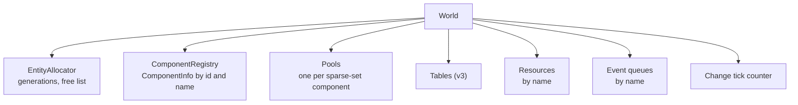

# 06 · World

## What it is

The world is **the container of a simulation**. It owns the entities, the component registry, every
storage, the resources, the event queues and the change-tick counter. Every other feature works *on* a
world.

## Why we need it

- **R3 (network):** a listen server runs a server world and a client world in the same process; a
  dedicated server runs **one world per game room**.
- **R4 (generic):** tests, editors and tools create worlds freely, independent of any engine.
- **R2 (Luau):** the bridge needs one object to call, by id, for everything.

## How others do it

| ECS | Container | Several per process? |
|---|---|---|
| EnTT | `entt::registry` (+ context variables for singletons) | Yes |
| Bevy | `World` (+ sub-apps with their own worlds, e.g. the render world) | Yes |
| flecs | `ecs_world_t` (+ stages for multithreading) | Yes |
| Unity DOTS | `World` | Yes |

## Our choice

A `World` class with **two API surfaces** over the same data:

- **Typed** (templates): convenient and checked at compile time, for C++ code.
- **Type-erased** (by `ComponentId`, `noexcept`, failure by return value): for the Luau bridge, the
  serializer and the network.

Several worlds can exist at once. Each has its own registry, so **ids are per world**; names are shared
across worlds and processes.

## How it works

### What it owns



The [scheduler](13-scheduler.md) and the systems are owned by the [App](14-app-and-plugins.md), not
the world: a world is pure data plus the operations on it, which keeps it easy to create in tests.

### Typed and type-erased

```c++
rtype::ecs::World world;

// Typed
const rtype::ecs::Entity ship = world.spawn();
world.add(ship, Position{.x = 10.F, .y = 20.F});
if (const Position* position = world.get<Position>(ship); position != nullptr) {
    // ...
}

// Type-erased (what the Luau bridge and the replication plugin use)
const std::optional<rtype::ecs::ComponentId> id = world.findComponent("rtype.Position");
const bool added = world.add(ship, *id, bytes);           // false if the entity is dead, the id unknown or the size wrong
std::span<const std::byte> raw = world.get(ship, *id);   // empty if absent
```

| Operation | Typed | Type-erased |
|---|---|---|
| Spawn / despawn | `spawn()`, `despawn(e)` | same |
| Add / remove | `add<T>(e, value)`, `remove<T>(e)` | `add(e, id, bytes)`, `remove(e, id)` |
| Test (tags included) | `has<T>(e)` | `has(e, id)` |
| Read | `get<T>(e)` → `const T*` | `get(e, id)` → `std::span<const std::byte>` |
| Write | `getMut<T>(e)` → `Mut<T>` | `getMut(e, id)` → `std::span<std::byte>` (marks changed) |
| Register | `component<T>()` | `registerComponent(descriptor)` |

Typed calls are thin wrappers that resolve `T` to an id and forward to the type-erased path, so there is
one implementation to test.

- **`add` on a component the entity already has replaces its value** (stamps `changed`, keeps `added`).
- **`add<T>` registers `T`** with default options the first time; call `component<T>(options)` before to set
  replication options. Reading (`has`, `get`, `remove`) never registers.
- Values are exchanged as byte spans of exactly the component's size; `viewAs<T>` turns them into a `T`.

### Despawning

`despawn(e)`, in this order:

1. **Removes `e` from every pool** (and its table row in v3), destroying its values.
2. **Clears the `kEntity` fields that pointed to it**: in every component with entity fields (C++
   `Entity` / `std::array<Entity, N>` members, or Luau `Entity` fields), each element holding exactly `e`
   becomes the null entity and its value is marked changed, so the network sends the null. An older,
   already stale handle of the same index is left alone.
3. **Frees the index**: the slot's generation is bumped, so every copy of the handle becomes stale.

**Removal scans every pool.** Each pool answers with one O(1) sparse lookup, so a despawn costs one lookup
per registered component (a few dozen in R-Type), with no bookkeeping anywhere else. The alternative, a
per-entity list of the pools it is in, would make despawn proportional to the entity's own components but
cost memory and work on every add and remove, which are far more frequent than despawns.

**Clearing looks at every value of the components that have entity fields**: its cost grows with how many
such values exist (bullets with an `owner`), not with the whole world; components without entity fields
are skipped after checking their field list.

Both choices stay behind `despawn`, so they can change after benchmarks (#131) without touching callers.

### Several worlds

| Situation | Worlds |
|---|---|
| Dedicated server | One per game room, plus a lobby world |
| Client | One |
| Listen server / local test | A server world and a client world, connected by an in-memory transport |
| Unit tests | As many as needed, created and destroyed per test |

Worlds never share entities or ids. They communicate only through the network layer (or its in-memory
version).

## Connections

- Uses: [Entity](01-entity.md), [Component registry](02-component-registry.md), [Pool](04-pool.md),
  [Archetype tables](05-archetype-tables.md).
- Used by: [Queries](07-queries.md), [Commands](09-commands.md), [Resources](10-resources.md),
  [Events](11-events.md), [App](14-app-and-plugins.md), [Luau bridge](19-luau-bridge.md),
  [Replication](20-replication.md).

## Pitfalls

- **Mixing ids between worlds.** `ComponentId` 5 in the server world is not 5 in the client world. Cross
  worlds by name only.
- **Structural changes during iteration.** Calling `world.add` / `despawn` while a query iterates the
  same pool invalidates it. Inside systems, use [commands](09-commands.md).
- **Global state.** The world must not rely on statics (see the DLL pitfall in
  [Component registry](02-component-registry.md)); everything lives in the world instance.

## Open questions

- Per-entity "pools I am in" list, or scan all pools on despawn? Decide with benchmarks. (ECS)
