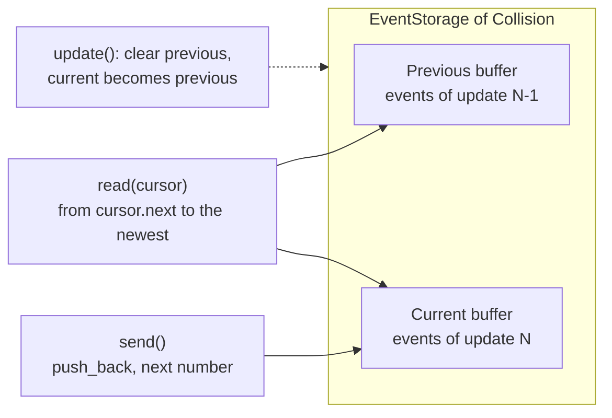
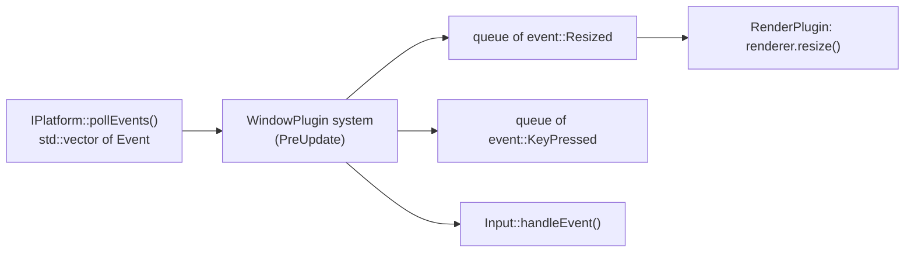

# 11 · Events

## What it is

Events are **typed messages between systems that do not know each other**: "these two entities
collided", "the window was resized", "a client connected". A system writes events into a queue; other
systems read them later in the same frame or the next.

## Why we need it

- **Decoupling (R4):** the collision system does not need to know about damage, sound or score; each
  listener reads `Collision` events.
- **R1:** platform events (Ethan's `Event` variant) enter the ECS as events.
- **R2:** Luau declares and sends its own events (`game.BossDefeated`).
- **R3:** the network plugins announce `ClientConnected` / `ClientDisconnected` as events.

## How others do it

| ECS | Mechanism |
|---|---|
| Bevy | `Events<T>` resource, double-buffered; `EventWriter<T>` / `EventReader<T>` with per-reader cursors |
| Bevy / flecs | Observers and triggers: callbacks run immediately when an event fires |
| EnTT | `entt::dispatcher` (queued or immediate) |
| Unity DOTS | No built-in events; usually entities or buffers used as messages |

## Our choice

**Double-buffered queues, as Bevy does.** Observers (immediate callbacks) are left for later, see
[Hooks and observers](16-hooks-and-observers.md): queued events keep all logic inside scheduled systems,
in a predictable order. Event types are registered by name like components and resources, so the
type-erased API and Luau can declare, send and read their own.

## How it works

### Declaring and storing

An event is a C++ type declared with `RTYPE_ECS_EVENT`, or a run-time (Luau) description. It is the third
kind of the [type core](../design.md) (see "The type core"): `EventInfo { TypeInfo type; }`, registered in an
`EventRegistry` (`TypeRegistry<EventInfo>`), its values kept in an `EventStorage` (one double-buffered queue
per event type, in two `ByteColumn`s). Like a resource, an event may be any movable class, including a
move-only one; a struct without fields is an event that carries no data.

```c++
struct Collision {
    rtype::ecs::Entity a;
    rtype::ecs::Entity b;
};
RTYPE_ECS_EVENT(Collision, "rtype.Collision", a, b);   // reflected: reachable from Luau

struct GameOver {};
RTYPE_ECS_EVENT(GameOver, "game.GameOver");            // no data: counted, not read
```

Events are **local to a world**: `validate()` refuses a replicated event, and `EventOptions` only holds the
presence. A name is one kind of type only: `WorldState::checkNameFree()` refuses an event named like a
component or a resource, and the other way round.

### Events API

Events live in an `Events` object owned by the world, reached with `world.getEvents()` (like
`world.getComponents()` and `world.getResources()`, see [World](06-world.md)):

```c++
rtype::ecs::Events& events = world.getEvents();
events.send(Collision{.a = bullet, .b = enemy});

rtype::ecs::EventCursor cursor;   // one per reader and per event type
for (const Collision& collision : events.read<Collision>(cursor)) {
    // ...
}

events.update();                  // end of the update: every queue moves forward
```

| Typed (C++) | Type-erased (Luau, network) |
|---|---|
| `registerType<T>(options)`: registers (`send()` does it if needed) | `registerType(EventInfo)`, `find(name)` |
| `send(value)`: moves the event in | `send(id, bytes)`: copies it (false if the id is unknown, the size wrong or the event move-only) |
| `read<T>(cursor)` → `EventRange<T>` of `const T&` | `read(id, cursor)` → `RawEventRange` of `std::span<const std::byte>` |
| `getCount<T>()`: events kept | `getCount(id)` |
| `update<T>()`, `clear<T>()`: one queue | `update(id)`, `clear(id)` |
| `update()`: every queue | |

An unknown type or id reads nothing (the cursor is left as is), counts 0, and makes `update` / `clear` return
false.

### Cursors and numbering

The events of one type are numbered from 0 in the order they are sent (`EventSequence`). An `EventCursor` is
the number of the next event its reader has not read. `read()` returns the events from the cursor to the
newest one, then moves the cursor past them: each reader sees each event once, and readers do not disturb
each other, since reading drops nothing.

A cursor older than the oldest event kept is moved up to it (the reader missed the dropped events); a cursor
used with another queue, past its end, reads nothing. A new cursor starts at 0, so its first read returns
every event still kept.

The range does not own the events: it is a view of the queue, invalidated by the next `update()` or `clear()`
of that queue, and events sent after it was made are not part of it. An event type without data can be
counted (`size()`) but not dereferenced.

### Double buffering

Each `EventStorage` holds the events of the previous update and those sent since the last one:

| Moment | Writers push into | Readers see |
|---|---|---|
| Update N | current buffer | previous (events of N-1) + current (events of N so far) |
| `update()` at the end of N | — | previous is cleared, current becomes previous |
| Update N+1 | current buffer (now empty) | previous (events of N) + current (events of N+1 so far) |



An event is therefore readable **during the update it was sent in and the next one**, then dropped. The
previous buffer is what lets a reader that runs **before** the writer in one update still read the event in
the next: its cursor still points into the previous buffer. A reader that is up to date only reads the
current one.

**The swap follows the phase that writes the event.** Events written in `FixedUpdate` (collisions, damage)
must move forward once per **fixed tick**, not once per frame: a frame that runs `FixedUpdate` three times
would otherwise mix three ticks of events, or drop some. That is why `update(id)` exists next to `update()`:
the [scheduler](13-scheduler.md) will update each queue with the phase that writes it. Until then, the caller
(tests, the game loop) calls `update()`.

Sending is a `push_back`; the buffers are swapped and cleared rather than freed, and `clear()` keeps the
numbering, so cursors stay valid and there is no allocation in steady state.

For a complete example (collision detection producing `Collision` events, step by step, and how to
keep it fast), see [Collisions: From Overlap to Event](../design.md#collisions-from-overlap-to-event)
in the design.

### System parameters

Systems send and read events through parameters (`system/EventReader.hpp`, `system/EventWriter.hpp`) on top
of this API: `EventWriter<T>` wraps `send()`; for `EventReader<T>` the system keeps an `EventCursor`, and each
run's reader takes (with `read()`) the events not read yet, as a range of `const T&`. They also tell the
scheduler which queues a system writes and reads.

```c++
void detectCollisions(/* queries... */ rtype::ecs::EventWriter<Collision> collisions) {
    collisions.send({.a = bullet, .b = enemy});
}

void applyDamage(rtype::ecs::EventReader<Collision> collisions, rtype::ecs::Query<Health> health) {
    for (const Collision& collision : collisions) {
        // ...
    }
}
```

### Platform events

Ethan's `rtype::engine::Event` is a `std::variant` of `event::Resized`, `event::KeyPressed`,
`event::Closed`... The window plugin's `PreUpdate` system calls `IPlatform::pollEvents()` and sends each
alternative to its own queue (one event type per alternative: `event::Resized`, ...). A system interested only in resizes reads
only that queue.



### From Luau

```luau
app:event("game.BossDefeated", { type = "BossDefeated" })   -- fields described by a Luau type

function BossHealth:run(ctx)
    for entity, health in ctx.query do
        if health.value <= 0 then
            ctx.events:send("game.BossDefeated", { boss = entity })
        end
    end
end
```

A script event is described by a Luau type exactly like a [component](02-component-registry.md), registered
with `registerType(EventInfo)`, and sent and read as bytes (`send(id, bytes)`, `read(id, cursor)`).

### Events and the network

Events are **local** to a world, and the registry refuses a replicated event. Something the clients must know (an explosion to display) is either
replicated state (a short-lived entity) or an explicit network message from a plugin; events are not
replicated automatically, so gameplay never depends on whether a message arrived.

## Connections

- Uses: [World](06-world.md), the type core (descriptions, registry, names; see
  [Component registry](02-component-registry.md)).
- Used by: [Systems](12-systems.md) (`EventReader` / `EventWriter` in access sets),
  [App and plugins](14-app-and-plugins.md) (platform events), [Luau bridge](19-luau-bridge.md),
  [Replication](20-replication.md) (connection events).

## Pitfalls

- **Reading too late.** A system that runs only every few frames (a run condition) misses events older
  than two frames.
- **Using events for state.** "Is the boss dead?" is state (a component or resource); "the boss just
  died" is an event.
- **Keeping a range.** A range returned by `read()` is invalidated by the next `update()` or `clear()` of its
  queue: copy what must outlive it.
- **One cursor per event type.** A cursor holds a number in one queue; reusing it for another type reads the
  wrong events or none.
- **Order between writer and reader.** If the reader runs before the writer in the same frame, it sees
  the event next frame. Order them in the [scheduler](13-scheduler.md) when one frame of delay matters.

## Open questions

- Should some events be replicated (server → clients) by the network plugin, for cosmetic effects only?
  (Team)
