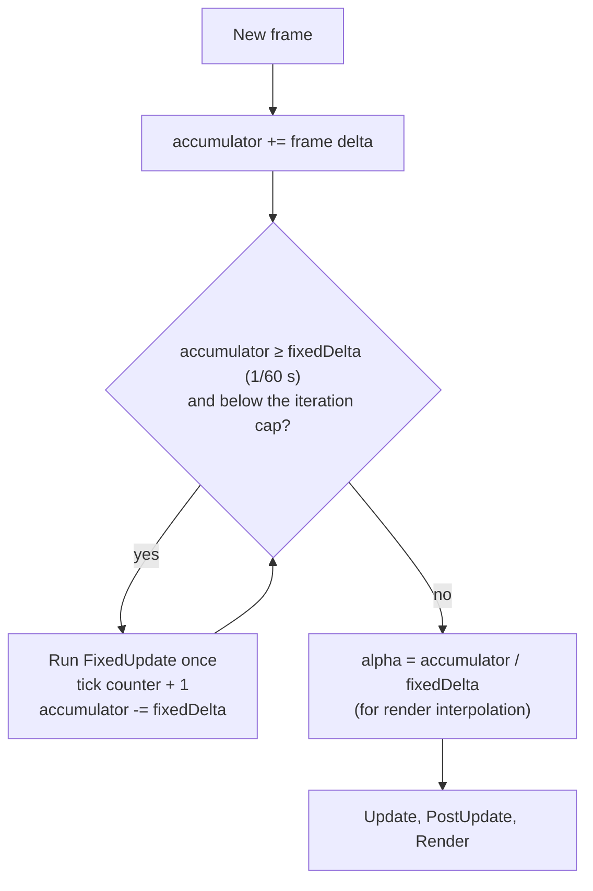
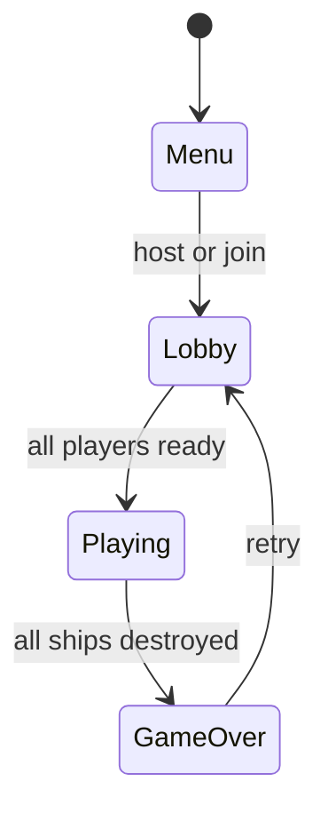

# 13 · Scheduler

## What it is

The scheduler decides **when each system runs**: in which phase of the frame, in which order inside the
phase, how many times (fixed timestep), and whether it runs at all (run conditions and game states).

## Why we need it

- **R1:** with the ECS owning the loop, the scheduler *is* the frame: poll the window, run gameplay,
  send network packets, draw.
- **R3:** the simulation must advance in **fixed ticks** (60 per second), independent of the frame rate,
  so server and clients count ticks the same way.
- **R4:** games add systems from many plugins; explicit ordering keeps that predictable.

## How others do it

| ECS | Scheduling |
|---|---|
| Bevy | Schedules (`Startup`, `PreUpdate`, `FixedUpdate`, `Update`, `PostUpdate`), system sets, `before` / `after`, run conditions, `States` with `OnEnter` / `OnExit`, automatic parallelism |
| flecs | Pipelines of phases (`OnLoad`, `PreUpdate`, `OnUpdate`, `PostUpdate`, `OnStore`), multithreading |
| Unity DOTS | System groups with `UpdateBefore` / `UpdateAfter`, fixed-step group |
| Unreal Mass | Processing phases and execution groups with ordering |

## Our choice

Bevy's model, in two steps: **phases + ordering + fixed timestep** in v1, **run conditions + States** in
v2. Sequential execution first; access sets are recorded from the start so a parallel version can come
later.

## How it works

### Phases


[Commands](09-commands.md) are flushed after each phase. The dedicated server runs only `PreUpdate`,
`FixedUpdate` and `PostUpdate`.

### Fixed timestep



A slow frame runs `FixedUpdate` several times; a fast one may run it zero times. A cap on iterations per
frame avoids the "spiral of death" when the machine cannot keep up.

### Ordering inside a phase

```c++
app.addSystem(rtype::ecs::Phase::kFixedUpdate, "rtype.movement", &movement);
app.addSystem(rtype::ecs::Phase::kFixedUpdate, "rtype.collision", &detectCollisions).after("rtype.movement");
app.addSystem(rtype::ecs::Phase::kFixedUpdate, "rtype.damage", &applyDamage).after("rtype.collision");
```

Until the App (#123) exists, the scheduler is made from a world and runs one phase at a time (repeating
`FixedUpdate` per fixed tick is #122):

```c++
rtype::ecs::Scheduler scheduler{world, rtype::ecs::RunMode::kStandalone};
scheduler.addSystem(rtype::ecs::Phase::kFixedUpdate, "rtype.movement", &movement);
scheduler.addSystem(rtype::ecs::Phase::kFixedUpdate, "rtype.collision", &detect).after("rtype.movement");
scheduler.addSystem(rtype::ecs::Phase::kUpdate, "rtype.camera", &follow).setSide(rtype::ecs::Side::kClient);
scheduler.build();                                // checks and sorts every phase
scheduler.run(rtype::ecs::Phase::kFixedUpdate);   // runs the phase's systems, then flushes their commands
scheduler.getOrder(rtype::ecs::Phase::kFixedUpdate);
```

When the schedule is built (by `build()`, or by the first `run()` after a change), the `before` /
`after` constraints of each phase become a graph (`detail::DependencyGraph`) that is sorted
topologically. **Systems with no order between them run by name**, so the order depends only on names and
constraints, never on the order plugins added the systems.

Building throws a `ScheduleException` naming the systems involved for:

| Problem | Message names |
|---|---|
| Two systems with the same name (in any phases) | the name |
| `before` / `after` naming an unknown system | the system and the target |
| `before` / `after` naming a system of another phase | both, and both phases: only systems of one phase can be ordered |
| A **cycle** of constraints | the systems of the cycle, `'a' -> 'b' -> 'c' -> 'a'` |
| Two systems with **conflicting access** and **no order** (direct or through other systems) | every such pair, in name order, and the component, resource or event they share |

Access conflicts: one system writes a type the other reads or writes (two readers never conflict). Every
system is checked whatever the run mode, so a schedule that builds on the server also builds on clients
(standalone runs both kinds together).

### Running a phase

`run(phase)` runs the phase's systems in order, skipping those whose [side](12-systems.md#the-side-rule)
does not run in the process's `RunMode` (`kServer`: server and both; `kClient`: client and both;
`kStandalone`: everything). Then it flushes the commands of those systems, in the same order: a system's
structural changes are visible from the next phase, never to the other systems of its own phase.

### Run conditions (v2)

```c++
app.addSystem(rtype::ecs::Phase::kFixedUpdate, "game.spawnWaves", &spawnWaves)
    .runIf(&rtype::ecs::inState<GamePhase::kPlaying>);
```

A run condition is a small read-only function evaluated before the system; if it returns false the
system is skipped (its `lastRun` does not move).

### States (v2)

A `State<T>` resource holds the current value of a game-flow enum; changing it runs the `OnExit` systems
of the old value and the `OnEnter` systems of the new one, at a defined point of the frame.



```luau
app:state("game.Phase", { "Menu", "Lobby", "Playing", "GameOver" })

local SpawnFirstWave = ecs.system("game.SpawnFirstWave", { onEnter = { "game.Phase", "Playing" } })
```

On the server, each room's world has its own state, which is how lobby → game → game over is handled
per room.

### Parallelism (later)

Each system's access set (reads/writes per component and resource, main-thread flag) is known. A
parallel scheduler can run systems of the same phase concurrently when their access sets do not conflict
and no ordering constraint links them. Nothing in the systems changes.

## Connections

- Uses: [Systems](12-systems.md) (access sets, sides), [Commands](09-commands.md) (flushes),
  [Resources](10-resources.md) (`Time`, `State<T>`, main-thread flags).
- Used by: [App and plugins](14-app-and-plugins.md) (owns the schedule and runs it).

## Pitfalls

- **Gameplay in `Update`.** Anything that affects the simulation belongs in `FixedUpdate`; `Update` runs
  at the frame rate, which differs per machine.
- **Implicit order.** Relying on registration order works until a plugin is added. Declare `after`.
- **Too many phases.** Prefer ordering inside a phase over inventing new phases.

## Open questions

- Fixed tick rate for R-Type: 60 Hz, or 30 Hz to halve network traffic? (Team)
- Maximum `FixedUpdate` iterations per frame before dropping time. (ECS)
