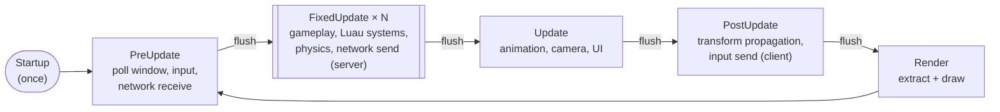
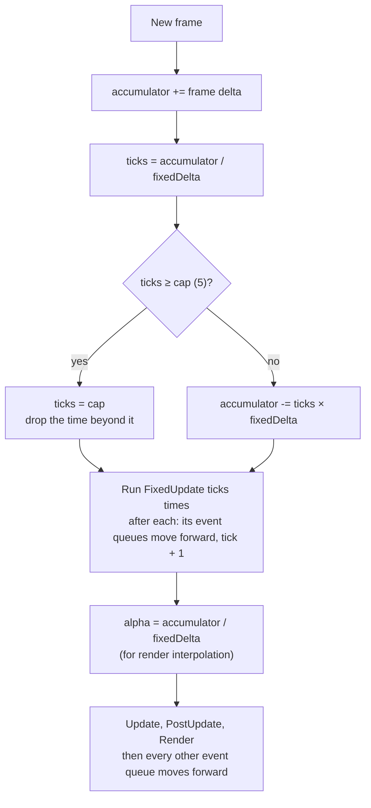
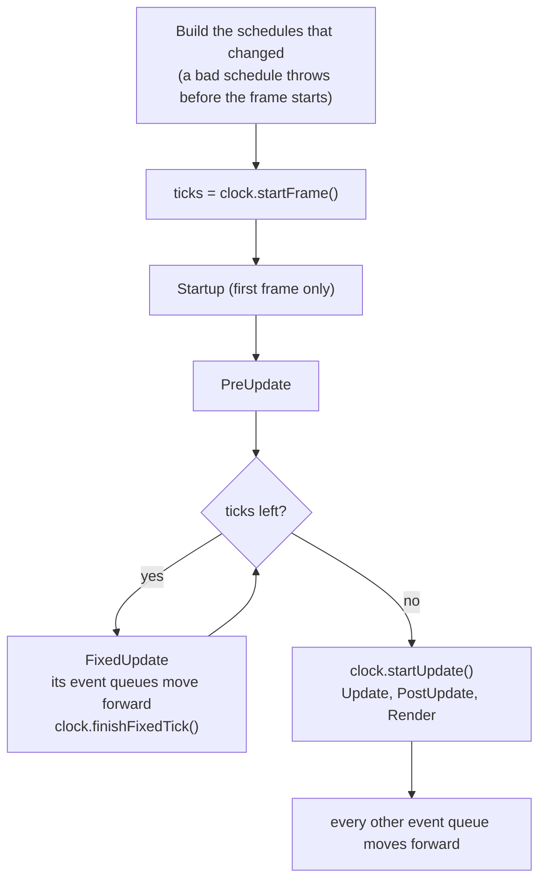
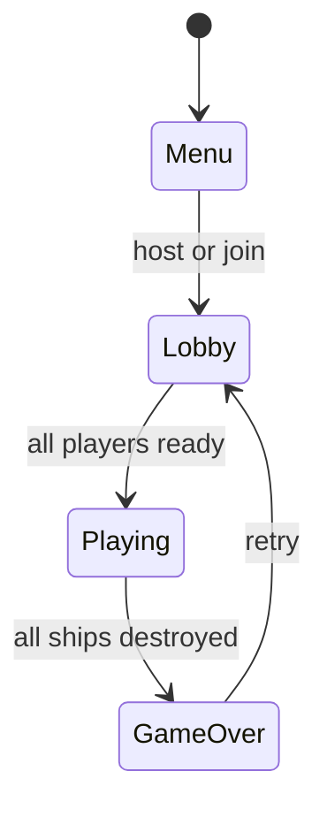

# 13 · Scheduler

## What it is

The scheduler decides **when each system runs**: in which phase of the frame, in which order inside the
phase, how many times (fixed timestep), and whether it runs at all (run conditions and game states).

## Why we need it

- **R1:** with the ECS owning the loop, the scheduler *is* the frame: poll the window, run gameplay,
  send network packets, draw.
- **R3:** the simulation must advance in **fixed ticks** (60 per second), independent of the frame rate,
  so server and clients count ticks the same way.
- **R4:** games add systems from many plugins; explicit ordering keeps that predictable.

## How others do it

| ECS | Scheduling |
|---|---|
| Bevy | Schedules (`Startup`, `PreUpdate`, `FixedUpdate`, `Update`, `PostUpdate`), system sets, `before` / `after`, run conditions, `States` with `OnEnter` / `OnExit`, automatic parallelism |
| flecs | Pipelines of phases (`OnLoad`, `PreUpdate`, `OnUpdate`, `PostUpdate`, `OnStore`), multithreading |
| Unity DOTS | System groups with `UpdateBefore` / `UpdateAfter`, fixed-step group |
| Unreal Mass | Processing phases and execution groups with ordering |

## Our choice

Bevy's model, in two steps: **phases + ordering + fixed timestep** in v1, **run conditions + States** in
v2. Sequential execution first; access sets are recorded from the start so a parallel version can come
later.

## How it works

### Phases



[Commands](09-commands.md) are flushed after each phase. The dedicated server runs only `PreUpdate`,
`FixedUpdate` and `PostUpdate`.

### Fixed timestep



A slow frame runs `FixedUpdate` several times; a fast one may run it zero times. A cap on ticks per frame
avoids the "spiral of death" when the machine cannot keep up: the time beyond it is dropped, so the game
slows down instead of spending ever longer catching up.

`rtype::ecs::FixedTimestep` (`time/FixedTimestep.hpp`) is the accumulator. It belongs to the **time plugin**
(`time/TimePlugin.hpp`), which every App has: if none was added, the App adds one with the defaults before its
first frame ([App and plugins](14-app-and-plugins.md#time)). Adding one yourself configures it:

```c++
app.addPlugin(rtype::ecs::TimePlugin{rtype::ecs::FixedTimestep{30, 5}});  // 30 ticks per second, at most 5 per frame
app.addPlugin(rtype::ecs::TimePlugin::manual(std::chrono::milliseconds{16}));  // tests: every frame lasts 16 ms
```

The default is **60 ticks per second, at most 5 per frame**. The accumulator counts in integers
(nanoseconds × ticks per second, so one tick is exactly 10^9 units at any rate): every machine counts the
same ticks for the same frame times, and 60 Hz gives exactly 60 ticks per second, with no float drift and no
rounding of 1/60 s. With the defaults, 5 ms frames run a tick every 3 or 4 frames, 16 ms frames almost one
per frame, and 50 ms frames 3 per frame.

The time plugin inserts the `Time` resource (`time/Time.hpp`, `"rtype.Time"`), and its clock keeps it up to
date:

| Field | Meaning | Set |
|---|---|---|
| `delta` | the last frame's duration, in seconds (a negative frame counts as 0) | before `PreUpdate` (and `Startup` on the first frame) |
| `fixedDelta` | one fixed tick, in seconds (1/60 by default): what `FixedUpdate` systems multiply by | before `PreUpdate` |
| `tick` | fixed ticks completed since the start; while `FixedUpdate` runs, the current tick (0, 1, 2...) | after each `FixedUpdate` |
| `alpha` | how far the frame is into the next tick, in [0, 1): to interpolate what is drawn | before `Update` |

```c++
void movement(rtype::ecs::Query<Position, const Velocity> query, rtype::ecs::Res<rtype::ecs::Time> time) {
    for (auto [entity, position, velocity] : query) {
        position->x += velocity.x * time->fixedDelta;
    }
}
```

**Event queues move forward with the phase that writes them** ([Events](11-events.md)). When a schedule
is built, it lists the events written (`EventWriter`) by its systems that run in this mode. The queues of
those written in `FixedUpdate` move forward after each fixed tick, so their events are readable for two fixed
ticks. Every other queue (written in another phase, or from outside the systems: platform, network, Luau)
moves forward at the end of the frame, so its events are readable for two frames.

### The frame and its clock

The schedules run the frame; a **frame clock** (`schedule/FrameClock.hpp`) decides how many fixed ticks it
has. The schedules know nothing about time: the time plugin installs its clock (`time/TimeClock.hpp`), and
tests install one that returns the ticks they want.

```c++
class FrameClock {
  public:
    virtual std::uint32_t startFrame(World& world) = 0;  // first thing of a frame: measure it, return the ticks
    virtual void finishFixedTick(World& world) = 0;      // after each FixedUpdate (and its event queues)
    virtual void startUpdate(World& world) = 0;          // after the fixed ticks, before Update
};
```

`Schedules::runFrame()`, called once per frame by the App:



`TimeClock` measures `std::chrono::steady_clock` (the first frame counts 0) or uses the fixed duration of a
manual plugin, runs the fixed timestep on it and writes `Time`. Without a clock, `FixedUpdate` never runs.

### Ordering inside a phase

```c++
app.addSystem(rtype::ecs::Phase::kFixedUpdate, "rtype.movement", &movement);
app.addSystem(rtype::ecs::Phase::kFixedUpdate, "rtype.collision", &detectCollisions).after("rtype.movement");
app.addSystem(rtype::ecs::Phase::kFixedUpdate, "rtype.damage", &applyDamage).after("rtype.collision");
```

Systems live in **one `Schedule` per phase** (`schedule/Schedule.hpp`): a schedule orders, checks and runs
the systems of its phase. A world's six schedules, the frame and its clock are held by **`Schedules`**
(`schedule/Schedules.hpp`), which the App owns: one App has one world, one `Schedules` and one run mode.
Systems are added through `Schedules` (the App forwards `app.addSystem` to it), which checks that a name is
used in no other phase before handing the system to the phase's schedule. Without an App, tests use them
directly:

```c++
rtype::ecs::Schedules schedules{world, rtype::ecs::RunMode::kStandalone};
schedules.addSystem(rtype::ecs::Phase::kFixedUpdate, "rtype.movement", &movement);
schedules.addSystem(rtype::ecs::Phase::kFixedUpdate, "rtype.collision", &detect).after("rtype.movement");
schedules.addSystem(rtype::ecs::Phase::kUpdate, "rtype.camera", &follow).setSide(rtype::ecs::Side::kClient);
schedules.build();                                // checks and sorts every schedule
schedules.run(rtype::ecs::Phase::kFixedUpdate);   // one phase: its systems, then their commands
schedules.runFrame();                             // a whole frame (above)
schedules.getOrder(rtype::ecs::Phase::kFixedUpdate);
```

The schedules are keyed by `Phase` for now; named schedules (States' `OnEnter` / `OnExit`) come with v2.

When a schedule is built (by `build()`, or before it runs after a change), the `before` / `after`
constraints of its systems become a graph (`detail::DependencyGraph`) that is sorted topologically. **Systems with no order between them run by name**, so the order depends only on names and
constraints, never on the order plugins added the systems.

Adding a system whose name is already used, in any phase, throws a `ScheduleException` naming it and both
phases; the system is not added. Building throws one naming the systems involved for:

| Problem | Message names |
|---|---|
| `before` / `after` naming a system that is not in the same phase (unknown, or in another phase) | the system, the target and the phase: only systems of one phase can be ordered |
| A **cycle** of constraints | the systems of the cycle, `'a' -> 'b' -> 'c' -> 'a'` |
| Two systems with **conflicting access** and **no order** (direct or through other systems) | every such pair, in name order, and the component, resource or event they share |

Access conflicts: one system writes a type the other reads or writes (two readers never conflict). Every
system is checked whatever the run mode, so a schedule that builds on the server also builds on clients
(standalone runs both kinds together).

### Running a phase

`Schedule::run()` (or `Schedules::run(phase)`) runs the phase's systems in order, skipping those whose [side](12-systems.md#the-side-rule)
does not run in the process's `RunMode` (`kServer`: server and both; `kClient`: client and both;
`kStandalone`: everything). Then it flushes the commands of those systems, in the same order: a system's
structural changes are visible from the next phase, never to the other systems of its own phase.

### Run conditions (v2)

```c++
app.addSystem(rtype::ecs::Phase::kFixedUpdate, "game.spawnWaves", &spawnWaves)
    .runIf(&rtype::ecs::inState<GamePhase::kPlaying>);
```

A run condition is a small read-only function evaluated before the system; if it returns false the
system is skipped (its `lastRun` does not move).

### States (v2)

A `State<T>` resource holds the current value of a game-flow enum; changing it runs the `OnExit` systems
of the old value and the `OnEnter` systems of the new one, at a defined point of the frame.



```luau
app:state("game.Phase", { "Menu", "Lobby", "Playing", "GameOver" })

local SpawnFirstWave = ecs.system("game.SpawnFirstWave", { onEnter = { "game.Phase", "Playing" } })
```

On the server, each room's world has its own state, which is how lobby → game → game over is handled
per room.

### Parallelism (later)

Each system's access set (reads/writes per component and resource, main-thread flag) is known. A
parallel scheduler can run systems of the same phase concurrently when their access sets do not conflict
and no ordering constraint links them. Nothing in the systems changes.

## Connections

- Uses: [Systems](12-systems.md) (access sets, sides), [Commands](09-commands.md) (flushes),
  [Resources](10-resources.md) (`Time`, `State<T>`, main-thread flags).
- Used by: [App and plugins](14-app-and-plugins.md) (owns the `Schedules` and runs a frame until `AppExit`;
  the time plugin installs the frame clock).

## Pitfalls

- **Gameplay in `Update`.** Anything that affects the simulation belongs in `FixedUpdate`; `Update` runs
  at the frame rate, which differs per machine.
- **Implicit order.** Relying on registration order works until a plugin is added. Declare `after`.
- **Too many phases.** Prefer ordering inside a phase over inventing new phases.
- **Reading `FixedUpdate` events in `Update`.** Their queues move forward once per fixed tick, so a frame that
  runs 3 ticks or more drops the events of its first tick before `Update` runs. Read them in `FixedUpdate`.
- **Frame time in gameplay.** `delta` changes with the frame rate: gameplay uses `fixedDelta`.

## Open questions

- Fixed tick rate for R-Type: 60 Hz, or 30 Hz to halve network traffic? (Team) The default is 60 Hz;
  `setFixedTimestep()` changes it.
