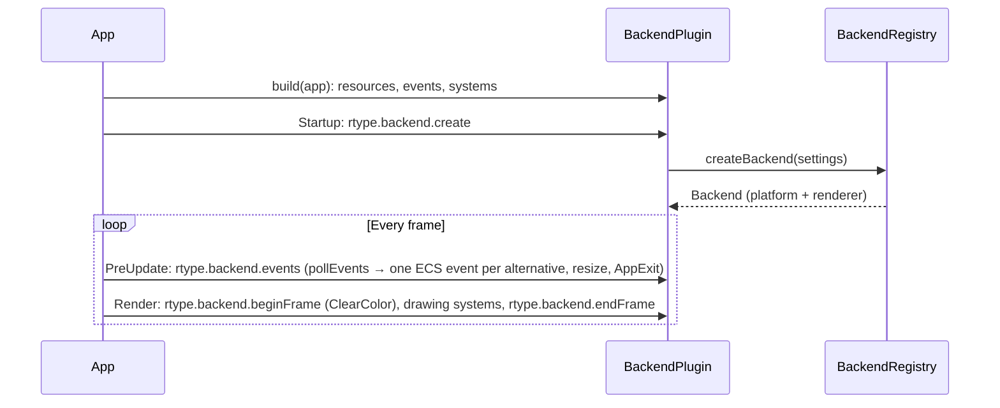

# 14 · App and Plugins

## What it is

The **App** is the entry point of a game: it owns the [world](06-world.md), the
[schedule](13-scheduler.md) and the main loop. A **plugin** is a reusable bundle that registers
components, resources, events, systems and other plugins into the App. A game is an App plus a list of
plugins.

## Why we need it

- **R1:** this is the Bevy-style engine: window, input, rendering, audio, assets, scripting and
  networking are each a plugin.
- **R2:** games are written as **Luau plugins** whenever possible.
- **R3:** a client and a dedicated server are the same game plugins with different engine plugins.
- **R4:** plugins are the unit of reuse between games.

## How others do it

| ECS / engine | Mechanism |
|---|---|
| Bevy | `App` + `Plugin` trait + plugin groups (`DefaultPlugins`, `MinimalPlugins`); sub-apps for rendering |
| flecs | Modules (`world.import<Module>()`) |
| Unreal | Modules + subsystems; Mass processors registered by modules |
| Godot / Unity | Not ECS-based: scenes and scripts, with editor-driven composition |

## Our choice

Bevy's model: `rtype::ecs::App`, `rtype::ecs::Plugin`, and plugin groups. Plus two things specific to
us: **Luau plugins** loaded through `LuauPlugin`, and a **standalone mode** that runs server and client
sides in one App.

## How it works

### The plugin interface

```c++
namespace rtype::ecs {
/// @brief A reusable bundle of components, resources, events and systems.
class RTYPE_ECS_API Plugin {
  public:
    virtual ~Plugin();
    [[nodiscard]] virtual std::string_view getName() const noexcept = 0;
    virtual void build(App& app) = 0;

  protected:  // plugins are values moved into the App; protected copy/move prevents slicing
    Plugin() = default;
    // copy and move constructors and assignments = default
};
}  // namespace rtype::ecs
```

`build` registers things; it does not run gameplay. A plugin is **built as soon as it is added**, and
adding a plugin whose name was already added does nothing, so plugins can safely depend on each other
(`RenderPlugin` adds `WindowPlugin` if missing). A plugin is recorded before it is built, so two plugins
adding each other are each built once. A `PluginGroup` (`app/PluginGroup.hpp`) adds several plugins through
the App with its own `build`.

### The App

`rtype::ecs::App` (`app/App.hpp`) owns **one world, its `Schedules` and one run mode**, the plugins added to
it, and the loop:

```c++
class GamePlugin : public rtype::ecs::Plugin {
  public:
    std::string_view getName() const noexcept override { return "game"; }
    void build(rtype::ecs::App& app) override {
        app.insertResource(Score{.value = 0});
        app.addSystem(rtype::ecs::Phase::kStartup, "game.spawnPlayer", &spawnPlayer);
        app.addSystem(rtype::ecs::Phase::kFixedUpdate, "game.movement", &movement);
        app.addSystem(rtype::ecs::Phase::kRender, "game.drawScore", &drawScore).setSide(rtype::ecs::Side::kClient);
    }
};

rtype::ecs::App app{rtype::ecs::RunMode::kStandalone};
app.addPlugins(rtype::ecs::MinimalPlugins{}).addPlugin(GamePlugin{});
return app.run();   // Startup once, then frames until a system sends AppExit; returns its code
```

| Member | Does |
|---|---|
| `App(RunMode = kStandalone)` | The run mode decides which systems run, from their side. Neither copyable nor movable: its schedules point to its world. |
| `addPlugin(plugin)` / `addPlugins(group)` / `hasPlugin(name)` | Plugins, built at once, skipped by name when already added |
| `addSystem(phase, name, function)` | `Schedules::addSystem()`, returning the system's configuration (`after`, `before`, `setSide`) |
| `insertResource(value)` | A resource of the world |
| `getWorld()`, `getSchedules()` | The world and its schedules |
| `runFrame()` | One frame ([scheduler](13-scheduler.md#the-frame-and-its-clock)), adding the default time plugin first if none was added |
| `run()` | Frames until an `AppExit` is read; returns its code |

`AppExit` (`app/AppExit.hpp`, `"rtype.AppExit"`) is an event: any system sends it (the window plugin on
`event::Closed`, the server on a signal), several may, and the App stops after the frame it was sent in,
returning the code of the first one read.

### Time

**Every App has a `TimePlugin`** (`time/TimePlugin.hpp`, named `"rtype.time"`): it inserts the `Time`
resource and installs the frame clock that runs `FixedUpdate` at a fixed rate
([Scheduler](13-scheduler.md#fixed-timestep)). If none was added, the App adds one with the defaults (60 ticks
per second, at most 5 per frame) before its first frame; `MinimalPlugins` adds the same default. To configure
it, add your own before `MinimalPlugins` and before the first frame: the default one is then skipped, by name.

```c++
app.addPlugin(rtype::ecs::TimePlugin{rtype::ecs::FixedTimestep{30, 5}})   // 30 Hz
    .addPlugins(rtype::ecs::MinimalPlugins{});
app.addPlugin(rtype::ecs::TimePlugin::manual(std::chrono::milliseconds{50}));  // tests: every frame lasts 50 ms
```

`TimePlugin` measures `std::chrono::steady_clock`; `manual()` makes every frame last a fixed duration, so tests
and replays are deterministic. A clock installed directly with `getSchedules().setClock()` is replaced by the
default plugin's on the first frame: a custom clock comes from a plugin named `"rtype.time"` added in place
of `TimePlugin`.

### Three ways to start

```c++
// Client: rtype::ecs::App app{rtype::ecs::RunMode::kClient};
app.addPlugins(rtype::plugins::DefaultPlugins{})   // window, input, render, audio, assets, script
    .addPlugin(rtype::plugins::ClientPlugin{"127.0.0.1", 4242})
    .addPlugin(rtype::plugins::LuauPlugin{"scripts/rtype/plugin.luau"})
    .run();

// Dedicated server (headless): rtype::ecs::App app{rtype::ecs::RunMode::kServer};
app.addPlugins(rtype::ecs::MinimalPlugins{})               // time (later assets metadata, script)
    .addPlugin(rtype::plugins::ServerPlugin{4242})
    .addPlugin(rtype::plugins::LuauPlugin{"scripts/rtype/plugin.luau"})
    .run();

// Standalone (single player, tests): rtype::ecs::App app{rtype::ecs::RunMode::kStandalone};
app.addPlugins(rtype::plugins::DefaultPlugins{})
    .addPlugin(rtype::plugins::StandalonePlugin{})
    .addPlugin(rtype::plugins::LuauPlugin{"scripts/rtype/plugin.luau"})
    .run();
```

The game plugin is **the same file in all three**.

### Standalone mode

Single player should not require running a server. An App made with `RunMode::kStandalone` runs **both
sides**: server systems (gameplay) and client systems (presentation) in the same world. `StandalonePlugin`
fills `PlayerInput` directly from local input instead of from the network. Because gameplay reads
`PlayerInput` and never the keyboard, nothing in the game changes.

| Mode | Server systems | Client systems | `PlayerInput` comes from |
|---|---|---|---|
| Client | no | yes | local input → sent to the server |
| Server | yes | no | the network |
| Standalone | yes | yes | local input, directly |

### Default plugin groups

| Group | Plugins |
|---|---|
| `MinimalPlugins` (`rtype::ecs`) | `TimePlugin`; later `AssetPlugin` (metadata only), `ScriptPlugin` |
| `DefaultPlugins` | `MinimalPlugins` + `WindowPlugin`, `InputPlugin`, `RenderPlugin`, `AudioPlugin`, `TransformPlugin`, `HierarchyPlugin` |
| Opt-in | `ClientPlugin`, `ServerPlugin`, `StandalonePlugin`, `CollisionPlugin` |

### Wiring Ethan's backends

`BackendPlugin` (`plugins/backend/`, `rtype::plugins::backend`) reuses `BackendRegistry` unchanged. The executable,
the only place that knows GLFW and Vulkan, fills a registry and hands it to the plugin with the `Settings`, so the
plugins depend on no backend:

```c++
auto registry = std::make_unique<rtype::engine::backend::BackendRegistry>();
rtype::platform::glfw::registerPlatform(*registry);
rtype::render::vulkan::registerRenderer(*registry);
app.addPlugins(rtype::ecs::MinimalPlugins{})
    .addPlugin(rtype::plugins::backend::BackendPlugin{std::move(registry), settings})
    .addPlugin(rtype::plugins::input::InputPlugin{});
return app.run();
```

`build()` only registers: the window opens in the `Startup` system, which calls `registry.createBackend(settings)`
(keeping the `setup → init → init` order) into the `Backend` [main-thread resource](10-resources.md). Every system
of the plugin is a client one, so a dedicated server has no window.



While the window is minimized, the events system waits for an event instead of polling, and both render systems
skip the frame. The `InputPlugin` reads the input events the backend sends, in the same phase: whichever of the two
plugins is added second orders its system against the other's, since a constraint naming a missing system is an
error.

### Luau plugins

`LuauPlugin` is a C++ plugin that loads a Luau plugin file and forwards its registrations to the App
(see [Luau bridge](19-luau-bridge.md)):

```luau
local RtypePlugin = ecs.plugin("rtype.Game")

function RtypePlugin:build(app)
    app:load("components/Shield.luau")
    app:load("systems/ShieldRegen.luau")
    app:addPlugin("scripts/rtype/weapons/plugin.luau")
    app:prefab("game.Bydo", { --[[ ... ]] })
end

return RtypePlugin
```

A C++ game plugin is added beside it when part of the game needs native speed
(`rtype::game::CollisionPlugin`).

### The loop

`app.run()` runs frames (`Schedules::runFrame()`: `Startup` on the first one, then the phases, `FixedUpdate`
as many times as the clock says) until a system sends `AppExit` (the window plugin does so on
`event::Closed`; the server on a signal), then returns its code. `app.runFrame()` runs a single frame, for
tests and for engines that drive the loop themselves.

## Connections

- Uses: [World](06-world.md), [Scheduler](13-scheduler.md), [Resources](10-resources.md),
  [Events](11-events.md).
- Used by: every plugin, [Luau bridge](19-luau-bridge.md), [Replication](20-replication.md),
  [Hierarchy](17-hierarchy.md).

## Pitfalls

- **Doing work in `build`.** `build` only registers; loading files or opening windows belongs in
  `Startup` systems, so registration stays fast and order-independent.
- **Plugins reaching into each other.** Plugins communicate through components, resources and events,
  never by calling each other's functions.
- **Mode-specific game code.** If game code checks "am I the server?", it is in the wrong place; use
  system sides.

## Open questions

- Should rooms on the server be separate Apps (each with its own schedules) or one App with several
  worlds? (ECS + network) For now one App has one world; `Schedules` is per world so that either stays
  possible.
- `CollisionPlugin` scope: AABB only, or circles too? (Team)
