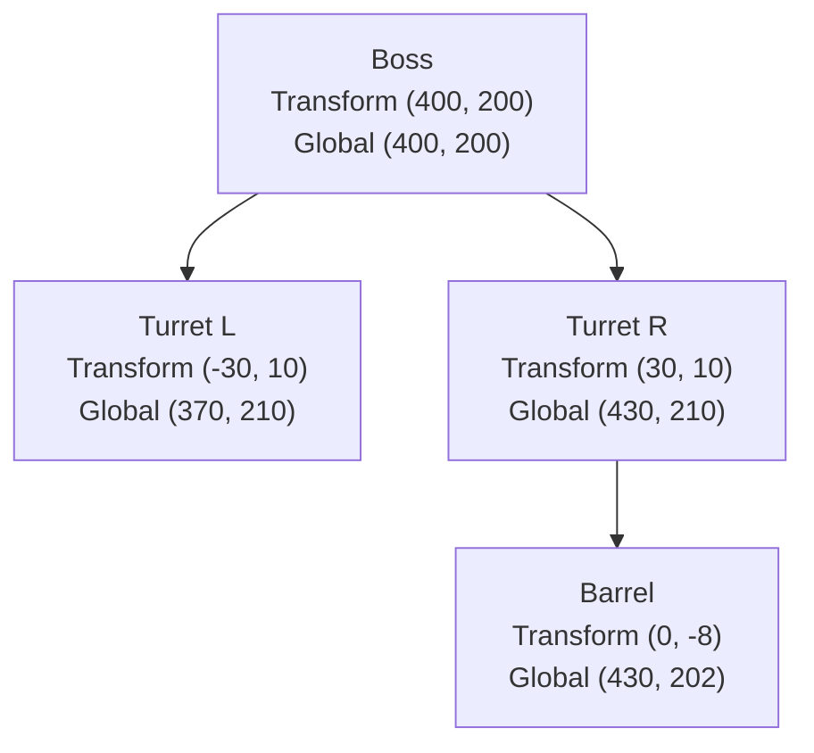

# 17 · Hierarchy

## What it is

A hierarchy links entities as **parent and children**: the R-Type "Force" pod attached to the player
ship, turrets on a boss, a UI panel and its buttons. A child's position is relative to its parent, and
despawning the parent despawns the children.

## Why we need it

- **R1:** UI, cameras following targets and attached effects all need it.
- **R4:** every generic engine has scene hierarchies.
- R-Type: bosses made of parts, ships with attachments.

## How others do it

| ECS / engine | Hierarchy |
|---|---|
| Bevy | `ChildOf(parent)` and `Children` components (relationships), `GlobalTransform` computed by a propagation system |
| flecs | `(ChildOf, parent)` pairs, a general relationship feature; hierarchy is one case |
| Unity DOTS | `Parent`, `Child` buffer, `LocalTransform` → `LocalToWorld` |
| Unreal | Actor attachment, scene components |
| EnTT | Nothing built in; usually parent/child components |

## Our choice

**Two components kept by the `World`, and a propagation system**, as Bevy and Unity do. General relationships (flecs
pairs) are left aside: they are powerful but a large feature, and a hierarchy covers the needs we know.

The links live in the `World`, not in a plugin: the ECS has no removal events, so a plugin could not see a despawn or a
removed component, while the `World` does all of them.

## How it works

### Components

| Component | Fields | Meaning |
|---|---|---|
| `ecs::Parent` | `entity` | This entity's parent. Sent to clients (`ecs::kParentOptions`) |
| `ecs::Children` | `entities`, a `std::vector<Entity>` | Its children, in the order they were attached. Kept by the `World`, not sent: each side rebuilds it from `Parent` |
| `Transform` | position, rotation, scale | Relative to the parent (or to the world without a parent) |
| `GlobalTransform` | position, rotation, scale | Absolute; computed, never written by gameplay |

`Children` is a list and not a fixed array: a UI panel can have many children, and their order is the layout's.

### Linking entities

```c++
commands.entity(turret).add(rtype::ecs::Parent{.entity = boss});  // or world.setParent(turret, boss)
commands.entity(turret).remove<rtype::ecs::Parent>();             // or world.removeParent(turret)
```

`Commands::flush()` hands every `Parent` to `World::setParent()` and `removeParent()`, however it was recorded, so
gameplay, the network and scripts need no special case. A parent the `World` refuses (a cycle, a dead entity) is
skipped. Only `Components::add()` and `remove()` called directly would leave `Children` out of date: never use them on
`Parent`.

`remove<Parent>()` leaves the `Transform` as it is, so the entity jumps to where that `Transform` falls in the world.
`transform::detachInPlace()` keeps it in place, and `attachInPlace()` is the reverse (`plugins/transform/Reparent.hpp`).

### Propagation



A `PostUpdate` system computes every `GlobalTransform` from the roots down with `combine()`
(`plugins/transform/TransformMath.hpp`). It writes only the values that differ, so `Changed<GlobalTransform>` only
reports entities that moved; the walk needs no record of what changed. An entity with no hierarchy costs one comparison.

`combine()` is exact with a uniform scale or a mirror. A rotated child of a parent scaled differently on each axis
would need a shear, which `GlobalTransform` cannot hold: its position stays right, its rotation and scale are
approximate.

Rendering reads `GlobalTransform`; gameplay writes `Transform`.

### The physics

The physics runs in `FixedUpdate`, before the propagation, and a propagation system there would conflict with every
gameplay system writing `Transform`. So it computes the poses it needs itself, with `transform::WorldPoses`, and only
when a body has a parent. See [Physics design](../../physics/design.md).

### Despawn

Despawning an entity despawns its descendants, in the same command flush, deepest first, without recursion: the walk is
iterative, and allocates nothing, since `World::despawn()` is `noexcept`. A parent loses a despawned child from its
`Children`.

### Over the network

`Parent` is a `kEntity` field, so it replicates through `NetworkId` like any entity reference. `Children` is not sent
and `GlobalTransform` neither: clients recompute them. A child listed before its parent in a snapshot is linked anyway,
since every spawn of a snapshot comes first. A parent the client does not know yet leaves the child a root until a
snapshot sends `Parent` again: complete snapshots do, and delta snapshots will have to (NET-20). A replicated child of
an entity that is not replicated stays a root on the client, its relative `Transform` read as a world position.

### From scripts

`ctx.commands:setParent(child, parent)` and `removeParent(child)` change a hierarchy. A system reads it with
`read = { "rtype.Parent" }` (`parent.entity`) and `read = { "rtype.Children" }` (`children.entities`, a copy). Both are
refused as `write` terms, which would bypass the `World`. They are registered by the `TransformPlugin`.

## Connections

- Uses: [Components](02-component-registry.md) (`kEntity` fields), [Commands](09-commands.md),
  [Change detection](08-change-detection.md), [Scheduler](13-scheduler.md) (`PostUpdate`).
- Used by: rendering (via `GlobalTransform`), [Actors](18-actors-and-scenes.md) (actors with
  children), [Replication](20-replication.md).

## Pitfalls

- **Cycles.** Setting an entity's parent to one of its descendants is refused.
- **Deep chains.** Propagation walks the tree, and a despawn goes back to the root for each descendant: very deep
  hierarchies cost more.
- **Writing `GlobalTransform`.** It is overwritten every frame; gameplay must write `Transform`.
- **Despawning many entities.** `clearReferencesTo()` looks at every `Parent` and `Children` value at each despawn.

## Open questions

- General relationships (flecs-style pairs) in v3, or never? (ECS)
