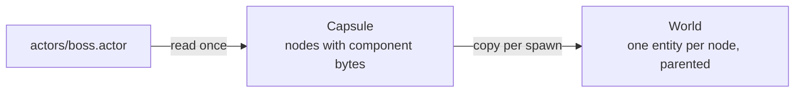

# 18 · Capsules

## What it is

A **capsule** is an entity described once and spawned by copy: its components, and its child entities, any of which
can be another capsule. An enemy, a bullet, a boss with its turrets and a whole level are all capsules: there is one
behaviour, not one for templates and another for levels. Other engines split it in two (prefabs and scenes); Godot
does not, and neither do we.

A capsule's file says what the developer means by its extension: `.actor` for a thing that moves, `.scene` for a level,
`.capsule` for anything else. The content and the behaviour are the same; the extension is only there to organize a
game's files.

## Why we need it

- **Convenience (R2):** spawning `actors/bydo.actor` instead of adding five components by hand in every system that
  creates an enemy.
- **R4, data-driven content:** designers describe enemies and levels in files, which an editor can read and write,
  without touching systems; a saved file is reloaded while the game runs.
- **R3 (network):** every spawned root carries a `CapsuleInstance` (capsule id, version), so the server can later tell a
  client "spawn this capsule here" in a few bytes (see [Replication](20-replication.md)).

## How others do it

| Engine | Templates and levels |
|---|---|
| Godot | One thing: a scene is a tree of nodes, a node can instance another scene; `.tscn` text files |
| Unity | Prefabs (editor assets) and scenes, two concepts; DOTS bakes them to entities |
| Bevy | Bundles in code, `DynamicScene` files for sets of entities |
| flecs | Prefabs are entities, instances inherit their components (`IsA`) |

## Our choice

- **A plugin, not an ECS feature:** capsules only use the ECS's public API (spawn, add a component by id and bytes,
  `Commands`, `setParent`), so they live in `plugin-capsule` (`rtype.Capsule`), as `bevy_scene` lives outside
  `bevy_ecs`.
- **One behaviour, two steps.** A file is read once into a capsule: each node's components as bytes ready to copy. A
  spawn then only allocates entities and copies bytes, so spawning a bullet hundreds of times never parses text.
- **A flat list of nodes**, the file's structure one to one: name, parent, side, the capsule it instances if any, and
  its components. The hierarchy is made at spawn, with `Parent` and `Children`.
- **Instances by copy**, no inheritance: changing a capsule changes what is spawned after, and what was spawned before
  when it is reloaded.

## How it works

### Adding the plugin

A game names it in its `project.luau`, and the `Engine` loads it from its library (see
[Plugins](../../Plugins.md#loading)):

```lua
engine.settings.plugins = { "rtype.Capsule" }
```

A program on a bare `App` (tests, examples) adds `rtype::plugins::capsule::CapsulePlugin{}`. It inserts the `Capsules`
resource (`"rtype.Capsules"`), the `LoadedCapsule` resource (`"rtype.LoadedCapsule"`), registers the `CapsuleInstance`
component and the engine calls. It requires no plugin and reads no settings.

### A capsule

A capsule is named by its path ("actors/bydo.actor"); its id is the `AssetId` of that path, the same in every process.
Its nodes form a flat list, a parent before its children, node 0 the root:

| Node field | Meaning |
|---|---|
| name | Its name among its parent's children (not empty, no `/`, unique there); a node's path is "Boss/LeftTurret" |
| parent | Its parent node |
| side | Where it is spawned: the server by default, the client, or both (`ecs::runsIn()`, as for systems). The root is spawned everywhere |
| instance | Another capsule it spawns instead of a plain entity: that capsule's root takes this node's components over its own, and gets this node's children too |
| components | `ComponentValues`: one live value per component (copied and destroyed with its type's hooks), each with the component's presence |

A `Capsule` is built node by node, then given to the `Capsules` resource with `define()`. Games describe capsules in
files, which the plugin reads the same way; building one in C++ is for tests and tools:

```c++
namespace capsule = rtype::plugins::capsule;
capsule::Capsule boss{"actors/boss.actor"};                    // a root only; the path is normalized, the id derived
boss.editNode(0).values.set(components, Health{.value = 50});
const std::uint32_t left = boss.addNode("LeftTurret", 0);
boss.editNode(left).instance = capsule::CapsuleRef{.id = capsule::CapsuleId::fromPath("actors/turret.actor"),
                                                   .path = "actors/turret.actor"};
boss.editNode(left).values.set(components, Transform{.position = {-40.F, 0.F}});
capsules.define(std::move(boss));
```

An instance is looked up when the capsule is spawned, so a capsule can instance one defined, or redefined, later. A
game describes its capsules in files instead ([below](#capsule-files)).

| Rule | Behaviour |
|---|---|
| Names | One capsule per path; two paths with the same id are refused (`CapsuleException`) |
| Values | Any component (all are copyable); setting one again replaces it. `Parent` and `Children` are refused: the nodes set the hierarchy |
| Hot reload | `Capsules::define()` of a capsule with the same id replaces its nodes and bumps its version, keeping its id and address, so what instances it stays valid |

### Capsule files

A game keeps its capsules under `<game>/assets`, as `.capsule`, `.scene` or `.actor` files: the same format, the
extension is for the developer. The format is specified in full (tokens, grammar, every value type, errors, how it is
written) in [`CapsuleFormat.md`](../../CapsuleFormat.md); why it is our own and not TOML is in
[`benchmarks/capsule-format.md`](../../benchmarks/capsule-format.md). A file is a flat list of node sections, the root
first and a parent before its children, each with its components written by field name (from the
[reflection](15-reflection-and-serialization.md)):

```
[capsule format=1]

[node path="."]
game.Health = { value = 50 }

[node path="LeftTurret" instance="actors/turret.actor"]
rtype.Transform = { position = (-40, 0) }

[node path="Background" side=client]
rtype.SpriteRenderer = { texture = "sprites/bg.png", layer = -10 }
```

| Part | Rule |
|---|---|
| `[capsule format=1]` | Optional, first: the version of the format |
| `[node path="..."]` | `"."` for the root, `"Boss/LeftTurret"` below it; the parent must come before |
| `instance="path"` | The node spawns that capsule; its components start from that capsule root's values, so it names only the fields it changes |
| `side=server\|client\|both` | Where the node is spawned (server by default); not on the root |
| `name = { field = value, ... }` | A component, its fields over its defaults; `{}` for the defaults or a tag |
| Values | numbers (`0x...` for an asset id with no path), `true` / `false`, `"text"` (strings, asset paths), `(x, y)` vectors, `[a, b]` arrays and lists; `#` starts a comment |

Entity fields cannot be set yet. `format::readCapsule()` reads a file into a capsule (an error names the file, line and
column) and `format::writeCapsule()` writes one back, with only the fields that differ from where reading starts,
floats in their shortest exact form and assets by the path they were read from, so a capsule read and written again is
the same: an editor can save what it reads.

**Loading.** The `CapsulePlugin` reads every capsule file from its `finish()`, once every plugin, scripts included, is
built, so a file can name the components scripts declare. A file instancing another reads it first. A broken file stops
the start, naming the file, line and column.

**Hot reload.** With the engine's hot reload (`hotReload`, the `HotReload` resource), the plugin adds a
`CapsuleReloadable` to the engine's `HotReloader`, following the capsule files of the assets. Between two frames, a
saved or added file is read again (`CapsuleFiles::reload()`) with the files that instance it, and the capsules read go
to the `ReloadedCapsules` resource; the next frame, the Render system `rtype.Capsule.HotReload` (every side) reloads
what was spawned from them, nested roots through their outermost capsule. A file saved broken keeps its old version and
the reload is reported as failed with the file, line and column; a removed file is ignored.

### Spawning

```c++
// in a system: reserved at once, alive when the system's commands are applied
void spawnWave(rtype::ecs::Commands& commands, rtype::ecs::Res<rtype::plugins::capsule::Capsules> capsules) {
    rtype::plugins::capsule::spawnCapsule(commands, *capsules, bydoId)
        .add(Transform{.position = {820.F, 140.F}});   // replaces the capsule's Transform for this entity
}
```

Spawning, loading and reloading are all recorded in a `Commands` buffer: in a system, its own; outside systems (tests,
tools), a `Commands{world}` flushed by hand.



One walk over the nodes: a node of the other side is skipped with its subtree; a
node is a new entity, or the root its instance spawns; its kept values are added (presence: a client leaves out
`kServerOnly` components, a dedicated server `kClientOnly` ones); it is parented to its parent's entity. The root gets a
`CapsuleInstance { capsule, version, nested }`. A check pass runs first (every instanced capsule exists, none contains
itself), so a spawn creates everything or nothing.

A level is a capsule whose root has no `Transform`: the `TransformPlugin` treats its children as roots, so they stay in
world space. A capsule that moves as one gives its root a `Transform`. Despawning a root despawns the capsule: its
descendants go with it.

### Loading: switching levels

`loadCapsule()` (and the `rtype.capsule.load` call) switches the level: it despawns the root the `LoadedCapsule`
resource names, spawns the new capsule and remembers it. Entities outside the old capsule's tree (the player, a game
manager) stay.

### Reloading

`reloadCapsule(commands, capsules, root, instance, children)` despawns the root's children, adds the capsule's current
root values again, spawns its children again and updates `CapsuleInstance.version`. The root entity and its other
components stay. A nested root (`nested`) is reloaded from its own capsule, which replaces the outer node's values on
it; reloading the outermost capsule it belongs to keeps them.

### From scripts

Scripts describe nothing: files do. A system spawns, loads and reloads through three engine calls, listed in its
`calls`; each records into the system's own commands and adds what it reads and writes to the system's access.

| Call | Arguments | Result |
|---|---|---|
| `rtype.capsule.spawn` | `capsule` (a path) | the root, reserved at once |
| `rtype.capsule.load` | `capsule` (a path) | the new root; the capsule loaded before is despawned |
| `rtype.capsule.reload` | `root` | `true` if it was a capsule's root |

The plugin also brings setup forms (`CapsuleForms.luau`, registered by `addCapsuleForms()` from its library and its
build step): `engine.capsule.spawn(ctx, path, overrides)`, `engine.capsule.load(ctx, path, overrides)` and
`engine.capsule.reload(ctx, root)`. A form checks its arguments, makes the call through `ctx.call` (so the system still
lists it) and patches the root with each override (`ctx.commands:patch`, [Commands](09-commands.md)): only the fields
named change, over the values the capsule gives the root.

```luau
engine.ecs.system("game.Waves", {
    phase = "Update",
    query = {},
    calls = { "rtype.capsule.spawn", "rtype.capsule.load" },
    run = function(ctx)
        local bydo = engine.capsule.spawn(ctx, "actors/bydo.actor", {
            ["rtype.Transform"] = { position = { x = 820, y = 140 } },   -- rotation and scale stay the capsule's
        })
        -- when the boss is defeated:
        engine.capsule.load(ctx, "scenes/level2.scene")
    end,
})
```

`ctx.commands:add` after a spawn still replaces the whole component (its defaults with the fields given), as in C++;
`patch<T>()` is the C++ way to change part of it.

## Connections

- Uses: [Component registry](02-component-registry.md) (ids, presence), [Commands](09-commands.md),
  [Hooks](16-hooks-and-observers.md) (`copy`), [Hierarchy](17-hierarchy.md), [Reflection](15-reflection-and-serialization.md)
  (the file format).
- Used by: [Luau bridge](19-luau-bridge.md) (the calls), [Replication](20-replication.md) (spawn by capsule id, later).
- Code: `src/rtype/plugins/capsule/`; example `examples/plugins/capsule/`; manual page `manual/pages/capsules.md`.

## Pitfalls

- **A node on the wrong side.** A node is server-side by default: on a client, a camera or a background must be marked
  `client` (or `both`), or it is not spawned there.
- **Reloading a root the game added to.** A reload despawns all the root's children, including ones the game parented
  to it, and keeps the root's other components, even ones the new version no longer sets.
- **Editing a capsule after spawning.** Instances are copies: they change only when reloaded.
- **A file naming a component no plugin or script registers.** It is refused when the files are read: list the plugin
  that owns the component.

## Open questions

- Remapping `Entity` fields that point inside the tree, written as node paths in the files (a turret aiming at a
  node of its own capsule). (Later)
- Saving part of a running world back to a capsule file, for an editor. (Later)
- Spawning by capsule over the network: the spawn record already has a `capsule` short id, still unused. (Later)
