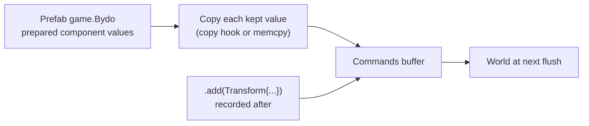

# 18 · Prefabs and Scenes

## What it is

A **prefab** is a named template of an entity: the list of components and values that make up, say, a
`game.Bydo` enemy or a `game.Bullet`. Spawning a prefab creates an entity with all of them at once.

A **scene** is a saved set of entities (with their components), such as a level layout, that can be
loaded into a world.

## Why we need it

- **Convenience (R2):** `spawnPrefab("game.Bydo")` instead of adding five components by hand in every
  system that creates an enemy.
- **R3 (network):** the server can tell a client "spawn `game.Bullet` here" in a few bytes instead of
  sending every component (see the `kSpawnOnly` mode in [Replication](20-replication.md)).
- **R4:** data-driven content: designers define enemy types without touching systems.

## How others do it

| ECS / engine | Templates | Saved sets |
|---|---|---|
| flecs | Prefabs are entities; instances inherit (share) their components via `IsA` | flecs script, JSON |
| Bevy | Bundles (code-only templates); scenes as serialized entity lists | `DynamicScene`, `.scn.ron` files |
| Unity | Prefabs (editor assets), baked to entities in DOTS | Scenes / subscenes |
| Unreal Mass | Entity configs (traits) | Levels |

## Our choice

- **Prefabs (v2, implemented):** a named list of component values with child prefabs, registered from C++
  or by id and bytes (Luau), instantiated by copying values (no inheritance). Simple, and it serializes
  trivially.
- **Scenes (v3):** files listing entities and their component values by name, read and written with the
  [reflection serializer](15-reflection-and-serialization.md).

## How it works

### Declaring a prefab

A prefab lives in the world's **`Prefabs`** (`prefab/Prefabs.hpp`, `world.getPrefabs()`): a name, its
**`ComponentValues`** (one live value per component, copied and destroyed with its type's hooks), and its child
prefabs. From C++, the App fills one with a chain (`PrefabConfig`):

```c++
app.addPrefab("game.Bullet")
    .with(Transform{})
    .with(Velocity{.value = {600.F, 0.F}})
    .with(Bullet{});
```

The Luau bridge, which only knows components by id, uses the same registry with bytes (SCR-08 builds the
`app:prefab` form below on it):

```c++
const rtype::ecs::PrefabId bydo = world.getPrefabs().add("game.Bydo");
world.getPrefabs().edit(bydo).getValues().set(world.getComponents(), transformId, transformBytes);
```

```luau
app:prefab("game.Bydo", {                                            -- planned (SCR-08)
    ["rtype.Transform"] = {},                                       -- defaults
    ["rtype.SpriteRenderer"] = { texture = asset("sprites/bydo.png") },
    ["game.Health"] = { value = 3 },
    ["game.Enemy"] = {},
})
```

| Rule | Behaviour |
|---|---|
| Names | Unique per world; an empty name, a taken one or a hash collision throws `PrefabException` |
| Values | Any component (all are copyable); setting one again replaces it. `Parent` and `Children` are refused: the prefab's children set the hierarchy |
| Editing | `edit(id)` changes the prefab; entities already spawned keep their copies |

### Spawning

```c++
// in a system: reserved at once, alive at the next flush
const rtype::ecs::Entity enemy =
    commands.spawnPrefab("game.Bydo").add(Transform{.position = {820.F, 140.F}}).getEntity();   // override

// outside systems (loading a level, tests): at once
const rtype::ecs::Entity boss = world.spawnPrefab("game.Boss");
```



`spawnPrefab` (by id or by name) returns the root's `EntityCommands`, so an override is a plain `add()`: it
is recorded after the prefab's values and replaces them for this entity. Field-level overrides from Luau
(`{ ["rtype.Transform"] = { position = ... } }`) are built by the scripting layer from the prefab's bytes
(`getValues().get(id)`). An unknown prefab throws `PrefabException`. `World::spawnPrefab` despawns what it
created if a copy fails halfway, so no half-built tree is left.

**Presence.** The App gives its run mode to the prefabs: a client leaves out `kServerOnly` components
(overrides of children included), a dedicated server `kClientOnly` ones; standalone, and a `World` without
an App, keep everything.

### Prefabs with children

A prefab lists child prefabs, each with its own overrides (typically its `Transform` relative to the
root). Spawning creates the whole tree, depth first, and sets `Parent` on each child, so the World keeps
`Children` in sync (see [Hierarchy](17-hierarchy.md)):

```c++
app.addPrefab("game.Turret").with(Transform{}).with(Health{.value = 5});
app.addPrefab("game.Boss")
    .with(Transform{})
    .with(Health{.value = 50})
    .withChild("game.Turret", Transform{.position = {-40.F, 0.F}})
    .withChild("game.Turret", Transform{.position = {40.F, 0.F}});
```

A child must be registered first, and a prefab cannot contain itself: `Prefabs::addChild()` refuses a
child whose tree holds the parent (`A → B → A`), while sharing a child (a diamond) is fine. `Commands` and
the `World` spawn through the same tree walk (`detail::spawnPrefabTree`), so both create the same entities
in the same order.

### Over the network

Prefab names are part of the connection **manifest**, mapped to short ids. A spawn message for a
`kSpawnOnly` entity is: prefab id + `NetworkId` + overrides (position, velocity) + spawn tick. The client
spawns the same prefab locally. See [Replication](20-replication.md).

### Scenes (v3)

What a scene holds, for example `level1` (the file format is still open, see below):

| Entity | Prefab | Components (values by field name) |
|---|---|---|
| 1 | — | `rtype.Transform { position = (0, 0) }`, `game.Background { … }` |
| 2 | `game.Bydo` | `rtype.Transform { position = (820, 140) }` (override) |
| … | … | … |

A scene can reference prefabs, so levels stay short. Loading a scene spawns its entities through
commands; saving one walks the world with the serializer.

## Connections

- Uses: [Component registry](02-component-registry.md) (ids, defaults), [Reflection](15-reflection-and-serialization.md),
  [Commands](09-commands.md), [Hooks](16-hooks-and-observers.md) (`copy`), [Hierarchy](17-hierarchy.md).
- Used by: [Luau bridge](19-luau-bridge.md) (`app:prefab`, `spawnPrefab`), [Replication](20-replication.md)
  (spawn by prefab id).

## Pitfalls

- **Prefabs that drift between server and client.** Both load the same Luau plugin, and the manifest
  carries a hash per prefab to catch differences.
- **Editing a prefab after spawning.** Instances are copies; changing the prefab affects only future
  spawns (no inheritance, by design).
- **Server-only data in prefabs.** Components flagged `kServerOnly` are skipped when the client spawns
  the prefab.

## Open questions

- Scene file format: Luau tables (reusing the scripting parser) or a dedicated text/binary format?
  (Team, v3)
