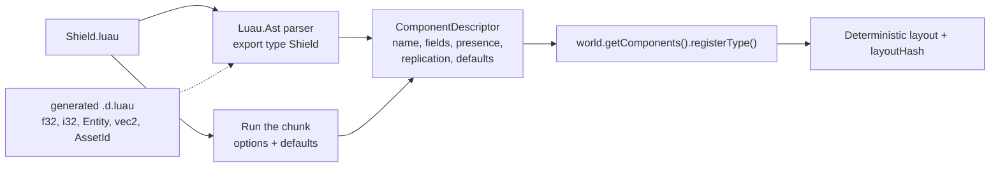

# 19 · Luau Bridge (v2)

## What it is

The bridge is the layer that lets **Luau scripts declare and run game code on the ECS**: components
(as Luau types), systems (as Luau classes), plugins, actors, events, resources, input actions and
entities. It sits between Charles's `rtype-luau` runtime and the ECS's type-erased API, in the engine's
`ScriptPlugin` / `LuauPlugin`.

This doc is the **contract** the ECS offers; the binding code itself belongs to the scripting side
(Charles).

## Why we need it

- **R2:** games are written in Luau first. Everything a C++ plugin can register, a Luau plugin must be
  able to register too.
- **R3:** script components must replicate exactly like C++ ones, so they need a real layout, not
  arbitrary Luau tables.

## How others do it

| Engine | Scripting model |
|---|---|
| Bevy | No official scripting; community crates (`bevy_mod_scripting`) expose reflected components to Lua/Rhai |
| flecs | flecs script (its own language) declares components, entities, prefabs; bindings for many languages |
| Unity | C# `MonoBehaviour` (object model), or DOTS `ISystem` in C# |
| Unreal | Blueprint: classes and structs created in the editor, reflected like C++ ones |
| Roblox | Luau scripts on an object tree (not an ECS) |

## Our choice

- **Components = Luau types**, read from the source with the Luau parser, so they get a fixed binary
  layout.
- **Systems = Luau classes** with declared access.
- **Plugins = Luau modules** with a `build(app)` method.
- Everything goes through the ECS's **type-erased, non-throwing API**; errors come back to Luau through
  `rtype::luau::Result` / `Error`.

## How it works

### Components from types

```luau
-- Shield.luau
export type Shield = {
    strength: f32,
    regen: f32,
    owner: Entity,
}

return ecs.component("game.Shield", {
    replication = "everyChange",          -- or "spawnOnly"; omitted = never sent
    defaults = { strength = 50, regen = 2 },
})
```



- Luau erases types at runtime and has a single `number` type, so the bridge **parses** the file with
  `Luau.Ast` (the parser the compiler already uses, not the full type checker) and maps annotations to
  [`FieldType`s](02-component-registry.md).
- The aliases `f32`, `i32`, `u8`, `Entity`, `vec2`, `AssetId`... are declared in the `.d.luau` file
  produced by Charles's `Runtime::generateTypes()` (`type f32 = number`), so editors accept them.
- **Automatic type linking:** when the file exports exactly one type, or one type whose name matches
  the last part of the component name (`Shield` for `game.Shield`), the bridge links them without a
  `type = "Shield"` option.
- **Fallback** if annotation parsing is not possible: typed defaults (`strength = ecs.f32(50)`).

### Generated declarations for script components

`generateTypes()` is extended to emit declarations for **script-defined** components, resources,
events and actors, after loading the plugins:

```luau
-- generated: game.d.luau
declare class ShieldComponent
    strength: number
    regen: number
    owner: Entity
end

type ComponentName = "rtype.Transform" | "rtype.SpriteRenderer" | "game.Shield" | "game.Health"
type ActorName = "game.Bydo" | "game.Bullet"
```

Editors then autocomplete component fields, and the type checker flags a typo like
`"game.Sheild"` in a query or actor before the game runs.

### Systems

```luau
local ShieldRegen = ecs.system("game.ShieldRegen", {
    phase = "FixedUpdate",             -- default
    side = "server",                   -- default; see the side rule
    query = { write = { "game.Shield" }, without = { "rtype.Dead" } },
    after = { "rtype.movement" },
})

function ShieldRegen:run(ctx)
    for entity, shield in ctx.query do
        shield.strength = math.min(shield.strength + shield.regen * ctx.time.fixedDelta, 100)
    end
end

return ShieldRegen
```

The bridge turns the declaration into a `QueryList` of [dynamic queries](07-queries.md) and adds a
system made from a [`ScriptCallable`](12-systems.md#script-callables): a lambda capturing a handle to `run`,
whose `DynamicQueries` parameter declares the access to the scheduler. `shield` is a **view** over the component bytes, valid only
during `run`; writing a field stamps the changed tick.

### Engine calls

What a plugin does through a C++ API rather than through plain data (load an atlas, bind an input action, play a
sound) is an [engine call](12-systems.md#engine-calls): a named C++ function registered with `App::addCall()`.
Scripts make it by name, with a table of argument fields converted as component fields are (an `assetId` takes a
path):

```luau
local total = engine.call("game.addPoints", { points = 3 })   -- while the script loads

engine.ecs.system("game.Scorer", {
    query = { read = { "game.Ship" } },
    calls = { "game.addPoints" },                              -- declared, like resources and events
    run = function(ctx)
        for entity, ship in ctx.query do
            ctx.call("game.addPoints", { points = 1 })
        end
    end,
})
```

Missing argument fields keep their defaults. A result of one field is returned as that value, a result of several as
a table, and a call that returns nothing returns no value. A system's declared calls add their access to its own, so
the scheduler sees what they read and write, and runs it on the main thread when one of them needs it. Calling a call
the system did not declare raises a Luau error. An unknown call, a wrong argument or a call that throws raises an error
naming the call. An unknown call in `calls` is refused when the script loads, unless the system does not run in that
`App`'s mode: a client system may list a call only the client plugins register.

The engine's plugins register these calls, on the side they are added on (the backend plugin and the plugins it
adds run on clients):

| Plugin | Calls |
|---|---|
| Sprite | `rtype.sprite.loadAtlas`, `rtype.sprite.createAtlas`, `rtype.sprite.addFrame`, `rtype.sprite.addAnimation` ([Sprites](../../Sprites.md#from-scripts)) |
| Backend | `rtype.backend.loadTexture` |
| Text | `rtype.text.loadFont` ([Text](../../Text.md#from-scripts)) |
| Tilemap | `rtype.tilemap.load`, `rtype.tilemap.spawn` ([Tilemaps](../../Tilemap.md#from-scripts)) |
| Particle | `rtype.particle.beginEffect`, `rtype.particle.addBurst`, `rtype.particle.addColorKey`, `rtype.particle.addCurveKey`, `rtype.particle.addEffect` (clients) ([Particles](../../particles/design.md#12-luau)) |
| Audio | `rtype.audio.loadSound`, `rtype.audio.playSound` ([Audio](../../audio/design.md#from-scripts)) |
| Input | `rtype.input.addAction`, `rtype.input.bind`, `rtype.input.bindAxis`, `rtype.input.bindVector`, `rtype.input.read` ([Input](../../Input.md#from-scripts)) |
| Physics | `rtype.physics.raycast`, `rtype.physics.shapeCast`, `rtype.physics.overlap`, `rtype.physics.moveAndSlide`, `rtype.physics.applyForce`, `rtype.physics.applyImpulse`, `rtype.physics.applyTorque`, `rtype.physics.setGravity` ([Physics](../../physics/design.md#from-scripts)) |
| Replication | `rtype.replication.addInput`, `rtype.replication.readInput`, `rtype.replication.localClient` (clients) ([Replication](20-replication.md)) |

### Setup forms

The setup every game writes (its assets and its input actions) has declarative forms under `engine.assets` and
`engine.input`, which make those calls from one table. Each plugin brings its own forms, in Luau
([`Plugins.md`](../../Plugins.md#setup-forms)):

```luau
local ship = engine.assets.atlas({
    name = "game.ship", texture = "assets/ship.png", linear = false,
    grid = { frameSize = { x = 48, y = 48 }, count = 5, spacing = { x = 17, y = 0 } },
    animations = { fly = { frames = { 0, 1, 2, 3, 4 }, frameDuration = 0.08, direction = "pingPong" } },
})
local laser = engine.assets.atlas({
    texture = "assets/laser.png",
    frames = { { name = "shot", position = { x = 108, y = 151 }, size = { x = 80, y = 16 } } },
})
local explosion = engine.assets.atlas({
    path = "assets/explosion.json", animations = { boom = { first = 0, plays = 1 } },
})
local planet = engine.assets.texture("assets/planet.png", { linear = true, wrap = true })
local shot = engine.assets.sound("assets/shot.ogg", { stream = false })
local font = engine.assets.font("assets/fonts/main.json")
local level = engine.assets.tilemap("assets/level.tmj")

engine.input.action("move", "vector2", {
    bind = { { up = "W", down = "S", left = "A", right = "D" }, { x = "GamepadLeftX", y = "GamepadLeftY" } },
})
engine.input.action("steer", "axis", {
    bind = { { negative = "Left", positive = "Right" }, { control = "GamepadLeftX", scale = 1 } },
})
engine.input.action("fire", "button", { bind = { "Space", "GamepadSouth" } })
```

| Form | Calls | Returns |
|---|---|---|
| `engine.assets.texture(path, {linear, wrap})` | `rtype.backend.loadTexture` | the texture's `AssetId` |
| `engine.assets.sound(path, {stream})` | `rtype.audio.loadSound` | the sound's `AssetId` |
| `engine.assets.shader(path)` | `rtype.shader.load` | the shader's `AssetId` |
| `engine.assets.material({name, shader, values, textures})` | `rtype.shader.addMaterial`, then `rtype.shader.setMaterialValue` and `rtype.shader.setMaterialTexture` | the material's `AssetId` |
| `engine.assets.font(path)` | `rtype.text.loadFont` | the font's `AssetId` |
| `engine.assets.tilemap(path)` | `rtype.tilemap.load` | the map's `AssetId` |
| `engine.assets.atlas{path \| texture, name, linear, grid, frames, animations}` | `rtype.sprite.loadAtlas` (a `path`) or `rtype.sprite.createAtlas` (a `texture`, named after it unless `name` is given), then `rtype.sprite.addFrame` per frame and `rtype.sprite.addAnimation` per animation, by name | the atlas's `AssetId` |
| `engine.assets.particle({name, ...})` | `rtype.particle.beginEffect` (every key but the lists), then `rtype.particle.addBurst` per burst, `rtype.particle.addColorKey` per `colorOverLife` key and `rtype.particle.addCurveKey` per `sizeOverLife` and `speedOverLife` key, then `rtype.particle.addEffect` | the effect's `AssetId` |
| `engine.input.action(name, type, {bind})` | `rtype.input.addAction` (`type`: `"button"` by default, `"axis"` or `"vector2"`), then one bind call per binding, in order | nothing |

- An atlas's `grid` takes `frameSize` and `count` (both needed), `spacing`, `columns` and `offset`; a frame takes a
  `position` and a `size`, and an optional `name` (its index otherwise) and `origin` (its centre otherwise). `grid`,
  `frames` and `name` make an atlas from a `texture`, not from a `path`.
- An animation's `frames` lists frame indices (from 0, as `rtype.sprite.addFrame` returns them) that follow each other,
  `{0, 1, 2}`, since an animation is a range of frames; `first` and `count` say the same (`count` 0 or absent: up to the
  last frame). It also takes `frameDuration`, `direction` and `plays` (0: forever).
- A binding is a control name (`rtype.input.bind`), `{control, scale}` (`rtype.input.bind` with a scale),
  `{negative, positive}` (`rtype.input.bindAxis`), `{up, down, left, right}` or `{x, y}` (`rtype.input.bindVector`).

A form checks its whole table on every side: an unknown key, a value of the wrong type or a binding of no known shape
is a Luau error naming the form and the part of it (`engine.assets.atlas: frame 2: 'size': missing 'y'`). Then, when
the App does not have its calls (the plugin is not in this process: on a dedicated server, the backend plugin and the
plugins it adds are not), it skips them and returns the id the asset would have, the hash of its path or name, so the
same script loads on the server and the clients. What only a plugin knows, such as a control name or an animation
direction, is checked where the plugin runs, and a call's error is prefixed with the form's name.

### Plugins

```luau
local RtypePlugin = ecs.plugin("rtype.Game")

function RtypePlugin:build(app)
    app:load("components/Shield.luau")       -- by path: no require() across files
    app:load("systems/ShieldRegen.luau")
    app:addPlugin("scripts/rtype/weapons/plugin.luau")
    app:actor("game.Bydo", { --[[ ... ]] })
    app:state("game.Phase", { "Menu", "Lobby", "Playing", "GameOver" })
    app:event("game.BossDefeated", { type = "BossDefeated" })
    app:resource("game.Score", { type = "Score", replication = "everyChange" })
end

return RtypePlugin
```

Files are loaded **by path** because cross-file `require` is a non-goal of the Luau proposal; it also
gives the bridge every file it must watch for hot reload.

### Input actions from Luau

Gameplay reads `PlayerInput`, which is filled from Ethan's named `InputAction`s. A script declares those actions and
their default bindings with `engine.input.action` (see [Setup forms](#setup-forms)):

```luau
engine.input.action("move", "vector2", { bind = { { up = "W", down = "S", left = "A", right = "D" } } })
engine.input.action("fire", "button", { bind = { "Space", "GamepadSouth" } })
```

The form forwards them to `Input::addAction()` / `InputAction::bind...()` on clients, and, where the replication
plugin is added, declares them in the network `InputLayout` on both sides (`rtype.replication.addInput`), which the
manifest checks. On a client run by the `Engine`, a system (`rtype.engine.networkInput`) copies each of them from
`Input` into the `PlayerInput` sent to the server; a server script reads it by name with
`rtype.replication.readInput`:

```luau
engine.ecs.system("game.Ships", {
    phase = "FixedUpdate",
    query = { write = { "rtype.Transform" }, with = { "net.PlayerInput" } },
    calls = { "rtype.replication.readInput" },
    run = function(ctx)
        for ship, transform in ctx.query do
            local move = ctx.call("rtype.replication.readInput", { entity = ship, action = "move" }).vector
            transform.position = { x = transform.position.x + move.x * 4, y = transform.position.y - move.y * 4 }
        end
    end,
})
```

### Rules of the boundary

| Rule | Why |
|---|---|
| Scripts hold `Entity` values, resolved on every access | Pool pointers move (see [Pool](04-pool.md)); matches the proposal's *Handles* |
| Nothing throws into Luau | The type-erased API returns failures; the bridge raises a Luau error with an `ErrorKind` |
| Component views are only valid during `run` | Same reason as handles |
| Writes to read-only terms are refused | Keeps access sets truthful for the scheduler |
| `client` systems may not write replicated or server-only components, in their query terms or through `ctx.commands` (checked when the side is set and when a command is recorded; `both` systems are not checked) | Replication would overwrite anything else |
| Hot reload re-registers a component only if its `layoutHash` is unchanged | Existing data keeps its meaning |

### Where scripts run

Luau plugins load on the **server and the clients** (both need layouts, actors and input actions).
System sides decide what runs where: `server` (gameplay, default), `client` (presentation), `both`
(identical simulation such as bullet motion). In standalone mode both sides run in one App.

A system is declared on both sides, whatever its side, and only its engine calls may be missing on the side it does not
run on: its components, resources and events must exist there, and the systems it is ordered against too. A script that
names what only one side has (the sprites, the audio, `net.applyInputs`) declares it on that side only, returning early
on the other once its components are declared, as `examples/games/rtype_duel/game/scripts/` does:

```luau
engine.ecs.component("game.Explosion", { fields = {}, presence = "clientOnly" }) -- on both sides
if not engine.isClient then
    return
end
engine.ecs.system("game.RemoveExplosions", { side = "client", ... })
```

## Connections

- Uses: [Component registry](02-component-registry.md), [Queries](07-queries.md),
  [Systems](12-systems.md), [Commands](09-commands.md), [Events](11-events.md),
  [Resources](10-resources.md), [Actors](18-actors-and-scenes.md), [Reflection](15-reflection-and-serialization.md),
  [App and plugins](14-app-and-plugins.md).
- External: Charles's `rtype::luau::Runtime`, `Result`, `Error`, `generateTypes()`; Ethan's `Input` /
  `InputAction`.

## Pitfalls

- **Per-entity overhead.** Each `run` crosses the C++/Luau boundary; iterating thousands of entities in
  Luau every tick (bullets) can be too slow. That is where a C++ game plugin takes over (collisions,
  bullet motion).
- **Table-per-entity temptation.** Storing arbitrary Luau tables on entities would bypass queries,
  replication and the data/logic split; not supported.
- **Layout drift.** Server and client running different script versions are caught by `layoutHash` at
  connection.

## Open questions

- Can the `luau` xmake package expose `Luau.Ast`? If not, use the typed-defaults fallback. (Charles)
- Exact list of aliases emitted by `generateTypes()`. (Charles + ECS)
- Hot reload in development: migrate component data by field name when the layout changes? (ECS)
