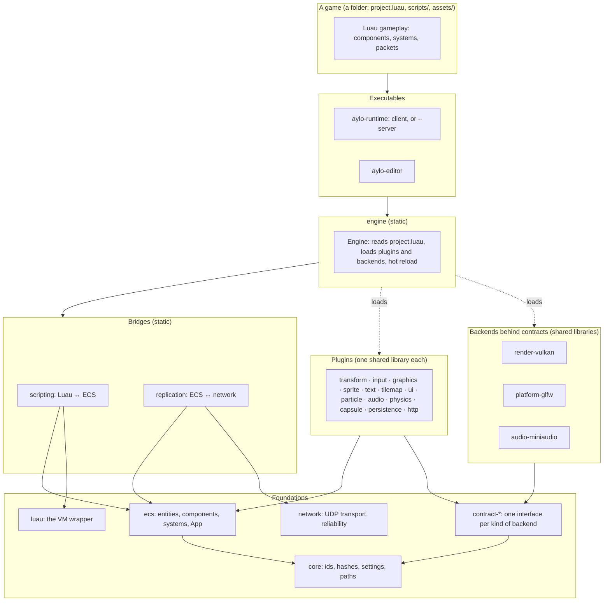

# AYLO Engine: developer documentation

For people who work **on the engine**, in C++. To make a game with it, in Luau, read the
[game developer manual](https://charles-mahoudeau.github.io/rtype/) instead.

## The architecture in one picture

The engine is a stack of layers. Each layer only knows the layers below it; a game sits on top and is only data and
Luau scripts.

- **Rendering**, **networking** and **game logic** never meet directly: rendering is a backend behind a contract, the
  network knows no ECS, and gameplay is ECS systems written in Luau.
- **Plugins** carry the engine's features. A game lists the ones it needs, by name, in `project.luau`.
- **The server** runs the same engine and plugins without any backend: no window, no GPU, no audio.

## Where to start

| You want to | Read |
|---|---|
| Know the modules and their rules | [Modules](Modules.md), [Plugins](Plugins.md), [Backends](Backend.md) |
| Understand the ECS | [ECS design](ecs/design.md) and its [feature pages](ecs/features/README.md) |
| Understand the network | [Overview](network/overview.md), then [design](network/design.md); the wire format is the [protocol](network/protocol.md) |
| See how a game is run | [Engine design](engine/design.md), [scripting plan](scripting/plan.md) |
| Know why we chose a library | [Technical and comparative study](study/index.md) |
| Contribute | [Contributing](https://github.com/Charles-Mahoudeau/rtype/blob/main/CONTRIBUTING.md), [Code style](CodeStyle.md) |

## How to

| Task | Page |
|---|---|
| Build, run, test | [README](https://github.com/Charles-Mahoudeau/rtype#build-and-run) |
| Add a plugin, a component, an engine call | [Plugins](Plugins.md), and the skills in `.agents/skills/` (`add-plugin`, `add-component`, `add-engine-call`) |
| Write a game's native plugin | [Plugins: writing a game's plugin](Plugins.md#writing-a-games-plugin) |
| Debug the GPU | [GPU debugging](gpu-debugging.md) |
| Release the engine | [Release](release/README.md) |
| Make the engine accessible | [Accessibility](Accessibility.md) |
