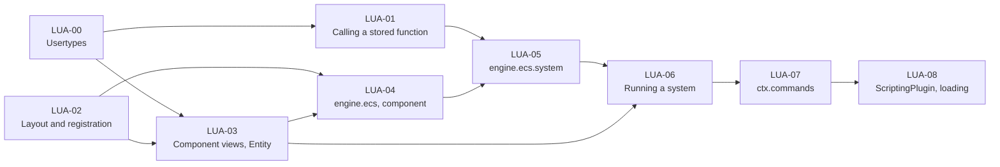

# Luau ECS Bridge: plan for a first version

Goal: **a game developer writes components and systems in Luau, and they run on the ECS** (`App`, `World`, scheduler),
on the server and the clients. Everything else of
[`docs/ecs/features/19-luau-bridge.md`](../ecs/features/19-luau-bridge.md) (prefabs, states, hot reload, side checks,
replication of script components) comes after.

Based on the code of 2026-10-29 (branch `refactor/engine/luau-settings-registry`). Every snippet is a
recommendation, not an obligation.

## 1. Decisions of this plan

| # | Decision | Why |
|---|---|---|
| D1 | **No AST parsing.** A component is described by a plain Luau table of field types (`fields = { strength = "f32" }`), read at runtime. The `export type` and the generated `.d.luau` are not needed to run. | Decided by the team. Cheapest way to get a real layout. |
| D2 | **The bridge is its own library**, the `scripting` target (`src/rtype/scripting/`, `rtype-scripting`, namespace `rtype::scripting`), depending on `core`, `ecs` and `luau`. It holds the bridge itself (`ScriptHost`: runtime, layout, usertypes, the `engine.ecs` Luau library, registration on an `App`) and, in `plugin/`, a thin `ScriptingPlugin` (an `ecs::Plugin`) that calls it from `build()`. The executable (or `engine`) adds the plugin. Not to be confused with the Luau plugins of LUA-10 (`engine.ecs.plugin`), which are Luau modules. `luau` stays free of the ECS, and `plugins` never depends on `luau`. `SettingsLoader` stays in `engine`. | `plugins/` cannot depend on `luau` (dependency rules), and `engine` should not grow the bridge. `CLAUDE.md` gets one line for the new target. |
| D3 | **Usertypes are implemented** in `rtype-luau` (LUA-00). A system receives each component as a **userdata view** that reads and writes the component bytes in place. | Removes the table copies and the write-back. A view is only valid during the `run` that received it (see D9): a late access raises a Luau error. |
| D4 | **`Entity` is a userdata handle** (`__eq`, `__tostring`, usable as a table key through its bits). | No 53-bit limit; scripts hold handles, not pointers. |
| D5 | **Systems are `ScriptCallable`s** holding a `luau::FunctionRef`, using `DynamicQueries` and `Commands&` as parameters. | That is exactly what `ScriptCallable` was made for. |
| D6 | **Files are loaded by the bridge, not with `require`.** For now it scans `game/scripts/**.luau` and loads every file in sorted path order. A `scripts` list in the project settings can replace the scan later. | `require` is a non-goal of the Luau proposal. Sorted order makes the load order the same on every machine. |
| D7 | **A system declares `run` as a field** of its declaration table (`run = function(ctx) ... end`). | One registration step, and errors point at the faulty call. A method form (`function Sys:run(ctx)`) would need the registration to wait for the end of the chunk; it can be added later as sugar. |
| D8 | **A Luau error in `run` is logged and the system is skipped for that tick.** The app keeps running. | One broken script must not take the game down. |
| D9 | **Views are validated by a generation counter.** Each script system owns a heap-allocated `ViewScope { generation }`; a view stores the scope and the generation it was created with, and the bridge increments the generation when `run` returns. A script must not keep a view; keeping an `Entity` across ticks is allowed. | No allocation per call, correct when the callable is moved. Views of earlier matches stay valid until `run` ends, because structural changes are deferred in `Commands`. |

## 2. What a script looks like (target of the first version)

```luau
-- game/scripts/components/Shield.luau
local ecs = engine.ecs

ecs.component("game.Shield", {
    fields = { strength = "f32", regen = "f32" },
    defaults = { strength = 50, regen = 2 },
})
```

```luau
-- game/scripts/components/Bullet.luau
local ecs = engine.ecs

ecs.component("game.Bullet", {
    fields = { owner = "entity", damage = "f32" },
    defaults = { damage = 10 },
})
```

```luau
-- game/scripts/systems/ShieldRegen.luau
local ecs = engine.ecs

ecs.system("game.ShieldRegen", {
    phase = "FixedUpdate",
    query = { write = { "game.Shield" }, without = { "rtype.Dead" } },
    after = { "rtype.movement" },
    run = function(ctx)
        for entity, shield in ctx.query do
            shield.strength = math.min(shield.strength + shield.regen * ctx.fixedDelta, 100)
        end
    end,
})
```

The scripts see one global, `engine` (as `project.luau` does: `engine.isClient`, `engine.isDebug`), and the bridge's
library is `engine.ecs`; `local ecs = engine.ecs` is only a shortcut. `ecs.component` and `ecs.system` are statements
that register on the `App`: the file returns nothing, because the bridge loads the files itself and no file uses
another one's return value. A later version can make them return a typed handle without breaking these scripts.

`run` is a field of the declaration table instead of a method (`function ShieldRegen:run`), because a plain table
needs no class machinery. The method form can be sugar on top later.

Supported in the first version:

- **Field types**: `bool`, `i8`..`i64`, `u8`..`u64`, `f32`, `f64`, `entity` (every `ecs::FieldType` except the vectors
  and `AssetId`). `vec2`/`vec3`/`vec4` and `assetId` are LUA-09.
- **Query terms**: `read`, `write`, `optionalRead`, `optionalWrite`, `with`, `without` (all exist in `QueryBuilder`).
  `added`/`changed` are LUA-09.
- **Phases**: all of `ecs::Phase`.
- **`ctx`**: `query` (iteration), `commands` (`spawn`, `despawn`, `add`), `fixedDelta`, `delta`.
- Scripts can read components declared in C++ (they are in the registry), as long as their fields use the types above.

## 3. Starting point

| Part | State |
|---|---|
| `ecs`: `Components::registerType(ComponentInfo)`, `QueryBuilder`, `DynamicQueries`, `QueryMatch::get/getMut`, `Commands::spawn/add(entity, id, bytes)/despawn`, `ScriptCallable`, `App::addSystem(..., QueryList)` | Done. Used by `examples/ecs/EcsRuntimeComponents` and `EcsScriptSystems`. |
| `luau`: `Runtime`, `Script`, `Table` (get/set/entries/metatable), `Value`, `Function` (native), `FunctionRef`, `Library`/`LibraryBuilder`, `Result` | Done. |
| `luau`: userdata | **Missing**: no `Value` alternative, no usertype builder (LUA-00). |
| `luau`: calling a stored Luau function from C++ | `FunctionRef`/`Function::call(ValuePack)` exist; LUA-01 checks it with the arguments the bridge needs. |
| `ecs`: layout computation from a field list | **Not in the ECS**: `registerType` expects offsets and size already set. The bridge computes them (LUA-02). |
| `engine`: `Engine` (holds an `App`), `SettingsLoader` | `Engine` does not run anything yet. The `scripting` target does not exist. |

## 4. Tasks

Each task is one issue and one pull request. Ids `LUA-xx`. Tests go in `tests/scripting/` (bridge) or `tests/luau/`
(runtime), as a separate `test(...)` commit.

### M1: first version

#### LUA-00: Usertypes

| | |
|---|---|
| Module | `luau` |
| Blocked by | none |

**Goal.** Let C++ expose its own types to Luau as userdata, with fields and methods.

**What to build**
- `Value::Userdata`: a handle on a userdata of the state, like `Table` and `FunctionRef`.
- A `Usertype<T>` builder with:
  - a name;
  - an optional constructor;
  - getters and setters by field name;
  - methods;
  - `__eq` and `__tostring`.
- An argument check that raises a Luau error (not a crash) when a method receives the wrong type.
- Tagged userdata with a destructor; each type is registered once per runtime.

**Done when**
- [ ] A test exposes a C++ struct with a getter, a setter and a method, and reads and writes it from a script.
- [ ] A method called with another userdata or `nil` raises a Luau error.
- [ ] The destructor runs when the state is closed.
- [ ] Two userdata compare equal when `__eq` says so.

#### LUA-01: Calling a stored function

| | |
|---|---|
| Module | `luau` |
| Blocked by | LUA-00 |

**Goal.** Make sure the bridge can keep a Luau function for the whole game and call it every tick.

**What to build** (check what exists first, add only what is missing)
- Call a stored `FunctionRef` from C++ with a userdata and a number as arguments.
- Return its error as a `Result`, with the script name and the line.
- Keep the `FunctionRef` alive across frames.
- A native function that returns an iterator, for `for ... in ctx.query do`.

**Done when**
- [ ] A test calls a Luau function stored in a table with a userdata argument.
- [ ] An error raised by that function comes back as a `Result` error with the script name and the line.
- [ ] A `for ... in` loop over a native iterator works in a script.

#### LUA-02: Component layout and registration

| | |
|---|---|
| Module | `scripting` (the sources only; the target is created by LUA-04) |
| Blocked by | none |

**Goal.** Turn a list of typed fields into a registered component with a deterministic layout.

**What to build**
- `ComponentDeclaration`: name, fields (`{name, FieldType}`), defaults as bytes, replication mode.
- `registerComponent(Components&, ComponentDeclaration)`:
  - sorts the fields by alignment, then by name;
  - computes the offsets, the size and the alignment;
  - calls `Components::registerType`.
- Errors come back as a `Result`: unknown field type, duplicate field, same name registered with another layout
  (`kLayoutMismatch`).

**Done when**
- [ ] `game.Bullet` (`owner: entity`, `damage: f32`) has size 16 and alignment 8, with `owner` first (alignment sorting
      and the `entity` type).
- [ ] `game.Shield` (`strength: f32`, `regen: f32`) has size 8 and alignment 4, with `regen` before `strength` (same
      alignment, sorted by name).
- [ ] Registering the same description twice returns the same id.
- [ ] A different layout under the same name is refused.

#### LUA-03: Component views and `Entity`

| | |
|---|---|
| Module | `scripting` |
| Blocked by | LUA-00, LUA-02 |

**Goal.** Let a script read and write a component's fields in place.

**What to build**
- A `ComponentView` usertype over `(const ComponentInfo*, span<std::byte>, ViewScope*, generation, read-only)`:
  - `__index` and `__newindex` read and write a field by name, straight in the bytes, according to its `FieldType`;
  - integers are range-checked;
  - `nil`, a wrong type or an unknown field is an error, never a silent default.
- A read-only view, for read terms, that refuses writes.
- `ViewScope { std::uint64_t generation; }`, one per script system, heap-allocated and owned by its `ScriptCallable`.
  A view stores the scope and the generation it was created with, and every access checks that they still match.
- The `Entity` usertype.
- The conversion from a Lua table to bytes, used for defaults and `spawn` tables.

**Done when**
- [ ] A round trip works for every supported `FieldType`.
- [ ] `i8` given `300` reports an error that names the field.
- [ ] After the scope's generation is incremented, any access to an older view raises an error.
- [ ] Writing through a read-only view raises an error.

#### LUA-04: The `scripting` target, `ScriptHost` and `engine.ecs.component`

| | |
|---|---|
| Module | `scripting` |
| Blocked by | LUA-02, LUA-03 |

**Goal.** A script can declare a component.

**What to build**
- The `scripting` target: `xmake.lua`, `Export.hpp` (`RTYPE_SCRIPTING_API`), `tests/scripting/`, and its line in the
  dependency rules of `CLAUDE.md`.
- `ScriptHost`: knows no `Plugin`, can be used and tested with a bare `App`. It owns the `Runtime` and builds the
  `engine` global (with `engine.isClient` and the other flags) and its `ecs` library with `LibraryBuilder`.
- `engine.ecs.component(name, {fields, defaults, replication})`, a statement that returns nothing:
  - registers the component;
  - applies the defaults over zeroed bytes (the value used when a field is omitted by `Commands::add` and by
    `spawn` tables).

**Done when**
- [ ] A script declares `game.Shield`.
- [ ] A C++ test finds it by name in `World::getComponents()` with the right fields.

#### LUA-05: `engine.ecs.system`, from declaration to registered system

| | |
|---|---|
| Module | `scripting` |
| Blocked by | LUA-04, LUA-01 |

**Goal.** A script can declare a system, and the scheduler knows it.

**What to build**
- Read `{phase, query, after, before, run}` from the declaration table.
- Turn `query` into a `QueryBuilder` and a `QueryList`.
- Call `app.addSystem(phase, name, ScriptCallable{...}, queryList)` with `.after()` and `.before()`.
- Report every error (unknown component or phase, missing `run`) as a `Result`; the loader turns it into one
  exception with the script name and the message.

**Done when**
- [ ] A script system is listed in the scheduler under its name, with the access set of its terms.
- [ ] An unknown component name is refused when the script loads.

#### LUA-06: Running a system

| | |
|---|---|
| Module | `scripting` |
| Blocked by | LUA-05, LUA-03 |

**Goal.** The `ShieldRegen` example runs on every tick.

**What to build**
- The body of the `ScriptCallable`: call `run` once with a `ctx` whose `query` iterator yields
  `(entity, view...)` for each match, in the order of the declared terms (read-only views for read terms).
- Increment the system's `ViewScope::generation` when `run` returns, which kills every view of the call.
- Error policy (decided): a Luau error in `run` is logged (system name and script location) and the system is skipped
  for that tick; the app keeps running.
- `ctx.fixedDelta` and `ctx.delta`.

**Done when**
- [ ] The `ShieldRegen` example above raises `strength` on every FixedUpdate tick, in a test.
- [ ] An entity with `rtype.Dead` is skipped by the `without` term.
- [ ] An error in `run` is logged once per tick and the other systems keep running.

#### LUA-07: `ctx.commands`

| | |
|---|---|
| Module | `scripting` |
| Blocked by | LUA-06 |

**Goal.** A script can create and destroy entities.

**What to build**
- `commands:spawn({ ["game.Shield"] = { strength = 10 }, ... })`: returns the reserved `Entity`.
- `commands:add(entity, "game.Shield", {...})`.
- `commands:despawn(entity)`.
- Component values are built with the LUA-03 conversion, over the defaults.

**Done when**
- [ ] A spawner system creates entities that a second system sees in the next phase.
- [ ] Spawning with an unknown component reports an error.
- [ ] Despawning a stale entity does nothing, as in C++.

#### LUA-08: `ScriptingPlugin` and loading by path

| | |
|---|---|
| Module | `scripting` (`plugin/`), `engine`, an example |
| Blocked by | LUA-07 |

**Goal.** A game starts with its Luau files and runs them.

**What to build**
- `ScriptingPlugin` (`scripting/plugin/ScriptingPlugin.hpp`, an `ecs::Plugin`, a few lines): owns a `ScriptHost`,
  calls it from `build()`.
- For now, scan `game/scripts/**.luau` and load every file found, in sorted path order (so the order is the same on
  every machine). A `scripts` list in the project settings can replace it later.
- The executable or `Engine` adds the plugin. The same files load on the server and on the clients; skipping systems
  by side comes later (LUA-12).
- An example: `rtype_duel`, or a new small `examples/luau/LuauShield`.

**Done when**
- [ ] The example runs a Luau component and a Luau system loaded from files, with `xmake run`.

### M2: after the first version (draft, not reviewed)

| Id | Content |
|---|---|
| LUA-09 | `vec2/3/4` and `assetId` fields, `added` / `changed` terms, events (`ctx.events`), resources (`ctx.resources["rtype.Input"]`), `ctx.time` as a table. |
| LUA-10 | `engine.ecs.plugin` with `build(app)` and nested plugins. |
| LUA-11 | Prefabs and states (depend on ECS features 18 and 13 v2). |
| LUA-12 | `side = "server" \| "client" \| "both"`, with the check that a client system only writes client-only components. |
| LUA-13 | Replication of script components: the manifest already uses `layoutHash`, and the deterministic layout of LUA-02 makes both sides agree. |

## 5. Later

- **Hot reload**: reloading a file keeps a component if its `layoutHash` is unchanged; systems can always be replaced.
- **`generateTypes()`**: still useful for editor completion (`.d.luau` of the `ecs` library and of the components), but
  nothing depends on it now that there is no AST parsing.

## 6. Task graph



Two people can work in parallel from the start: LUA-00/01 (runtime) alongside LUA-02 (layout). LUA-03 needs both.
The first version is LUA-00 to LUA-08.
