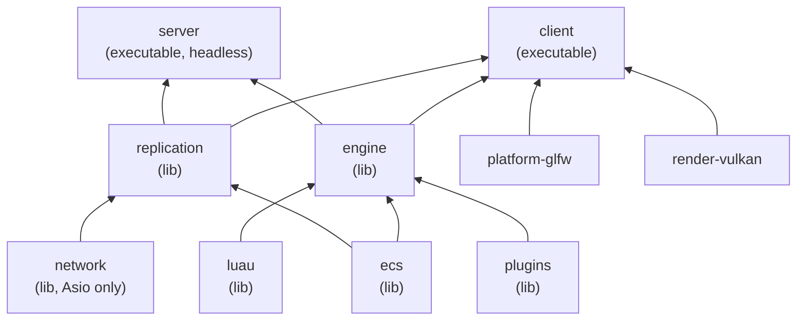
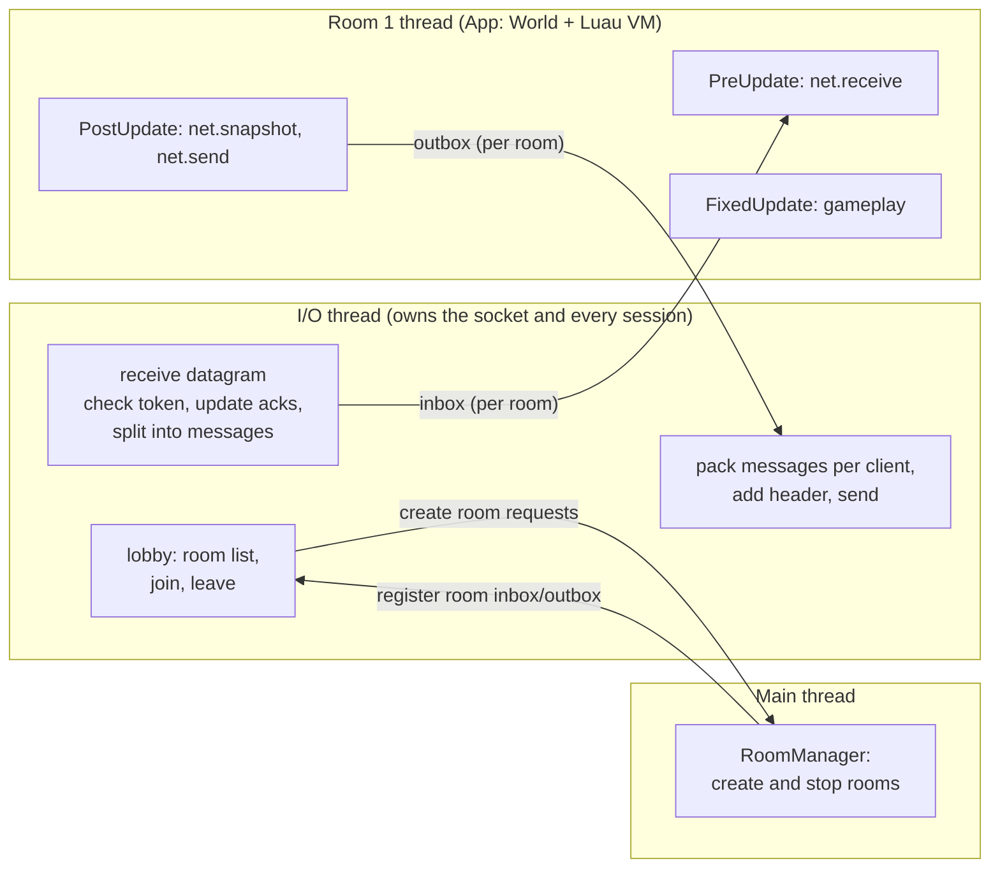
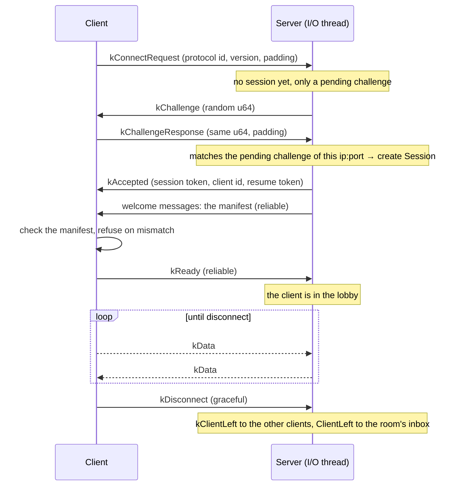
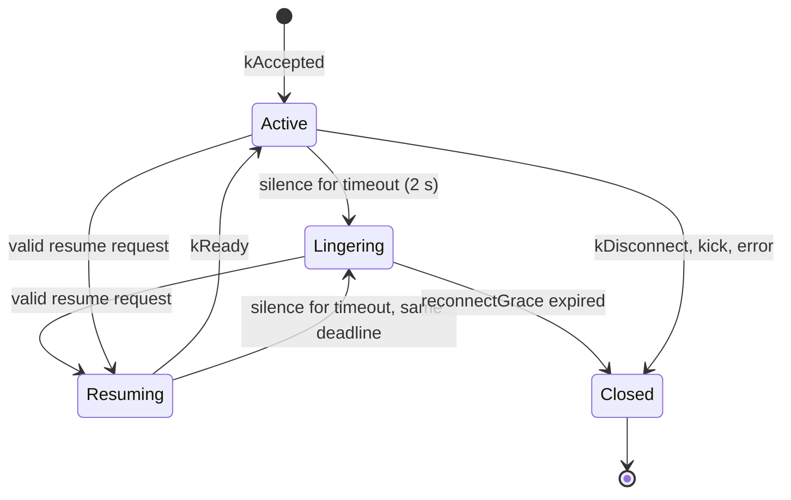

# Network Design

This document specifies the network of the R-Type engine: the transport library (`rtype-network`), the
replication library that connects it to the ECS (`rtype-replication`), and the `client` and `server`
executables. Nothing here is implemented yet. For a shorter first read, see [`overview.md`](overview.md).

It builds on the ECS design, which already decides *what* is replicated and *why*:
[`../ecs/design.md`](../ecs/design.md#networking) and
[`../ecs/features/20-replication.md`](../ecs/features/20-replication.md) (inputs up, state down, replication
modes, manifest), [`08-change-detection.md`](../ecs/features/08-change-detection.md) (change ticks) and
[`15-reflection-and-serialization.md`](../ecs/features/15-reflection-and-serialization.md) (`FieldInfo`). This
document decides *how*: the wire format, reliability, connections, threads and robustness. Where it changes
something the ECS docs say, the change is listed in [Differences with the ECS docs](#13-differences-with-the-ecs-docs).

> Snippets omit the Epitech header, the rule-of-five members and most `[[nodiscard]]`/`noexcept` for brevity.
> The real code follows every rule in `CLAUDE.md`.

## Contents

1. [Requirements](#1-requirements)
2. [Principles](#2-principles)
3. [Targets and dependencies](#3-targets-and-dependencies)
4. [Topology and run modes](#4-topology-and-run-modes)
5. [Threads](#5-threads)
6. [Transport: `rtype-network`](#6-transport-rtype-network)
7. [Replication: `rtype-replication`](#7-replication-rtype-replication)
8. [Custom packets](#8-custom-packets)
9. [Lobby and rooms](#9-lobby-and-rooms)
10. [Robustness and security](#10-robustness-and-security)
11. [Bandwidth estimate](#11-bandwidth-estimate)
12. [Testing](#12-testing)
13. [Differences with the ECS docs](#13-differences-with-the-ecs-docs)
14. [Pitfalls](#14-pitfalls)
15. [Build order](#15-build-order)
16. [Decisions and open questions](#16-decisions-and-open-questions)
17. [References](#17-references)

## 1. Requirements

| # | Requirement | Source | Met by |
|---|---|---|---|
| N1 | The server notifies every client when a monster spawns, moves, is destroyed, fires, kills a player, and of the other clients' actions | Subject | [Snapshots](#74-snapshots-server--client) (spawns, updates, despawns; a shot is a bullet spawn) and [custom packets](#8-custom-packets) (`PlayerKilled`...) |
| N2 | The server is multithreaded: it never blocks or waits for client messages, the game runs frame after frame regardless of clients | Subject | One I/O thread plus one thread per room; rooms never wait on the network ([Threads](#5-threads)) |
| N3 | If a client crashes, the server keeps working and notifies the other clients of the same game | Subject | Timeouts, a grace period before removal, `kClientLeft` broadcast, `ClientDisconnected` event ([Connection lifecycle](#63-connection-lifecycle), [6.8](#68-reconnecting-after-a-connection-loss)) |
| N4 | The server is robust: it keeps running whatever goes wrong | Subject | [Robustness and security](#10-robustness-and-security) |
| N5 | Networking uses Asio or the OS socket API | Subject | Standalone Asio; the reliability layer is written in-house (ENet and similar libraries are not allowed) |
| N6 | Authoritative server, inputs up, state down, with client prediction and server reconciliation for the local player | ECS R3, changed ([13](#13-differences-with-the-ecs-docs)) | The whole design; [7.6](#76-client-prediction-and-reconciliation) |
| N7 | Builds and runs on Linux, macOS and Windows with Clang, Apple Clang and MSVC | `CLAUDE.md` | No compiler extensions; [Windows pitfall](#windows-connection_reset) handled |
| N8 | A client that loses its connection for a short time (lost wifi, network change) can rejoin the game in progress, with fresh session credentials | Design review | Lingering sessions and resume tokens ([6.8](#68-reconnecting-after-a-connection-loss)); the game decides what happens meanwhile |

## 2. Principles

- **The server decides, clients display.** Clients send input states (buttons and axes) and permitted
  intentions (custom packets), never authoritative world state. The server never trusts what a client sends
  beyond that. The client may *predict* the result of its own inputs to feel instant, but the server's state
  always wins ([7.6](#76-client-prediction-and-reconciliation)).
- **The transport knows nothing about the ECS.** `rtype-network` moves bytes and messages between endpoints.
  Only `rtype-replication` knows both sides.
- **One owner per piece of data.** Every variable is written by exactly one thread. Threads talk through
  queues, never through shared variables.
- **Send states, not differences.** A snapshot says "health is 40", never "health lost 10". Receiving a state
  twice is harmless, so lost packets are repaired by sending the current state again, never by resending
  old packets.
- **Never trust the network.** Every byte read from a socket is checked. A bad packet is dropped; it never
  crashes, throws or asserts.
- **Names are the identity, short ids are the wire.** Components, packets, prefabs and input actions are
  identified by name. The server sends a manifest (name, hash, short id) at connection; the wire then uses
  the 2-byte short ids.

## 3. Targets and dependencies



An arrow means "is used by".

| Target | Kind | Folder / namespace | Contains | Depends on |
|---|---|---|---|---|
| `network` | shared library (`rtype-network`) | `src/rtype/network/`, `rtype::network` | UDP socket and I/O thread, handshake and sessions, sequence numbers and acks, reliable channel, message packing, `ByteWriter` / `ByteReader`, lobby routing | Asio only. No ECS, no engine. |
| `replication` | shared library (`rtype-replication`) | `src/rtype/replication/`, `rtype::replication` | `ReplicationPlugin` (shared types, `InputLayout`), `ServerPlugin` / `ClientPlugin` and their systems, `NetworkId` / `Owner` / `PlayerInput` / `Interpolated`, manifest, snapshot writer and reader, per-client ack bookkeeping, input buffers, custom packet registry | `ecs`, `network` |
| `engine` | library (today the executable) | `src/rtype/engine/` | The engine shared by both executables | `plugins`, `ecs`, `luau` |
| `client` | executable | | The game with a window. Can also host a game ([listen server](#4-topology-and-run-modes)). | `engine`, `replication`, `platform-glfw`, `render-vulkan` |
| `server` | executable, headless | | The dedicated server | `engine`, `replication`. **Never** `platform-glfw` or `render-vulkan`, so it starts on a machine with no display or GPU. |

Rules, in the spirit of the existing dependency rules:

- `network` and `ecs` never include each other's headers. The glue lives in `replication`.
- `network` is declared with `add_requires("asio 1.36.x")` in its own `xmake.lua`. Exported symbols use
  `RTYPE_NETWORK_API` / `RTYPE_REPLICATION_API`, like `ecs` and `luau`: both libraries are shared for now (they
  can be switched to static later, as `ecs` allows).
- The Luau `net` bindings (`net.packet`, `ctx.net`) live in the engine's Luau plugin, which depends on `luau` and
  `replication`. `luau` and `replication` never include each other's headers.
- No header outside `network/` includes `<asio.hpp>`, just as GLFW never leaves `platform/glfw/`.
- Tests: `tests/network/` (`network-tests`) and `tests/replication/` (`replication-tests`).

## 4. Topology and run modes

**Authoritative client-server over UDP.** Peer-to-peer is rejected because it needs deterministic lockstep
(floating-point and Luau differences desynchronize peers, and one slow peer freezes everyone) or rollback
(rewinding the Luau VMs), and it fails behind strict NATs. TCP is rejected for gameplay because one lost
packet blocks everything behind it until it is resent (head-of-line blocking), which shows as freezes.

| Mode | Process | Network |
|---|---|---|
| Dedicated server | `server` | Binds one UDP port (default `4242`) and hosts every room. |
| Client | `client` | Connects to a server. |
| Listen server ("Host" button) | `client` | Starts a **server thread inside the client process**: the same server code, with its own rooms, worlds and Luau VMs, bound on `0.0.0.0`. The client connects to `127.0.0.1` like any other player; friends connect to the host's IP. Closing the game stops and joins that thread. |
| Standalone (single player) | `client` | No network at all: the ECS `StandalonePlugin` runs server and client systems in one world. |

The listen server runs in a thread rather than a child process: there is no executable to locate, no
per-OS process API (`CreateProcess`, `posix_spawn`), and no orphaned server left running if the client
crashes. It works because the ECS keeps no global state and each `luau::Runtime` owns its own `lua_State`.

### Configuration

Nothing below is hardcoded. Every tunable value is a field of a `NetworkSettings` struct (in `network` for the
transport values, in `replication` for the others), filled from the executable's command line or config file and
passed to the `RoomManager` and the I/O thread. The values written in this document are only the defaults.

| Setting | Default | Where it is used |
|---|---|---|
| `snapshotRate` | 60 Hz, a divisor of the tick rate (60, 30, 20...) | A room sends a snapshot every `tickRate / snapshotRate` ticks ([7.4](#74-snapshots-server--client)) |
| `maxPlayersPerRoom` | 4 | Room capacity in `kRoomList` and `kJoinRoom` ([9](#9-lobby-and-rooms)) |
| `maxRooms` | 16 | `kMaxRooms`, `kTooManyRooms` |
| `maxClients` | 64 | Sessions (lingering ones included), `kServerFull` |
| `port` | 4242 | The server's UDP port |
| `timeout`, `keepalive`, `resendInterval` | 2 s, 100 ms, `max(1.25 × RTT, 50 ms)` | [6.3](#63-connection-lifecycle), [6.5](#65-messages-and-channels) |
| `reconnectGrace` | 60 s, `0` disables reconnection | How long a lost session waits for its client ([6.8](#68-reconnecting-after-a-connection-loss)) |
| Rate limits and error budgets | see [10](#10-robustness-and-security) | Per-session limits |

The client learns the `snapshotRate` from the server (it is sent with the manifest), so interpolation always
uses the rate in force. The default values are tuned later from benchmarks ([12](#12-testing)).

## 5. Threads

### Server



| Thread | Owns | Never touches |
|---|---|---|
| I/O thread (one) | The socket, every `Session` (endpoint, token, sequences, acks, reliable queues, RTT, room id), the room table | Any `World`, any `lua_State` |
| Room thread (one per room) | That room's `App`: `World`, schedule, Luau `Runtime`, replication state | The socket, sessions, other rooms |
| Main thread | The `RoomManager`: creates rooms and their threads, joins them, handles shutdown signals | Sessions, worlds |

The `RoomManager` lives in `replication`, so the listen server reuses it. The executable gives it a factory
that builds a room's `App` with the game's plugins.

- **Rooms only see messages.** A room never sees sequence numbers, acks or datagrams. It receives
  `ClientJoined`, `ClientLost`, `ClientReconnected`, `ClientLeft` and `Message{client, channel, bytes}` from its
  inbox, and pushes
  `Send{client or everyone, channel, bytes}` and `Kick{client, reason}` into its outbox.
- **The lobby runs on the I/O thread**, because it changes `Session::roomId`, which the I/O thread reads to
  route every packet.
- **Queues are a `std::mutex` and a `std::vector`.** Once per tick the room locks, swaps the vector with an
  empty one and unlocks; the lock is held for nanoseconds. After pushing to its outbox, a room posts a flush
  to the I/O thread's `asio::io_context`, so its packets leave right away. Lock-free queues are not worth
  their complexity at 60 Hz with a few clients.
- **One thread per room** means a slow Luau script in one room cannot slow down another. The number of rooms
  is capped (`kMaxRooms`).
- **Each room is its own `App`** with its own schedule, running a fixed 60 Hz loop.

### Client

The client has **no network thread**. At the start of every frame (`PreUpdate`), `net.receive` calls
`io_context::poll()`, which handles the datagrams that arrived and the due resends, then returns at once.
At 30 frames per second or more, that is often enough for acks and resends. A listen server's server part
still has its own I/O and room threads.

### Two different ticks

- The **server tick** counts fixed updates (60 per second). It numbers snapshots.
- The ECS **`Tick`** ([`change/Tick.hpp`](../../src/rtype/ecs/change/Tick.hpp)) counts system runs. It stamps
  component changes.

When the server sends the snapshot of server tick 101, it records the ECS tick of that moment (say 5432).
"Changed since this snapshot" then means "change tick greater than 5432".

## 6. Transport: `rtype-network`

### 6.1 Bytes on the wire

- **Little-endian everywhere**, written byte by byte with shifts, so the result does not depend on the
  machine.
- **No serialization library.** Replication writes type-erased component bytes field by field from
  `FieldInfo`, which a compile-time serializer cannot do, and it needs quantization later. A small writer and
  reader cover every need:

```c++
namespace rtype::network {
/// @brief Writes little-endian values into a fixed buffer. Once a write overflows, it is invalid for good.
class ByteWriter {
  public:
    explicit ByteWriter(std::span<std::byte> buffer) noexcept;

    void writeU8(std::uint8_t value) noexcept;
    void writeU16(std::uint16_t value) noexcept;
    void writeU32(std::uint32_t value) noexcept;
    void writeU64(std::uint64_t value) noexcept;
    void writeF32(float value) noexcept;  // std::bit_cast<std::uint32_t>(value)
    void writeBytes(std::span<const std::byte> bytes) noexcept;

    [[nodiscard]] bool isValid() const noexcept;
    [[nodiscard]] std::size_t getSize() const noexcept;
};

/// @brief Reads little-endian values. Reading past the end returns 0 and makes the reader invalid for good.
class ByteReader {
  public:
    explicit ByteReader(std::span<const std::byte> data) noexcept;

    [[nodiscard]] std::uint8_t readU8() noexcept;
    [[nodiscard]] std::uint16_t readU16() noexcept;
    // ... same types as ByteWriter

    [[nodiscard]] bool isValid() const noexcept;
    [[nodiscard]] std::size_t getRemaining() const noexcept;
};
}  // namespace rtype::network
```

A parser reads every field, then checks `isValid()` once. A truncated packet can never read out of bounds.

### 6.2 Packets

Every datagram starts with a **packet kind** byte.

| Value | Kind | Direction | Content after the kind byte |
|---|---|---|---|
| `0x01` | `kConnectRequest` | C → S | protocol id `u32` (`0x52545950`, "RTYP"), protocol version `u16`, resume client id `u32` and resume token `u64` (both 0 for a new connection, [6.8](#68-reconnecting-after-a-connection-loss)), zero padding up to 64 bytes in total |
| `0x02` | `kChallenge` | S → C | challenge `u64` |
| `0x03` | `kChallengeResponse` | C → S | challenge `u64`, zero padding up to 64 bytes in total |
| `0x04` | `kAccepted` | S → C | session token `u32`, client id `u32`, resume token `u64` |
| `0x05` | `kRejected` | S → C | reason `u8` (`kVersionMismatch`, `kServerFull`, `kSessionExpired`) |
| `0x06` | `kData` | both | session token `u32`, sequence `u16`, ack `u16`, ack bits `u32`, then messages ([6.5](#65-messages-and-channels)) |
| `0x07` | `kDisconnect` | both | session token `u32`, reason `u8` |

The `kData` header is 13 bytes. Limits:

| Constant | Value | Why |
|---|---|---|
| `kMaxPacketSize` | 1200 bytes | Below every common MTU, IPv6's minimum of 1280 included, minus IP and UDP headers, so the OS never fragments a datagram (one lost fragment loses the whole datagram). |
| `kMaxMessageSize` | 1000 bytes | Leaves room for the header and a few reliable messages in the same datagram. |

A datagram larger than `kMaxPacketSize`, or of a size that does not match its kind, is dropped.

### 6.3 Connection lifecycle



- **Challenge.** The server answers a connect request with a random `u64` and remembers it in a bounded
  table (`kMaxPendingChallenges` = 256 entries, 5 s expiry). A session exists only once the client echoes the
  challenge from the same `ip:port`. Someone forging another player's address never receives the challenge,
  so they cannot create sessions or use memory.
- **Padding.** Both client handshake packets are padded to 64 bytes and every server reply is smaller, so the
  server can never be used to send more bytes to a forged address than it received (amplification).
- **Session token.** A random `u32` given in `kAccepted`, carried by every `kData` and `kDisconnect`. A
  packet whose token does not match its endpoint's session is dropped, so forged inputs are rejected. Tokens
  and challenges are drawn directly from `std::random_device`, never from a seeded pseudo-random generator
  such as `std::mt19937_64`, whose output a client could use to predict other sessions' values. The standard
  does not require `random_device` to be secure, but it is backed by the OS on Linux, macOS and MSVC; a
  platform without a secure source must use the OS call (`getrandom`, `BCryptGenRandom`) instead (see
  [Security scope](#security-scope)).
- **Version.** A `kConnectRequest` with another protocol version gets `kRejected{kVersionMismatch}`, so the
  client can show a clear message.
- **Lost handshake packets.** The client resends `kConnectRequest`, then `kChallengeResponse`, every 100 ms
  and gives up after 5 s ("server unreachable"). If `kAccepted` is lost, the client resends its response; the
  server sees a session created with that same challenge and resends `kAccepted`.
- **Keepalive.** If a side has sent no `kData` for 100 ms, it sends an empty one, which also carries its acks.
- **Timeout.** A session that receives nothing for 2 s is considered lost. This is how a crashed client or a
  dropped connection is detected (N3). The session is not closed right away: it lingers for `reconnectGrace` so
  the client can come back ([6.8](#68-reconnecting-after-a-connection-loss)). Only when that grace expires is it
  closed, with reason `kTimeout`.
- **Disconnect.** A graceful `kDisconnect` is sent 3 times, since nothing acks it. Reasons: `kGraceful`,
  `kTimeout`, `kKicked`, `kProtocolError`, `kManifestMismatch`, `kOverflow`, `kServerShutdown`. A graceful `kDisconnect`, a kick and a protocol error close the session at once, with no grace
period.

When a session closes for good (any of the above, or the end of the grace period), the I/O thread sends a reliable `kClientLeft{clientId, reason}` to the
other clients of its room and pushes `ClientLeft` to the room's inbox. The server keeps running either way.

### 6.4 Sequence numbers, acks and RTT

Every `kData` has its own `sequence`, incremented by one per datagram sent to that peer.

- `ack` is the newest sequence received from the peer.
- Bit `N` of `ackBits` is set if sequence `ack - 1 - N` was received too.

Every datagram therefore confirms the last 33 datagrams received, and a lost ack is repaired by the next
datagram. Acks are always piggybacked; no packet exists only to ack.

**Wraparound.** A `u16` counts to 65535, then goes back to 0: after about 18 minutes at 60 datagrams per
second. Comparing with `<` would then think every new packet is old and drop them all. Every comparison of
sequences (and of reliable message ids) goes through:

```c++
/// @return True if sequence `a` is newer than `b`, across the wrap from 65535 to 0.
[[nodiscard]] constexpr bool isNewer(std::uint16_t a, std::uint16_t b) noexcept {
    return static_cast<std::int16_t>(static_cast<std::uint16_t>(a - b)) > 0;
}
// isNewer(3, 65530) == true: 3 is 9 steps ahead of 65530.
```

**Sent packet records.** The sender keeps a ring of the last 1024 datagrams (index `sequence % 1024`): send
time, acked flag, and the reliable message ids it carried. When a datagram is acked, its reliable messages
are removed from the resend queue ([6.5](#65-messages-and-channels)).

**RTT** is measured from acks: when a datagram is acked for the first time, `sample = now - sendTime` and
`rtt += (sample - rtt) * 0.1`. No ping packets are needed.

### 6.5 Messages and channels

A `kData` datagram carries a list of messages, as many as fit in `kMaxPacketSize`:

```
kData datagram (≤ 1200 bytes)
├─ header (13 bytes): kind | session token | sequence | ack | ack bits
└─ messages, back to back until the end of the datagram
   ├─ unreliable: channel u8 = 0 | length u16 | payload
   └─ reliable:   channel u8 = 1 | message id u16 | length u16 | payload
```

The transport never looks inside a payload. The first payload byte is the **message type**, defined by the
layer that owns it: `0x00`–`0x1F` by `rtype-network` (lobby, [9](#9-lobby-and-rooms)), `0x20`–`0xFF` by
`rtype-replication` ([7](#7-replication-rtype-replication)).

**Two channels:**

| Channel | Guarantee | Used for |
|---|---|---|
| `kUnreliable` (`0`) | None: can be lost, duplicated or reordered | Snapshots and inputs. They carry ticks, so the layer above drops old ones itself. |
| `kReliable` (`1`) | Delivered exactly once, in order | Manifest, `kReady`, lobby messages (`kClientLeft`, `kClientLost`...), reliable custom packets (`PlayerKilled`) |

There is no reliable unordered channel. Its only benefit is avoiding head-of-line blocking, which does not
matter once spawns and despawns travel in snapshots and reliable traffic is rare.

**Why reliability is per message, not per datagram.** A resent datagram needs a new sequence number, or acks
become ambiguous, so it is the *content* that is resent and that content needs its own id. That id also lets
the receiver drop duplicates: if a datagram arrives but its ack is lost, the sender resends the message, and
without an id it would be delivered twice (two kill-feed lines, or two actions).

**Reliable sender:**

1. A new reliable message gets the next message id and joins the resend queue.
2. When a datagram is built, it takes the queued messages not sent within the last
   `max(1.25 × RTT, 50 ms)` (oldest first), and the datagram's record notes their ids.
3. When that datagram is acked, those messages leave the queue.
4. At most `kReliableWindow` (256) messages are in flight. The ids are `u16`, so a bounded window keeps
   `isNewer` unambiguous. If more than `kMaxPendingReliable` (1024) messages pile up, the peer is not keeping
   up and is disconnected with `kOverflow`.

**Reliable receiver:** it keeps the next expected id.

- A message with the expected id is delivered, followed by any consecutive ones kept aside.
- A message ahead of it (within the window) is kept aside.
- A message older than it is a duplicate and is dropped.

**Datagram packing order:** reliable messages due for resend, then new reliable messages, then unreliable
ones. An unreliable message that does not fit is dropped: snapshots are sized to fit
([7.4](#74-snapshots-server--client)).

### 6.6 Large data

There is **no fragmentation** in v1. A message is never larger than `kMaxMessageSize`; anything bigger is
split by its sender into several reliable messages. The reliable channel guarantees they all arrive, in
order. For example, the manifest is sent as one message per entry followed by `kManifestEnd`
([7.2](#72-manifest)).

If larger blobs are needed later (a level file), a generic split is easy on top of the ordered channel: each
piece carries a "more follows" flag and the receiver concatenates them.

### 6.7 Socket and I/O

- One `asio::ip::udp::socket` bound to one port serves every client and every room. Datagrams are matched
  to a `Session` by their source endpoint and session token. One port per room is avoided because of
  firewalls and NATs.
- The server receives with `async_receive_from` and re-arms the receive after **every** result, error or
  not, except `operation_aborted` (shutdown).
- A `steady_timer` on the I/O thread (every 10 ms) runs resends, keepalives, timeouts and challenge expiry.
- On Windows, `_WIN32_WINNT` is defined to silence Asio's warning, and the socket gets `SIO_UDP_CONNRESET`
  turned off (see [Windows `connection_reset`](#windows-connection_reset)).

### 6.8 Reconnecting after a connection loss

A short loss (wifi drop, switching networks, a router restart) must not throw a player out of a game in
progress. A timeout therefore does not end the session at once: the session **lingers** for a grace period, and
the client can resume it with a secret. The engine only provides the mechanism; what a lost player's entity
does meanwhile is the game's choice ([below](#what-the-game-decides)).



**Server side (I/O thread):**

- **Lingering.** After `timeout` of silence the session stops being sent to, but keeps its client id, room id and
  confirmed-entity bookkeeping. `ClientLost` is pushed to the room's inbox. Its deadline is `reconnectGrace` after
  the loss (default 60 s; `0` disables reconnection and keeps the immediate close of [6.3](#63-connection-lifecycle)).
  The deadline is never extended. A lingering session still counts against `maxClients`, so memory stays bounded.
- **Resume token.** `kAccepted` carries a random `u64` besides the session token. The session token identifies
  one *connection*, the resume token identifies the *player's session*. The resume token is only sent in
  `kConnectRequest` of a resume and in `kAccepted`, never in `kData`.
- **Resume request.** The client sends `kConnectRequest` with its client id and resume token. The server answers
  with a challenge like for any new connection (the pending challenge remembers the request), so a forged address
  can neither resume a session nor learn whether one exists. When the challenge response comes back, the server
  looks up the session by client id and compares the token. If they match, the session is resumed, whatever its
  state: it may still be `Active` if the client noticed a network change before the 2 s timeout. Otherwise the
  server answers `kRejected{kSessionExpired}`.
- **A resume starts a fresh connection.** The server issues a **new session token and a new resume token** in
  `kAccepted`; the old ones die, so packets captured from the lost connection are dropped. Sequence numbers,
  acks, RTT and reliable queues start from scratch, and the endpoint → session map points to the new `ip:port`
  (the old one is removed), so a client that changed network is accepted.
- **Back in the game.** The manifest is sent again and checked. On `kReady` the server sends `kRoomJoined` (the
  client was in a room) and pushes `ClientReconnected` to the room's inbox; a client that was in the lobby stays
  in the lobby. `knownEntities` is cleared, so the next snapshots are full spawns, spread over a few snapshots by
  the size budget ([7.4](#74-snapshots-server--client)).
- **Inputs.** Inputs buffered before the loss are discarded. The client's input sequence keeps counting, so
  "sequences already applied are ignored" ([7.5](#75-inputs-client--server)) still holds. While the session
  lingers, `net.applyInputs` applies a neutral input to the client's entity, so a held button is not held for the
  whole grace period.
- **Expiry.** When the deadline passes, the session is closed with `kTimeout`, exactly as in
  [6.3](#63-connection-lifecycle): `kClientLeft` to the other clients, `ClientLeft` to the room, which raises
  `ClientDisconnected`.

**Client side:**

- After 2 s without a datagram, the client raises `ConnectionLost` and starts sending resume requests, one every
  500 ms (below the connect-request rate limit). It keeps showing its last state meanwhile, so the game can draw
  a "reconnecting" overlay.
- It stops after the `reconnectGrace` the server announced in `kManifestEnd`, or on a `kRejected`
  (`kSessionExpired`, `kVersionMismatch`, `kServerFull`), and raises `Disconnected{reason}`: the game goes back
  to its menu.
- On `kRoomJoined` after a resume, the client drops every replicated entity (those with a `NetworkId`) and clears
  its `NetworkId → Entity` map, its interpolation buffers, its ring of unconfirmed inputs
  ([7.6](#76-client-prediction-and-reconciliation)) and its last applied snapshot tick. The full state then
  arrives as spawns, which also removes anything that was despawned during the outage. It raises `Reconnected`.

**ECS events:**

| Event | Side | Raised when |
|---|---|---|
| `ClientLost{clientId}` | server, and the other clients of the room | A session starts lingering (on the other clients, from `kClientLost`) |
| `ClientReconnected{clientId}` | server, and the other clients of the room | A lingering session is resumed and ready (on the other clients, from `kClientReconnected`) |
| `ClientDisconnected{clientId, reason}` | server | A session closes for good, including at the end of the grace |
| `ConnectionLost` | client | 2 s without a datagram; the client is retrying |
| `Reconnected` | client | The session was resumed |
| `Disconnected{reason}` | client | The client gave up or was refused |

#### What the game decides

The engine is generic, so it does not decide what a lost player means. It keeps the player's entity in the
world, applies a neutral input and raises the events above. Everything else is a game system reacting to
`ClientLost` and `ClientReconnected`: make the entity invulnerable or frozen, remove it after some seconds,
pause the whole room, or nothing at all.

**The other players are told by default.** The I/O thread sends the other clients of the room the reliable
messages `kClientLost{clientId}` when the session starts lingering and `kClientReconnected{clientId}` when it is
back ([9](#9-lobby-and-rooms)), next to `kClientLeft` when it is gone for good. Each client raises the matching
`ClientLost{clientId}` / `ClientReconnected{clientId}` ECS event, so a game shows a "player X lost connection"
notice with an ordinary system and no custom packet. A game that does not want it ignores the events.

## 7. Replication: `rtype-replication`

This library implements [`20-replication.md`](../ecs/features/20-replication.md) on top of `rtype-network`.
The ECS side (components, resources, systems, replication modes) is described there; this section fixes
the wire format and the bookkeeping.

### 7.1 Identity

- Every replicated entity gets a `NetworkId` (`u32`) from the server: per room, increasing, **never
  reused**, `0` means none. At 1000 spawns per second it would take 49 days to run out.
- The client keeps `NetworkId → Entity` in `ClientState`. A `kEntity` field is written as the target's
  `NetworkId` (`0` if null or not replicated) and read back through that map; an unknown id becomes the
  null `Entity`.
- `Entity` values are never sent: they are local to one world.
- Client ids (`u32`) are given by the server in `kAccepted`, starting at 1.

### 7.2 Manifest

The manifest is what makes names into short ids and catches every mismatch between the client's and the
server's game.

| Entry | Content | Checked with |
|---|---|---|
| Component | short id `u16`, name, `layoutHash` `u64` | The client's `ComponentInfo::layoutHash` for that name |
| Custom packet | short id `u16`, name, schema hash `u64` | The client's schema hash for that name ([8](#8-custom-packets)) |
| Prefab | short id `u16`, name | The client knows the name |
| Input action | index `u8`, name, kind `u8` (`kButton`, `kAxis`, `kVector2`) | Same name and kind at the same index. At most 32 `kButton` actions (one bit each in `kInput`'s `u32`): the server refuses to start with a larger manifest |

- Short ids are indices in the manifest, entries sorted by name. They are **not** the world's dense
  `ComponentId`s: each world maps short id → its own `ComponentId` by name.
- Names are written as a length `u8` followed by the bytes (at most 255).
- At startup the server builds one `App` with the game's plugins (without running it) to produce the
  manifest. Every room's `App` must produce the same manifest hash, checked when the room starts.
- The network library sends the manifest as **welcome messages** to every new session right after
  `kAccepted`, without knowing what they contain.
- The client compares every entry. On any unknown name or different hash, it disconnects with
  `kManifestMismatch` and shows which entry differs ("`game.PlayerKilled` differs between client and
  server: update your scripts"). Otherwise it sends `kReady`.

### 7.3 Message types

| Value | Type | Channel | Direction | Content |
|---|---|---|---|---|
| `0x20` | `kManifestComponent` | reliable | S → C | short id `u16`, name, layout hash `u64` |
| `0x21` | `kManifestPacket` | reliable | S → C | short id `u16`, name, schema hash `u64` |
| `0x22` | `kManifestPrefab` | reliable | S → C | short id `u16`, name |
| `0x23` | `kManifestInputAction` | reliable | S → C | index `u8`, name, kind `u8` |
| `0x24` | `kManifestEnd` | reliable | S → C | entry count `u16`, manifest hash `u64`, tick rate `u8`, snapshot rate `u8` (Hz, [Configuration](#configuration)), reconnect grace `u16` (seconds) |
| `0x30` | `kSnapshot` | unreliable | S → C | [7.4](#74-snapshots-server--client) |
| `0x31` | `kInput` | unreliable | C → S | [7.5](#75-inputs-client--server) |
| `0x32` | `kCustomPacket` | packet's channel | packet's direction | short id `u16`, fields ([8](#8-custom-packets)) |

### 7.4 Snapshots (server → client)

**Layout:**

```
u8   type = kSnapshot
u32  tick                    server tick of this snapshot
u32  last processed input    sequence of the last input of this client applied by the server (7.6)
u16  spawn count
     spawn   × { netId u32, prefab u16 (0xFFFF = none), component count u8,
                 component count × { component u16, fields } }
u16  update count
     update  × { netId u32, component count u8, component count × { component u16, fields } }
u16  removal count
     removal × { netId u32, component u16 }
u16  despawn count
     despawn × { netId u32 }
```

Fields are written by walking the component's `FieldInfo` list (one generic serializer for C++ and Luau
components), with the quantization options of
[`15-reflection-and-serialization.md`](../ecs/features/15-reflection-and-serialization.md) when set. v1 sends
whole components; per-field masks come later.

**What goes in a snapshot for one client.** The server keeps, per client, the ECS tick at which the client
last confirmed each entity (`knownEntities: NetworkId → Tick`):

| Entity state for that client | Sent as |
|---|---|
| Not in `knownEntities` (never confirmed) | **spawn**, with all its replicated components (`kEveryChange` and `kSpawnOnly`) |
| Known, a `kEveryChange` component changed after its known tick | **update** with those components; a component added since is sent the same way |
| Known, a replicated component removed after its known tick, and absent now | **removal** |
| Despawned, and it was sent to this client at least once | **despawn**, until confirmed |

So spawns and despawns are **in the snapshot**, not on a reliable channel. A spawn is repeated in every
snapshot until the client confirms it (about one round trip, so 1 to 3 times), then never again. Lost
packets are repaired automatically, and one lost bullet spawn never delays anything else. An entity that
spawns and despawns before any snapshot includes it is never sent at all.

The diff is computed from the **current** state of each entity compared to its known tick, never from a log of
operations. A component that was removed and then added again before the client confirmed is present now, so it
is sent as an update and never as a removal. Otherwise the client, which applies updates before removals,
would end without the component, and the server would not resend it after the confirmation.

**Confirmations are application-level.** Each `kInput` carries the tick of the last snapshot the client
**applied** ([7.5](#75-inputs-client--server)). For the last 64 snapshots sent to each client, the server
keeps the ECS tick at that moment and the list of entities, removals and despawns the snapshot contained.
When the client reports snapshot `T` as applied, every entity included in `T` gets `knownEntities[e] =
ecsTick(T)`, and the removals and despawns of `T` are cleared. A report too old to be in the ring is ignored,
so the data is simply sent again.

Packet-level acks cannot be used for this: a client may receive a snapshot and drop it because a newer one
already arrived, and the transport would still ack the datagram.

**Size budget.** A snapshot is at most `kMaxMessageSize`. It is filled in this order: despawns, spawns, then
updates, the oldest-confirmed entities first. An entity is included whole or not at all. Whatever does not
fit goes in the next snapshot: it is still unconfirmed, so it is selected again automatically. Nothing is
lost, and nothing starves.

**Client side:**

1. A snapshot whose tick is not newer than the last applied one is dropped.
2. Otherwise it is applied in order: spawns (create the entity if it does not exist, then set its
   components), updates (set, adding the component if missing), removals, despawns.
3. `kEntity` fields are resolved after the spawns, so they can refer to entities spawned by the same
   snapshot.
4. Components that are interpolated are written to their `Interpolated` buffer instead of being displayed
   directly. The entity the local player controls is the exception: it is predicted and reconciled instead
   ([7.6](#76-client-prediction-and-reconciliation)).

**Interpolation.** The client keeps a display clock about 100 ms behind the newest snapshot tick received,
advanced every frame by the frame time and gently corrected when it drifts. Entities are drawn
interpolated between the two snapshots around that time. Ticks, not arrival times, give the spacing between
snapshots, so network jitter does not make motion speed up and slow down.

**Snapshot rate:** set by the `snapshotRate` setting ([Configuration](#configuration)), not fixed in code. It
must divide the tick rate (60 Hz): a room builds a snapshot every `tickRate / snapshotRate` ticks. The server
sends the rate to the client with the manifest, and the interpolation delay is derived from it (at least two
snapshot intervals, so there is always a snapshot to interpolate towards). The default is 60 Hz until
benchmarks say otherwise ([12](#12-testing)).

### 7.5 Inputs (client → server)

**Layout:**

```
u8   type = kInput
u32  last applied snapshot tick        the confirmation of 7.4
u8   input count (1 to 3)
     input × { sequence u32, buttons u32, axes i16 × n }
```

- `buttons` has one bit per `kButton` action, in manifest order (at most 32, see [7.2](#72-manifest)); bits
  beyond the number of button actions must be 0. `axes` has one `i16` per `kAxis` action and two per `kVector2` action, in manifest order, mapping
  [-1, 1] to [-32767, 32767].
- `sequence` is the client's own input counter, incremented once per fixed tick on the client.
- **Each message carries the last 3 inputs.** If one datagram is lost, the next one still contains its
  input, with no extra delay. Resending reliably would not help: the resend would arrive after that tick is
  over. Three inputs cost about 24 bytes.
- Inputs are **held states**, not events. The server computes "pressed this tick" by comparing an input with
  the previous one, so a lost packet can never swallow a press that is still held.

**Server side:**

1. Inputs are kept in a small buffer per client, by sequence; sequences already applied are ignored.
2. Every `FixedUpdate`, `net.applyInputs` takes the next input of each client, in sequence order, and writes it
   to the `PlayerInput` of the entity with that client's `Owner`. The sequence of the last input applied is
   remembered as the client's *last processed input* and sent back in every snapshot ([7.4](#74-snapshots-server--client)).
   If none arrived, the last one is repeated, and the last processed input does not advance. A client that is
   lingering ([6.8](#68-reconnecting-after-a-connection-loss)) gets a neutral input instead (buttons released, axes 0).
3. If the buffer grows beyond 4 inputs (the client runs slightly fast or sent a burst), the oldest are
   dropped down to 2.

Every input is applied at most once and in order, which is what lets the client replay exactly the inputs the
server has not processed yet.

### 7.6 Client prediction and reconciliation

Without prediction, the local player's ship reacts only after a round trip plus the interpolation delay (100 ms
or more), which feels sluggish in a shooter. The client therefore **predicts its own entity** and corrects it
with the server's answer. Every other entity stays interpolated. The server stays authoritative: prediction is a
local guess that is replaced as soon as the truth arrives.

**What is predicted.** Only entities that carry the `Predicted` marker, which `rtype-replication` adds on the
client to the entity whose `Owner` is the local client id. Only the movement of that entity is predicted, by
systems declared as predictable (`predicted = true`, next to the `side` of
[`12-systems.md`](../ecs/features/12-systems.md)). They run on the server and on the client from the same code,
so both compute the same result from the same input. Everything with consequences is not predicted and comes
only from the server: damage, deaths, scores, pickups, and bullets (a bullet appears when its spawn arrives; a
local muzzle flash or sound can play at once, without a bullet entity).

**Each client tick:**

1. Read the input devices, number the input with the next input sequence, and send it ([7.5](#75-inputs-client--server)).
2. Keep the input in a ring of *unconfirmed inputs* (sequence and input state), 64 entries.
3. Write it to the `PlayerInput` of the `Predicted` entity and run the predicted systems on it, right away.

**Ring overflow.** 64 inputs are about 1 s at 60 Hz, so prediction supports a round trip up to roughly 1 s; the
session times out at 2 s of silence anyway ([6.8](#68-reconnecting-after-a-connection-loss)). If the ring is
full when a new input is made (no snapshot has confirmed any input for 64 ticks), the client never drops an
input silently, and never overwrites the oldest one: it **suspends prediction**. It keeps numbering and sending
inputs (the server still needs them), stops storing them and stops running the predicted systems, and the
entity is displayed as an ordinary interpolated one. The next snapshot applied resumes prediction from an empty
ring: the entity is restored from the authoritative state and snaps without the fading offset, since the
inputs sent during the suspension cannot be replayed. Every input newer than the acknowledged sequence was
therefore either kept for the replay or covered by this explicit resynchronization.

**When a snapshot is applied:**

1. Take its `last processed input` `S`. Drop every unconfirmed input with a sequence up to `S`.
2. Restore **every** predicted component of the `Predicted` entity to the server's state *after* input `S`.
   A snapshot only carries the components that changed since the client's known tick, so a component it omits
   is unchanged on the server but may have been moved by the prediction. The client therefore keeps, for
   the `Predicted` entity, a copy of the last authoritative value of each predicted component, updated by
   every snapshot it applies. The restore writes the whole copy, not only the values present in this
   snapshot.
3. **Replay** the remaining unconfirmed inputs in order, running the predicted systems on that one entity for
   each. The result is where the server will put the ship once it receives them.
4. Compare the replayed result with what was displayed. A small difference is hidden by a visual offset that
   fades out over a few frames, so the ship never jumps; a difference above `kPredictionSnapDistance` snaps
   directly (teleport, respawn).

When prediction and server agree (the common case, since the same code runs on the same inputs), the replay
lands where the client already was and nothing is visible. A correction only appears when the server knew
something the client did not: another ship that pushed it, a wall, damage that slowed it.

**Rules for predicted systems:**

- They read only the `Predicted` entity's own components and the input. Collisions with other entities use
  their interpolated (past) positions, so a rare mismatch is corrected by the server. They never write to
  other entities.
- They are deterministic from the component values and the input: no random numbers, no wall clock, a fixed
  step. Floating-point differences between machines stay below the correction threshold.
- Replaying runs only these systems, on one entity, `N` times in one frame (`N` is the number of unconfirmed
  inputs, about RTT × 60 Hz, so 6 at 100 ms). It does not run the rest of the schedule.

**The listen server's own player and standalone mode** have no network delay, so they apply the input directly
and never reconcile.

**Cost.** One `u32` per snapshot, a ring of unconfirmed inputs (64 entries) per client, plus a copy of the predicted components, and the replay of a few
cheap steps per snapshot.

## 8. Custom packets

Custom packets are game-defined messages for what is not state: "player X was killed by Y" for a kill feed,
"ready" in a lobby, a chat line. They are **events, not commands**: a client-to-server packet expresses an
intention that the server checks, never a state that the server takes as true.

### 8.1 Declaring a packet

A packet is declared with a **schema table**: an ordered array of fields. The same type names are used as
for components.

```luau
-- shared/packets/PlayerKilled.luau, loaded by the server and the client
return net.packet("game.PlayerKilled", {
    direction = "toClients",   -- "toClients" or "toServer"
    channel = "reliable",      -- "reliable" or "unreliable"
    fields = {
        { name = "victim", type = "Entity" },
        { name = "killer", type = "Entity" },
    },
})
```

| Type | On the wire | Checked on receive |
|---|---|---|
| `bool` | `u8` | 0 or 1 |
| `i8` `i16` `i32` `i64` `u8` `u16` `u32` `u64` | little-endian integer of that size | |
| `f32` `f64` | IEEE 754, little-endian | finite (no NaN, no infinity) |
| `vec2` `vec3` `vec4` | 2, 3 or 4 × `f32` | each component finite |
| `Entity` | `NetworkId` `u32`, 0 = none | an unknown id becomes the null `Entity` |
| `AssetId` | `u64` | |
| `string` | length `u8`, then UTF-8 bytes | length ≤ the field's `maxLength` (default 64, at most 255) |

Rules:

- **Field order is the array order**, so it is the same on every machine.
- Packets are declared only at startup. Once the server has built its manifest, or once the client has
  connected, `net.packet` fails.
- The field name `sender` is reserved ([8.3](#83-receiving)).
- Luau numbers are doubles, so `i64` / `u64` values beyond ±2^53 cannot be represented: sending one is an
  error.

**Schema hash.** It hashes the packet's name, direction, channel and every field (name, type,
`maxLength`) in order, with the 64-bit FNV-1a of the ECS (`hashString` / `hashInteger` in
[`NameHash.hpp`](../../src/rtype/ecs/component/NameHash.hpp)). It goes in the manifest: a client whose
script declares the packet differently is refused at connection, instead of silently misreading every
packet after it.

**Wire size of `PlayerKilled`:** type `1` + short id `2` + victim `4` + killer `4` = **11 bytes**, plus the
3-byte message header on the reliable channel (and its 2-byte id).

C++ packets use the same descriptor (name, direction, channel, fields) and the same serializer. A C++ struct
declares its fields with a macro that mirrors `RTYPE_ECS_COMPONENT`, so there is one way to describe a type
for the engine:

```c++
struct PlayerKilled {
    rtype::ecs::Entity victim;
    rtype::ecs::Entity killer;
};
RTYPE_REPLICATION_PACKET(PlayerKilled, "game.PlayerKilled", kToClients, kReliable, victim, killer);
```

The macro builds the `FieldInfo` list from the members (types deduced, `Entity` written as a `NetworkId`) and
registers the descriptor, so the schema hash and the manifest entry come out identical to those of the
equivalent Luau declaration. Registration happens at startup, before the manifest is built.

### 8.2 Sending

```luau
-- server system: gameplay decided that the ship died
ctx.net:sendToRoom("game.PlayerKilled", { victim = ship, killer = enemy })
```

| Function | Side |
|---|---|
| `ctx.net:sendToRoom(name, data)` | server: every client of the room |
| `ctx.net:sendTo(client, name, data)` | server: one client |
| `ctx.net:sendToServer(name, data)` | client |

Sending checks every value against its type and raises a script error on a mismatch: a missing field,
`300` or `1.5` into a `u8`, a NaN, a string that is too long, or a packet sent in the wrong direction.

### 8.3 Receiving

Every packet type is registered as an **ECS event** with the packet's name. `net.receive` writes the
received packets into that event queue, and systems read them like any other event, inside the schedule:

```luau
local KillFeed = ecs.system("game.KillFeed", { side = "client", events = { "game.PlayerKilled" } })

function KillFeed:run(ctx)
    for packet in ctx.events["game.PlayerKilled"] do
        showKillFeed(packet.victim, packet.killer)
    end
end

return KillFeed
```

On the server, every event from a `toServer` packet also carries `sender`, the client id it came from.

A received packet is dropped if:
- its short id is unknown;
- it comes in the wrong direction or on the wrong channel;
- a field fails its check (see the table in [8.1](#81-declaring-a-packet));
- bytes are missing or left over.

Every drop counts toward the sender's error budget ([10](#10-robustness-and-security)).

### 8.4 Shooting is an input, not a packet

A packet like `PlayerShoot { origin = ... }` sent by the client would let a cheater spawn bullets anywhere.
Shooting is an **input action**: the client only says "fire is held", and the server decides where the
bullet appears.

```luau
-- the game's plugin
app:inputAction("fire", "button", { key = "Space", gamepad = "South" })
```

```luau
-- server system (illustrative: the PlayerInput Luau API belongs to the Luau bridge)
function Shoot:run(ctx)
    for entity, transform, input in ctx.query do
        if input:isHeld("fire") then
            ctx.commands:spawnPrefab("game.Bullet", { ["rtype.Transform"] = { position = transform.position } })
        end
    end
end
```

The bullet then reaches every client as a spawn in the next snapshot, which is how "a player shoots" is
notified to the others (N1).

## 9. Lobby and rooms

After `kReady`, a client is in the **lobby**: connected, but in no room. The lobby is handled by the I/O
thread with these reliable messages:

| Value | Message | Direction | Content |
|---|---|---|---|
| `0x01` | `kRoomListRequest` | C → S | |
| `0x02` | `kRoomList` | S → C | count `u8`, count × { room id `u32`, players `u8`, max players `u8`, open `u8` } |
| `0x03` | `kCreateRoom` | C → S | |
| `0x04` | `kJoinRoom` | C → S | room id `u32` |
| `0x05` | `kLeaveRoom` | C → S | |
| `0x06` | `kRoomJoined` | S → C | room id `u32` |
| `0x07` | `kRoomError` | S → C | reason `u8` (`kFull`, `kNotFound`, `kClosed`, `kTooManyRooms`) |
| `0x08` | `kClientLeft` | S → C | client id `u32`, reason `u8` |
| `0x09` | `kReady` | C → S | (sent once per connection, after the manifest is checked; also after a reconnection) |
| `0x0A` | `kClientLost` | S → C | client id `u32` (sent to the other clients of the room when a session starts lingering) |
| `0x0B` | `kClientReconnected` | S → C | client id `u32` (sent to the other clients of the room when a lingering session is resumed) |

- **Capacity:** the maximum number of players per room and of rooms are settings, not constants
  ([Configuration](#configuration)).
- **Joining:** the I/O thread checks the room's capacity, sets `Session::roomId`, pushes `ClientJoined` to
  the room's inbox and answers `kRoomJoined`. The room's `net.receive` turns `ClientJoined` into the ECS
  event `ClientConnected`; the game spawns the player's ship, and the client starts receiving snapshots
  (everything is a spawn for it at first, which is the full snapshot).
- **Creating:** the I/O thread forwards the request to the `RoomManager` on the main thread, which creates
  the room's `App` and thread and registers its inbox and outbox with the I/O thread. The creator is then
  joined to it.
- **Open or closed:** a room can close itself to new players (a game in progress) through an outbox command.
  `open` in `kRoomList` reflects it.
- **Leaving** (by `kLeaveRoom`, graceful disconnect, kick, or the end of the reconnection grace): `ClientLeft`
  goes to the room, which raises the ECS event `ClientDisconnected{clientId, reason}` so the game removes the
  ship, and `kClientLeft` goes to the other clients of the room. A room with no players left, lingering ones
  included, is stopped by the `RoomManager`.
- **Connection loss** (silence for `timeout`): the player stays in the room as a lingering session and the room
  raises `ClientLost{clientId}`, and `kClientLost` goes to the other clients of the room. If the client comes
  back, the room raises `ClientReconnected{clientId}` and the others receive `kClientReconnected`
  ([6.8](#68-reconnecting-after-a-connection-loss)).

## 10. Robustness and security

### Rules for every byte from the network

- Parse with `ByteReader`. Drop the whole datagram or message if the reader is invalid or bytes are left
  over.
- Check every enum value (packet kind, channel, message type, reasons, input action kinds).
- Floats must be finite. A single NaN position would poison the physics.
- Every count is capped: messages per datagram, entities per snapshot, inputs per message (3), string
  lengths, room counts.
- **Never `throw`, `assert` or crash on network input.** Drop it, count it, and log it at a limited rate (so
  logs cannot be flooded). Exceptions (in `network/exceptions/`) are only for local setup errors, such as a
  port that cannot be bound.

### Limits per client

| Limit | Initial value | On excess |
|---|---|---|
| Datagrams per second per session | 120, bursts of 20 | Dropped |
| Connect requests per second per IP | 10 | Dropped |
| Pending challenges | 256, 5 s expiry | Oldest dropped |
| Sessions, lingering ones included | `kMaxClients` (64) | `kRejected{kServerFull}` |
| Pending reliable messages | 1024 | Disconnect `kOverflow` |
| Protocol errors (bad messages, bad packets) | 20 per 10 s | Disconnect `kProtocolError` |

All values are starting points and settings ([Configuration](#configuration)), to tune with benchmarks.

### Windows `connection_reset`

On Windows, when the server sends a datagram to a client that is gone (crashed, closed), the client's
machine answers with an ICMP "port unreachable" message, and Windows reports it as an error on the server
socket's **next receive** (`WSAECONNRESET`, `asio::error::connection_reset`). A receive loop that stops on
errors would stop receiving for **every** client right after one of them crashes, which breaks N3 and N4.

The server does both:

```c++
#ifdef _WIN32
// A datagram sent to a closed port would make the next receive fail with WSAECONNRESET.
BOOL reportConnectionReset = FALSE;
DWORD bytesReturned = 0;
WSAIoctl(socket.native_handle(), SIO_UDP_CONNRESET, &reportConnectionReset, sizeof(reportConnectionReset),
         nullptr, 0, &bytesReturned, nullptr, nullptr);
#endif
```

and, on every platform, re-arms the receive after any error except `operation_aborted`.

### Security scope

The challenge and the session token protect against forged source addresses and amplification, so they must
be unpredictable: both come from `std::random_device` ([6.3](#63-connection-lifecycle)). **Encryption
and authentication are out of scope:** the session token protects against spoofing only, not against an
attacker who can read the traffic. The resume token has the same scope: it is a secret `u64` from
`std::random_device`, so it cannot be guessed (attempts are also limited by the connect-request rate limit), but
anyone who can read the traffic can steal it and take over the session. Cheating is limited by design (the server only accepts inputs), not by
cryptography.

## 11. Bandwidth estimate

300 moving entities, of which 250 are bullets, 4 clients:

| Approach | Bytes per entity per snapshot | Snapshot | Upload, 20 Hz × 4 clients |
|---|---|---|---|
| Naive: `u32` net id and `u32` name hash per component, raw `Transform` (20 B) and `Velocity` (8 B), every entity every time | ~40 | ~12 KB (10 datagrams) | ~7.7 Mbit/s |
| This design: bullets `kSpawnOnly` (one ~20 B spawn each); the 50 others with `u32` net id, `u16` short id, positions quantized to `i16` | ~11 for the 50 | ~0.6 KB in steady state (1 datagram) | ~0.4 Mbit/s |

The 0.6 KB is a steady-state snapshot: it excludes the spawn records of bullets that appeared since the last
confirmation. Each new bullet costs about 20 B and is repeated in 1 to 3 snapshots, so a burst of spawns adds
to the snapshot, and what does not fit goes in the next one ([7.4](#74-snapshots-server--client)).

Most of the gain comes from `kSpawnOnly` and quantization, not from compression, which is why there is no
compression library.

## 12. Testing

- **Sans-IO core.** `network::Connection` (the per-peer state: sequences, acks, reliable queue, RTT) has no
  socket and no clock of its own: `receive(bytes, now)` and `buildPacket(now) → bytes`. Tests drive two
  `Connection`s through a **simulated link** (loss, duplication, reordering, delay) with a fake clock.
- **Unit tests** (`tests/network/`): `ByteWriter` / `ByteReader` bounds, `isNewer` across the wrap, ack bits,
  reliable delivery (exactly once and in order under 30 % loss), handshake (challenge, token, version,
  padding), timeouts, reconnection (valid and wrong resume token, expired grace, new endpoint).
- **Fuzz test:** random and truncated bytes fed to every parser must never crash, read out of bounds or
  throw.
- **Replication tests** (`tests/replication/`): two worlds connected through the simulated link; check that
  spawns, updates, removals and despawns converge under loss, that a snapshot over budget is completed over
  the next ones, and that a manifest mismatch is refused.
- **Integration:** a `server` and two `client` processes on localhost; kill a client and check that the
  other one receives `kClientLeft` and that the server keeps its tick rate. Cut a client's traffic for a few
  seconds and check that it resumes the same entity with new tokens; cut it for longer than `reconnectGrace` and
  check that the others receive `kClientLeft`.
- **Prediction tests:** with the simulated link, a client that predicts must end on the same position as the
  server under loss and delay; a forced server-side push must be corrected without a jump above the
  threshold; replaying zero inputs must change nothing.
- **Benchmarks** (later): bandwidth and CPU per room as a function of players, entities and `snapshotRate`,
  to choose the defaults of [Configuration](#configuration) and the timeouts, resend and rate-limit values.
- **Statistics** per session (RTT, loss, bytes per second in and out), readable by a debug overlay.

## 13. Differences with the ECS docs

This document changes or settles some points of the ECS docs, which are not edited here. To report there
later:

| ECS doc | It says | This document |
|---|---|---|
| [`20-replication.md`](../ecs/features/20-replication.md), packet layout | Header: protocol id `u16`, type `u8`, tick `u32`, ack `u32`, ack bits `u32` | Transport header of [6.2](#62-packets) (`u16` sequence and ack, session token); the tick moves into the snapshot |
| [`08-change-detection.md`](../ecs/features/08-change-detection.md), "Replication's own last run" | One acked tick per client | One confirmed tick **per client and per entity**, so a snapshot over budget can be completed later ([7.4](#74-snapshots-server--client)) |
| [`20-replication.md`](../ecs/features/20-replication.md), requirement R3 | No client prediction | Prediction and reconciliation for the local player's entity ([7.6](#76-client-prediction-and-reconciliation)); the snapshot carries the last processed input |
| `20-replication.md`, "What lives in the ECS" | Shared `ReplicationPlugin` named, `net.collectInput` a system of the client plugin | `ReplicationPlugin` registers the types and the `InputLayout` resource; `net.collectInput` is not in `ClientPlugin`: the game or the engine reads `plugins::input::Input` and calls `ClientState::setInput`, since `replication` never includes `plugins` |
| `20-replication.md`, server systems | `net.snapshot` and `net.send` as two systems | One `net.snapshot` system builds and hands the snapshots to `NetServer`; `net.send` returns with the I/O thread ([NET-24](implementation.md#net-24--io-thread-and-room-queues)) |
| `20-replication.md`, update layout | Field mask per update | Whole components in v1, field masks later |
| `20-replication.md`, inputs | Inputs numbered by tick | Inputs numbered by a client input sequence; the message also carries the snapshot confirmation |
| `20-replication.md`, open questions | Transport details, packet size, encryption | Settled: [6](#6-transport-rtype-network), 1200 bytes, no encryption |
| `20-replication.md` / [`14-app-and-plugins.md`](../ecs/features/14-app-and-plugins.md), rooms | Rooms as separate Apps or one App with several worlds? | One `App` per room, each on its own thread |
| [`19-luau-bridge.md`](../ecs/features/19-luau-bridge.md), components from types | Luau components read from `export type` with `Luau.Ast` | AST parsing is dropped for now: packets use schema tables, and Luau components are expected to follow |
| [`11-events.md`](../ecs/features/11-events.md), open question | Should some events be replicated? | Custom packets are network events, read with `ctx.events` ([8.3](#83-receiving)) |
| `CLAUDE.md`, project structure | `engine` is the executable | `engine` becomes a library; `client` and `server` are the executables |

## 14. Pitfalls

1. **Sending `Entity` values.** They are local slots: entity 15 on the server is something else on the
   client. Send `NetworkId` and translate it.
2. **Ids from `typeid` or registration order.** They differ between compilers and processes. Use names and
   the manifest.
3. **Server logic in client systems.** Use the system side rule (`side = "server"`) of
   [`12-systems.md`](../ecs/features/12-systems.md), not "am I the server?" checks in scripts.
4. **Displaying positions as they arrive.** Snapshots at 20–60 Hz look jerky on a 144 Hz screen. Interpolate
   ([7.4](#74-snapshots-server--client)).
5. **Datagrams over 1200 bytes.** The OS fragments them, and one lost fragment loses the whole datagram.
6. **Touching a world from the I/O thread, or a session from a room thread.** Data races. Only queues cross
   threads.
7. **Comparing sequence numbers with `<`.** The connection dies after 18 minutes. Use `isNewer`.
8. **Stopping the receive loop on an error.** On Windows, one crashed client would then stop the server from
   receiving anything.
9. **Trusting client data.** Positions, origins or damage values from a client are cheats waiting to happen.
   Clients send inputs and intentions only.
10. **Sending differences instead of states.** "Health −10" breaks when a packet is lost or duplicated;
    "health = 40" does not.
11. **Predicting more than movement.** A predicted death, damage or pickup that the server then denies is a
    visible lie. Predict only the local entity's own movement.
12. **A predicted system that is not deterministic.** Random numbers or wall-clock time in it make every
    snapshot a correction. Use the fixed step and the input only.
13. **Reusing the old connection state on a resume.** The sequences, acks, reliable queues and tokens of the lost
    connection mean nothing to the new one: carrying them over delivers stale reliable messages or rejects the
    new packets. A resume starts a fresh `Connection` ([6.8](#68-reconnecting-after-a-connection-loss)).
14. **Repeating the last input of a lingering client.** A held fire button would stay held for the whole grace
    period. A lingering client gets a neutral input.

## 15. Build order

1. `network`: `ByteWriter` / `ByteReader`, `isNewer`, `Connection` (acks, reliable channel), tested
   through the simulated link.
2. Socket and handshake: challenge, token, timeouts. Split `engine` into a library and add the `client` and
   `server` executables; two processes exchange messages.
3. `replication`: manifest, then snapshots with spawns only: the client sees the server world.
4. Inputs up: the ship moves on the server and on the client.
5. Updates, removals, despawns, per-entity confirmations, size budget, `kSpawnOnly`: scales to many bullets.
6. Lobby and rooms, reconnection ([6.8](#68-reconnecting-after-a-connection-loss)), custom packets, interpolation,
   quantization.
7. Client prediction and reconciliation of the local ship ([7.6](#76-client-prediction-and-reconciliation)).
8. Benchmarks, then tune the defaults of [Configuration](#configuration).

## 16. Decisions and open questions

### Decided

| Question | Decision |
|---|---|
| Library kind of `network` and `replication` | Shared libraries, like `ecs` and `luau`, for now; can change later ([3](#3-targets-and-dependencies)) |
| Snapshot rate | A setting, not fixed in code; default 60 Hz ([Configuration](#configuration), [7.4](#74-snapshots-server--client)) |
| Local player's ship latency | Client prediction with server reconciliation ([7.6](#76-client-prediction-and-reconciliation)) |
| How C++ structs declare packet fields | `RTYPE_REPLICATION_PACKET` macro, mirroring `RTYPE_ECS_COMPONENT` ([8.1](#81-declaring-a-packet)) |
| Where the Luau `net` bindings live | In the engine's Luau plugin, not in `luau` or `replication` ([3](#3-targets-and-dependencies)) |
| Maximum players per room and maximum rooms | Settings, not hardcoded ([Configuration](#configuration)) |
| Different games in different rooms | No: one server hosts one game (one manifest) for now |
| Timeout, resend and rate-limit values | Benchmark later ([12](#12-testing)); the current values are defaults |
| Written protocol description beyond this document | Yes, required (see below) |
| Reconnection after a short connection loss | The session lingers and is resumed with a secret resume token; fresh session token on every resume; `reconnectGrace` is a setting, default 60 s ([6.8](#68-reconnecting-after-a-connection-loss)) |
| What happens to a player while lost, and whether the others are told | The engine raises ECS events (`ClientLost`, `ClientReconnected`, and `ConnectionLost`, `Reconnected` on the client), applies a neutral input and tells the other players by default (`kClientLost`, `kClientReconnected`); the game decides what the lost entity does and what to display |

### Still open

| Question | Owner |
|---|---|
| Write the protocol description (RFC style): packet kinds, handshake, reliability, messages. [6](#6-transport-rtype-network) and [7](#7-replication-rtype-replication) are the base for it. | Network |
| Exact value of `kPredictionSnapDistance` and the fade-out time of the visual correction, to tune by play-testing | Network + gameplay |

## 17. References

- Glenn Fiedler, Gaffer On Games: [Reliability, Ordering and Congestion Avoidance over UDP](https://gafferongames.com/post/reliability_ordering_and_congestion_avoidance_over_udp/),
  [Reliable Ordered Messages](https://gafferongames.com/post/reliable_ordered_messages/),
  [Client Server Connection](https://gafferongames.com/post/client_server_connection/)
- [netcode standard](https://github.com/mas-bandwidth/netcode/blob/main/STANDARD.md): challenge, tokens and
  anti-amplification padding
- Fabien Sanglard, [Quake 3 network model](https://fabiensanglard.net/quake3/network.php): snapshots
  relative to the last acknowledged state
- [bevy_replicon](https://github.com/projectharmonia/bevy_replicon): ECS replication with per-client,
  per-entity change ticks
- Valve, [Source Multiplayer Networking](https://developer.valvesoftware.com/wiki/Source_Multiplayer_Networking):
  interpolation delay and input handling
