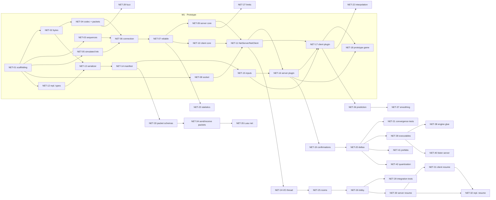

# Network Implementation Spec

This document turns [`design.md`](design.md) into work that developers can pick up, one task at a time. Every task
below is sized to be **one GitHub issue and one pull request**, has an id (`NET-xx`), the tasks that block it, and
acceptance criteria. The design stays the reference for the *why* and the byte-level details; this spec says *what
to build, in which order, with which API*, and fills the few gaps the design leaves open
([Values fixed by this spec](#5-values-fixed-by-this-spec)).

The plan is cut so that a **working prototype** (a server and several clients playing a tiny game on localhost)
can be built in **one to two days** with the ECS as it is today (its `App` and plugins included), then grown into the full design without throwing
code away.

> **Review status: only M1 is reviewed.** The M1 tasks (NET-01 to NET-18) are reviewed and ready to be filed as
> issues. The tasks of M2 to M8 (NET-19 to NET-45) are a draft kept for later: they give the direction and the
> order, but they have not been reviewed and will change, in content and in detail, once M1 is built. Do not file
> them as issues before they are reviewed.

> **Based on the state of the code on 2026-10-19** (`main` at `2649ee9`): the ECS then had its world, components,
> resources, events, change ticks, queries, commands, systems, scheduler and the `App` with its plugins, but no
> prefabs or Luau bridge ([Starting point](#1-starting-point)). The replication is written as ECS plugins from M1.
> When prefabs and the Luau bridge land, re-check the tasks that depend on them (NET-35, NET-41) and the
> [external blockers](#16-external-blockers).

> **Every C++ snippet is a recommendation, not an obligation.** Class names, signatures, file splits and data
> structures show one way to meet the task; the developer may choose another, as long as the task's behaviour, the
> wire format of [`design.md`](design.md) and [5](#5-values-fixed-by-this-spec), and the acceptance criteria are
> met, and the reviewer agrees. Snippets omit the Epitech header, the rule-of-five members and most
> `[[nodiscard]]`/`noexcept`; the real code follows every rule in `CLAUDE.md`.

## Contents

1. [Starting point](#1-starting-point)
2. [Milestones](#2-milestones)
3. [The prototype in two days](#3-the-prototype-in-two-days)
4. [Module layout and shared rules](#4-module-layout-and-shared-rules)
5. [Values fixed by this spec](#5-values-fixed-by-this-spec)
6. [Deviations from the design](#6-deviations-from-the-design)
7. [Task graph](#7-task-graph)
8. [M1: Prototype](#8-m1-prototype)
9. [M2: Scalable replication](#9-m2-scalable-replication)
10. [M3: Server architecture and robustness](#10-m3-server-architecture-and-robustness)
11. [M4: Reconnection](#11-m4-reconnection)
12. [M5: Custom packets](#12-m5-custom-packets)
13. [M6: Client prediction](#13-m6-client-prediction)
14. [M7: Engine integration](#14-m7-engine-integration)
15. [M8: Protocol document, docs and tuning](#15-m8-protocol-document-docs-and-tuning)
16. [External blockers](#16-external-blockers)
17. [Filing the issues](#17-filing-the-issues)

## 1. Starting point

What the network can rely on as of **2026-10-19** (`main` at `2649ee9`):

| Part | State | What the network uses from it |
|---|---|---|
| `ecs`: `World`, `Entity`, components, resources, events | Done | Spawn and despawn entities, add/get/remove components by `ComponentId` and by type, `isAlive`, ECS events (`RTYPE_ECS_EVENT`, `Events::send` / `read` / `update`) |
| `ecs`: type core (`TypeInfo`, `FieldInfo`, `ReplicationMode`, `Presence`, `layoutHash`) | Done | The field list of every replicated component, its replication mode, its layout hash, `TypeRegistry::getReplicatedIds()` |
| `ecs`: change ticks (`Tick`, `ComponentTicks`, `isNewerThan`, `World::advanceChangeTick`) | Done | "Changed since the client's known tick" (M2) |
| `ecs`: `NameHash.hpp` (FNV-1a 64) | Done | Manifest and schema hashes |
| `ecs`: queries (typed and dynamic), commands, systems, scheduler and phases, fixed timestep, `App`, `Plugin`, `RunMode` / `Side` | Done | The replication is written as plugins from the start: resources, systems on phases and sides, `Commands` (spawn, add by `ComponentId`, remove, despawn), queries |
| `ecs`: prefabs, Luau bridge, field network options (quantization) | **Not started** | Needed by NET-35, NET-41, NET-42 |
| `plugins/input`: `InputPlugin`, the `rtype.Input` resource, `Control` | Done | Client side: a system of the executable fills a `PlayerInput` from it |
| `plugins/backend`: `BackendPlugin` (window, platform events, frame systems) and `platform-glfw` | Done | The prototype client is an `App` with a window, like `engine/main.cpp` |
| `render-vulkan`: `draw(RectShape)`, `draw(Sprite)`, `setCamera` | **Not implemented** (`notImplemented`) | The prototype client draws rectangles once it lands; until then it prints the world ([NET-18](#net-18--prototype-game)) |

Consequences for the plan:

- **Replication is plugins from M1.** `ReplicationPlugin` (the shared types), `ServerPlugin` and `ClientPlugin` are
  the deliverables of [NET-12](#net-12--replication-types), [NET-16](#net-16--server-plugin-with-complete-snapshots)
  and [NET-17](#net-17--client-plugin). Their state is a resource (`ServerState`, `ClientState`) and their logic is
  systems on the phases of [ECS 20](../ecs/features/20-replication.md#one-server-tick-one-client-frame). Protocol
  logic stays in sans-IO helpers (`Snapshot`, `InputBuffer`, `Manifest`...) that know nothing of the `App`, so it
  keeps plain unit tests; the plugins are tested with an `App` and `TimePlugin::manual`.
- **No ECS work blocks M1 to M7, except the items of [16](#16-external-blockers).** The `App` is not a blocker
  any more; only prefabs, field options and the Luau bridge are.
- **Entities are tracked automatically.** A system that spawns with `Commands` cannot call a `track(entity)`: the
  entity is only alive after the phase's flush. The server therefore assigns `NetworkId`s itself, in a `PostUpdate`
  system (`net.assignIds`), for every entity that has a replicated component and no `NetworkId`.
- **Replicated components are read by `ComponentId` through a system parameter of `replication`.** The game's
  components are unknown to `replication`, so no typed `Query` can name them; their values are bytes, laid out by
  their `TypeInfo` fields and serialized field by field (NET-13). A `DynamicQuery` is built from ids (the ECS names
  the network among its users), and a library can add its own parameter type by specializing `SystemParam`
  ([ECS 12](../ecs/features/12-systems.md#parameters-from-other-libraries)). `ReplicatedRead` (`query/`) holds one
  `DynamicQuery` per replicated component and reports their `getAccess()` in `addAccess`, so the schedule orders the
  systems that take it against the game's like any other: two unordered systems of a phase that touch the same
  component, one of them writing it, fail to build. It gives read access only (`QueryMatch::get`,
  `Components::get`), never `getMut`. The parameter is built when the system is added, so `ServerPlugin` is added
  **after** the plugins that register replicated components; `net.start` fails with a clear message if one was
  registered later.
- **Replicated components are written through `Commands`, by `ComponentId`.** Spawn, add or replace
  (`Commands::add(entity, id, bytes)`), remove and despawn are applied after the phase, so no system of the phase sees
  them half done and they need no declared access. That is all the client needs to apply a snapshot: M1 has no
  `ReplicatedWrite`. One would be needed only by a system that writes replicated values in place during its phase
  (interpolation, NET-22, decided with M2).
- **The glue between `plugins::input::Input` and `PlayerInput` lives in the executable or example.** `plugins` knows
  nothing of `replication`, and `replication` nothing of `plugins`: only the executable (or example) links both.

## 2. Milestones

| Milestone | Goal | Delivers | Blocked by external work |
|---|---|---|---|
| **M1 · Prototype** (reviewed) | A tiny game played by several clients on localhost | Transport (bytes, acks, reliable channel, handshake, timeouts), UDP socket, manifest, inputs, full-state snapshots, a demo in `examples/network/Prototype/` | No |
| **M2 · Scalable replication** | Hundreds of bullets, smooth display | Per-entity confirmations, delta snapshots, `kSpawnOnly`, size budget, interpolation, statistics | No |
| **M3 · Server architecture and robustness** | The subject's server requirements (N2, N3, N4) | I/O thread, one thread per room, lobby, rate limits, error budget, fuzz and integration tests | No |
| **M4 · Reconnection** | A short connection loss does not end a game (N8) | Lingering sessions, resume tokens, client retry, ECS events | No |
| **M5 · Custom packets** | Kill feed, chat, lobby "ready" | Packet schemas, `RTYPE_REPLICATION_PACKET`, send and receive as ECS events; Luau bindings | Luau bindings only (Luau bridge) |
| **M6 · Client prediction** | The local ship reacts instantly | Input ring, reconciliation, correction smoothing | No |
| **M7 · Engine integration** | `client` and `server` executables, listen server | Engine split, `StandalonePlugin`, prefabs, quantization | Yes: prefabs, field options |
| **M8 · Docs and tuning** | The protocol document required by the subject, defaults from measures | RFC-style protocol, ECS docs updates, benchmarks | No |

M2 to M6 only depend on M1 and can be worked on in parallel by different people (see the [task graph](#7-task-graph)).
M3 is the most important after M1, since it carries the subject's mandatory server requirements.

## 3. The prototype in two days

### Scope

The prototype (M1) is the real foundation, not a throwaway: every M1 task is final code that later milestones
extend. It leaves out, on purpose:

| Left out of M1 | Consequence in M1 | Added by |
|---|---|---|
| I/O thread, room threads | The server is single-threaded: its `App` polls the socket in `PreUpdate` and runs the game in the same thread (N2 is not met yet) | NET-24, NET-25 |
| Lobby and rooms | Every client that sends `kReady` joins the one game | NET-26 |
| Per-entity confirmations, deltas | Every snapshot carries **every** replicated entity with **all** its replicated components (a *complete* snapshot); fine for a few dozen entities | NET-19, NET-20 |
| Interpolation | Clients display the latest snapshot as is (choppy at 60 Hz on a faster screen, acceptable for a demo) | NET-22 |
| Rate limits, error budget | Bad packets are dropped, but a flooding client is not disconnected | NET-27 |
| Reconnection | A client silent for 2 s is closed at once (`reconnectGrace = 0` behaviour) | NET-30 to NET-32 |
| Custom packets, prefabs, quantization, prediction | Not available | M5, M6, M7 |

### Demo

`examples/network/Prototype/` builds two targets, `prototype-server` and `prototype-client`
([NET-18](#net-18--prototype-game)):

1. `xmake f --Prototype=y && xmake build -y`
2. `xmake run prototype-server` (port 4242)
3. Two or more `xmake run prototype-client 127.0.0.1 4242` (a window for the keyboard, `--bot` for a scripted
   player with no window). Both are `App`s: the server a `RunMode::kServer` one, the client a `RunMode::kClient`
   one with the `BackendPlugin`.
4. Each client moves its own square with the arrow keys / WASD and fires with Space; it sees the other players
   and every bullet. Closing a client removes its ship for the others at once; killing it (`kill -9`) removes it
   after the 2 s timeout, and the server keeps ticking.

### Schedule

Two lanes that only meet at the end. One developer does them one after the other (with agent help); two developers
do one lane each.

| Slot | Lane A: transport (`network`) | Lane B: replication (`replication`) |
|---|---|---|
| Day 1, morning | NET-01 (shared), NET-02, NET-03, NET-04, NET-05 | NET-12, NET-13 (after NET-02) |
| Day 1, afternoon | NET-06, NET-07 | NET-14, NET-15 |
| Day 2, morning | NET-08, NET-09, NET-10, NET-11 | NET-16, NET-17 |
| Day 2, afternoon | NET-18 together, then fixes found by the demo | |

Sizes used below: **S** about 1–2 hours, **M** about half a day, **L** about a day, for one developer.

## 4. Module layout and shared rules

### Folders and namespaces

Each library is split in one folder per feature, and **namespaces mirror the folders**, as the `CLAUDE.md` rule
says (no flat-namespace exception as in `ecs`). Only what every feature shares stays at the root of the library.
`exceptions/` holds local setup errors.

```
src/rtype/network/                rtype::network — rtype-network (shared), Asio only
├── xmake.lua
├── Export.hpp                    RTYPE_NETWORK_API
├── Types.hpp                     ClientId, Channel, DisconnectReason, RejectReason, Clock, TimePoint, Bytes
├── NetworkSettings.hpp           every transport setting, with the design's defaults
├── RandomSource.hpp              std::random_device by default, replaceable in tests
├── bytes/                        rtype::network::bytes
│   └── ByteWriter, ByteReader, WriteStream, ReadStream, Codec (.tpp), Overloaded (NET-04)
├── protocol/                     rtype::network::protocol
│   └── Constants (kProtocolId, kMaxPacketSize...), Sequence (isNewer), SequenceBuffer (.tpp), Packets + PacketCodec
├── connection/                   rtype::network::connection
│   └── Connection, ReliableSender, ReliableReceiver, ConnectionStats
├── io/                           rtype::network::io  (the only folder whose .cpp files include Asio)
│   └── Address, UdpSocket, later IoThread pieces (NET-24)
├── server/                       rtype::network::server
│   └── ServerCore, Session, NetServer, RoomMessages (ServerEvent, ServerCommand), later NetServerThread,
│       MessageQueue (.tpp), lobby messages (NET-24, NET-26)
├── client/                       rtype::network::client
│   └── ClientCore, ClientEvent, NetClient
└── exceptions/                   rtype::network::exceptions
    └── NetworkExceptions (SocketException...)

src/rtype/replication/            rtype::replication — rtype-replication (shared), depends on ecs + network
├── xmake.lua, Export.hpp         RTYPE_REPLICATION_API
├── ReplicationSettings.hpp
├── MessageType.hpp               0x20–0xFF
├── ReplicationPlugin.hpp/.cpp    ReplicationPlugin "rtype.replication": registers every component and event below,
│                                 inserts the InputLayout resource; added by the server and client plugins
├── component/                    rtype::replication::component
│   └── NetworkId, Owner, PlayerInput
├── event/                        rtype::replication::event
│   └── ClientConnected, ClientDisconnected, later ClientLost, ClientReconnected... (M4)
├── query/                        rtype::replication::query
│   └── ReplicatedRead (a SystemParam over one DynamicQuery per replicated component)
├── serialization/                rtype::replication::serialization
│   └── EntityMapper, FieldSerializer
├── manifest/                     rtype::replication::manifest
│   └── Manifest, ManifestReceiver, ManifestCheck
├── input/                        rtype::replication::input
│   └── InputKind, InputLayout, InputMessage, InputBuffer
├── snapshot/                     rtype::replication::snapshot
│   └── Snapshot (encode / decode), later SnapshotHistory, KnownEntities (M2)
├── server/                       rtype::replication::server
│   └── ServerPlugin "rtype.replication.server", ServerState (resource), later Room, RoomManager (NET-25)
├── client/                       rtype::replication::client
│   └── ClientPlugin "rtype.replication.client", ClientState (resource), later Interpolator (NET-22),
│       Predictor (NET-36, NET-37)
├── packet/                       rtype::replication::packet  (M5)
│   └── PacketDescriptor, PacketRegistry, RTYPE_REPLICATION_PACKET
└── exceptions/                   rtype::replication::exceptions
    └── ReplicationExceptions (ManifestException...)

tests/network/      network-tests      (SimulatedLink.hpp lives here, test-only)
tests/replication/  replication-tests
examples/network/Prototype/            prototype-server, prototype-client
```

Files are named after their class (`connection/Connection.hpp`, `.cpp`, `.tpp` for templates) and included as
`rtype/network/<feature>/<File>.hpp`. The snippets of the tasks below omit the namespaces for brevity: each type
lives in the namespace of the folder listed here.

### Rules every task follows

These apply to every task; the acceptance criteria below do not repeat them.

- **Definition of done** of `CLAUDE.md`: builds on Linux, macOS and Windows (`xmake build -y`), `clang-format`
  and `clang-tidy` clean, unit tests for the success *and* failure paths, rule of five, `RTYPE_NETWORK_API` /
  `RTYPE_REPLICATION_API` on exported symbols.
- **No `<asio.hpp>` outside `src/rtype/network/*.cpp`.** Headers expose `Address`, `UdpSocket` (pimpl) and
  plain types only.
- **`network` never includes an `ecs` header; `ecs` never includes `network` or `replication`.**
  `replication` never includes `plugins` headers, nor `plugins` those of `replication`: the glue between
  `plugins::input::Input` and `PlayerInput` lives in the executable or example, the only place that links both.
- **Never throw, assert or crash on bytes from the network.** Parse with `ByteReader`, check `isValid()` and that
  nothing is left over, drop on failure. Exceptions are only for local setup errors (a port that cannot be bound,
  a manifest that cannot be built).
- **Plugins follow the ECS rules** ([ECS 14](../ecs/features/14-app-and-plugins.md)): `build()` only registers
  (resources, events, systems, other plugins); opening a socket, building the manifest or connecting happens in a
  `Startup` system, when every plugin of the game has registered its types. A system parameter is built when the system
  is added, so a plugin whose parameters depend on registered types (`ServerPlugin`, through `ReplicatedRead`) is added
  after the plugins that register them. A plugin name is `rtype.replication...`;
  each plugin exposes its system names as `static constexpr std::string_view` constants (as `BackendPlugin` does), so
  that game systems can order themselves with `.after(...)` / `.before(...)`. Server systems are `Side::kServer`,
  client systems `Side::kClient`.
- **Sans-IO cores.** Everything with protocol logic (`Connection`, `ServerCore`, `ClientCore`, the state and helper classes of the plugins)
  takes bytes and a `TimePoint now` as parameters and never reads a clock or a socket itself, so tests drive time.
- **Every sequence or message id comparison goes through `isNewer`.**
- **Settings, not constants**, for every value listed in [design Configuration](design.md#configuration): they
  live in `NetworkSettings` / `ReplicationSettings` with the design's defaults. Protocol constants (packet kinds,
  sizes, protocol id) stay `constexpr`.
- **Random values** (challenges, tokens) come from `std::random_device` through a `RandomSource` that tests can
  replace (`std::function<std::uint64_t()>`).
- Every network test file is named after the class it covers (`ConnectionTests.cpp`), as in `tests/ecs/`.

## 5. Values fixed by this spec

The design names these values without giving their encoding. They are fixed here so that both sides agree; `0`
is never a valid value of a wire enum, so a zeroed byte is always rejected.

| Enum (`u8` on the wire) | Values |
|---|---|
| `DisconnectReason` | `kGraceful = 1`, `kTimeout = 2`, `kKicked = 3`, `kProtocolError = 4`, `kManifestMismatch = 5`, `kOverflow = 6`, `kServerShutdown = 7` |
| `RejectReason` | `kVersionMismatch = 1`, `kServerFull = 2`, `kSessionExpired = 3` |
| `RoomError` | `kFull = 1`, `kNotFound = 2`, `kClosed = 3`, `kTooManyRooms = 4` |
| `InputKind` | `kButton = 1`, `kAxis = 2`, `kVector2 = 3` |
| `Channel` | `kUnreliable = 0`, `kReliable = 1` (as in the design: the channel byte of a message) |

| Other value | Fixed to | Why |
|---|---|---|
| `kProtocolVersion` | `1`; bumped by every change of a wire layout | Rejected with `kVersionMismatch` |
| Initial RTT, before the first sample | 100 ms (so the first resend interval is 125 ms) | The design gives the formula, not its start |
| Datagrams built per flush, per peer | at most `kMaxDatagramsPerFlush = 8` | Bounds one flush. Reliable messages left over stay queued; unreliable ones left over are dropped (they are time-sensitive) |
| Snapshot `flags` byte | see [deviation 1](#6-deviations-from-the-design) | |
| Input actions order in the manifest | sorted by name, like every other manifest entry | One ordering rule for the whole manifest |
| `kMaxInputAxes` | 16 `f32` slots in `PlayerInput` (a `kVector2` takes 2) | `PlayerInput` is a fixed-size component |
| Snapshot ring per client (M2) | 64 entries, as in the design | |
| Client handshake retry | every 100 ms, give up after 5 s, as in the design | |

## 6. Deviations from the design

To report in `design.md` when the matching task lands (the task says so in its checklist).

1. **Snapshot `flags` byte.** The snapshot layout gets a `u8 flags` right after `last processed input`. Bit 0,
   `kComplete`, means "this snapshot lists every replicated entity of the room, with all its replicated
   components": the client despawns every replicated entity it knows that is absent, and removes every replicated
   component absent from a listed entity. The M1 server sets it whenever everything fits in one snapshot. From M2
   on, the server never sets it (deltas are never complete), so the flag costs one byte and changes nothing. It is
   also a cheap tool for later (a full resynchronization after a reconnection).
2. **The server's `net.*` systems are split by phase, not one per step.** The design names `net.receive`,
   `net.applyInputs`, `net.assignIds`, `net.snapshot` and `net.send`. M1 has `net.receive` (PreUpdate),
   `net.applyInputs` (FixedUpdate), `net.assignIds` and `net.snapshot` (PostUpdate, the snapshot also sends: the
   commands go straight to `NetServer`); a separate `net.send` comes with the I/O thread (NET-24).
3. **Snapshots are built once per frame, not once per fixed tick.** `PostUpdate` runs once per frame, after every
   `FixedUpdate` tick of the frame: with two ticks in one frame, the snapshot carries the latest state, and the server
   tick it announces is `Time::tick`. Building one inside `FixedUpdate` would need a system that runs after every
   gameplay system, which the schedule cannot express. A frame can run 0, 1 or several ticks, so the snapshot is due
   when `Time::tick - lastSnapshotTick >= tickRate / snapshotRate`, never on `Time::tick % N == 0` (which misses a
   snapshot when a frame jumps over the multiple, and repeats one when a frame runs no tick).
4. **Interpolation buffers in `ClientState`.** The design has an `Interpolated` client-only component holding
   the last states. A component has a fixed size, while the history covers any interpolated component, so the
   buffers live in the client state, keyed by `(NetworkId, component)`. The world keeps the *displayed*
   value in the component itself.
5. **Prediction is a callback until the systems can be marked.** Prediction (M6) takes a
   `std::function<void(ecs::World&, ecs::Entity, const PlayerInput&)>` that the game registers on both sides.
   NET-38 replaces it with the systems marked `predicted = true`.
6. **A new connection from an address that already has a session.** Not covered by the design: a client restarted
   on the same port would be ignored until its old session times out. A valid challenge response for a new
   (non-resume) connection from that address closes the old session as a graceful disconnect, then creates the
   new one. The challenge still prevents a forged address from doing this.
7. **The prototype lives in `examples/`** (`examples/network/Prototype/`), not in `client` / `server` executables:
   the engine entry point (`engine` as a library, `client` / `server` executables, NET-39) comes with M7.

## 7. Task graph



External blockers (ECS prefabs, field options, Luau bridge...) are listed in [16](#16-external-blockers) and on
each task.

## 8. M1: Prototype

### NET-01 · Module scaffolding

| Milestone | Size | Blocked by | Design |
|---|---|---|---|
| M1 | S | — | [3](design.md#3-targets-and-dependencies), [Configuration](design.md#configuration) |

**Summary.** Create the `network` and `replication` libraries, their test targets, and the few types, constants
and settings that every later task uses, so that every other task only adds files.

**What it is for.** The network is two libraries with a strict split ([design 3](design.md#3-targets-and-dependencies)):

- `rtype-network` moves bytes between machines: sockets, connections, acks, reliability. It knows nothing about the
  ECS, so it can be tested alone and reused by anything.
- `rtype-replication` is the only code that knows both the ECS and the network: it turns a `World` into messages
  and back.

This task creates the empty shells and the vocabulary they share:

- **`Types.hpp`**: the small types that appear in almost every signature of the transport. `ClientId` names a
  connected player; `TimePoint` is how every class receives the current time (classes never read the clock
  themselves, so tests can drive time, see [4](#rules-every-task-follows)); `Bytes` is an owned byte buffer;
  `Channel` and the reason enums are wire values.
- **`protocol/Constants.hpp`**: values that are **part of the protocol**. Both sides must agree on them, so they are
  `constexpr`, and changing one changes `kProtocolVersion`.
- **`NetworkSettings.hpp`**: values that are **tuning**, chosen per deployment from the command line or a config
  file (port, timeouts, limits). Nothing tunable is hard-coded anywhere else.
- **`RandomSource.hpp`**: where challenges and tokens come from. Production uses the OS (`std::random_device`);
  tests inject a fixed sequence so that a handshake test is reproducible.

**What it must do.**

1. `network` builds as a shared library `rtype-network` that depends on Asio only. Asio is a **private** package:
   no public header includes it, so the libraries and executables that use `network` never see Asio
   (as GLFW never leaves `platform/glfw/`).
2. `replication` builds as a shared library `rtype-replication` that depends on `ecs` and `network`, both public
   (its headers use their types).
3. Exported symbols use `RTYPE_NETWORK_API` / `RTYPE_REPLICATION_API`, defined like `RTYPE_ECS_API`.
4. `Types.hpp` defines:

   | Type | Meaning |
   |---|---|
   | `ClientId` (`u32`) | A connected player, given by the server from 1 upwards and never reused; `kNoClient = 0` |
   | `Clock`, `TimePoint` | `std::chrono::steady_clock` and its time point: monotonic, never jumps with the wall clock |
   | `Bytes` | `std::vector<std::byte>` |
   | `Channel` | `kUnreliable = 0`, `kReliable = 1` ([design 6.5](design.md#65-messages-and-channels)) |
   | `DisconnectReason`, `RejectReason` | Wire values of [5](#5-values-fixed-by-this-spec) |

5. `protocol/Constants.hpp` defines `kProtocolId = 0x52545950` ("RTYP"), `kProtocolVersion = 1`,
   `kMaxPacketSize = 1200`, `kMaxMessageSize = 1000`, `kHandshakePadding = 64`, `kReliableWindow = 256`,
   `kMaxPendingReliable = 1024`, `kMaxDatagramsPerFlush = 8`, `kSentPacketHistory = 1024`.
6. `NetworkSettings` holds every tunable transport value with the design's default:

   | Field | Default | Used by |
   |---|---|---|
   | `port` | 4242 | NET-11 (server) |
   | `maxClients` | 64 | NET-09 |
   | `timeout` | 2 s | NET-09, NET-10 |
   | `keepalive` | 100 ms | NET-06 |
   | `minResendInterval` | 50 ms | NET-07 |
   | `initialRtt` | 100 ms | NET-06 |
   | `handshakeRetry`, `handshakeTimeout` | 100 ms, 5 s | NET-10 |
   | `challengeExpiry`, `maxPendingChallenges` | 5 s, 256 | NET-09 |

   Later tasks add their own fields (reconnection grace in NET-30, rate limits in NET-27).
7. `RandomSource` is `std::function<std::uint64_t()>`; `makeSystemRandom()` returns one backed by
   `std::random_device` (never a seeded pseudo-random generator, [design 6.3](design.md#63-connection-lifecycle)).
8. `network-tests` and `replication-tests` build and run with `xmake test`, like `ecs-tests`.

**API (recommendation).**
```c++
namespace rtype::network {
using ClientId = std::uint32_t;
inline constexpr ClientId kNoClient = 0;
using Clock = std::chrono::steady_clock;
using TimePoint = Clock::time_point;
using Bytes = std::vector<std::byte>;
enum class Channel : std::uint8_t { kUnreliable = 0, kReliable = 1 };
enum class DisconnectReason : std::uint8_t {
    kGraceful = 1, kTimeout, kKicked, kProtocolError, kManifestMismatch, kOverflow, kServerShutdown,
};
enum class RejectReason : std::uint8_t { kVersionMismatch = 1, kServerFull, kSessionExpired };

using RandomSource = std::function<std::uint64_t()>;
[[nodiscard]] RTYPE_NETWORK_API RandomSource makeSystemRandom();

struct NetworkSettings {
    std::uint16_t port{4242};
    std::uint32_t maxClients{64};
    std::chrono::milliseconds timeout{2000};
    std::chrono::milliseconds keepalive{100};
    // ... every field of the table above
};
}  // namespace rtype::network
```

**Tasks.**
- [ ] `src/rtype/network/xmake.lua`: shared target `network` (`rtype-network`), globs `**.cpp`,
  `add_requires("asio 1.36.x")` used privately, `RTYPE_NETWORK_BUILD` define, `$(projectdir)/src` include dir
  public. On Windows: `_WIN32_WINNT=0x0A00` (private) and `ws2_32` (plus `mswsock` if Asio needs it).
- [ ] `src/rtype/replication/xmake.lua`: shared target `replication` (`rtype-replication`), `add_deps("ecs", "network")`.
- [ ] `Export.hpp` of both, modelled on `src/rtype/ecs/Export.hpp`.
- [ ] `network/Types.hpp`, `network/protocol/Constants.hpp`, `network/NetworkSettings.hpp`,
  `network/RandomSource.hpp/.cpp`.
- [ ] Root `xmake.lua`: `includes` both modules and add them to the `rtype` phony target.
- [ ] `tests/network/` (`network-tests`) and `tests/replication/` (`replication-tests`), included from
  `tests/xmake.lua`, with a test that includes every public header of the module.
- [ ] Create the feature folders of [4](#folders-and-namespaces) only when a file goes in them.
- [ ] `CLAUDE.md`: describe both modules, their feature folders and sub-namespaces in *Project structure*, and the
  dependency rule (`network` ← `replication` ← executables; `ecs` ← `replication`).

**Acceptance.**
- [ ] `xmake build -y` builds both libraries on the three platforms; `xmake test -v network-tests/*` and
  `replication-tests/*` run.
- [ ] No public header of `network` includes Asio: `network-tests` has no Asio include path, so the
  every-header test fails to build if one does.
- [ ] `makeSystemRandom()` returns different values on two calls (smoke test).

### NET-02 · `ByteWriter` and `ByteReader`

| Milestone | Size | Blocked by | Design |
|---|---|---|---|
| M1 | S | NET-01 | [6.1](design.md#61-bytes-on-the-wire) |

**Summary.** A writer that puts numbers into a byte buffer in a fixed byte order, and a reader that takes them back
out and can never read past the end of what it was given.

**What it is for.** Everything the network sends is a sequence of bytes, and both machines must agree on what each
byte means. Copying a C++ struct into a packet (`memcpy`, `reinterpret_cast`) does not work: the byte order depends
on the CPU, the compiler inserts padding between fields, and two compilers may lay the same struct out differently.
So every value is written and read **one at a time, in little-endian order**, through these two classes. They are
the lowest layer: the codec (NET-04), the field serializer (NET-13), snapshots and inputs all go through them.

The reader is also the first line of defence against bad input ([design 10](design.md#10-robustness-and-security)).
Bytes from the network can be truncated, corrupted or crafted. Instead of checking the remaining size before every
read, a parser reads every field it expects and asks once at the end "was everything there?". Reading past the end
never touches memory outside the buffer: it returns 0 and marks the reader invalid **for good**. The writer works
the same way, so an encoder can write a whole message and check once whether it fitted.

**What `ByteWriter` must do.**

1. Write into a buffer that the caller owns (`std::span<std::byte>`). It never allocates and never grows the buffer.
2. Write every multi-byte value lowest byte first, with shifts (`value >> 8`...), never by copying memory, so the
   result is the same on every CPU. `0x04030201` as a `u32` becomes `01 02 03 04`.
3. Signed integers are written as the unsigned value of the same size (two's complement); floats as the bits of
   the IEEE 754 value (`std::bit_cast`), so a NaN or `-0.0` keeps its exact bits. Checking that floats are finite
   is not its job (NET-13 does it).
4. A write that does not fit **writes nothing** and makes the writer invalid. From then on, every write does
   nothing, `isValid()` is false, and `getSize()` stays at the size reached before the failure.
5. `writeString(text)` writes the length as a `u8`, then the bytes. A text longer than 255 bytes makes the writer
   invalid (nothing written).
6. `writeZeros(count)` writes `count` zero bytes (handshake padding).
7. `getWritten()` returns the bytes written so far, as a view of the caller's buffer.

**What `ByteReader` must do.**

1. Read from a buffer that the caller owns (`std::span<const std::byte>`), from its start, moving forward.
2. Read values with the same byte order and encodings as the writer: whatever `ByteWriter` wrote, `ByteReader`
   reads back identically.
3. A read that needs more bytes than remain returns 0 (or an empty span or string), consumes nothing, and makes the
   reader invalid. From then on, **every** read returns 0, even if bytes remain: there is no way to "resume" after
   a failure.
4. `readBytes(count)` returns a view **into the caller's buffer** (no copy): it is only valid while that buffer
   lives.
5. `readString(maxLength)` reads the `u8` length; a length above `maxLength`, or bytes missing, makes the reader
   invalid. The bytes are not checked as UTF-8 (the value is only displayed, never interpreted).
6. `skip(count)` moves forward without reading; past the end, it makes the reader invalid.
7. `getRemaining()` is the number of bytes not read yet; `isFinished()` is true when the reader is valid **and**
   nothing remains. Decoders use it to reject messages with bytes left over.
8. No input, of any size or content, can make it read outside the buffer, throw, or crash.

**Used by.** NET-04 (the streams wrap them), NET-06 (message headers inside `kData`), NET-13 (component fields),
NET-15 (inputs), NET-16 / NET-17 (snapshots).

**API (recommendation).**
```c++
namespace rtype::network::bytes {
/// @brief Writes little-endian values into a buffer owned by the caller. Invalid for good after a write that
/// does not fit.
class RTYPE_NETWORK_API ByteWriter {
  public:
    explicit ByteWriter(std::span<std::byte> buffer) noexcept;

    void writeU8(std::uint8_t value) noexcept;  // + writeU16, writeU32, writeU64, writeI8 ... writeI64
    void writeF32(float value) noexcept;
    void writeF64(double value) noexcept;
    void writeBytes(std::span<const std::byte> bytes) noexcept;
    void writeString(std::string_view text) noexcept;
    void writeZeros(std::size_t count) noexcept;

    [[nodiscard]] bool isValid() const noexcept;
    [[nodiscard]] std::size_t getSize() const noexcept;
    [[nodiscard]] std::span<const std::byte> getWritten() const noexcept;

  private:
    std::span<std::byte> _buffer;  ///< Owned by the caller.
    std::size_t _size{0};          ///< Bytes written so far.
    bool _valid{true};             ///< False after the first write that did not fit.
};

/// @brief Reads little-endian values from a buffer owned by the caller. Invalid for good after a read past the end.
class RTYPE_NETWORK_API ByteReader {
  public:
    explicit ByteReader(std::span<const std::byte> data) noexcept;

    [[nodiscard]] std::uint8_t readU8() noexcept;  // + every type of the writer; 0 once invalid
    [[nodiscard]] float readF32() noexcept;
    [[nodiscard]] std::span<const std::byte> readBytes(std::size_t count) noexcept;  // view into the buffer
    [[nodiscard]] std::string readString(std::size_t maxLength) noexcept;
    void skip(std::size_t count) noexcept;

    [[nodiscard]] bool isValid() const noexcept;
    [[nodiscard]] std::size_t getRemaining() const noexcept;
    [[nodiscard]] bool isFinished() const noexcept;

  private:
    std::span<const std::byte> _data;  ///< Owned by the caller.
    std::size_t _position{0};          ///< Next byte to read.
    bool _valid{true};                 ///< False after the first read past the end.
};
}  // namespace rtype::network::bytes
```

**Tasks.**
- [ ] `bytes/ByteWriter.hpp/.cpp`, `bytes/ByteReader.hpp/.cpp`.
- [ ] Tests: round trip of every type at its limits (`INT16_MIN`, `UINT64_MAX`, `-0.0F`, a NaN payload kept bit for
  bit); exact bytes of `0x04030201`; a write that does not fit leaves `getSize()` unchanged and every later write
  ignored; reads after a failure return 0 even with bytes left; strings of 0, 255 and 256 bytes; `readString`
  above `maxLength`; `readBytes` view points into the original buffer; reading from an empty span; `isFinished`.

**Acceptance.**
- [ ] The tests pass under AddressSanitizer locally (noted in the PR).

### NET-03 · Sequence numbers

| Milestone | Size | Blocked by | Design |
|---|---|---|---|
| M1 | S | NET-01 | [6.4](design.md#64-sequence-numbers-acks-and-rtt) |

**Summary.** Two small tools for numbers that wrap around: `isNewer`, which compares two sequence numbers
correctly after the counter wraps from 65535 to 0, and `SequenceBuffer`, which remembers some data about each of
the last `N` numbers in a fixed array.

**What it is for.** Every `kData` datagram carries a `u16` sequence number, one more than the previous datagram
sent to that peer. Sequence numbers are how the transport knows what arrived and what was lost: the receiver
reports the newest number it saw plus the 32 before it (acks, NET-06), and the sender matches those acks against
what it sent to measure the RTT and to know which reliable messages to resend (NET-06, NET-07). Reliable messages
have their own `u16` id with the same needs (NET-07).

A `u16` wraps around after 65 536 values: about 18 minutes at 60 datagrams per second, so in every long game.
Two problems follow, and each tool solves one:

- **Comparing.** "Is datagram 3 newer than datagram 65530?" With `<` the answer is no, although 3 came 9 steps
  later. The receiver would then treat every new datagram as old, stop acking, and the connection would die
  (design pitfall 7). `isNewer` gives the right answer across the wrap. **Every** comparison of a sequence number
  or a reliable message id in the project goes through it; a `<` on one of them is a bug.
- **Remembering per number.** The transport keeps data per number for a short while: the send time and contents of
  each of the last 1024 datagrams sent (NET-06), the reliable messages that arrived ahead of their turn (NET-07).
  A `std::map` would allocate on every packet and grow without bound if a peer stops acking. `SequenceBuffer` is a
  fixed array where number `s` lives in slot `s % N`: no allocation after construction, constant-time access, and
  old entries are forgotten automatically when a newer number takes their slot.

Neither tool knows anything about packets, sockets or time; they are pure data structures, which is why they come
first and are tested on their own.

**What `isNewer(a, b)` must do.**

1. Return true when `a` is ahead of `b` by 1 to 32 767 steps, counting forward with wraparound, and false otherwise.
   `isNewer(3, 65530)` is true (9 steps ahead); `isNewer(65530, 3)` is false.
2. Return false for equal values: a number is not newer than itself.
3. At exactly half the range (`a - b == 32768`) the order is undefined, so return false **both ways**. The protocol
   never compares numbers that far apart: acks cover 33 datagrams and the reliable window is 256 messages.
4. Be `constexpr` and `noexcept`, with no branches on platform: the formula of design 6.4 (difference in `u16`,
   read as `int16`, compared to 0).

**What `SequenceBuffer<T, N>` must do.** It stores at most one `T` per slot, tagged with the sequence that wrote it.

1. **Starts empty.** On a new buffer, `find(s)` returns `nullptr` for every `s`, including 0. An entry must therefore
   carry an "occupied" flag; using the stored sequence alone would make `find(0)` match an untouched slot.
2. **`insert(s)`** takes slot `s % N`, resets its value to `T{}`, tags it with `s`, marks it occupied and returns a
   reference to the value. Whatever was in that slot before (sequence `s - N`, or any other) is overwritten: that
   older number is now forgotten.
3. **`find(s)`** returns a pointer to the value if slot `s % N` is occupied **by `s`**, `nullptr` otherwise. This tag
   check is what makes a late lookup safe: an ack for datagram 4 that arrives after datagram 1028 took its slot
   (with `N = 1024`) finds nothing, instead of marking datagram 1028 as acked.
4. **`remove(s)`** empties the slot if it holds `s`, and does nothing otherwise (so it never erases a newer entry).
5. **`N` is a power of two**, checked by a `static_assert`. 65 536 must be a multiple of `N`, or two numbers fewer
   than `N` apart could share a slot across the wrap (with `N = 1000`, sequences 0 and 65 000 are only 536 apart
   but both map to slot 0).
6. It never compares sequences itself and never decides what is "too old": that is the caller's job, with
   `isNewer`. It only answers "do you still have `s`?".

**Used by.**

| User | Stores, per number | `N` |
|---|---|---|
| NET-06 sent-packet records | send time, acked flag, ids of the reliable messages it carried | 1024 |
| NET-07 reliable receiver | a message that arrived ahead of the next expected id | 256 |
| NET-19 snapshot history | snapshot ticks are `u32`, so NET-19 uses its own ring; see its task | — |

**API (recommendation).**
```c++
namespace rtype::network::protocol {
/// @return True if sequence `a` is newer than `b`, across the wrap from 65535 to 0.
[[nodiscard]] constexpr bool isNewer(std::uint16_t a, std::uint16_t b) noexcept;

/// @brief Data about each of the last N sequence numbers, in a fixed array: number `s` lives in slot `s % N`.
template <typename T, std::size_t N>
class SequenceBuffer {
    static_assert(N > 0 && (N & (N - 1)) == 0, "SequenceBuffer: N must be a power of two");

  public:
    /// @brief Takes the slot of `sequence`, forgetting what was there, and returns its value reset to T{}.
    T& insert(std::uint16_t sequence);
    /// @return The value stored for `sequence`, or nullptr if its slot is empty or holds another number.
    [[nodiscard]] T* find(std::uint16_t sequence) noexcept;
    [[nodiscard]] const T* find(std::uint16_t sequence) const noexcept;
    /// @brief Empties the slot of `sequence` if it still holds `sequence`.
    void remove(std::uint16_t sequence) noexcept;

  private:
    struct Entry {
        T value{};
        std::uint16_t sequence{0};  ///< The number that wrote this slot.
        bool occupied{false};       ///< False until the first insert, and after a remove.
    };
    std::array<Entry, N> _entries{};  ///< Slot `s % N` for sequence `s`.
};
}  // namespace rtype::network::protocol
```

**Tasks.**
- [ ] `protocol/Sequence.hpp` with `isNewer`.
- [ ] `protocol/SequenceBuffer.hpp` and `SequenceBuffer.tpp`.
- [ ] Tests for `isNewer`, as `static_assert`s where possible: 1 step ahead, across the wrap (`(3, 65530)` both ways),
  equal values, 32 767 ahead (true), 32 768 apart (false both ways).
- [ ] Tests for `SequenceBuffer`: `find` on a new buffer (including 0); insert then find; insert resets a reused
  slot to `T{}`; insert of `s + N` makes `find(s)` return `nullptr`; `remove(s)` after `s + N` took the slot leaves
  `s + N` in place; all of this across the wrap (sequences 65 530 to 10).

**Acceptance.**
- [ ] No `<`, `>` or `-` comparison of sequence numbers outside `isNewer` (reviewers check this rule in every later
  transport PR).

### NET-04 · Generic codec and transport packets

| Milestone | Size | Blocked by | Design |
|---|---|---|---|
| M1 | L | NET-02 | [6.1](design.md#61-bytes-on-the-wire), [6.2](design.md#62-packets) |

**Summary.** One generic way to turn a message struct into bytes and back: each message lists its fields once, in
a `serialize` function used for both directions, and a `Codec` gives a single `encode` and a single `decode` for a
whole family of messages. The seven transport packets of design 6.2 are its first users.

**What it is for.** The protocol has many small messages with a fixed layout: the seven packet kinds of the
transport (connect request, challenge, accepted...), then the manifest entries (NET-14) and the lobby messages
(NET-26). For each one, the program needs to write it and to read it back, and both must agree byte for byte.
Writing an encoder and a decoder by hand for each message doubles the code and invites the classic bug where the
two disagree on a field's order or size, which only shows up as garbage on the other machine.

The codec removes that duplication:

- **One field list per message.** A message's `serialize` function names its fields in wire order. The same
  function writes them when given a `WriteStream` and reads them when given a `ReadStream`, so the two directions
  cannot disagree. Adding a field is one line.
- **One entry point per family.** A family is a closed list of message types, each with its kind byte
  (`PacketKind::kAccepted = 0x04`...). `Codec::encode(message)` writes the kind byte then the fields;
  `Codec::decode(bytes)` reads the kind byte, finds the matching type, reads its fields, and returns the message
  as a `std::variant` of the family's types.
- **One place for the checks.** The streams check every value as they read it (enum ranges, string lengths, list
  sizes, constants), and `decode` rejects bytes left over. A message type gets all of this by listing its fields;
  it never writes a check by hand.

The cores (NET-09, NET-10) never touch raw bytes for packets: they build a struct and encode it, or decode a
datagram and `std::visit` the result.

**Why not a runtime factory.** A factory where each packet registers an encode and a decode lambda gives one entry
point too, but the transport's packet kinds are a closed set known at compile time: registering them at runtime
only moves errors (a missing or duplicated kind) from compile time to run time, adds `std::function` calls, and
`decode` would still have to return a variant or a type-erased value. A runtime registry is the right tool for an
open set, which is what custom packets are (NET-33).

**What the streams must do.** `WriteStream` and `ReadStream` have the **same function names**, so one `serialize`
compiles with both. Each wraps a `ByteWriter` / `ByteReader` and becomes invalid with it; once invalid, every call
does nothing.

| Function | `WriteStream` | `ReadStream` |
|---|---|---|
| `value(x)` | Writes `x`: integers and floats as in NET-02, `bool` as `u8` 0/1, enums as their underlying integer | Reads `x`. A `bool` must be 0 or 1; an enum must pass `isValidWireValue(x)` (below), else invalid |
| `constant(k)` | Writes `k` | Reads a value of the same type; invalid if it is not `k` (the protocol id: not our protocol) |
| `bytes(span)` | Writes the span (a size both sides know) | Fills the span; invalid if bytes are missing |
| `string(s, max)` | Writes `u8` length and bytes; invalid if longer than `max` | Invalid if the length is above `max` or bytes are missing |
| `list<Count>(v, max)` | Writes the size as `Count` (`u8` or `u16`), then each item; invalid if above `max` | Reads the count; invalid if above `max` (checked **before** allocating); then each item |
| `padTo(n)` | Writes zeros until the message (kind byte included) is `n` bytes; invalid if already longer | Skips until byte `n`; invalid if the message is shorter |
| `rest(span)` | Writes the span; must be the last call | Sets the span to every remaining byte (possibly none), as a view into the input; must be the last call |

- List items are serialized with their own `serialize` when they are structs, with `value` otherwise.
- `isValidWireValue(e)` is a `constexpr` function declared next to each wire enum and found by argument-dependent
  lookup. Calling `value()` on an enum that has none is a compile error, so no enum can skip its range check. Every
  wire enum treats 0 as invalid ([5](#5-values-fixed-by-this-spec)).
- A third stream, `SizeStream`, has the same functions but only counts bytes. `Codec::encode(message)` uses it to
  know the exact size before allocating the result.

**What the codec must do.**

1. Accept as messages only types that have a `static constexpr Kind kKind` and a `serialize` function usable in both
   directions, and that are default-constructible. Two messages of a family with the same `kKind` are a compile
   error (`static_assert` with a message naming the problem).
2. `encode(message, writer)` writes `kKind` as one byte, then the fields; returns false if the writer became invalid
   (the message did not fit). `encode(message)` returns a `Bytes` of exactly the right size.
3. `decode(bytes)` returns `std::nullopt` when: the input is empty, the kind byte is not one of the family, a stream
   check fails, bytes are missing, or **bytes are left over**. Otherwise it returns the message in the family's
   variant.
4. `decode` finds the type from the kind byte with one table lookup built at compile time, not a chain of `if`s
   (explained below).
5. `peekKind(bytes)` returns the first byte as a `Kind` if it is one of the family, without decoding the rest.
6. Nothing in the codec allocates more than the message needs, throws on bad input, or reads outside the input.
7. A message whose layout depends on outside data (the number of input axes, a component's fields) does **not**
   belong in a codec: its `serialize` could not know that data. Such messages use the streams directly (NET-13,
   NET-15, snapshots), so no `serialize` ever contains an `if` on the direction.

**What the transport packets are** (`protocol/Packets.hpp`, layouts of [design 6.2](design.md#62-packets)):

| Packet | Kind | Sent by | Fields after the kind byte | Size | Purpose |
|---|---|---|---|---|---|
| `ConnectRequest` | `0x01` | client | `constant(kProtocolId)` `u32`, version `u16`, resume client `u32`, resume token `u64`, `padTo(64)` | 64 | "I want to connect"; padded so that the server's answer is never bigger (anti-amplification) |
| `Challenge` | `0x02` | server | challenge `u64` | 9 | Proves the client really owns its address: only the real address receives it |
| `ChallengeResponse` | `0x03` | client | challenge `u64`, `padTo(64)` | 64 | Echoes the challenge |
| `Accepted` | `0x04` | server | session token `u32`, client id `u32`, resume token `u64` | 17 | The session exists; the token must be in every later packet |
| `Rejected` | `0x05` | server | reason `u8` (`RejectReason`) | 2 | Why the connection is refused |
| `Data` | `0x06` | both | session token `u32`, sequence `u16`, ack `u16`, ack bits `u32`, `rest` (messages) | 13 + messages | Everything once connected (NET-06) |
| `Disconnect` | `0x07` | both | session token `u32`, reason `u8` (`DisconnectReason`) | 6 | Closing |

- The protocol id is a `constant`: a datagram from another program is dropped without an answer. The version is a
  field, not a constant, so that the server can answer `kVersionMismatch` instead of staying silent.
- The packets only check their own layout. Whether a token is right, a version accepted or a challenge known is the
  cores' job (NET-09, NET-10).
- `Data::messages` points into the received datagram: it is valid only while that buffer lives, so
  `Connection::receive` reads it at once and never stores it.

**Used by.** NET-06 (`Data`), NET-09 and NET-10 (every packet), NET-14 (`ManifestCodec`), NET-26 (`LobbyCodec`);
the streams alone by NET-13, NET-15 and the snapshot code; NET-28 fuzzes every `decode`.

**API (recommendation): streams** (`bytes/`, on top of `ByteWriter` / `ByteReader`).
```c++
namespace rtype::network::bytes {
/// @brief Writing side of a serialize() function. Every call is a no-op once the stream is invalid.
class RTYPE_NETWORK_API WriteStream {
  public:
    explicit WriteStream(ByteWriter& writer) noexcept;
    template <typename T> void value(const T& value) noexcept;             // integers, floats, wire enums
    template <typename T> void constant(T expected) noexcept;              // writes `expected`
    void bytes(std::span<const std::byte> bytes) noexcept;                 // fixed size, known by both sides
    void string(const std::string& text, std::size_t maxLength) noexcept;  // u8 length + bytes
    template <typename Count, typename T>
    void list(const std::vector<T>& items, std::size_t maxCount) noexcept; // Count (u8/u16) + items
    void padTo(std::size_t size) noexcept;               // zeros until the message is `size` bytes long
    void rest(std::span<const std::byte> bytes) noexcept; // a trailing payload, until the end of the message
    [[nodiscard]] bool isValid() const noexcept;
};

/// @brief Reading side: same functions, taking references to fill. Any failed check makes the stream invalid.
class RTYPE_NETWORK_API ReadStream {
  public:
    explicit ReadStream(ByteReader& reader) noexcept;
    template <typename T> void value(T& value) noexcept;          // an enum must pass isValidWireValue (below)
    template <typename T> void constant(T expected) noexcept;     // invalid if the value read differs
    void bytes(std::span<std::byte> destination) noexcept;
    void string(std::string& text, std::size_t maxLength) noexcept;
    template <typename Count, typename T>
    void list(std::vector<T>& items, std::size_t maxCount) noexcept;   // count above maxCount: invalid
    void padTo(std::size_t size) noexcept;                // skips the padding (its content is not checked)
    void rest(std::span<const std::byte>& bytes) noexcept; // points into the decoded buffer, no copy
    [[nodiscard]] bool isValid() const noexcept;
};

/// @brief Declared next to every wire enum, found by ADL: `value()` on an enum does not compile without it.
[[nodiscard]] constexpr bool isValidWireValue(DisconnectReason reason) noexcept;   // 1 to 7, never 0
}  // namespace rtype::network::bytes
```

**API (recommendation): the codec** (`bytes/Codec.hpp` + `Codec.tpp`).
```c++
namespace rtype::network::bytes {
/// @brief A message of a codec: its kind and its fields, listed once for both directions.
template <typename M, typename Kind>
concept CodecMessage = std::is_default_constructible_v<M> && requires {
    { M::kKind } -> std::convertible_to<Kind>;
};  // + M::serialize(self, stream) callable with a const M& and a WriteStream, and with an M& and a ReadStream

/// @brief Encodes and decodes a closed family of messages: a kind byte, then the message's fields.
template <typename Kind, typename Variant>
class Codec;

template <typename Kind, typename... Messages>
class Codec<Kind, std::variant<Messages...>> {
    // static_assert: every Messages is a CodecMessage, and no two share a kKind
  public:
    using Message = std::variant<Messages...>;

    /// @return False (writer invalid) if it does not fit.
    template <typename M> static bool encode(const M& message, ByteWriter& writer) noexcept;
    template <typename M> [[nodiscard]] static Bytes encode(const M& message);
    [[nodiscard]] static std::optional<Kind> peekKind(std::span<const std::byte> bytes) noexcept;
    /// @return Nullopt on an unknown kind, a failed check, missing bytes or bytes left over.
    [[nodiscard]] static std::optional<Message> decode(std::span<const std::byte> bytes) noexcept;
};
}  // namespace rtype::network::bytes
```

`decode` reads the kind byte and jumps to the matching alternative through a table built at compile time from the
variant (no chain of `if`s). Callers handle the result with `std::visit` or `std::get_if`.

**API (recommendation): the transport packets** (`protocol/Packets.hpp`).
```c++
namespace rtype::network::protocol {
enum class PacketKind : std::uint8_t {
    kConnectRequest = 0x01, kChallenge = 0x02, kChallengeResponse = 0x03,
    kAccepted = 0x04, kRejected = 0x05, kData = 0x06, kDisconnect = 0x07,
};

struct ConnectRequest {
    static constexpr PacketKind kKind = PacketKind::kConnectRequest;
    std::uint16_t version{0};
    ClientId resumeClient{kNoClient};
    std::uint64_t resumeToken{0};

    template <typename Self, typename Stream>  // Self is const when writing
    static void serialize(Self& self, Stream& stream) {
        stream.constant(kProtocolId);          // wrong protocol id: the datagram is dropped
        stream.value(self.version);            // a field, so that a mismatch can be answered
        stream.value(self.resumeClient);
        stream.value(self.resumeToken);
        stream.padTo(kHandshakePadding);       // 64 bytes in total, anti-amplification
    }
};

struct Data {
    static constexpr PacketKind kKind = PacketKind::kData;
    std::uint32_t sessionToken{0};
    std::uint16_t sequence{0};
    std::uint16_t ack{0};
    std::uint32_t ackBits{0};
    std::span<const std::byte> messages;      // decoded: points into the datagram

    template <typename Self, typename Stream>
    static void serialize(Self& self, Stream& stream) {
        stream.value(self.sessionToken);
        stream.value(self.sequence);
        stream.value(self.ack);
        stream.value(self.ackBits);
        stream.rest(self.messages);
    }
};
// Challenge, ChallengeResponse, Accepted, Rejected, Disconnect: same pattern.

using Packet = std::variant<ConnectRequest, Challenge, ChallengeResponse, Accepted, Rejected, Data, Disconnect>;
using PacketCodec = bytes::Codec<PacketKind, Packet>;
}  // namespace rtype::network::protocol
```

```c++
// Usage in the cores
const network::Bytes datagram = PacketCodec::encode(Accepted{.sessionToken = token, .client = id, .resumeToken = resume});

if (const std::optional<Packet> packet = PacketCodec::decode(datagram)) {
    std::visit(Overloaded{
        [&](const ConnectRequest& request) { ... },
        [&](const Data& data) { connection.receive(data, now); },
        [](const auto&) {},  // kinds this side never receives: dropped
    }, *packet);
}
```

**How the templates expand.** The templates only save writing code by hand. Here is what the compiler generates
from them, written out.

*`serialize`: one function written, two generated.* A template is a recipe; the compiler fills in the types at
each call. `Codec::encode` calls `Accepted::serialize` with a `const Accepted` and a `WriteStream`, and
`Codec::decode` calls it with an `Accepted` and a `ReadStream`, so the compiler produces two ordinary functions:

```c++
// Self = const Accepted, Stream = WriteStream: used by encode
static void serialize(const Accepted& self, WriteStream& stream) {
    stream.value(self.sessionToken);  // WriteStream::value: writes 4 bytes
    stream.value(self.client);
    stream.value(self.resumeToken);
}

// Self = Accepted, Stream = ReadStream: used by decode
static void serialize(Accepted& self, ReadStream& stream) {
    stream.value(self.sessionToken);  // ReadStream::value: reads 4 bytes into self.sessionToken
    stream.value(self.client);
    stream.value(self.resumeToken);
}
```

The body is the same text; because both streams have a `value` function, the same line writes in one version and
reads in the other. The field list exists once, so the two directions cannot disagree. `value` is itself a
template: `value(self.sessionToken)` with a `std::uint32_t` generates a version that writes (or reads) 4 bytes, with
a `std::uint64_t` one that handles 8, and so on.

*The decode table: a `switch` written by the compiler.* When a datagram arrives, only its first byte says which
message it is, and that byte is only known at run time. Written by hand, decoding would be a `switch`:

```c++
switch (reader.readU8()) {
    case 0x01: return decodeAs<ConnectRequest>(reader);
    case 0x02: return decodeAs<Challenge>(reader);
    // ... one case per packet
    default: return std::nullopt;
}
```

This works, but every codec (packets, manifest, lobby) needs its own `switch`, and a message added to the variant
but forgotten in the `switch` compiles and is silently dropped at run time. The codec builds the same dispatch from
the variant instead:

```c++
template <typename M>
static std::optional<Message> decodeAs(ByteReader& reader) {
    M message{};
    ReadStream stream{reader};
    M::serialize(message, stream);
    if (!stream.isValid() || !reader.isFinished()) {  // failed check, truncated, or bytes left over
        return std::nullopt;
    }
    return Message{std::move(message)};
}

using DecodeFn = std::optional<Message> (*)(ByteReader&);

static constexpr std::array<DecodeFn, 256> kTable = [] {
    std::array<DecodeFn, 256> table{};  // nullptr: unknown kind
    ((table[static_cast<std::uint8_t>(Messages::kKind)] = &decodeAs<Messages>), ...);
    return table;
}();

static std::optional<Message> decode(std::span<const std::byte> bytes) noexcept {
    ByteReader reader{bytes};
    const DecodeFn decoder = kTable[reader.readU8()];
    return (reader.isValid() && decoder != nullptr) ? decoder(reader) : std::nullopt;
}
```

The line with `, ...)` is a *fold expression*: it repeats the statement once per type of `Messages...`, the list
of the variant's alternatives. For the packet codec it expands to exactly:

```c++
table[0x01] = &decodeAs<ConnectRequest>;
table[0x02] = &decodeAs<Challenge>;
table[0x03] = &decodeAs<ChallengeResponse>;
table[0x04] = &decodeAs<Accepted>;
table[0x05] = &decodeAs<Rejected>;
table[0x06] = &decodeAs<Data>;
table[0x07] = &decodeAs<Disconnect>;
```

So `kTable` holds the same lines as the hand-written `switch`, built at compile time (the lambda is `constexpr`),
and `decode` is one array lookup. A message is listed in one place only, the variant, and a duplicated `kKind` is
caught by a `static_assert` built the same way. This is why the template is kept rather than one `switch` per
codec: three codecs (packets, manifest, lobby) share it, and forgetting a message is impossible.

*Example.* `Accepted{.sessionToken = 0xA1B2C3D4, .client = 7, .resumeToken = 1}` encodes to 17 bytes:

```
04                         kKind (kAccepted), written by Codec::encode
D4 C3 B2 A1                sessionToken, u32 little-endian
07 00 00 00                client
01 00 00 00 00 00 00 00    resumeToken
```

Decoding: byte `04` selects `decodeAs<Accepted>`, `serialize` reads the three fields, `isFinished()` confirms that
nothing is left. With an 18th byte, or a datagram cut at 12 bytes, `decode` returns `std::nullopt` and the datagram
is dropped.

**Tasks.**
- [ ] `bytes/WriteStream`, `bytes/ReadStream`, `bytes/SizeStream`, `bytes/Codec.hpp/.tpp`, and a small
  `Overloaded` helper for `std::visit`.
- [ ] `isValidWireValue` for every wire enum of [5](#5-values-fixed-by-this-spec) (`DisconnectReason`,
  `RejectReason`, `PacketKind`...), next to the enum.
- [ ] `protocol/Packets.hpp`: the seven packets of the table, `Packet` and `PacketCodec`.
- [ ] Tests (`CodecTests.cpp`, with toy messages): round trip; unknown kind; truncated at every byte; one byte left
  over; enum out of range and 0; `bool` value 2; `constant` mismatch; `list` above `maxCount`; `string` above
  `maxLength`; `padTo` on both sides (too short, too long); `rest` empty and full; encode into a buffer too small;
  `encode(message)` size equals `SizeStream`'s count.
- [ ] Tests (`PacketsTests.cpp`): round trip of each packet, the exact sizes of the table, wrong protocol id, padded
  packets of 63 and 65 bytes rejected, and a `static_assert` that every server reply is smaller than 64 bytes.

### NET-05 · Simulated link and fake clock

| Milestone | Size | Blocked by | Design |
|---|---|---|---|
| M1 | S | NET-01 | [12](design.md#12-testing) |

**Summary.** A test-only fake network between two endpoints that can lose, duplicate, reorder and delay datagrams,
driven by a fake clock, so that the transport is tested under bad conditions in a reproducible way.

**What it is for.** The hard parts of the transport (acks, resends, ordering, timeouts) only matter when the
network misbehaves, and localhost never does: real sockets on one machine deliver everything, in order, at once.
Bugs in loss handling would therefore only appear during real play, on a bad wifi, impossible to reproduce. The
simulated link replaces the socket in tests: the code under test hands it datagrams, and the link decides, from a
seeded random generator, which ones arrive, when, in which order and how many times.

The fake clock goes with it. Every protocol class receives the current time as a parameter (sans-IO), so a test
can make two seconds pass instantly to check a timeout, and the same test run twice sees exactly the same times.

It lives in `tests/network/` and is never shipped. It knows nothing about packets: it carries opaque `Bytes`.

**How it replaces the network.** The link does not intercept a socket or mock any operating-system function. It
works because the classes it tests never touch a socket: `Connection`, `ServerCore` and `ClientCore` take bytes in
(`receive`) and give bytes out (`buildPackets`, `takeDatagrams`). In production, `NetServer` / `NetClient` carry
those bytes through a `UdpSocket`; in a test, **the test itself carries them**, through the link:

```
Production:  ClientCore ──takeDatagrams──► UdpSocket ~~ internet ~~ UdpSocket ──receive──► ServerCore
Test:        ClientCore ──takeDatagrams──► SimulatedLink ───────────────────────receive──► ServerCore
                                           (decides: lose it? delay it? duplicate it?)
```

A test is a loop that moves the fake clock forward and shuttles bytes between the two sides:

```c++
TEST(ConnectionTests, ReliableUnderLoss) {
    FakeClock clock;
    SimulatedLink link{{.loss = 0.3, .delay = 50ms, .jitter = 10ms}, /*seed=*/42};
    Connection a{token, settings, clock.now()};  // endpoint 0
    Connection b{token, settings, clock.now()};  // endpoint 1
    // ... a.send(Channel::kReliable, ...) 5000 times

    for (int step = 0; step < 10'000; ++step) {  // 10 000 steps of 1 ms: 10 s of simulated time
        // 1. Each side builds what it would send now and gives it to the link instead of a socket.
        for (Bytes& datagram : a.buildPackets(clock.now())) { link.send(1, std::move(datagram), clock.now()); }
        for (Bytes& datagram : b.buildPackets(clock.now())) { link.send(0, std::move(datagram), clock.now()); }
        // 2. The link gives each side what has "arrived" by now.
        for (const Bytes& datagram : link.receive(1, clock.now())) { b.receive(decodeData(datagram), clock.now()); }
        for (const Bytes& datagram : link.receive(0, clock.now())) { a.receive(decodeData(datagram), clock.now()); }
        // 3. Collect what was delivered, then move time forward.
        collect(b.takeMessages());
        clock.advance(1ms);
    }
    // every message delivered exactly once and in order, despite 30 % loss
}
```

Nothing waits for real time: the 10 simulated seconds take a few milliseconds, and every run is identical.

Inside, the link is a list of datagrams **in flight**, each with the time it arrives. `send` decides each
datagram's fate once, when it is sent; `receive` hands over the ones whose arrival time has passed:

```c++
void SimulatedLink::send(int to, Bytes datagram, TimePoint now) {
    if (roll() < _conditions.loss) {
        return;                                              // lost: never added
    }
    TimePoint arrival = now + _conditions.delay + randomJitter();
    if (roll() < _conditions.reorder) {
        arrival += std::max(_conditions.delay, 1ms);         // held back: later datagrams overtake it
    }
    if (roll() < _conditions.duplicate) {
        _inFlight.push_back({to, now + _conditions.delay + randomJitter(), _nextOrder++, datagram});  // a copy
    }
    _inFlight.push_back({to, arrival, _nextOrder++, std::move(datagram)});
}

std::vector<Bytes> SimulatedLink::receive(int at, TimePoint now) {
    // remove from _inFlight every datagram for `at` with arrival <= now,
    // and return them sorted by (arrival, send order)
}
```

Each network fault is one line of `send`:

| Real network | Simulated link |
|---|---|
| Loss | The datagram is not added |
| Latency | Arrival = `now + delay` |
| Jitter | A random 0 to `jitter` added to the arrival |
| Reordering | Some datagrams get an extra delay, so later ones arrive first |
| Duplication | A second copy is added |
| Cut cable | The test calls `setConditions({.loss = 1.0})` for a while, then restores the conditions |

`receive` is what makes time matter: a datagram sent at t = 0 with 50 ms of delay is not returned by
`receive(at, t = 20 ms)`, only by a call at t ≥ 50 ms.

The same loop connects a `ClientCore` and a `ServerCore` (NET-10), or a `ServerState` and a `ClientState` (NET-21): only the
functions that produce and consume bytes change.

**What it must do.**

1. Connect two endpoints, `0` and `1`. `send(to, datagram, now)` hands a datagram to the link for endpoint `to`;
   `receive(at, now)` returns every datagram for endpoint `at` whose delivery time is at or before `now`, ordered by
   delivery time (ties in the order they were sent), and forgets them.
2. Decide each datagram's fate when it is sent, from `LinkConditions`:
   - **loss**: dropped with probability `loss`;
   - **delay** and **jitter**: delivered at `now + delay + random(0, jitter)`;
   - **duplicate**: with probability `duplicate`, a second copy is scheduled with its own jitter;
   - **reorder**: with probability `reorder`, the datagram gets an extra delay of one `delay` (at least 1 ms), so
     later datagrams overtake it.
3. Be deterministic: the same seed and the same sequence of calls give the same results on every platform. Use
   `std::mt19937` with explicit distributions computed by hand (the standard distributions are not guaranteed to
   give the same numbers on every standard library).
4. Allow changing the conditions at any time (`setConditions`), e.g. `loss = 1.0` for three seconds to simulate a
   cut cable, then back.
5. Count sent, dropped and duplicated datagrams, so tests can assert on what happened.
6. `FakeClock` holds a `TimePoint` that only moves when the test calls `advance(duration)`; `now()` returns it.

**Used by.** NET-06 and NET-07 (acks and reliability under loss), NET-10 (handshake under loss), NET-21
(replication convergence), NET-36 (prediction under delay).

**API (recommendation).**
```c++
struct LinkConditions {
    double loss{0.0};       ///< Probability that a datagram is dropped.
    double duplicate{0.0};  ///< Probability that a datagram is delivered twice.
    double reorder{0.0};    ///< Probability that a datagram is held back so that later ones overtake it.
    std::chrono::milliseconds delay{0};
    std::chrono::milliseconds jitter{0};
};

class SimulatedLink {
  public:
    SimulatedLink(LinkConditions conditions, std::uint32_t seed);
    void setConditions(LinkConditions conditions) noexcept;
    void send(int to, rtype::network::Bytes datagram, rtype::network::TimePoint now);
    [[nodiscard]] std::vector<rtype::network::Bytes> receive(int at, rtype::network::TimePoint now);
    [[nodiscard]] LinkStats getStats() const noexcept;

  private:
    struct InFlight {
        int to;                             ///< Endpoint 0 or 1.
        rtype::network::TimePoint arrival;  ///< When receive() may return it.
        std::uint64_t order;                ///< Send order, to break ties between equal arrival times.
        rtype::network::Bytes bytes;
    };
    /// @return A number in [0, 1) from _random, converted by hand: (_random() >> 8) * 2^-24. The standard
    /// distributions may give other numbers on another standard library; this gives the same everywhere.
    [[nodiscard]] double roll();

    LinkConditions _conditions;
    std::mt19937 _random;               ///< Seeded by the test; mt19937's output is fixed by the standard.
    std::vector<InFlight> _inFlight;    ///< Datagrams sent but not received yet.
    std::uint64_t _nextOrder{0};
    LinkStats _stats;
};

class FakeClock {
  public:
    [[nodiscard]] rtype::network::TimePoint now() const noexcept;
    void advance(std::chrono::nanoseconds duration) noexcept;
};
```

**Tasks.**
- [ ] `tests/network/SimulatedLink.hpp/.cpp`, `tests/network/FakeClock.hpp` (in the test target only).
- [ ] Tests of the link itself: perfect conditions deliver everything in order after `delay`; `loss = 1` delivers
  nothing; observed loss over 10 000 datagrams within 2 % of the setting; duplicates and reordering happen at the
  configured rates; two links with the same seed give identical results.

### NET-06 · Connection: acks, RTT and message packing

| Milestone | Size | Blocked by | Design |
|---|---|---|---|
| M1 | L | NET-03, NET-04, NET-05 | [6.4](design.md#64-sequence-numbers-acks-and-rtt), [6.5](design.md#65-messages-and-channels) |

**Summary.** The state the transport keeps for one peer: it packs outgoing messages into numbered `kData`
datagrams, tells the peer which datagrams arrived (acks), learns which of its own datagrams arrived, measures the
round-trip time, and splits received datagrams back into messages. This task covers the unreliable channel; NET-07
adds the reliable one on top.

**What it is for.** Once a client is connected, everything between it and the server travels in `kData`
datagrams. The layers above think in **messages** (one snapshot, one input, one manifest entry); the network carries
**datagrams**. `Connection` sits between the two:

- **Packing.** Many small messages share one datagram (an input, a lobby message and an ack fit together), up to
  1200 bytes, which saves bandwidth and per-datagram overhead.
- **Acks.** Every datagram carries the newest sequence number received from the peer and a 32-bit mask of the 32
  before it ([design 6.4](design.md#64-sequence-numbers-acks-and-rtt)). There are no separate ack packets: acks ride
  on normal traffic, and each one is repeated in 33 datagrams, so a lost ack is repaired for free. From the acks it
  receives, the connection learns which of its own datagrams arrived. That is what the reliable channel needs to
  know what to resend (NET-07) and how the RTT is measured.
- **RTT.** The round-trip time (send time to ack time) sets how long to wait before resending and is shown in the
  statistics.
- **Keepalive.** If nothing was sent for 100 ms, an empty datagram goes out anyway, so that the peer keeps receiving
  acks and does not time out.

There is one `Connection` per peer: one per session on the server (NET-09), one on the client (NET-10). It is
**sans-IO**: it never touches a socket or a clock. It does not know the peer's address, and it does not check the
session token of incoming datagrams; the core does that before calling it. This is what makes it testable through
the simulated link.

**What it must do.**

*Sending.*

1. `send(channel, payload)` queues a copy of the payload. An empty payload or one above `kMaxMessageSize` is
   refused (returns false, nothing queued). In this task only `kUnreliable` is handled.
2. `buildPackets(now)` turns the queue into datagrams:
   - each datagram is the `Data` header (session token, next sequence number, current `ack` and `ackBits`) followed
     by messages back to back, each as `channel u8 | length u16 | payload`;
   - messages are added in queue order until the next one does not fit in `kMaxPacketSize`; a message is never split
     between datagrams;
   - at most `kMaxDatagramsPerFlush` datagrams per call. Unreliable messages that did not fit are **dropped** (they
     are time-sensitive: a stale snapshot or input is useless), and counted;
   - if the queue is empty and nothing was sent for `keepalive`, one header-only datagram is built;
   - otherwise, with nothing to send, it returns no datagram.
3. Every datagram built takes the next sequence number (+1, wrapping) and gets a record in a
   `SequenceBuffer<SentPacket, kSentPacketHistory>`: send time, `acked = false`, and (NET-07) the reliable message
   ids it carries.

*Receiving.*

4. `receive(data, now)` first parses **all** the messages of the datagram. If any is malformed (unknown channel,
   length 0, length above `kMaxMessageSize`, length past the end), the whole datagram is rejected: it returns false
   and changes nothing (no acks processed, no message delivered, no receive time updated).
5. It updates what it will ack:
   - a sequence newer than `ack` (by `isNewer`): shift `ackBits` left by the distance, set the bit of the previous
     `ack`, and make the new number `ack`. A distance above 32 clears the bits;
   - an older sequence within 32 of `ack`: set its bit (bit `N` means `ack - 1 - N` was received);
   - older than that, or a duplicate: nothing to update, but its messages are still delivered (unreliable messages
     may arrive twice; the layers above handle it).
6. It processes the peer's `ack` and `ackBits`: for each of the 33 sequence numbers they confirm, if the record is
   still in the buffer and not yet acked, mark it acked. On that **first** ack, take an RTT sample
   (`now - sendTime`) and update `rtt += (sample - rtt) * 0.1`, starting from `initialRtt`. Later acks of the same
   datagram change nothing.
7. It sets the last receive time to `now` (used by the cores for timeouts) and queues the messages for
   `takeMessages()`, in datagram order.
8. `takeMessages()` returns the delivered messages and empties the list.

**Used by.** NET-07 (extends it), NET-09 (one per session), NET-10 (one per client), NET-23 (statistics).

**API (recommendation).**
```c++
namespace rtype::network::connection {
struct ReceivedMessage {
    Channel channel;
    Bytes payload;
};

/// @brief Transport state for one peer: sequence numbers, acks, RTT, message packing. Never touches a socket or a
/// clock.
class RTYPE_NETWORK_API Connection {
  public:
    Connection(std::uint32_t sessionToken, const NetworkSettings& settings, TimePoint now);

    /// @return False, and nothing queued, if the payload is empty or above kMaxMessageSize.
    bool send(Channel channel, std::span<const std::byte> payload);
    /// @brief Processes one kData packet whose session token the caller already checked.
    /// @return False, and nothing changed, if one of its messages is malformed.
    bool receive(const protocol::Data& data, TimePoint now);
    /// @return The datagrams to send now, possibly none.
    [[nodiscard]] std::vector<Bytes> buildPackets(TimePoint now);
    [[nodiscard]] std::vector<ReceivedMessage> takeMessages();

    [[nodiscard]] TimePoint getLastReceiveTime() const noexcept;
    [[nodiscard]] std::chrono::duration<float, std::milli> getRtt() const noexcept;

  private:
    struct SentPacket {
        TimePoint sendTime;
        bool acked{false};
        std::vector<std::uint16_t> reliableIds;  ///< NET-07.
    };
    std::uint32_t _sessionToken;
    std::uint16_t _nextSequence{0};
    std::uint16_t _ack{0};         ///< Newest sequence received from the peer.
    std::uint32_t _ackBits{0};     ///< Bit N: sequence _ack - 1 - N was received too.
    bool _receivedAny{false};      ///< False until the first datagram: nothing to ack yet.
    protocol::SequenceBuffer<SentPacket, kSentPacketHistory> _sent;
    std::vector<std::pair<Channel, Bytes>> _queue;
    std::vector<ReceivedMessage> _received;
    // rtt, last send time, last receive time...
};
}  // namespace rtype::network::connection
```

**Tasks.**
- [ ] `connection/Connection.hpp/.cpp`.
- [ ] Tests, two connections through `SimulatedLink` and `FakeClock`: ack bits after in-order, out-of-order,
  duplicated and lost datagrams; a jump of more than 32; ack across the 65535 → 0 wrap (70 000 datagrams); RTT
  converges to twice the link delay within 10 %; keepalive sent after 100 ms of silence and not before; overflowing
  unreliable messages dropped and counted; a malformed message rejects the whole datagram and changes nothing.

### NET-07 · Connection: reliable channel

| Milestone | Size | Blocked by | Design |
|---|---|---|---|
| M1 | M | NET-06 | [6.5](design.md#65-messages-and-channels), [6.6](design.md#66-large-data) |

**Summary.** The reliable channel of `Connection`: a message sent on `Channel::kReliable` is delivered exactly once
and in order, by resending it in later datagrams until one of them is acked.

**What it is for.** Some messages must arrive: the manifest (a client cannot play without it), `kReady`, the lobby
messages, a kill-feed event. UDP loses datagrams, so these messages are resent until the peer confirms them. Two
choices from [design 6.5](design.md#65-messages-and-channels) shape how:

- **The message is resent, not the datagram.** A lost datagram is never sent again as is; its reliable messages
  are put into the next datagrams, next to whatever else is going out. Each datagram keeps its own new sequence
  number, so acks stay unambiguous.
- **Each reliable message has its own id** (`u16`). The receiver uses it to deliver messages in order and to drop
  the duplicates that resending creates: if a datagram arrived but its ack was lost, the message is sent again,
  and without an id it would be delivered twice (two kill-feed lines).

The channel is split in two classes owned by `Connection`: `ReliableSender` (what to send and resend) and
`ReliableReceiver` (what to deliver and when).

**What `ReliableSender` must do.**

1. A message sent on `kReliable` gets the next id (from 0, +1, wrapping) and waits in the pending list.
2. A message can go into a datagram only if its id is less than `kReliableWindow` (256) ahead of the oldest
   unacked one. The window keeps the ids comparable with `isNewer`; newer messages wait their turn.
3. A message is **due** when it was never sent, or when it was last sent at least
   `max(1.25 × RTT, minResendInterval)` ago.
4. `Connection::buildPackets` puts reliable messages first: due messages already sent once (oldest first), then
   messages never sent, then unreliable ones. Each reliable message is written as
   `channel u8 = 1 | id u16 | length u16 | payload`, and its id is added to the datagram's `SentPacket` record. The
   same message may be in several datagrams in flight; that is fine.
5. When a datagram's record is acked (NET-06 rule 6), every reliable id it carries is acknowledged: the message
   leaves the pending list and is never sent again. Acknowledging an id twice does nothing.
6. If more than `kMaxPendingReliable` (1024) messages are pending, the peer is not keeping up:
   `Connection::isOverflowed()` becomes true and stays true. The connection never throws; the core disconnects the
   peer with `kOverflow` (NET-09).

**What `ReliableReceiver` must do.**

1. It keeps the next id it expects, starting at 0.
2. A message with the expected id is delivered, then every message already kept aside with the following ids,
   in order, and the expected id moves past them.
3. A message less than 256 ids ahead of the expected one is kept aside (in a `SequenceBuffer<Bytes, 256>`), unless
   it already is.
4. A message older than the expected id was already delivered: it is a duplicate from a resend, dropped silently.
   This is normal traffic, not an error.
5. A message 256 or more ids ahead cannot come from a correct peer: it is dropped and counted as a protocol error
   (used by NET-27).
6. Reliable messages are delivered in id order among themselves. Their order relative to unreliable messages is
   not guaranteed.

**Used by.** NET-09 and NET-10 (`kReady`, welcome messages), NET-14 (manifest), NET-26 (lobby), NET-34 (reliable
custom packets).

**API (recommendation).**
```c++
namespace rtype::network::connection {
class ReliableSender {
  public:
    std::uint16_t push(Bytes payload);                                    // assigns the id
    /// @return Messages due at `now`, oldest first, within the window.
    [[nodiscard]] std::vector<const PendingMessage*> collectDue(TimePoint now, std::chrono::milliseconds interval);
    void markSent(std::uint16_t id, TimePoint now);
    void acknowledge(std::uint16_t id) noexcept;
    [[nodiscard]] bool isOverflowed() const noexcept;
};

class ReliableReceiver {
  public:
    /// @return False on an id beyond the window (protocol error).
    bool receive(std::uint16_t id, std::span<const std::byte> payload);
    [[nodiscard]] std::vector<Bytes> takeDelivered();
};
}  // namespace rtype::network::connection
```

**Tasks.**
- [ ] `connection/ReliableSender.hpp/.cpp`, `connection/ReliableReceiver.hpp/.cpp`, wired into `Connection`
  (`send(kReliable, ...)`, packing order, ack handling, `isOverflowed()`).
- [ ] Tests: 5 000 messages delivered exactly once and in order under 30 % loss, 10 % duplication and 10 %
  reordering; across the id wrap (70 000 messages); a message is not resent before the interval and is resent
  after it; the window holds back message 257 until message 1 is acked; overflow at 1025 pending; an id far beyond
  the window counted as an error; a 64-message burst spread over several datagrams.

**Acceptance.**
- [ ] The 30 % loss test passes for 20 different seeds.

### NET-08 · UDP socket and `Address`

| Milestone | Size | Blocked by | Design |
|---|---|---|---|
| M1 | M | NET-01 | [6.7](design.md#67-socket-and-io), [10](design.md#windows-connection_reset) |

**Summary.** The only code that talks to the operating system's network, through Asio: a UDP socket that keeps
receiving whatever happens, and an `Address` type that names a peer without exposing Asio.

**What it is for.** Everything above this task is sans-IO and works on bytes and addresses. Something has to move
those bytes through a real socket, and that is the only place where Asio is used. Keeping it in one folder (`io/`)
means no other header includes Asio, so the rest of the project builds without it and stays easy to test.

- **`Address`** identifies a peer: an IP address and a port. The server uses it as the key of its session table
  (which session does this datagram belong to?), so it must be comparable and hashable; logs print it. It hides
  `asio::ip::udp::endpoint` so that headers do not need Asio.
- **`UdpSocket`** sends and receives datagrams. The server uses one socket for every client
  ([design 6.7](design.md#67-socket-and-io)); each client has its own. Receiving is asynchronous on an Asio
  `io_context`. In M1 the caller polls it once per tick; NET-24 runs the same `io_context` on the I/O thread without
  changing this class.

It must also survive the **Windows trap** ([design 10](design.md#windows-connection_reset)): on Windows, after the
server sends a datagram to a client that crashed, the next receive fails with `connection_reset`. A receive loop that
stops on errors would then stop receiving for every player. The socket turns that report off and, on every platform,
keeps receiving after any error.

**What `Address` must do.**

1. `resolve(host, port)` turns a host name or an IP literal into an address, using Asio's resolver (blocking: it is
   only called at startup). It prefers IPv4 and returns `std::nullopt` if nothing resolves.
2. Two addresses are equal when the IP and the port are equal. IPv4 addresses are stored as IPv4-mapped IPv6, so
   one IP has one representation.
3. `std::hash<Address>` is consistent with equality.
4. `toString()` gives `"127.0.0.1:4242"` (IPv4) or `"[::1]:4242"` (IPv6), for logs and messages.
5. A default-constructed address is `0.0.0.0:0`, which no real peer has.

**What `UdpSocket` must do.**

1. The constructor opens an IPv4 UDP socket and binds it to `0.0.0.0:port` (`port = 0`: any free port, for clients).
   If that fails (port in use, no permission) it throws `exceptions::SocketException` with the port and the
   system's message. This is the only exception of the module, a local setup error.
2. On Windows, right after opening, it disables `SIO_UDP_CONNRESET` (`WSAIoctl`, as in the design).
3. It starts an `async_receive_from` at once, into a buffer of `kMaxPacketSize + 1` bytes. On each completion:
   - success, at most `kMaxPacketSize` bytes: the datagram and its sender are added to the received list;
   - success, more than `kMaxPacketSize` bytes: dropped (the extra byte detects it) and counted;
   - any error except `operation_aborted` (including `connection_reset`, `message_size`...): counted and ignored;
   - then, **in every case except `operation_aborted`**, the next receive is started.
4. `poll()` runs the handlers that are ready and returns at once; it never blocks.
5. `sendTo(address, bytes)` sends synchronously. A failure (`would_block`, unreachable network...) is counted,
   never thrown: the transport resends what matters anyway.
6. `takeReceived()` returns the received datagrams and empties the list.
7. `run()` blocks and processes completions until `stop()` (used from NET-24). `stop()` cancels the pending receive
   (the handler sees `operation_aborted` and does not re-arm).
8. Counters for received, oversized, receive errors and send errors, for the statistics.
9. It is not thread-safe: one thread owns it.

**Used by.** NET-11 (`NetServer`, `NetClient`), NET-24 (I/O thread); `Address` by NET-09 (session table) and every
log line about a peer.

**API (recommendation).**
```c++
namespace rtype::network::io {
class RTYPE_NETWORK_API Address {
  public:
    [[nodiscard]] static std::optional<Address> resolve(std::string_view host, std::uint16_t port);
    [[nodiscard]] std::string toString() const;
    [[nodiscard]] std::uint16_t getPort() const noexcept;
    friend bool operator==(const Address& left, const Address& right) = default;

  private:
    std::array<std::uint8_t, 16> _bytes{};  ///< IPv6, or IPv4 mapped into IPv6.
    std::uint16_t _port{0};
};

struct Datagram {
    Address from;
    Bytes bytes;
};

class RTYPE_NETWORK_API UdpSocket {
  public:
    /// @throws exceptions::SocketException if the port cannot be bound.
    explicit UdpSocket(std::uint16_t port);
    void sendTo(const Address& to, std::span<const std::byte> bytes) noexcept;
    void poll();
    void run();
    void stop() noexcept;
    [[nodiscard]] std::vector<Datagram> takeReceived();
    [[nodiscard]] std::uint16_t getLocalPort() const;
    [[nodiscard]] SocketStats getStats() const noexcept;

  private:
    struct Impl;                  ///< io_context, socket, receive buffer: the only place Asio appears.
    std::unique_ptr<Impl> _impl;
};
}  // namespace rtype::network::io
// + template <> struct std::hash<rtype::network::io::Address>
```

**Tasks.**
- [ ] `io/Address.hpp/.cpp`, `io/UdpSocket.hpp/.cpp`, `exceptions/NetworkExceptions.hpp`.
- [ ] Tests on loopback: two sockets exchange datagrams both ways; an oversized datagram is dropped; sending to a
  closed port, then receiving from another socket, still works (the regression test of the Windows trap, run on
  every platform); binding a port in use throws `SocketException`; `Address` equality, hashing, `toString`, and
  `resolve("localhost", 4242)`.

### NET-09 · Server protocol core

| Milestone | Size | Blocked by | Design |
|---|---|---|---|
| M1 | L | NET-04, NET-07 | [6.3](design.md#63-connection-lifecycle), [5](design.md#5-threads) |

**Summary.** All the server's connection logic, without a socket or a clock: the handshake with its challenge, the
table of connected clients, routing datagrams to the right `Connection`, timeouts and disconnections. It turns
datagrams into events for the game and the game's commands into datagrams.

**What it is for.** A server receives datagrams from anyone on the internet. Before a datagram can reach the game,
the server must know who sent it, whether that peer really completed the handshake, and which connection state it
belongs to. `ServerCore` holds that logic:

- **Handshake** ([design 6.3](design.md#63-connection-lifecycle)): a client asks to connect, the server answers with
  a random challenge, the client echoes it. Only the real owner of an address receives the challenge, so someone
  forging another player's address cannot create a session. Only after the echo does the server spend memory on a
  session.
- **Sessions.** Each accepted client gets a `Session`: its address, a client id, a random session token that every
  later datagram must carry (so forged datagrams are dropped), and its `Connection`.
- **Welcome and ready.** Right after acceptance, the server sends the welcome messages (the manifest, given by
  replication) on the reliable channel. The client checks them and answers `kReady`; only then does the game hear
  about the client (`ClientJoined`).
- **Leaving.** A client leaves by `kDisconnect`, by being kicked, by overflowing its reliable queue, or by staying
  silent for 2 s (a crash or a cut cable, requirement N3). Each way produces one `ClientLeft` event, so the game
  removes the player's ship.

The room (the game) never sees datagrams, addresses or sequence numbers: it receives `ServerEvent`s and sends
`ServerCommand`s ([design 5](design.md#5-threads)). Those two types are defined here and reused unchanged by the
room queues of NET-24.

`ServerCore` is sans-IO: datagrams, time and random numbers come in as parameters, outgoing datagrams come out of
`takeDatagrams`. `NetServer` (NET-11) connects it to a socket.

**What it must do.**

*Handshake.*

1. `kConnectRequest` from an address:
   - wrong version → reply `Rejected{kVersionMismatch}`;
   - a challenge is already pending for that address → resend the **same** `Challenge` (the first answer was lost);
   - sessions (all of them) ≥ `maxClients` → reply `Rejected{kServerFull}`;
   - otherwise create a pending challenge (random `u64`, creation time, the resume fields for M4) and reply
     `Challenge`. When `maxPendingChallenges` are pending, the oldest is dropped.
2. `kChallengeResponse` from an address:
   - if a session of that address was created by this same challenge value → resend its `Accepted` (the first was
     lost);
   - else, if a pending challenge of that address has this value and has not expired → remove it; if the server is
     full, reply `Rejected{kServerFull}`; if the address already has a session, close that one as a graceful
     disconnect ([deviation 6](#6-deviations-from-the-design)); then create the session: next client id (from 1,
     never reused), random non-zero session token and resume token, a new `Connection`, state `kWelcoming`; reply
     `Accepted` and queue every welcome message on the reliable channel;
   - otherwise drop it silently (no answer that would tell an attacker anything).
3. Pending challenges older than `challengeExpiry` are removed by `update`.
4. Every reply is smaller than the request that caused it (guaranteed by the packet sizes of NET-04).

*Connected traffic.*

5. `kData` and `kDisconnect` are processed only if the address has a session **and** the token matches; anything
   else is dropped silently. A malformed `kData` is dropped (and counted for NET-27).
6. Messages delivered by the session's `Connection`, by session state:
   - `kWelcoming`: only `kReady` (type `0x09`, reliable) is accepted: the session becomes `kReady` and
     `ClientJoined` is emitted (in M1 there is no lobby: ready means in the game; NET-26 changes this). Anything else
     is dropped and counted;
   - `kReady`: types `0x00`–`0x1F` belong to the transport and lobby (in M1, a second `kReady` is ignored, others
     counted); types `0x20` and above are emitted as `ClientMessage` for the game.
7. `kDisconnect` with the right token closes the session with the reason it carries.

*Closing.* A session closes in exactly one of these ways, and `ClientLeft{client, reason}` is emitted once, only if
`ClientJoined` was emitted for it (the game never heard of a client that was still in `kWelcoming`):

8. Silence: `update(now)` closes every session whose last receive is older than `timeout`, with `kTimeout`.
9. Kick (`KickClient` command) and overflow (`Connection::isOverflowed()`, reason `kOverflow`): send
   `Disconnect{reason}` three times (nothing acks it), then close.
10. `shutdown(now)`: send `Disconnect{kServerShutdown}` three times to every session, close them all, and ignore
    every datagram afterwards.
11. A closed session is removed from every table; its client id is never given again.

*Commands and output.*

12. `SendMessage{client, channel, payload}` queues the message on that client's connection; `kAllClients` sends it to
    every `kReady` session. A client that no longer exists is ignored (it may have left during the same tick).
13. `takeDatagrams(now)` returns the handshake replies and disconnects queued since the last call, then, for every
    session, the datagrams of `Connection::buildPackets(now)`, each with the session's address.
14. With the same `RandomSource`, the same datagrams and the same times, the output is identical (reproducible
    tests).

**Used by.** NET-11 (`NetServer` wraps it), NET-24 (moved onto the I/O thread), NET-26 (lobby on top), NET-27 (rate
limits inside), NET-30 (lingering sessions). The event and command types are used by every room (NET-16, NET-25).

**API (recommendation).**
```c++
namespace rtype::network::server {
// RoomMessages.hpp: what a room receives and sends.
struct ClientJoined { ClientId client; };
struct ClientMessage { ClientId client; Channel channel; Bytes payload; };
struct ClientLeft { ClientId client; DisconnectReason reason; };
using ServerEvent = std::variant<ClientJoined, ClientMessage, ClientLeft>;  // + ClientLost, ClientReconnected (M4)

inline constexpr ClientId kAllClients = std::numeric_limits<ClientId>::max();
struct SendMessage { ClientId client; Channel channel; Bytes payload; };  // client or kAllClients
struct KickClient { ClientId client; DisconnectReason reason; };
using ServerCommand = std::variant<SendMessage, KickClient>;              // + SetRoomOpen (NET-26)

struct OutgoingDatagram { io::Address to; Bytes bytes; };

class RTYPE_NETWORK_API ServerCore {
  public:
    ServerCore(NetworkSettings settings, RandomSource random);
    void setWelcomeMessages(std::vector<Bytes> messages);
    void receive(const io::Address& from, std::span<const std::byte> datagram, TimePoint now);
    void execute(ServerCommand command);
    void update(TimePoint now);
    void shutdown(TimePoint now);
    [[nodiscard]] std::vector<OutgoingDatagram> takeDatagrams(TimePoint now);
    [[nodiscard]] std::vector<ServerEvent> takeEvents();

  private:
    struct PendingChallenge { std::uint64_t value; TimePoint created; /* resume fields (M4) */ };
    std::unordered_map<io::Address, PendingChallenge> _pending;
    std::unordered_map<io::Address, ClientId> _clientsByAddress;
    std::unordered_map<ClientId, Session> _sessions;  // Session: address, tokens, challenge, state, Connection
    ClientId _nextClient{1};
    // queued handshake replies, events, settings, random source...
};
}  // namespace rtype::network::server
```

**Tasks.**
- [ ] `server/RoomMessages.hpp`, `server/Session.hpp`, `server/ServerCore.hpp/.cpp`.
- [ ] Tests (sans-IO, `FakeClock`, a fixed `RandomSource`): full handshake to `ClientJoined`; wrong challenge value;
  challenge echoed from another address; expired challenge; version mismatch; server full (on request and on
  response); repeated `kConnectRequest` gets the same challenge; repeated `kChallengeResponse` gets the same
  `Accepted`; wrong token dropped; messages before `kReady` dropped; game messages emitted after `kReady`;
  timeout; graceful disconnect; kick; overflow; shutdown; 257 pending challenges; `ClientLeft` not emitted for a
  session that never sent `kReady`; a new connection from an address with a session replaces it.

### NET-10 · Client protocol core

| Milestone | Size | Blocked by | Design |
|---|---|---|---|
| M1 | M | NET-04, NET-07 | [6.3](design.md#63-connection-lifecycle) |

**Summary.** The client's connection logic, without a socket or a clock: it runs the handshake (with retries),
holds the `Connection` once accepted, detects that the server went silent, and turns everything into events for the
client application.

**What it is for.** The client side of the handshake has to cope with loss too: any of its packets or the server's
answers can disappear, so it retries until it gets an answer or gives up. Once connected, it needs the same
`Connection` machinery as the server, plus a timeout to notice that the server is gone. `ClientCore` does all of
this and reports what happened as `ClientEvent`s: accepted, a message from the server, disconnected (with a reason
the game can show), or connection failed. The application decides what to do with each.

Like `ServerCore`, it is sans-IO; `NetClient` (NET-11) connects it to a socket.

**What it must do.**

It goes through the states `kIdle → kRequesting → kResponding → kConnected → kClosed`.

1. `connect(now)` (from `kIdle` or `kClosed`) starts from scratch: state `kRequesting`, sends `ConnectRequest`
   (current version, resume fields 0) at once and then every `handshakeRetry` (100 ms).
2. `Challenge` received in `kRequesting` or `kResponding`: store its value (a new value replaces the old one: the
   server restarted or the first challenge expired), state `kResponding`, send `ChallengeResponse` at once and then
   every `handshakeRetry`.
3. `Accepted` received in `kResponding`: create the `Connection` with the session token, store the client id and the
   resume token, state `kConnected`, emit `ConnectionAccepted{client}`. A duplicate `Accepted` later is ignored.
4. `Rejected` received before `kConnected`: emit `ConnectFailed{reason}`, state `kClosed`.
5. No `Accepted` within `handshakeTimeout` (5 s) of `connect`: emit `ConnectFailed{}` (server unreachable), state
   `kClosed`.
6. In `kConnected`, `Data` with our token goes to the `Connection`; every delivered message becomes
   `ServerMessage{channel, payload}`. The client core does not interpret message types: the application and the
   `ClientPlugin` do.
7. In `kConnected`, `Disconnect` with our token: emit `Disconnected{reason}`, state `kClosed`.
8. In `kConnected`, no valid datagram for `timeout` (2 s): emit `Disconnected{kTimeout}`, state `kClosed`.
9. `send(channel, payload)` works only in `kConnected` (returns false otherwise). `sendReady()` sends the `kReady`
   message (type `0x09`) on the reliable channel, once.
10. `disconnect(now)` in `kConnected`: send `Disconnect{kGraceful}` three times, state `kClosed`, no event (the
    application asked for it).
11. Any packet that does not fit the current state, or carries another token, is dropped silently.
12. `takeDatagrams(now)` returns the handshake packets due and, once connected, `Connection::buildPackets(now)`.

**Used by.** NET-11 (`NetClient` wraps it), NET-17 (`ClientPlugin` consumes its events), NET-31 (reconnection
extends the state machine).

**API (recommendation).**
```c++
namespace rtype::network::client {
struct ConnectionAccepted { ClientId client; };
struct ServerMessage { Channel channel; Bytes payload; };
struct Disconnected { DisconnectReason reason; };
struct ConnectFailed { std::optional<RejectReason> reason; };  ///< nullopt: no answer within 5 s.
using ClientEvent = std::variant<ConnectionAccepted, ServerMessage, Disconnected, ConnectFailed>;

class RTYPE_NETWORK_API ClientCore {
  public:
    explicit ClientCore(NetworkSettings settings);
    void connect(TimePoint now);
    void receive(std::span<const std::byte> datagram, TimePoint now);
    bool send(Channel channel, std::span<const std::byte> payload);
    void sendReady();
    void disconnect(TimePoint now);
    void update(TimePoint now);
    [[nodiscard]] std::vector<Bytes> takeDatagrams(TimePoint now);
    [[nodiscard]] std::vector<ClientEvent> takeEvents();
    [[nodiscard]] ClientId getClientId() const noexcept;
};
}  // namespace rtype::network::client
```

**Tasks.**
- [ ] `client/ClientEvent.hpp`, `client/ClientCore.hpp/.cpp`.
- [ ] Tests, a `ClientCore` and a `ServerCore` through `SimulatedLink`: handshake under 50 % loss; version mismatch;
  server full; server never answers (5 s); a new challenge value replaces the old one; messages both ways after
  `kReady`; server shutdown reaches the client as `Disconnected{kServerShutdown}`; server silence gives
  `Disconnected{kTimeout}`; `send` before acceptance returns false.

### NET-11 · `NetServer` and `NetClient`

| Milestone | Size | Blocked by | Design |
|---|---|---|---|
| M1 | S | NET-08, NET-09, NET-10 | [6.7](design.md#67-socket-and-io) |

**Summary.** The two classes applications use: a real UDP socket glued to `ServerCore` or `ClientCore`, driven by
one `poll` call per tick.

**What it is for.** The cores are pure logic and the socket is pure I/O; something has to connect them, and that
glue should be written once rather than in every executable. `NetServer` and `NetClient` own a socket and a core,
move received datagrams into the core and the core's datagrams out of the socket. Applications (the prototype,
then the rooms) only see events and commands.

In M1 the server is single-threaded: its game loop calls `poll` once per tick (60 Hz). That is often enough for
keepalives (100 ms) and resends (at least 50 ms). NET-24 later runs the same `NetServer` on its own thread.

**What `NetServer` must do.**

1. The constructor binds the socket on `settings.port` (a bind failure throws `SocketException`) and creates the
   core.
2. `poll(now)`: run the socket's ready handlers, hand every received datagram to `ServerCore::receive`, call
   `update(now)`, then send everything `takeDatagrams(now)` returns.
3. `execute(command)` forwards to the core. `flush(now)` sends what the commands queued right away, so a snapshot
   built this tick leaves this tick instead of waiting for the next `poll`.
4. `takeEvents()` returns the core's events.
5. `shutdown(now)` calls the core's `shutdown` and flushes.

**What `NetClient` must do.**

1. The constructor binds a socket on any free port and remembers the server's address; `connect(now)` starts the
   handshake.
2. `poll(now)`: like the server, but datagrams from any address other than the server's are dropped.
3. `send`, `sendReady` forward to the core (sent at the next `poll` or `flush`); `disconnect(now)` sends the three
   `Disconnect` at once.
4. `takeEvents()` returns the core's events.

Neither class is thread-safe.

**Used by.** NET-16 / NET-17 (through the application loop), NET-18 (prototype), NET-24 (`NetServer` on the I/O
thread).

**API (recommendation).**
```c++
namespace rtype::network::server {
class RTYPE_NETWORK_API NetServer {
  public:
    explicit NetServer(NetworkSettings settings);
    void setWelcomeMessages(std::vector<Bytes> messages);
    void poll(TimePoint now);
    void execute(ServerCommand command);
    void flush(TimePoint now);
    void shutdown(TimePoint now);
    [[nodiscard]] std::vector<ServerEvent> takeEvents();
};
}  // namespace rtype::network::server

namespace rtype::network::client {
class RTYPE_NETWORK_API NetClient {
  public:
    NetClient(io::Address server, NetworkSettings settings);
    void connect(TimePoint now);
    void poll(TimePoint now);
    bool send(Channel channel, std::span<const std::byte> payload);
    void sendReady();
    void disconnect(TimePoint now);
    [[nodiscard]] std::vector<ClientEvent> takeEvents();
};
}  // namespace rtype::network::client
```

**Tasks.**
- [ ] `server/NetServer.hpp/.cpp`, `client/NetClient.hpp/.cpp`.
- [ ] A test over real loopback sockets: a client connects, sends `kReady`, sends a reliable message, and the server
  echoes it back; a datagram from a third socket is ignored by the client.
- [ ] `examples/network/Echo/`: the same exchange as two programs (server and client), for the manual check below.

**Acceptance.**
- [ ] Two processes exchange messages on localhost on the three platforms (manual check, noted in the PR).

### NET-12 · Replication types

| Milestone | Size | Blocked by | Design |
|---|---|---|---|
| M1 | S | NET-01 | [7.1](design.md#71-identity), [ECS 20](../ecs/features/20-replication.md#what-lives-in-the-ecs), [ECS 14](../ecs/features/14-app-and-plugins.md) |

**Summary.** The ECS components and events through which a game takes part in replication: `NetworkId`, `Owner`,
`PlayerInput`, `ClientConnected`, `ClientDisconnected`, and the `ReplicationPlugin` that registers them in an `App`.

**What it is for.** Replication is meant to be invisible to gameplay code: a game marks its components as replicated
and works with ordinary ECS data. These few types are the meeting point:

- **`NetworkId`** gives an entity an identity that both machines share. An `Entity` is a slot in one world
  (entity 15 on the server is something else on the client), so it can never be sent. The server gives every
  replicated entity a number, sends that number, and each client keeps a `NetworkId → Entity` map
  ([design 7.1](design.md#71-identity)).
- **`Owner`** says which client controls an entity. The server uses it to apply each client's inputs to the right
  ship; each client uses it to find its own ship (to center the camera, or later to predict it).
- **`PlayerInput`** is the input state that drives a controlled entity for one tick: which buttons are held and the
  value of each axis. Gameplay systems read it next to the ship's other components, and never know whether it came
  from the network (server), from the local keyboard (single player) or from a replayed input (prediction, M6).
  It is a component because the input belongs to the entity it controls: each ship of a room has its own.
- **`ClientConnected` / `ClientDisconnected`** are ECS events: the game reacts to them with ordinary code (spawn a
  ship for the new player, remove it when they leave), with no network code.

`ReplicationPlugin` (named `"rtype.replication"`) registers all of them. `ServerPlugin` (NET-16) and `ClientPlugin`
(NET-17) both add it from their `build()`; the ECS skips a plugin already added, so the types are registered once
whichever is added first. They must be registered on both sides, because the manifest (NET-14) compares the
replicated types of both worlds. The plugin also inserts the `InputLayout` resource (NET-15), so the game declares its
input actions on it in the same way on the server, the client and, later, in standalone mode, where only this plugin
is needed and no network plugin.

The plugin only registers: it adds no system and does no I/O.

**What the types must be.**

| Type | Kind, ECS name | Presence | Replication | Fields and rules |
|---|---|---|---|---|
| `NetworkId` | component `net.NetworkId` | both | `kNone` | `value` `u32`; 0 means none. Given only by the server (NET-16), never changed afterwards. Not sent as a component: snapshots carry it in each record's header; the client adds it when it creates the entity |
| `Owner` | component `net.Owner` | both | `kEveryChange` | `client` `u32` (a `ClientId`). Set by the game on the server; replicated so that every client knows who controls what |
| `PlayerInput` | component `net.PlayerInput` | both | `kNone` | `buttons` `u32` (bit `i`: button action `i` held), `previousButtons` `u32` (the buttons of the input applied before, so "pressed this tick" = held now and not before), `axes` 16 × `f32` (slots of NET-15), `sequence` `u32` (the client input it came from, used by M6). All zeros is the neutral input. Never in snapshots: inputs travel in `kInput` (NET-15) |
| `ClientConnected` | event `net.ClientConnected` | server | — | `client` `u32`. Raised on the server when a client joins the game |
| `ClientDisconnected` | event `net.ClientDisconnected` | server | — | `client` `u32`, `reason` `u8` (a `DisconnectReason`). Raised on the server when a client leaves for good |

- All names start with `net.`, so they cannot collide with the game's.
- Adding `ReplicationPlugin` twice does nothing the second time (the plugin name is the key); it is also safe if the
  game registered the same type itself before (the ECS accepts re-registering an identical type).

**Used by.** NET-13 (entity fields go through `NetworkId`), NET-14 (`Owner` is in the manifest), NET-15
(`PlayerInput` layout), NET-16 / NET-17 (everything), NET-18 (the game).

**API (recommendation).**
```c++
namespace rtype::replication::component {
struct NetworkId { std::uint32_t value; };
struct Owner { std::uint32_t client; };
inline constexpr std::size_t kMaxInputAxes = 16;
struct PlayerInput {
    std::uint32_t buttons;
    std::uint32_t previousButtons;
    std::array<float, kMaxInputAxes> axes;
    std::uint32_t sequence;
};
}  // namespace rtype::replication::component
// RTYPE_ECS_COMPONENT(NetworkId, "net.NetworkId", value); ... with their presence and replication options

namespace rtype::replication::event {
struct ClientConnected { std::uint32_t client; };
struct ClientDisconnected { std::uint32_t client; std::uint8_t reason; };
}  // namespace rtype::replication::event

namespace rtype::replication {
/// @brief Registers every replication component and event, and inserts the InputLayout resource (NET-15).
/// Added by ServerPlugin and ClientPlugin; the only plugin a standalone game needs.
class RTYPE_REPLICATION_API ReplicationPlugin : public ecs::Plugin {
  public:
    static constexpr std::string_view kName = "rtype.replication";
    [[nodiscard]] std::string_view getName() const noexcept override;
    void build(ecs::App& app) override;  // plus the rule of five, like every Plugin
};
}  // namespace rtype::replication
```

**Tasks.**
- [ ] `component/NetworkId.hpp`, `component/Owner.hpp`, `component/PlayerInput.hpp`, `event/ClientConnected.hpp`,
  `event/ClientDisconnected.hpp`, `ReplicationPlugin.hpp/.cpp`.
- [ ] Check that `std::array<float, N>` is reflected by `FieldTypeOf` as one field with `count = N`; if not, add that
  support to `ecs` first, in its own `feat(ecs)` commit.
- [ ] Tests: the plugin added to a fresh `App`, and twice; names, presence and replication modes; the events can be
  sent and read; the `InputLayout` resource is there; layout hashes compared to hard-coded values, so that a change of
  layout is noticed in review.

### NET-13 · Field serializer

| Milestone | Size | Blocked by | Design |
|---|---|---|---|
| M1 | M | NET-02, NET-12 | [7.4](design.md#74-snapshots-server--client), [ECS 15](../ecs/features/15-reflection-and-serialization.md) |

**Summary.** Writes the value of any replicated component into bytes, and reads it back, by walking the field list
the ECS already keeps for every type, so no component needs network code of its own.

**What it is for.** Snapshots carry component values: a ship's position, its health, its owner. There are many
component types, some written in C++, later some in Luau, and the network must handle all of them the same way.
The ECS already describes every type: its `TypeInfo` lists the fields with their name, type, offset and count
(`FieldInfo`, filled by `RTYPE_ECS_COMPONENT`). The serializer walks that list and writes each field with the
right encoding. Adding a replicated component then needs no network code at all.

Copying the component's bytes as they are in memory would not work: the byte order may differ, padding bytes would
be sent, and `Entity` fields hold local slot numbers that mean nothing on the other machine. Field by field, each
value is written in a fixed form, and entity references are translated to `NetworkId`s and back through an
`EntityMapper` given by the caller (the server maps with its tracking table, the client with its
`NetworkId → Entity` map).

Reading is also where component values from the network are checked: a NaN position or a `bool` of 7 would poison
the game, so they make the read fail.

**What it must do.**

1. `writeFields(writer, info, value, mapper)` writes every field of `info.fields`, in that order, and for each field
   its `count` values in order. Each value is read from `value` at `offset + i × size` (copied into a local variable,
   so unaligned access is never a problem) and written as:

   | `FieldType` | On the wire |
   |---|---|
   | `kBool` | `u8`: 1 if the byte in memory is non-zero, else 0 |
   | `kI8` … `kU64` | Integer of the same size, little-endian |
   | `kF32`, `kF64` | IEEE 754, little-endian |
   | `kVec2`, `kVec3`, `kVec4` | 2, 3 or 4 × `f32` |
   | `kEntity` | `u32`: `mapper.toNetwork(entity)`, 0 for a null or untracked entity |
   | `kAssetId` | `u64`, as is (asset ids are the same in every process) |

   Padding bytes are never written.
2. `readFields(reader, info, value, mapper)` first zeroes `value` (so padding is always zero), then reads every value
   in the same order and encoding. It returns false if:
   - a `bool` is not 0 or 1;
   - an `f32`/`f64`, or any component of a vector, is NaN or infinite;
   - bytes are missing.
   On false, the content of `value` is unspecified and must be thrown away.
3. An entity field is read as a `u32` and translated with `mapper.toLocal(id)`: 0 gives the null entity, and so does an
   id the mapper does not know (the target may not exist on this client yet).
4. `getWireSize(info)` returns the number of bytes `writeFields` writes for that type. It is the same for every value,
   since no field has a variable size; the snapshot builder uses it to know whether a record fits.
5. `isSerializable(info)` is true when the type has at least one field and no lifecycle hooks (it is plain data that
   can be built from zeroed bytes). The manifest refuses to replicate a type that is not (NET-14).
6. Nothing allocates or throws.

**Used by.** NET-14 (`isSerializable`), NET-16 (writing snapshots), NET-17 (reading them), later NET-34 (custom
packets) and NET-42 (quantization changes the encodings of this table).

**API (recommendation).**
```c++
namespace rtype::replication::serialization {
/// @brief Translates entity references between the local world and the network.
class EntityMapper {
  public:
    virtual ~EntityMapper() = default;
    /// @return The NetworkId of the entity, 0 if it is null or not replicated.
    [[nodiscard]] virtual std::uint32_t toNetwork(ecs::Entity entity) const noexcept = 0;
    /// @return The local entity of a NetworkId, the null entity if unknown or 0.
    [[nodiscard]] virtual ecs::Entity toLocal(std::uint32_t networkId) const noexcept = 0;
};

[[nodiscard]] RTYPE_REPLICATION_API bool isSerializable(const ecs::TypeInfo& info) noexcept;
[[nodiscard]] RTYPE_REPLICATION_API std::size_t getWireSize(const ecs::TypeInfo& info) noexcept;
RTYPE_REPLICATION_API void writeFields(network::bytes::ByteWriter& writer, const ecs::TypeInfo& info,
                                       std::span<const std::byte> value, const EntityMapper& mapper) noexcept;
[[nodiscard]] RTYPE_REPLICATION_API bool readFields(network::bytes::ByteReader& reader, const ecs::TypeInfo& info,
                                                    std::span<std::byte> value, const EntityMapper& mapper) noexcept;
}  // namespace rtype::replication::serialization
```

**Tasks.**
- [ ] `serialization/EntityMapper.hpp`, `serialization/FieldSerializer.hpp/.cpp`.
- [ ] Tests: round trip of a component with one field of every type and a fixed array; exact bytes of a small
  component; NaN, +∞ and −∞ rejected (in a scalar and in a vector); `bool` 2 rejected; truncated input rejected at
  every length; entity mapping both ways, unknown id → null entity; `getWireSize` equals the bytes written; a type
  with hooks is not serializable.

### NET-14 · Manifest

| Milestone | Size | Blocked by | Design |
|---|---|---|---|
| M1 | M | NET-04, NET-13 | [7.2](design.md#72-manifest), [7.3](design.md#73-message-types) |

**Summary.** The list of everything the server replicates (components, input actions), with a hash of each layout,
sent to every client at connection. The client compares it with its own registrations and refuses to play on any
difference; afterwards both sides use the list's short ids instead of names.

**What it is for.** A snapshot says "component 3 of entity 42 is these 12 bytes". That only works if both machines
agree on what component 3 is and on its exact layout. They might not: a client may run older scripts than the
server, or register its types in another order. Without a check, the client would silently read garbage.

The manifest settles it once, at connection ([design 7.2](design.md#72-manifest)):

- The server lists every replicated component by **name**, sorted, with the `layoutHash` the ECS computes for it, and
  every input action with its kind. A component's position in the sorted list is its **short id**, a `u16` used on
  the wire instead of the name.
- The client receives the list and compares it with its own world. Any difference (an unknown name, a different
  layout, a missing or extra entry) refuses the connection with a message that names the entry
  (`` `game.Health` differs between client and server: update your game ``). Otherwise it sends `kReady`.
- The short ids are **not** the world's `ComponentId`s, which depend on registration order and differ between
  processes. Each side maps short id → its own `ComponentId` by name.

The last manifest message also carries the server's settings the client needs: tick rate, snapshot rate and
reconnection grace.

**What it must do.**

*Building, on the server.*

1. Take the world's replicated components (`TypeRegistry::getReplicatedIds()`), sort them by name, and give each its
   index as short id. More than 65 535 is a `ManifestException`.
2. Every replicated component must be serializable (NET-13); otherwise throw `ManifestException` naming it. This is a
   setup error: the server does not start. `build` runs in a `Startup` system of `ServerPlugin` (NET-16), once every
   plugin of the game has been built; `ServerPlugin` itself is added after the plugins that register replicated
   components (see NET-16).
3. Take the input actions from the `InputLayout` (NET-15), which orders them by name; their index is their position.
4. Compute the manifest hash: FNV-1a 64 (`hashString` / `hashInteger` of the ECS) over every entry in order: entry
   type, short id or index, name, then layout hash (component) or kind (action).
5. `encode(settings)` produces the welcome messages, all on the reliable channel: one `kManifestComponent` per
   component, one `kManifestInputAction` per action, then `kManifestEnd` with the entry count, the hash, the tick
   rate, the snapshot rate and the reconnection grace in seconds ([design 7.3](design.md#73-message-types)). They are
   messages of a `ManifestCodec` (NET-04): no hand-written encoder.
6. `toLocal(shortId)` and `toShort(componentId)` translate both ways; unknown values give `std::nullopt`.

*Receiving and checking, on the client.*

7. `ManifestReceiver::receive(message)` accepts entries until `kManifestEnd`. It returns false (malformed) on a
   message that does not decode, a duplicated short id or index, an entry after the end, or an end whose count does
   not match the entries received. Messages arrive in order (reliable channel), so no reordering is needed.
8. `isComplete()` is true once a valid `kManifestEnd` was received.
9. `check(world, layout)` builds the client's own manifest the same way and compares (it runs in the receive system
   of `ClientPlugin`, NET-17, when the last manifest message arrives):
   - same hash → success: the result maps every short id to the client's `ComponentId` by name;
   - different → find the first difference in sorted order and describe it: present on one side only, different
     layout hash, or an input action with another kind or index. The client's set must equal the server's: an extra
     replicated component on the client is a difference too.
10. A mismatch is network input, not a setup error: it is returned in `ManifestCheck`, never thrown.
11. `getServerSettings()` returns the settings of `kManifestEnd`.

**Used by.** NET-15 (input actions), NET-16 (`ServerPlugin`: welcome messages, short ids when writing), NET-17 (`ClientPlugin`:
check, short ids when reading), later NET-33 (packets) and NET-41 (prefabs) add entry types.

**API (recommendation).**
```c++
namespace rtype::replication {
enum class MessageType : std::uint8_t {
    kManifestComponent = 0x20, kManifestPacket = 0x21, kManifestPrefab = 0x22, kManifestInputAction = 0x23,
    kManifestEnd = 0x24, kSnapshot = 0x30, kInput = 0x31, kCustomPacket = 0x32,
};
}  // namespace rtype::replication

namespace rtype::replication::manifest {
class RTYPE_REPLICATION_API Manifest {
  public:
    /// @throws exceptions::ManifestException on a non-serializable replicated type or too many entries.
    [[nodiscard]] static Manifest build(const ecs::World& world, const input::InputLayout& inputs);
    [[nodiscard]] std::vector<network::Bytes> encode(const ReplicationSettings& settings) const;
    [[nodiscard]] std::uint64_t getHash() const noexcept;
    [[nodiscard]] std::optional<ecs::ComponentId> toLocal(std::uint16_t shortId) const noexcept;
    [[nodiscard]] std::optional<std::uint16_t> toShort(ecs::ComponentId id) const noexcept;
    [[nodiscard]] std::span<const ecs::ComponentId> getComponents() const noexcept;  // by short id
};

struct ManifestCheck {
    std::optional<Manifest> manifest;  ///< Set on success, mapped to the local world.
    std::string mismatch;              ///< Set on failure: the first difference, for the player.
};

class RTYPE_REPLICATION_API ManifestReceiver {
  public:
    bool receive(std::span<const std::byte> message);
    [[nodiscard]] bool isComplete() const noexcept;
    [[nodiscard]] ManifestCheck check(const ecs::World& world, const input::InputLayout& inputs) const;
    [[nodiscard]] const ReplicationSettings& getServerSettings() const noexcept;
};
}  // namespace rtype::replication::manifest
```

**Tasks.**
- [ ] `MessageType.hpp`, `ReplicationSettings.hpp` (tick rate 60, snapshot rate 60, reconnection grace 60 s),
  `manifest/ManifestMessages.hpp` (the codec messages), `manifest/Manifest.hpp/.cpp`,
  `manifest/ManifestReceiver.hpp/.cpp`, `exceptions/ReplicationExceptions.hpp`.
- [ ] Tests: build → encode → receive → check on two worlds registered in different orders (same short ids by
  name); each kind of difference and its message; malformed, duplicated and late messages; wrong count; a
  non-serializable replicated type refused at build.

### NET-15 · Inputs

| Milestone | Size | Blocked by | Design |
|---|---|---|---|
| M1 | M | NET-12, NET-14 | [7.5](design.md#75-inputs-client--server) |

**Summary.** Everything about player inputs on the wire: the game's list of input actions (`InputLayout`), the
`kInput` message that carries the last three inputs from client to server, and the server's per-client
`InputBuffer` that hands out one input per tick.

**What it is for.** Clients never send positions or actions with coordinates: they send what the player is pressing,
and the server decides what happens ([design 7.5](design.md#75-inputs-client--server)). Three pieces make that work:

- **`InputLayout`** is the game's list of named actions (`"move"` is a 2D vector, `"fire"` a button), the same on
  both sides (checked by the manifest). It is an ECS resource, inserted by `ReplicationPlugin` (NET-12): a game plugin
  declares its actions in `build()` with
  `app.getWorld().getResources().requireMut<InputLayout>()->add("fire", InputKind::kButton)`, as it does for
  `plugins::input::Input`, and gameplay systems read it with `Res<InputLayout>`. It decides where each action lives in a `PlayerInput`: which bit for a
  button, which slots for an axis. Gameplay code reads actions by name through it (`isPressed(input, "fire")`) and
  never deals with bits.
- **`kInput`** carries, every client tick, the **last three** inputs. A datagram can be lost, but its input is
  repeated in the next two, so it still arrives, with no resend delay. A resend through the reliable channel would
  arrive after that tick is over, which is useless. Inputs are **held states**, not events: "fire is held", never
  "fire was pressed", so a lost datagram can never swallow a press that is still held. The message also carries the
  tick of the last snapshot the client applied (used from M2 on).
- **`InputBuffer`** smooths arrival on the server. Datagrams arrive in bursts, late or twice; the game wants exactly
  one input per tick, in order, each at most once. The buffer orders them by the client's input sequence and gives
  the next one each tick, or repeats the last one when none arrived.

**What `InputLayout` must do.**

1. `add(name, kind)` declares an action. Names are unique. Adding after `freeze()` (called when the manifest is
   built) throws: actions are declared at startup only.
2. Actions are ordered **by name**, whatever the order of `add` calls. Button `i` is the `i`-th `kButton` action in
   that order; axis slots are given in that order, one for a `kAxis`, two for a `kVector2`.
3. More than 32 buttons or more than `kMaxInputAxes` (16) axis slots throws at `add`.
4. Reading helpers, on a `PlayerInput`: `isHeld` (bit set), `isPressed` (set now, not in `previousButtons`),
   `isReleased` (the reverse), `readAxis` (one slot), `readVector` (two slots). An unknown action name throws (a
   programming error, not network input). `find(name)` returns a handle so that hot code avoids looking names up
   every tick.
5. Writing helpers, for the client's glue: `setButton`, `setAxis`, `setVector`. Axis values are clamped to [-1, 1];
   NaN becomes 0.

**What the `kInput` message must be.**

```
u8   type = kInput (0x31)
u32  last applied snapshot tick
u8   input count (1 to 3), oldest first, sequences strictly increasing
     input × { sequence u32, buttons u32, axes i16 × (number of axis slots) }
```

6. Axes are quantized: `round(value × 32767)`, so [-1, 1] maps to [-32767, 32767]. On reading, -32768 is clamped to
   -1.
7. Decoding fails when: the count is 0 or above 3, sequences are not strictly increasing, a button bit beyond the
   number of button actions is set, or bytes are missing or left over.
8. `kInput` is written with the streams of NET-04 but **not** through a `Codec`: its number of axes comes from the
   `InputLayout`, which a `serialize` function cannot know. `encode` and `decode` take the layout as a parameter.

**What `InputBuffer` must do** (one per client, on the server).

9. `push(sample)` ignores a sequence that was already applied or is already buffered, and otherwise inserts it in
   sequence order.
10. `next()` returns the lowest buffered input and remembers it as the current one and its sequence as the **last
    processed input**. With nothing buffered, it returns the current one again and the last processed input does
    not move. Before any input, the current one is neutral (all zeros).
11. If more than 4 inputs are buffered after a push (the client runs slightly fast, or sent a burst), the oldest are
    dropped until 2 remain. They are never applied.
12. `reset()` empties it and makes the current input neutral (used when a client is lost, M4).

**Used by.** NET-14 (actions in the manifest), NET-16 (`ServerPlugin`: buffers and `net.applyInputs`), NET-17
(`ClientPlugin`: `net.sendInput`), NET-18 (the game declares its actions and reads them), later M6 (prediction
replays inputs by sequence).

**API (recommendation).**
```c++
namespace rtype::replication::input {
enum class InputKind : std::uint8_t { kButton = 1, kAxis = 2, kVector2 = 3 };

class RTYPE_REPLICATION_API InputLayout {
  public:
    void add(std::string name, InputKind kind);
    void freeze() noexcept;
    [[nodiscard]] bool isHeld(const component::PlayerInput& input, std::string_view action) const;
    [[nodiscard]] bool isPressed(const component::PlayerInput& input, std::string_view action) const;
    [[nodiscard]] bool isReleased(const component::PlayerInput& input, std::string_view action) const;
    [[nodiscard]] float readAxis(const component::PlayerInput& input, std::string_view action) const;
    [[nodiscard]] std::array<float, 2> readVector(const component::PlayerInput& input, std::string_view action) const;
    void setButton(component::PlayerInput& input, std::string_view action, bool held) const;
    void setAxis(component::PlayerInput& input, std::string_view action, float value) const;
    void setVector(component::PlayerInput& input, std::string_view action, std::array<float, 2> value) const;
    [[nodiscard]] std::size_t getButtonCount() const noexcept;
    [[nodiscard]] std::size_t getAxisSlotCount() const noexcept;
};

struct InputSample {
    std::uint32_t sequence;
    std::uint32_t buttons;
    std::array<float, component::kMaxInputAxes> axes;
};
struct InputMessage {
    std::uint32_t lastAppliedSnapshot;
    std::vector<InputSample> inputs;  ///< 1 to 3, oldest first.
};
[[nodiscard]] RTYPE_REPLICATION_API network::Bytes encodeInput(const InputMessage& message, const InputLayout& layout);
[[nodiscard]] RTYPE_REPLICATION_API std::optional<InputMessage> decodeInput(std::span<const std::byte> message,
                                                                            const InputLayout& layout) noexcept;

class RTYPE_REPLICATION_API InputBuffer {
  public:
    void push(const InputSample& sample);
    [[nodiscard]] const InputSample& next();
    void reset() noexcept;
    [[nodiscard]] std::uint32_t getLastProcessed() const noexcept;
};
}  // namespace rtype::replication::input
```

**Tasks.**
- [ ] `input/InputKind.hpp`, `input/InputLayout.hpp/.cpp` (declared as an ECS resource, named `net.InputLayout`; check how
  `plugins::input::Input` does it), `input/InputMessage.hpp/.cpp`, `input/InputBuffer.hpp/.cpp`.
- [ ] Tests: two layouts built in different `add` orders give the same bits and slots; limits; `isPressed` /
  `isReleased` through `previousButtons`; clamping and NaN; encode / decode of 1 and 3 inputs; counts 0 and 4;
  non-increasing sequences; extra button bits; -32768; buffer ordering, duplicates, already-applied sequences,
  repetition without advancing the last processed input, overflow down to 2, reset.

### NET-16 · Server plugin with complete snapshots

| Milestone | Size | Blocked by | Design |
|---|---|---|---|
| M1 | L | NET-11, NET-15 | [7.4](design.md#74-snapshots-server--client), [7.5](design.md#75-inputs-client--server), [ECS 20](../ecs/features/20-replication.md#one-server-tick-one-client-frame), deviations [1](#6-deviations-from-the-design) to [3](#6-deviations-from-the-design) |

**Summary.** The server's half of replication, as the `ServerPlugin`: it opens the socket, gives replicated entities
their `NetworkId`, tells the game when players join and leave, writes each player's inputs into their ship, and sends
every client a snapshot of the world after each frame's ticks.

**What it is for.** The game's world lives on the server; clients only show copies. Something has to sit between the
world and the network on the server, and that is the `ServerPlugin`. It is an ordinary plugin: `build()` only
registers, and the work is done by systems on the phases of the frame (`Side::kServer`):

```
Startup      net.start         bind the NetServer, build the manifest, give it the welcome messages
PreUpdate    net.receive       NetServer::poll, then every event: ClientJoined → ECS event ClientConnected,
                               ClientLeft → ClientDisconnected, kInput → the client's input buffer
FixedUpdate  net.applyInputs   each owned entity's PlayerInput ← its client's next input
             gameplay          the game's systems, ordered .after(ServerPlugin::kApplyInputsSystem)
PostUpdate   net.assignIds     NetworkId for every new replicated entity
             net.snapshot      one snapshot per client (every N ticks), NetServer::execute, flush
```

The commands the game records in `FixedUpdate` (spawning a ship) are applied after the phase, so `net.assignIds` in
`PostUpdate` sees the new entities and the snapshot of the same frame already carries them.

Protocol logic is **not** in the systems: they are one-liners over helpers that know nothing of the `App`
(`Snapshot`, `InputBuffer`, `Manifest`, and a `ServerState` that owns the clients and the tracking tables), which are
unit-tested directly. The systems only pass them the bytes, the events and the time.

In M1 every snapshot is **complete** ([deviation 1](#6-deviations-from-the-design)): it lists every replicated
entity with all its replicated components. That is simple and correct, and fits a few dozen entities. M2 replaces it
with deltas (only what each client has not confirmed yet), keeping the same message layout.

**How the snapshot reads the game's components.** The replicated components (`Body`, `Health`...) are declared by the
game, so no typed `Query` of `replication` can name them. `net.snapshot` takes a `ReplicatedRead` parameter instead,
which does two things:

- **It gives the system the data**: one `DynamicQuery` per replicated component, and each component's description
  (name, fields). The system iterates them, reads each value as bytes (`QueryMatch::get`) and serializes it field by
  field (NET-13).
- **It tells the scheduler what the system reads**: every replicated component. A game system that writes one of them
  in `PostUpdate` must be ordered against `net.snapshot`, or the schedule refuses to build; once ordered, the snapshot
  carries that frame's value, instead of this frame's or the last one's depending on the order systems were added.

Only `net.snapshot` takes it. The other server systems use types the network knows (`PlayerInput`, `Owner`,
`NetworkId`) through typed queries, and the client never reads replicated components: it writes them through
`Commands` (NET-17).

`net.snapshot` runs every frame, but `ReplicatedRead` reads nothing by itself: the values are read only when the system
iterates, and it returns at once unless a snapshot is due (step 10). A frame with no fixed tick sends nothing. In M1, a
snapshot that is due reads and sends every replicated entity with all its replicated components. From M2 on, the same
queries are iterated, but each value is compared with the tick that client last confirmed (`Components::getTicks`), so
only what that client lacks is sent; the system's `lastRun` is not used for this, since each client confirms at its
own pace.

**What it must do.**

*Plugin and setup.*

1. `ServerPlugin(network::NetworkSettings, ReplicationSettings)`, named `"rtype.replication.server"`. `build()` adds
   `ReplicationPlugin` (NET-12), inserts the `ServerState` resource and adds the systems above, each with its
   `static constexpr` name constant (`kReceiveSystem`, `kApplyInputsSystem`, `kAssignIdsSystem`, `kSnapshotSystem`).
2. The `net.start` system (Startup) creates the `NetServer` (a socket that cannot be bound is an exception: setup
   error), builds the manifest from the world and the `InputLayout` resource (a `ManifestException` stops the server),
   checks that `snapshotRate` divides `tickRate` (otherwise it throws), and gives the encoded manifest to
   `NetServer::setWelcomeMessages`. It also freezes the `InputLayout`.
3. Time: the state reads the transport time through a function (default `network::Clock::now()`) that tests replace,
   so a test with `TimePlugin::manual` drives both clocks.

*Tracking entities.*

4. `net.assignIds` gives every alive entity that has at least one replicated component and no `NetworkId` the next
   `NetworkId` (from 1, increasing, never reused), adds the `NetworkId` component, and remembers the entity both ways
   (`NetworkId → Entity`, `Entity → NetworkId`). ECS queries have no "any of" term, so `ReplicatedRead` also holds,
   per replicated component, a query `With` it and `Without<NetworkId>`; the `NetworkId` is added with `Commands`, so
   an entity matching several queries in one frame is given one id (the first match records it in the tracking table,
   the others skip it).
5. At each snapshot, entities that are no longer alive (`World::isAlive`) are forgotten. In M1 nothing else is
   needed for despawns: the next complete snapshot does not list them, so clients remove them.

*Players.*

6. A `ClientJoined` event creates the client's record (its `InputBuffer`, its last applied snapshot) and sends the ECS
   event `ClientConnected`. A game system reading it spawns a ship with an `Owner` and a `PlayerInput` (through
   `Commands`).
7. A `ClientLeft` event deletes the record and sends `ClientDisconnected{client, reason}`. The game despawns the ship.
8. A `ClientMessage` of type `kInput` from a known client: decode it with the layout; on failure drop it (counted for
   NET-27); otherwise push its inputs into the client's buffer and remember its last applied snapshot tick (unused
   until M2). Other message types are ignored in M1 (counted).

*Inputs.*

9. `net.applyInputs`, once per fixed tick before the game systems: for every entity with an `Owner` and a
   `PlayerInput` (a typed `Query<PlayerInput, const Owner>`, so the access is declared), take `next()` from that
   client's buffer and write it: `previousButtons` = the buttons it had, then `buttons`, `axes` and `sequence` from the
   input. An entity whose owner is not connected gets the neutral input. An entity with an `Owner` and no `PlayerInput`
   is left alone: the game spawns ships with both.

*Snapshots.*

10. `net.snapshot` counts the server ticks (`Time::tick`). When at least `tickRate / snapshotRate` ticks passed since
    the last snapshot it built ([deviation 3](#6-deviations-from-the-design)), it builds one snapshot per connected
    client, with the layout below; a frame that ran no tick sends nothing:
    - the header: the server tick, **that client's** last processed input (`InputBuffer::getLastProcessed`), the
      flags;
    - one spawn record per tracked entity, in increasing `NetworkId` order: the id, prefab `0xFFFF` (none in M1), and
      every replicated component the entity has, in short id order, written with NET-13 (entity fields through the
      tracking table). The components are read by `ComponentId` through the `ReplicatedRead` parameter;
    - records are added while the message stays within `kMaxMessageSize` (`getWireSize` tells the size in advance).
      An entity is written whole or not at all. If every entity fits, the `kComplete` flag is set; if not, the flag is
      cleared (clients then remove nothing) and a rate-limited warning is logged;
    - updates, removals and despawns are empty in M1.
    The body is the same for every client: build it once and only change the header.
11. Each snapshot becomes a `SendMessage{client, kUnreliable, bytes}` command given to `NetServer::execute`, then
    `NetServer::flush`. Never more than one snapshot per client per frame.

**Snapshot layout** (design 7.4 plus the `flags` byte of deviation 1; this is the final layout, M2 only changes what
the server puts in it):

```
u8   type = kSnapshot (0x30)
u32  tick                    server tick of this snapshot
u32  last processed input    of the receiving client (0 before its first input)
u8   flags                   bit 0: kComplete; other bits must be 0
u16  spawn count    × { netId u32, prefab u16 (0xFFFF = none), component count u8, × { short id u16, fields } }
u16  update count   × { netId u32, component count u8, × { short id u16, fields } }
u16  removal count  × { netId u32, short id u16 }
u16  despawn count  × { netId u32 }
```

`snapshot/Snapshot.hpp` holds a decoded `Snapshot` (header and the four lists, component values as bytes per
short id) with its encoder and decoder, shared by both plugins. The decoder fails on: counts larger than the
remaining bytes allow, an unknown short id, a component listed twice in one record, a net id listed twice in one
list, a net id of 0, reserved flag bits set, or bytes left over.

**Used by.** NET-18 (the prototype server), NET-19 / NET-20 (M2 replaces the snapshot selection), NET-25 (runs in a
room), NET-38 (engine glue).

**API (recommendation).**
```c++
namespace rtype::replication::server {
/// @brief The server's replication: opens the NetServer, hands out NetworkIds, applies inputs, sends snapshots.
class RTYPE_REPLICATION_API ServerPlugin : public ecs::Plugin {
  public:
    static constexpr std::string_view kName = "rtype.replication.server";
    static constexpr std::string_view kApplyInputsSystem = "net.applyInputs";  // game systems run .after() it
    ServerPlugin(network::NetworkSettings network, ReplicationSettings settings);
    [[nodiscard]] std::string_view getName() const noexcept override;
    void build(ecs::App& app) override;
    // plus the rule of five
};

/// @brief The resource: what the systems share.
class RTYPE_REPLICATION_API ServerState {
  public:
    [[nodiscard]] std::uint32_t getServerTick() const noexcept;
    [[nodiscard]] std::size_t getClientCount() const noexcept;
    [[nodiscard]] network::server::NetServer& getNetServer();  // tests and the prototype read statistics from it

  private:
    struct ClientRecord {
        input::InputBuffer inputs;
        std::uint32_t lastAppliedSnapshot{0};
    };
    std::unique_ptr<network::server::NetServer> _server;  ///< Created by net.start (a NetServer cannot move).
    manifest::Manifest _manifest;
    std::unordered_map<network::ClientId, ClientRecord> _clients;
    std::map<std::uint32_t, ecs::Entity> _entities;  ///< By NetworkId, in id order for snapshots.
    std::uint32_t _nextNetworkId{1};
    std::uint32_t _serverTick{0};
};
}  // namespace rtype::replication::server
```

**Tasks.**
- [ ] `snapshot/Snapshot.hpp/.cpp`, `server/ServerState.hpp/.cpp`, `server/ServerPlugin.hpp/.cpp`.
- [ ] `query/ReplicatedRead.hpp/.cpp`: the `ReplicatedRead` type and its `SystemParam` specialization, declared in
  `rtype::ecs` in the same header (every file that adds a system taking it includes that header):
  - `State`: one `DynamicQuery` with a `kRead` term per id of `getComponents().getRegistry().getReplicatedIds()`,
    built by `init`; a failed `DynamicQuery::create` throws a `ReplicationException` naming the component;
  - `get(state, context)`: a `ReplicatedRead` that keeps the queries, `context.world`'s components and
    `context.lastRun`, so the system iterates with `iter(lastRun)` and reads one entity with `Components::get`;
  - `addAccess`: `addComponent(id, false)` for each query's `getAccess()`;
  - read access only: `ReplicatedRead` exposes `QueryMatch::get` and `Components::get`, never a mutable span.

  `ServerPlugin` is added after the plugins that register replicated components; `net.start` compares the replicated
  components it finds with the ones the parameter was built from, and throws a `ReplicationException` naming the first
  one registered later.
- [ ] Test the parameter: a game system of the same phase, with no order against `net.snapshot`, that writes a
  replicated component makes the schedule fail to build with the usual ambiguity message; ordering it with
  `.before` / `.after` fixes it; a replicated component registered after the plugin is reported by `net.start`.
- [ ] Tests of the helpers (no `App`, no socket: events in, commands out, decoded with `snapshot::Snapshot`): inputs
  reach the right buffer, `previousButtons` correct, repeated when none arrive, neutral without a connected owner;
  snapshot content (entities, components, entity fields as ids); `kComplete` set when everything fits and cleared
  above the budget; snapshot decoder failure cases.
- [ ] Tests of the plugin (an `App` in `RunMode::kServer` with `TimePlugin::manual`, a `NetServer` on loopback or a
  fake): systems run only in server and standalone modes; ids increasing and never reused, and given in the frame the
  entity was spawned by `Commands`; `ClientConnected` / `ClientDisconnected` events; snapshot rate divisor; dead
  entities disappear from the next snapshot; a game system ordered `.after(kApplyInputsSystem)` sees the input.

### NET-17 · Client plugin

| Milestone | Size | Blocked by | Design |
|---|---|---|---|
| M1 | L | NET-11, NET-15, NET-16 (`Snapshot`) | [7.2](design.md#72-manifest), [7.4](design.md#74-snapshots-server--client), [7.5](design.md#75-inputs-client--server), [ECS 20](../ecs/features/20-replication.md#one-server-tick-one-client-frame) |

**Summary.** The client's half of replication, as the `ClientPlugin`: it connects, checks the manifest, keeps the
local world a copy of the server's by applying snapshots through a `NetworkId → Entity` map, and sends the player's
inputs.

**What it is for.** The client's world is a mirror: it has the same component types as the server's, and its
replicated entities must follow what the server says. The `ClientPlugin`'s systems (`Side::kClient`) are the only
thing that writes them:

```
Startup      net.connect       create the NetClient, start connecting
PreUpdate    net.receive       NetClient::poll, then every event: manifest messages, snapshots
PostUpdate   net.sendInput     number the input the game gave, send it with the two before, NetClient::flush
```

- At connection, it collects the manifest and checks it against the client's own world; the plugin then sends
  `kReady` itself, or records the mismatch.
- For each snapshot, it creates the entities the client does not have yet, overwrites their replicated components
  with the server's values, removes what the server removed, and destroys what the server destroyed. It keeps the
  `NetworkId → Entity` map, since the client's `Entity` values have nothing to do with the server's.
- Each frame, it numbers the player's input and sends it with the two previous ones, plus the tick of the last
  snapshot it applied. The input comes from the **game**: a system of the executable (NET-18) reads
  `plugins::input::Input` and calls `ClientState::setInput`, ordered `.before(ClientPlugin::kSendInputSystem)`.
  `replication` never includes `plugins`.

Like the server side, the logic is not in the systems: they call helpers and a `ClientState` that know nothing of the
`App`, and they never touch the socket directly.

**What it must do.**

*Plugin and setup.*

1. `ClientPlugin(network::io::Address server, network::NetworkSettings)`, named `"rtype.replication.client"`.
   `build()` adds `ReplicationPlugin`, inserts the `ClientState` resource and adds the systems above, each with its
   `static constexpr` name constant. The `net.connect` system (Startup) creates the `NetClient` and calls `connect`.
2. As on the server, the transport time comes from a replaceable function, so tests drive it.

*Manifest.*

3. Manifest messages go to a `ManifestReceiver`. When it is complete, `check` runs once: the status becomes
   `kAccepted` (the short id mapping is kept; the plugin calls `NetClient::sendReady()`) or `kMismatch` (the text is
   kept for the player; the plugin disconnects with `kManifestMismatch`). The game reads both from `ClientState`.
4. Before `kAccepted`, snapshots are dropped and `setInput` is ignored.

*Applying a snapshot.* Writes go through `Commands` (spawn, add or replace by `ComponentId`, remove, despawn) and are
applied after the `PreUpdate` phase, so the game sees the new state from `Update` on. The client does not take
`ReplicatedRead`: it never needs to know which components an entity has before writing, since `Commands::add`
replaces an existing value and removing a component the entity does not have does nothing. `ClientPlugin` can
therefore be added in any order; the manifest check reads the registry when the manifest arrives.

5. A snapshot whose tick is not newer than the last one applied is dropped (it arrived late; a newer state is
   already shown).
6. A snapshot is applied **all or nothing**. It is first decoded and validated completely without touching the world
   (with a mapper that turns every entity reference into the null entity). Only if that succeeds are commands
   recorded. A malformed snapshot leaves the world exactly as it was.
7. Applying, in this order:
   1. **spawns**: for every record whose net id is unknown (or whose entity is no longer alive), `Commands::spawn()`
      an entity, add `NetworkId`, and add it to the map. This happens for all spawns **before** any value is read, so
      that entity fields can refer to entities spawned by the same snapshot (the reserved entities are valid
      references in the same buffer);
   2. the component values of spawns and updates are then decoded again with the real mapper and added: added if the
      entity does not have the component, overwritten otherwise. An update for an unknown net id is ignored;
   3. **removals**: remove the component if present;
   4. **despawns**: despawn the entity and remove it from the map;
   5. if `kComplete` is set: despawn every mapped entity that is not in the spawn list, and remove from each listed
      entity every replicated component the record did not list.
8. Then remember the snapshot's tick (sent back in every `kInput`) and its last processed input (kept for M6).

*Inputs.*

9. `ClientState::setInput(input)` stores the game's `PlayerInput` for the frame. `net.sendInput` gives it the next
   sequence (from 1), keeps the last three, and sends a `kInput` message (unreliable) with them, oldest first, and the
   last applied snapshot tick. It runs once per frame in `PostUpdate`: if frames are slower than the tick rate the
   server repeats the last input (inputs are held states), and the rate is revisited with prediction (M6).

*Lookups.*

10. `ClientState::find(networkId)` returns the local entity, or the null entity. `getLocalPlayer()` returns the entity
    whose `Owner` is this client's id, if there is one.
11. Nothing coming from the network throws; malformed messages are dropped and counted. A failed connection or a
    disconnection is recorded in the state (reason included), for the game to read.

**Used by.** NET-18 (the prototype client), NET-22 (interpolation hooks into the apply step), NET-32 (reset on
reconnection), NET-36 (prediction uses the last processed input), NET-38 (engine glue).

**API (recommendation).**
```c++
namespace rtype::replication::client {
enum class ManifestStatus : std::uint8_t { kWaiting, kAccepted, kMismatch };

/// @brief The client's replication: connects, checks the manifest, applies snapshots, sends inputs.
class RTYPE_REPLICATION_API ClientPlugin : public ecs::Plugin {
  public:
    static constexpr std::string_view kName = "rtype.replication.client";
    static constexpr std::string_view kSendInputSystem = "net.sendInput";  // the game's input system runs .before() it
    ClientPlugin(network::io::Address server, network::NetworkSettings settings);
    [[nodiscard]] std::string_view getName() const noexcept override;
    void build(ecs::App& app) override;
    // plus the rule of five
};

/// @brief The resource: what the systems share, and what the game reads.
class RTYPE_REPLICATION_API ClientState {
  public:
    [[nodiscard]] ManifestStatus getManifestStatus() const noexcept;
    [[nodiscard]] std::string_view getMismatch() const noexcept;
    void setInput(const component::PlayerInput& input);
    [[nodiscard]] ecs::Entity find(std::uint32_t networkId) const noexcept;
    [[nodiscard]] std::optional<ecs::Entity> getLocalPlayer() const noexcept;

  private:
    std::unique_ptr<network::client::NetClient> _client;  ///< Created by net.connect.
    manifest::ManifestReceiver _receiver;
    std::optional<manifest::Manifest> _manifest;
    std::unordered_map<std::uint32_t, ecs::Entity> _entities;  ///< NetworkId → local entity.
    std::uint32_t _lastAppliedTick{0};
    std::uint32_t _nextInputSequence{1};
    std::deque<input::InputSample> _recentInputs;  ///< The last three, oldest first.
};
}  // namespace rtype::replication::client
```

**Tasks.**
- [ ] `client/ClientState.hpp/.cpp`, `client/ClientPlugin.hpp/.cpp`.
- [ ] Test, with the plugin, what `Commands` already promises: an entity reserved by `Commands::spawn()` is usable at
  once as the target of an entity field written by `Commands::add(entity, id, bytes)` in the same buffer (the flush
  makes the reserved entities alive before it applies the commands), and the buffer is flushed at the end of
  `PreUpdate`, before `Update`.
- [ ] Tests of the helpers (snapshots built with `snapshot::Snapshot`, no `App`, no socket): manifest accepted and
  mismatched; snapshots before acceptance dropped; a snapshot applied to an empty world; an older tick dropped; two
  entities spawned by the same snapshot referring to each other; update, removal and despawn; `kComplete` removes
  absent entities and components; a malformed snapshot (at every truncation) leaves the world unchanged; `kInput`
  content (sequences, last three, last applied tick); `getLocalPlayer`.
- [ ] Tests of the plugin (an `App` in `RunMode::kClient` with `TimePlugin::manual`): systems run only in client and
  standalone modes; `sendReady` after acceptance, the disconnection after a mismatch; the entities of a snapshot are
  there in the frame after the `PreUpdate` phase; `setInput` then one `kInput` per frame.

### NET-18 · Prototype game

| Milestone | Size | Blocked by | Design |
|---|---|---|---|
| M1 | M | NET-16, NET-17 | [3](#3-the-prototype-in-two-days) of this spec |

**Summary.** `examples/network/Prototype/`: a server and a client of a tiny shooter, each an `App` built from the
replication plugins and the game's own plugin, that runs the whole M1 pipeline and serves as the demo.

**What it is for.** It proves that every M1 piece works together on real sockets, between real processes, and gives
the team a reference for how to wire the plugins (which phase, which side, which ordering). It is also the test bed
used for every later milestone: deltas, rooms and reconnection are all checked first in this game. It lives in
`examples/` because the real `client` and `server` executables come with the engine split (NET-39).

**What the game is.**

- An 800 × 600 area. Each player has a square ship; arrows / WASD move it, Space fires.
- Components: `Body { vec2 position; vec2 size; u32 color; }` (replicated, `kEveryChange`) and
  `Velocity { vec2 value; }` (server only, not replicated).
- Actions: `move` (`kVector2`) and `fire` (`kButton`).
- One `PrototypePlugin` (the shared game code: components, actions, rules) is added to both `App`s. Its server
  systems (`Side::kServer`): on `ClientConnected`, spawn a ship (`Body` with a color from the client id, `Owner`,
  `PlayerInput`) with `Commands`; on `ClientDisconnected`, despawn that ship; move ships from `move`, clamped to the
  area; when `fire` is pressed (not held), spawn a bullet (`Body` and `Velocity`) in front of the ship, moving right,
  and despawn it when it leaves the area. These systems run in `FixedUpdate`, `.after(ServerPlugin::kApplyInputsSystem)`.

**What it must do.**

*`prototype-server`* (no window): `App app{RunMode::kServer}`.

1. Options: `--port` (4242), `--snapshot-rate` (60).
2. `app.addPlugins(MinimalPlugins{})`, `PrototypePlugin{}`, then `ServerPlugin{networkSettings, replicationSettings}`
   (last: it reads the replicated components registered before it), then `app.run()`. The fixed 60 Hz timestep comes
   from `TimePlugin`; the order of the tick is the one of the
   [phases](#net-16--server-plugin-with-complete-snapshots), not hand-written.
3. A pacing system of the example, last in the last phase, sleeps until the next fixed tick is due
   (`sleep_until`, never a fixed duration). `App::run()` never waits between frames, so without it a headless server
   runs frames with no tick in a busy loop and uses a whole core.
4. A system prints the tick count and the connected players every 5 s (shows that the tick rate holds).
5. SIGINT: a system sends `AppExit`; the `ServerPlugin` shuts the `NetServer` down when its `ServerState` is destroyed.

*`prototype-client`*: `App app{RunMode::kClient}`.

6. Arguments: server host and port; `--bot` for a scripted player without a window.
7. With a window: `BackendPlugin` (the executable fills its registry like `engine/main.cpp`, with `platform-glfw` and
   `render-vulkan`), `PrototypePlugin{}` and `ClientPlugin{address, settings}`. With `--bot`: `MinimalPlugins`,
   `PrototypePlugin{}` and `ClientPlugin`, plus the pacing system of step 3 (no window, so no vsync to wait on).
   `PrototypePlugin` is needed in both: it registers the components the manifest compares with the server's.
8. A system of the executable, `PostUpdate` and `.before(ClientPlugin::kSendInputSystem)`, fills a `PlayerInput`
   with the `InputLayout` and calls `ClientState::setInput`: from `plugins::input::Input` (actions bound to the
   arrows / WASD and Space) or, with `--bot`, from a script (moves in a circle, fires every second). This glue lives
   in the example: `replication` and `plugins` never include each other.
9. A system reads `ClientState`: on `kMismatch`, a failed connection or a disconnection, it prints the reason and
   sends `AppExit`.
10. Display: draws every `Body` with `IRenderer::draw(RectShape)` in the `Render` phase once the renderer implements
   it; until then (`VulkanRenderer::draw(RectShape)` is `notImplemented`), a system prints every `Body` (net id,
   position, owner) twice per second. The window still opens, for the keyboard.

**Used by.** Every later milestone as its manual test bed; NET-25 moves its server into a room.

**Tasks.**
- [ ] `examples/network/Prototype/xmake.lua` with the two targets, enabled by `--Prototype=y`.
- [ ] `PrototypePlugin` (components, actions, rules), shared by both targets.
- [ ] `prototype-server` and `prototype-client` as above.
- [ ] `README.md` in the example with the demo steps of [3](#demo).

**Acceptance.**
- [ ] The [demo](#demo) works on Linux and on one other platform (noted in the PR).
- [ ] Two bot clients and one keyboard client play together for 10 minutes without a disconnection.
- [ ] `kill -9` of a client: the other clients see its ship disappear after about 2 s, and the server's printed tick
  rate does not change.

## 9. M2: Scalable replication

> **Draft, not reviewed.** These tasks are kept for later and will change once M1 is built (see the review
> status at the top).

### NET-19 · Snapshot confirmations

| Milestone | Size | Blocked by | Design |
|---|---|---|---|
| M2 | M | NET-16 | [7.4](design.md#74-snapshots-server--client) (Confirmations are application-level) |

**Summary.** Track, per client and per entity, the ECS tick the client last confirmed, from the
`last applied snapshot` of `kInput`.

**Tasks.**
- [ ] Per client: a `SequenceBuffer`-like ring of the last 64 snapshots (server tick, ECS tick at build time, list of
  `(NetworkId, components included)`, removals and despawns).
- [ ] On a confirmation of snapshot `T` in the ring: `knownEntities[id] = {ecsTick(T), components known}` for every
  entity of `T`; removals and despawns of `T` cleared. Confirmations older than the ring, or not newer than the last
  one, are ignored.
- [ ] Tests: confirmation updates, stale confirmation ignored, ring wrap, confirmation of a snapshot never sent
  ignored.

### NET-20 · Delta snapshots, `kSpawnOnly` and size budget

| Milestone | Size | Blocked by | Design |
|---|---|---|---|
| M2 | L | NET-19 | [7.4](design.md#74-snapshots-server--client), [11](design.md#11-bandwidth-estimate) |

**Summary.** Replace complete snapshots by the design's per-client selection: spawns until confirmed, updates of
changed components, removals, despawns, filled in priority order up to the budget.

**Tasks.**
- [ ] Selection per entity and client exactly as the design's table, from the **current** state compared with the
  known tick (`ecs::isNewerThan(changed, known, now)`) and the known component set; `kSpawnOnly` components only in
  spawns; a component removed then re-added before confirmation is an update.
- [ ] Despawns: remember, per client, the despawned ids that were sent at least once, until confirmed.
- [ ] Budget: despawns, spawns, then updates with the oldest-confirmed entities first; an entity whole or not at
  all; never set `kComplete`.
- [ ] Client: nothing new (NET-17 already applies the four lists); verify updates add missing components.
- [ ] Update `design.md` 7.4 with the `flags` byte (deviation 1).
- [ ] Tests: each row of the design's table; budget overflow completed over the next snapshots; no starvation
  (an entity left out is sent within N snapshots); spawn-then-despawn before any snapshot never sent.

### NET-21 · Replication convergence tests

| Milestone | Size | Blocked by | Design |
|---|---|---|---|
| M2 | M | NET-20, NET-05 | [12](design.md#12-testing) |

**Summary.** Two worlds connected through cores and the simulated link: the client world must converge to the
server world under loss.

**Tasks.**
- [ ] Harness: `ServerCore` + `ServerState` and `ClientCore` + `ClientState`, datagrams through
  `SimulatedLink`, fake clock, a scripted server game (spawns, moves, removes components, despawns).
- [ ] After the script and a quiet period, compare every replicated entity and component (by `NetworkId`).
- [ ] Scenarios: 0 %, 10 %, 30 % loss; 300 entities (budget); a manifest mismatch refused.

### NET-22 · Interpolation

| Milestone | Size | Blocked by | Design |
|---|---|---|---|
| M2 | M | NET-17 | [7.4](design.md#74-snapshots-server--client) (Interpolation), deviation [4](#6-deviations-from-the-design) |

**Summary.** Display remote entities about 100 ms in the past, interpolated between the two snapshots around the
display time.

**API.**
```c++
clientState.interpolate(componentId);    // before connecting (a Startup system); fields kF32 / kVecN are lerped, others snap
clientState.updateDisplay(frameTime);    // every frame, from net.interpolate (Update), after net.receive
```

**Tasks.**
- [ ] Buffers per `(NetworkId, component)` of the last few `(tick, value)`; snapshots write there instead of the
  world for interpolated components.
- [ ] Display clock: `newest tick − delay`, delay = `max(2 snapshot intervals, 100 ms)` from the server's snapshot
  rate; advanced by frame time, corrected gently (e.g. ±10 % speed) when it drifts, snapped when far off.
- [ ] Tests: values halfway between two ticks; jitter in arrival time does not change the output; snap on a big
  drift; non-float fields snap.

### NET-23 · Network statistics

| Milestone | Size | Blocked by | Design |
|---|---|---|---|
| M2 | S | NET-07 | [12](design.md#12-testing) (Statistics) |

**Summary.** Per connection: RTT, loss (unacked records over the last 1024), datagrams and bytes per second in and
out, resent reliable messages. Readable from `NetServer` (per client) and `NetClient`, for a debug overlay or the
prototype's text dump.

**Tasks.**
- [ ] `ConnectionStats` struct and `Connection::getStats(now)`; one-second sliding window.
- [ ] Tests through `SimulatedLink`: loss estimate within 3 % of the link's.

## 10. M3: Server architecture and robustness

> **Draft, not reviewed.** These tasks are kept for later and will change once M1 is built (see the review
> status at the top).

### NET-24 · I/O thread and room queues

| Milestone | Size | Blocked by | Design |
|---|---|---|---|
| M3 | M | NET-11 | [5](design.md#5-threads) |

**Summary.** Run `NetServer` on its own thread and route events and commands through one inbox and one outbox per
room, so the game never waits on the network (N2).

**API.**
```c++
using RoomId = std::uint32_t;
/// @brief One direction between the I/O thread and a room: a mutex and a vector, swapped once per tick.
template <typename T>
class MessageQueue {
  public:
    void push(T message);
    [[nodiscard]] std::vector<T> takeAll();   // locks, swaps with an empty vector, unlocks
};
struct RoomChannel { MessageQueue<ServerEvent> inbox; MessageQueue<ServerCommand> outbox; };

class RTYPE_NETWORK_API NetServerThread {
  public:
    explicit NetServerThread(NetworkSettings settings);
    void start();                                       // binds, then runs the io_context on the I/O thread
    void stop();                                        // shutdown() to every client, joins the thread
    void addRoom(RoomId room, std::shared_ptr<RoomChannel> channel);   // posted to the I/O thread
    void removeRoom(RoomId room);
    void notifyOutbox(RoomId room);                     // posts a flush of that room's outbox
};
```

**Tasks.**
- [ ] The I/O thread owns `ServerCore` and the room table; every other thread only calls `post`ed functions or
  pushes to a queue.
- [ ] A `steady_timer` every 10 ms runs `update` and flushes (resends, keepalives, timeouts).
- [ ] `Session::roomId` routes `ClientMessage`s; `SendMessage{kAllClients}` from a room reaches only its clients.
- [ ] M3 keeps auto-join until NET-26: every ready client goes to room 1.
- [ ] Tests: a room thread pushing commands while the I/O thread receives (run under ThreadSanitizer locally);
  stop with clients connected.

### NET-25 · Rooms and `RoomManager`

| Milestone | Size | Blocked by | Design |
|---|---|---|---|
| M3 | M | NET-24 | [5](design.md#5-threads), [9](design.md#9-lobby-and-rooms) |

**Summary.** One thread per room running a fixed-step loop around a game-provided room object; the
`RoomManager` creates and stops them. Lives in `replication` so the listen server reuses it.

**API.**
```c++
class Room {   // implemented by the game (later: an App, NET-38)
  public:
    virtual ~Room() = default;
    virtual void tick(std::span<const network::server::ServerEvent> events,
                      std::vector<network::server::ServerCommand>& commands) = 0;
};
using RoomFactory = std::function<std::unique_ptr<Room>(network::server::RoomId)>;

class RTYPE_REPLICATION_API RoomManager {
  public:
    RoomManager(network::server::NetServerThread& server, RoomFactory factory, ReplicationSettings settings);
    network::server::RoomId create();       // thread started, channel registered with the I/O thread
    void stop(network::server::RoomId room);
    void stopAll();                 // on shutdown
};
```

**Tasks.**
- [ ] Room loop: `takeAll` inbox → `tick` → push commands → `notifyOutbox`, at `tickRate`; catches every exception
  from `tick`, logs it and closes the room (kicking its clients with `kServerShutdown`) without stopping the server.
- [ ] The manifest is built once at startup from a throwaway room; every new room's manifest hash must match it.
- [ ] `maxRooms` enforced.
- [ ] Move the prototype server to rooms (one room, auto-join) to validate the API.
- [ ] Tests: create, stop, room exception isolated, manifest hash mismatch refused.

### NET-26 · Lobby and rooms protocol

| Milestone | Size | Blocked by | Design |
|---|---|---|---|
| M3 | M | NET-25 | [9](design.md#9-lobby-and-rooms) |

**Summary.** After `kReady`, clients are in the lobby; they list, create, join and leave rooms with the design's
reliable messages.

**Tasks.**
- [ ] Message types `0x01`–`0x08` of design 9 (`kRoomListRequest`, `kRoomList`, `kCreateRoom`, `kJoinRoom`,
  `kLeaveRoom`, `kRoomJoined`, `kRoomError`, `kClientLeft`) as messages of a `LobbyCodec` (NET-04), handled on the
  I/O thread; `kCreateRoom` forwarded to
  the main thread's `RoomManager` and the creator joined when it is registered.
- [ ] `ClientJoined` now pushed on join (no auto-join); leave / disconnect → `ClientLeft` to the room and
  `kClientLeft` to the other clients of the room.
- [ ] `SetRoomOpen{bool}` command; `open` reflected in `kRoomList`; capacity `maxPlayersPerRoom`.
- [ ] A room with no players left is stopped.
- [ ] Client side helpers in `NetClient` (`requestRoomList`, `createRoom`, `joinRoom`, `leaveRoom` and the matching
  events), and a lobby mode in the prototype client (`--room <id>` / `--create`).
- [ ] Tests: each message and error (`kFull`, `kNotFound`, `kClosed`, `kTooManyRooms`), last player leaving stops the
  room.

### NET-27 · Rate limits and error budget

| Milestone | Size | Blocked by | Design |
|---|---|---|---|
| M3 | M | NET-09 | [10](design.md#10-robustness-and-security) |

**Summary.** The per-client limits of design 10, so a broken or hostile client cannot flood the server.

**Tasks.**
- [ ] Token bucket per session (120 datagrams/s, bursts of 20) and per source IP for connect requests (10/s);
  excess dropped. The per-IP table is bounded and expires.
- [ ] Error budget per session: 20 protocol errors per 10 s (malformed datagram, malformed message, bad reliable id,
  unknown message type, bad input or snapshot confirmation, bad custom packet) → disconnect `kProtocolError`.
  Replication reports its errors back through a `ReportError{client}` command.
- [ ] Rate-limited logging helper (at most N lines per second per category).
- [ ] All limits in `NetworkSettings`.
- [ ] Tests: flood dropped, budget exceeded disconnects, budget recovers after the window.

### NET-28 · Fuzz tests

| Milestone | Size | Blocked by | Design |
|---|---|---|---|
| M3 | S | NET-04 (grows with every parser) | [12](design.md#12-testing) |

**Summary.** Random and truncated bytes fed to every parser must never crash, throw or read out of bounds.

**Tasks.**
- [ ] A GoogleTest suite that, for each parser (every `Codec::decode`, `Connection::receive`, `ServerCore::receive`,
  `ClientCore::receive`, manifest, input, snapshot, custom packet), feeds 100 000 random buffers and every
  truncation and single-byte mutation of a valid one. Seeded and reproducible.
- [ ] Optional libFuzzer targets behind an xmake option (`--Fuzz=y`, Clang only), not in CI.

### NET-29 · Real-socket integration tests

| Milestone | Size | Blocked by | Design |
|---|---|---|---|
| M3 | M | NET-26 | [12](design.md#12-testing) (Integration) |

**Summary.** Server and clients over real loopback sockets, in one test process (threads), checking the subject's
requirements end to end.

**Tasks.**
- [ ] A client that stops sending (simulated crash): the others receive `kClientLeft` after the timeout; the
  room's tick count keeps its rate (±5 %).
- [ ] A client spamming garbage is disconnected; the others are unaffected.
- [ ] Two rooms run independently; a room whose game throws is closed, the other continues.
- [ ] Runs in CI on the three platforms (ports chosen with `UdpSocket(0)` to avoid collisions).

## 11. M4: Reconnection

> **Draft, not reviewed.** These tasks are kept for later and will change once M1 is built (see the review
> status at the top).

### NET-30 · Server: lingering sessions and resume

| Milestone | Size | Blocked by | Design |
|---|---|---|---|
| M4 | L | NET-26 | [6.8](design.md#68-reconnecting-after-a-connection-loss) |

**Summary.** A timeout makes a session linger for `reconnectGrace`; a valid resume request rebinds it to a fresh
connection with new tokens.

**Tasks.**
- [ ] Session states `Active → Lingering → Resuming → Active`, `→ Closed` at the grace deadline (never extended);
  `reconnectGrace = 0` keeps the M1 behaviour.
- [ ] `ClientLost` / `ClientReconnected` added to `ServerEvent`; `kClientLost` (`0x0A`) and `kClientReconnected`
  (`0x0B`) to the other clients of the room.
- [ ] Resume: `kConnectRequest` with client id and resume token → challenge (the pending entry keeps them) → on
  response, look up and compare the token; on success new session token, new resume token, fresh `Connection`,
  endpoint map moved to the new address; else `kRejected{kSessionExpired}`.
- [ ] After `kReady` on a resumed session: `kRoomJoined` if it was in a room, `ClientReconnected` to the room.
- [ ] Lingering sessions count against `maxClients`.
- [ ] Tests: resume within the grace (same and new address), wrong token, expired grace, resume while still
  `Active`, packets with the old token dropped, grace 0.

### NET-31 · Client: reconnection

| Milestone | Size | Blocked by | Design |
|---|---|---|---|
| M4 | M | NET-30 | [6.8](design.md#68-reconnecting-after-a-connection-loss) (Client side) |

**Tasks.**
- [ ] After 2 s of silence: `ConnectionLost` client event; resume requests every 500 ms until the grace received in
  `kManifestEnd`; then `Disconnected{kTimeout}`. `kRejected` stops the retries.
- [ ] On success: `Reconnected` event; the manifest is received and checked again.
- [ ] The client can re-open its socket on a new local port if sending fails (network change).
- [ ] Tests with `ServerCore` + `ClientCore`: cut the link for 3 s then restore; cut beyond the grace.

### NET-32 · Replication: lost and reconnected players

| Milestone | Size | Blocked by | Design |
|---|---|---|---|
| M4 | M | NET-30, NET-31 | [6.8](design.md#68-reconnecting-after-a-connection-loss), [What the game decides](design.md#what-the-game-decides) |

**Tasks.**
- [ ] Server: `ClientLost` → ECS event `net.ClientLost`, neutral input applied while lingering, input buffer
  discarded; `ClientReconnected` → ECS event, `knownEntities` cleared (full resend as spawns).
- [ ] Client: on `kRoomJoined` after a resume, drop every entity with a `NetworkId`, clear the map, interpolation
  buffers, prediction ring and last applied tick; ECS events `net.ConnectionLost`, `net.Reconnected`,
  `net.Disconnected`; `net.ClientLost` / `net.ClientReconnected` from `kClientLost` / `kClientReconnected`.
- [ ] Prototype: grey out a lost ship; show "reconnecting…" on the client.
- [ ] Integration test: the same entity is resumed with new tokens after a 3 s cut.

## 12. M5: Custom packets

> **Draft, not reviewed.** These tasks are kept for later and will change once M1 is built (see the review
> status at the top).

### NET-33 · Packet schemas

| Milestone | Size | Blocked by | Design |
|---|---|---|---|
| M5 | M | NET-14 | [8.1](design.md#81-declaring-a-packet) |

**Summary.** Packet descriptors (name, direction, channel, ordered fields), their schema hash, the
`RTYPE_REPLICATION_PACKET` macro and the manifest entries.

**Tasks.**
- [ ] `PacketDescriptor` and `PacketRegistry` (frozen once the manifest is built); field types of design 8.1,
  including `string` with `maxLength`; reserved field name `sender`.
- [ ] Schema hash exactly as design 8.1 (FNV-1a of name, direction, channel, fields in order).
- [ ] `RTYPE_REPLICATION_PACKET(Type, "name", direction, channel, fields...)` mirroring `RTYPE_ECS_COMPONENT`
  (reuse its field-description machinery; `Entity` written as a `NetworkId`). C++ packets cannot hold strings in v1
  unless a fixed-capacity string type is added (decide in review).
- [ ] Every packet is also registered as an ECS event with the packet's name.
- [ ] `kManifestPacket` entries and their check.
- [ ] Tests: hash stability (hard-coded), a C++ and a hand-built descriptor of the same packet give the same hash,
  mismatch detected at connection.

### NET-34 · Sending and receiving custom packets

| Milestone | Size | Blocked by | Design |
|---|---|---|---|
| M5 | M | NET-33 | [8.2](design.md#82-sending), [8.3](design.md#83-receiving) |

**Tasks.**
- [ ] Server: `sendToRoom(packet)`, `sendTo(client, packet)` on `ServerState`; client: `sendToServer(packet)`.
  Wrong direction refused at the call (exception: a programming error, not network input).
- [ ] Receive: `kCustomPacket` decoded with its descriptor and pushed into its ECS event queue; server-side events
  carry `sender`. Drop rules of design 8.3, each drop counted in the error budget.
- [ ] Prototype: a `game.PlayerKilled` packet when a bullet hits a ship, printed as a kill feed.
- [ ] Tests: each drop rule; reliable packet delivered once under loss (through the convergence harness).

### NET-35 · Luau `net` bindings

| Milestone | Size | Blocked by | Design |
|---|---|---|---|
| M5 | M | NET-34, **ECS Luau bridge**, **engine Luau plugin** | [8](design.md#8-custom-packets), [3](design.md#3-targets-and-dependencies) |

**Tasks.**
- [ ] `net.packet(name, schema)` building a `PacketDescriptor` (fails after startup), `ctx.net:sendToRoom`,
  `sendTo`, `sendToServer` with the value checks of design 8.2 (script errors), received packets as Luau tables in
  `ctx.events[name]`.
- [ ] Lives in the engine's Luau plugin; `luau` and `replication` never include each other.
- [ ] Tests: the same packet declared in Luau and in C++ has the same schema hash; every check of 8.2.

## 13. M6: Client prediction

> **Draft, not reviewed.** These tasks are kept for later and will change once M1 is built (see the review
> status at the top).

### NET-36 · Prediction and reconciliation

| Milestone | Size | Blocked by | Design |
|---|---|---|---|
| M6 | L | NET-17, NET-05 | [7.6](design.md#76-client-prediction-and-reconciliation), deviation [5](#6-deviations-from-the-design) |

**Summary.** The client moves its own entity at once from its inputs and corrects it from the server's state and
`last processed input`.

**API.**
```c++
using PredictStep = std::function<void(ecs::World&, ecs::Entity, const PlayerInput&)>;
clientState.setPrediction({componentIds...}, step);   // the same step runs on the server in FixedUpdate
```

**Tasks.**
- [ ] Ring of 64 unconfirmed inputs; on `sendInput`, store, write `PlayerInput` and run `step` on the local player.
- [ ] Copy of the last authoritative value of every predicted component, updated by every applied snapshot.
- [ ] On a snapshot: drop inputs ≤ `last processed input`, restore the whole copy, replay the remaining inputs.
- [ ] Ring full: suspend prediction (keep sending, stop storing and stepping, display as interpolated); resume from
  an empty ring at the next applied snapshot.
- [ ] The local player's predicted components bypass interpolation.
- [ ] Tests (convergence harness with delay and loss): final position equals the server's; zero replay changes
  nothing; a server-side push is corrected; ring overflow suspends and resumes.

### NET-37 · Correction smoothing

| Milestone | Size | Blocked by | Design |
|---|---|---|---|
| M6 | S | NET-36 | [7.6](design.md#76-client-prediction-and-reconciliation) (step 4) |

**Tasks.**
- [ ] Visual offset = displayed − replayed for position-like fields, fading over a configurable time; snap above
  `kPredictionSnapDistance` (both settings; values tuned by play-testing, open question of the design).
- [ ] Tests: small correction fades, large one snaps.

## 14. M7: Engine integration

> **Draft, not reviewed.** These tasks are kept for later and will change once M1 is built (see the review
> status at the top).

`ReplicationPlugin`, `ServerPlugin` and `ClientPlugin` already exist from M1 (NET-12, NET-16, NET-17): M7 is what is
left to do once the engine is split.

### NET-38 · Engine glue for the plugins

| Milestone | Size | Blocked by | Design |
|---|---|---|---|
| M7 | S | NET-20, NET-39, **ECS `StandalonePlugin`** ([#128](https://github.com/Charles-Mahoudeau/rtype/issues/128)) | [7](design.md#7-replication-rtype-replication), [ECS 20](../ecs/features/20-replication.md#one-server-tick-one-client-frame) |

**Tasks.**
- [ ] The input glue of the prototype (reads `plugins::input::Input`, fills `PlayerInput` through the `InputLayout`)
  moves into the engine library, which links both `plugins` and `replication`; `StandalonePlugin` reuses it to fill
  `PlayerInput` without a network.
- [ ] Predicted systems (`predicted = true`) replace the `PredictStep` callback.
- [ ] `Room` adapter that runs an `App` for `RoomManager`.

### NET-39 · Engine library and `client` / `server` executables

| Milestone | Size | Blocked by | Design |
|---|---|---|---|
| M7 | M | NET-20 | [3](design.md#3-targets-and-dependencies), [4](design.md#4-topology-and-run-modes) |

**Tasks.**
- [ ] `engine` becomes a library; `client` (window, renderer) and `server` (headless, never links `platform-glfw`
  or `render-vulkan`) executables; command line and config file fill `NetworkSettings` / `ReplicationSettings`.
- [ ] Update `CLAUDE.md` (project structure, dependency rules, commands).

### NET-40 · Listen server

| Milestone | Size | Blocked by | Design |
|---|---|---|---|
| M7 | S | NET-39, NET-25 | [4](design.md#4-topology-and-run-modes) |

**Tasks.**
- [ ] "Host" in the client starts a `NetServerThread` + `RoomManager` in the process, binds `0.0.0.0`, then connects
  to `127.0.0.1`; closing the game stops and joins them.
- [ ] The host's own player applies its input directly (no reconciliation needed, but it is harmless).

### NET-41 · Prefabs in replication

| Milestone | Size | Blocked by | Design |
|---|---|---|---|
| M7 | S | NET-20, **ECS prefabs** | [7.2](design.md#72-manifest), [7.4](design.md#74-snapshots-server--client) |

**Tasks.**
- [ ] `kManifestPrefab` entries; spawn records carry the prefab short id; the client instantiates the prefab, then
  applies the replicated components.

### NET-42 · Quantization

| Milestone | Size | Blocked by | Design |
|---|---|---|---|
| M7 | M | NET-20, **ECS field network options** | [ECS 15](../ecs/features/15-reflection-and-serialization.md#network-options-per-field) |

**Tasks.**
- [ ] The serializer honours fixed-point and range options; the options enter the manifest's component entry hash.
- [ ] Tests: precision bounds, out-of-range values clamped.

## 15. M8: Protocol document, docs and tuning

> **Draft, not reviewed.** These tasks are kept for later and will change once M1 is built (see the review
> status at the top).

### NET-43 · Protocol document (RFC style)

| Milestone | Size | Blocked by | Design |
|---|---|---|---|
| M8 | M | NET-26 (write after the formats settle; can start after M1) | [16](design.md#16-decisions-and-open-questions) |

**Tasks.**
- [ ] `docs/network/protocol.md`: RFC-style (requirement keywords, byte diagrams), covering packet kinds, handshake,
  sequence and acks, channels and reliability, every message type with its layout and checks, the values of
  [5](#5-values-fixed-by-this-spec), error handling, and the version.
- [ ] Written so that a third party could write a compatible client without reading the code.

### NET-44 · Report the design differences

| Milestone | Size | Blocked by | Design |
|---|---|---|---|
| M8 | S | NET-20 | [13](design.md#13-differences-with-the-ecs-docs) |

**Tasks.**
- [ ] Apply the table of design 13 to `docs/ecs/features/20-replication.md`, `08-change-detection.md`,
  `14-app-and-plugins.md`, `19-luau-bridge.md`, `11-events.md`.
- [ ] Apply the deviations of [6](#6-deviations-from-the-design) of this spec to `design.md` and `overview.md`.

### NET-45 · Benchmarks and defaults

| Milestone | Size | Blocked by | Design |
|---|---|---|---|
| M8 | M | NET-20, NET-23, NET-25 | [12](design.md#12-testing) (Benchmarks), [Configuration](design.md#configuration) |

**Tasks.**
- [ ] A headless benchmark (server + N bot clients in one process) measuring bandwidth and CPU per room as a
  function of players, entities and `snapshotRate`.
- [ ] Choose and document the defaults (snapshot rate, timeouts, resend, rate limits) in `design.md`.

## 16. External blockers

Work owned by other modules that some network tasks wait for. Only the `std::array` line below touches M1, as a small
check.

| Blocker | Owner | Blocks |
|---|---|---|
| ECS `StandalonePlugin` ([#128](https://github.com/Charles-Mahoudeau/rtype/issues/128)) | ECS | NET-38 |
| ECS hook to finish a plugin's setup once every plugin was built (optional) | ECS | Nothing: `ReplicatedRead` is built when `ServerPlugin` adds its systems, so it is added last, checked by `net.start` |
| ECS prefabs | ECS | NET-41 |
| ECS field network options (quantization) | ECS | NET-42 |
| ECS Luau bridge, engine Luau plugin | ECS + Luau | NET-35 |
| `VulkanRenderer::draw(RectShape)` | Render | Only the visual display of the prototype client (NET-18 prints the world until then) |
| `std::array` fields in `FieldTypeOf`, if missing | ECS | NET-12 (small fix in the same PR) |

## 17. Filing the issues

- File only reviewed tasks (M1 for now). One issue per `NET-xx` task, with the **Network Feature** template (`.github/ISSUE_TEMPLATE/network-feature.yml`).
- Title: `[Network] NET-xx <task title>` (e.g. `[Network] NET-06 Connection: acks, RTT and message packing`).
- One epic issue per milestone (`[Network] M1 · Prototype`...), with its tasks as sub-issues.
- *Blocked by* relationships from the **Blocked by** column; external blockers link to the ECS / render / Luau
  issue when it exists.
- Labels: `network`, the milestone (`network:m1`...), priority (`critical` for M1 and M3, `high` for M2 and M4,
  `medium` for the rest) and `weight: *` from the size (S = 1, M = 2, L = 3).
- Copy the task's Summary, API, Tasks and Acceptance into the template's fields; link back to the task's section
  of this document in *References*.
- Branches: `feat/network/<task-name>` (e.g. `feat/network/connection-acks`), per `CLAUDE.md`.
