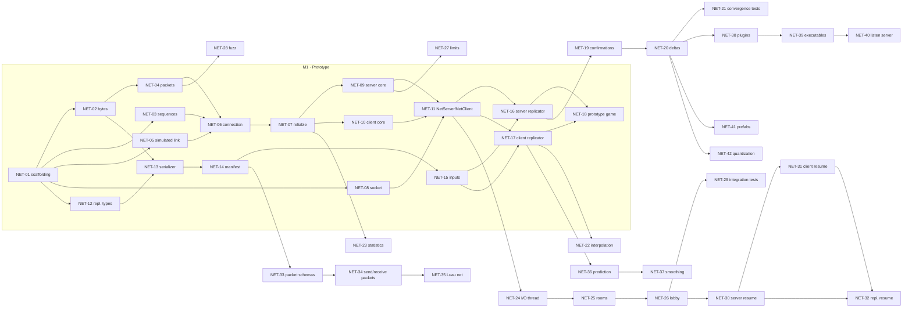

# Network Implementation Spec

This document turns [`design.md`](design.md) into work that developers can pick up, one task at a time. Every task
below is sized to be **one GitHub issue and one pull request**, has an id (`NET-xx`), the tasks that block it, and
acceptance criteria. The design stays the reference for the *why* and the byte-level details; this spec says *what
to build, in which order, with which API*, and fills the few gaps the design leaves open
([Values fixed by this spec](#5-values-fixed-by-this-spec)).

The plan is cut so that a **working prototype** (a server and several clients playing a tiny game on localhost)
can be built in **one to two days** with the ECS as it is today, then grown into the full design without throwing
code away.

> Snippets are indicative: names and signatures may change during implementation if the reviewer agrees. They
> omit the Epitech header, the rule-of-five members and most `[[nodiscard]]`/`noexcept`. The real code follows
> every rule in `CLAUDE.md`.

## Contents

1. [Starting point](#1-starting-point)
2. [Milestones](#2-milestones)
3. [The prototype in two days](#3-the-prototype-in-two-days)
4. [Module layout and shared rules](#4-module-layout-and-shared-rules)
5. [Values fixed by this spec](#5-values-fixed-by-this-spec)
6. [Deviations from the design](#6-deviations-from-the-design)
7. [Task graph](#7-task-graph)
8. [M1: Prototype](#8-m1-prototype)
9. [M2: Scalable replication](#9-m2-scalable-replication)
10. [M3: Server architecture and robustness](#10-m3-server-architecture-and-robustness)
11. [M4: Reconnection](#11-m4-reconnection)
12. [M5: Custom packets](#12-m5-custom-packets)
13. [M6: Client prediction](#13-m6-client-prediction)
14. [M7: Engine integration](#14-m7-engine-integration)
15. [M8: Protocol document, docs and tuning](#15-m8-protocol-document-docs-and-tuning)
16. [External blockers](#16-external-blockers)
17. [Filing the issues](#17-filing-the-issues)

## 1. Starting point

What the network can rely on **today** (October 2026):

| Part | State | What the network uses from it |
|---|---|---|
| `ecs`: `World`, `Entity`, components, resources, events | Done | Spawn and despawn entities, add/get/remove components by `ComponentId` and by type, `isAlive`, ECS events (`RTYPE_ECS_EVENT`, `Events::send` / `read` / `update`) |
| `ecs`: type core (`TypeInfo`, `FieldInfo`, `ReplicationMode`, `Presence`, `layoutHash`) | Done | The field list of every replicated component, its replication mode, its layout hash, `TypeRegistry::getReplicatedIds()` |
| `ecs`: change ticks (`Tick`, `ComponentTicks`, `isNewerThan`, `World::advanceChangeTick`) | Done | "Changed since the client's known tick" (M2) |
| `ecs`: `NameHash.hpp` (FNV-1a 64) | Done | Manifest and schema hashes |
| `ecs`: queries, systems, scheduler, commands, `App`/plugins | **Not started** | Needed only by [M7](#14-m7-engine-integration) |
| `ecs`: prefabs, Luau bridge, field network options (quantization) | **Not started** | Needed by NET-35, NET-41, NET-42 |
| `engine-core`: `Input`, `InputAction` | Done | Client side: fill a `PlayerInput` from the local devices |
| `platform-glfw` | Done | Window and keyboard for the prototype client |
| `render-vulkan`: `draw(RectShape)`, `draw(Sprite)`, `setCamera` | **Not implemented** (`notImplemented`) | The prototype client draws rectangles once it lands; until then it prints the world ([NET-18](#net-18--prototype-game)) |

Consequences for the plan:

- **No ECS work blocks M1 to M6.** Replication is written as plain classes (`ServerReplicator`,
  `ClientReplicator`) that take a `World&` and are called by a hand-written loop. When the `App` exists, the
  `ServerPlugin` / `ClientPlugin` of the design become thin systems that call the same classes ([NET-38](#net-38--serverplugin-and-clientplugin)).
- **Without queries, replicated entities are registered explicitly**: the game calls `replicator.track(entity)`
  after spawning it. The automatic `net.assignIds` system of the design comes with queries (NET-38).
- **Without a scheduler, a room is a fixed-step loop** that calls the replicator and a game callback.

## 2. Milestones

| Milestone | Goal | Delivers | Blocked by external work |
|---|---|---|---|
| **M1 · Prototype** | A tiny game played by several clients on localhost | Transport (bytes, acks, reliable channel, handshake, timeouts), UDP socket, manifest, inputs, full-state snapshots, a demo in `examples/network/Prototype/` | No |
| **M2 · Scalable replication** | Hundreds of bullets, smooth display | Per-entity confirmations, delta snapshots, `kSpawnOnly`, size budget, interpolation, statistics | No |
| **M3 · Server architecture and robustness** | The subject's server requirements (N2, N3, N4) | I/O thread, one thread per room, lobby, rate limits, error budget, fuzz and integration tests | No |
| **M4 · Reconnection** | A short connection loss does not end a game (N8) | Lingering sessions, resume tokens, client retry, ECS events | No |
| **M5 · Custom packets** | Kill feed, chat, lobby "ready" | Packet schemas, `RTYPE_REPLICATION_PACKET`, send and receive as ECS events; Luau bindings | Luau bindings only (Luau bridge) |
| **M6 · Client prediction** | The local ship reacts instantly | Input ring, reconciliation, correction smoothing | No |
| **M7 · Engine integration** | `client` and `server` executables, listen server | Plugins, automatic ids, engine split, prefabs, quantization | Yes: `App`, systems, queries, commands, prefabs, field options |
| **M8 · Docs and tuning** | The protocol document required by the subject, defaults from measures | RFC-style protocol, ECS docs updates, benchmarks | No |

M2 to M6 only depend on M1 and can be worked on in parallel by different people (see the [task graph](#7-task-graph)).
M3 is the most important after M1, since it carries the subject's mandatory server requirements.

## 3. The prototype in two days

### Scope

The prototype (M1) is the real foundation, not a throwaway: every M1 task is final code that later milestones
extend. It leaves out, on purpose:

| Left out of M1 | Consequence in M1 | Added by |
|---|---|---|
| I/O thread, room threads | The server is single-threaded: one loop polls the socket and runs the game (N2 is not met yet) | NET-24, NET-25 |
| Lobby and rooms | Every client that sends `kReady` joins the one game | NET-26 |
| Per-entity confirmations, deltas | Every snapshot carries **every** replicated entity with **all** its replicated components (a *complete* snapshot); fine for a few dozen entities | NET-19, NET-20 |
| Interpolation | Clients display the latest snapshot as is (choppy at 60 Hz on a faster screen, acceptable for a demo) | NET-22 |
| Rate limits, error budget | Bad packets are dropped, but a flooding client is not disconnected | NET-27 |
| Reconnection | A client silent for 2 s is closed at once (`reconnectGrace = 0` behaviour) | NET-30 to NET-32 |
| Custom packets, prefabs, quantization, prediction | Not available | M5, M6, M7 |

### Demo

`examples/network/Prototype/` builds two targets, `prototype-server` and `prototype-client`
([NET-18](#net-18--prototype-game)):

1. `xmake f --Prototype=y && xmake build -y`
2. `xmake run prototype-server` (port 4242)
3. Two or more `xmake run prototype-client 127.0.0.1 4242` (a window for the keyboard, `--bot` for a scripted
   player with no window).
4. Each client moves its own square with the arrow keys / WASD and fires with Space; it sees the other players
   and every bullet. Closing a client removes its ship for the others at once; killing it (`kill -9`) removes it
   after the 2 s timeout, and the server keeps ticking.

### Schedule

Two lanes that only meet at the end. One developer does them one after the other (with agent help); two developers
do one lane each.

| Slot | Lane A: transport (`network`) | Lane B: replication (`replication`) |
|---|---|---|
| Day 1, morning | NET-01 (shared), NET-02, NET-03, NET-04, NET-05 | NET-12, NET-13 (after NET-02) |
| Day 1, afternoon | NET-06, NET-07 | NET-14, NET-15 |
| Day 2, morning | NET-08, NET-09, NET-10, NET-11 | NET-16, NET-17 |
| Day 2, afternoon | NET-18 together, then fixes found by the demo | |

Sizes used below: **S** about 1–2 hours, **M** about half a day, **L** about a day, for one developer.

## 4. Module layout and shared rules

### Folders and namespaces

Each library is split in one folder per feature, and **namespaces mirror the folders**, as the `CLAUDE.md` rule
says (no flat-namespace exception as in `ecs`). Only what every feature shares stays at the root of the library.
`exceptions/` holds local setup errors.

```
src/rtype/network/                rtype::network — rtype-network (shared), Asio only
├── xmake.lua
├── Export.hpp                    RTYPE_NETWORK_API
├── Types.hpp                     ClientId, Channel, DisconnectReason, RejectReason, Clock, TimePoint, Bytes
├── NetworkSettings.hpp           every transport setting, with the design's defaults
├── RandomSource.hpp              std::random_device by default, replaceable in tests
├── bytes/                        rtype::network::bytes
│   └── ByteWriter, ByteReader
├── protocol/                     rtype::network::protocol
│   └── Constants (kProtocolId, kMaxPacketSize...), Sequence (isNewer), SequenceBuffer (.tpp), packets (NET-04)
├── connection/                   rtype::network::connection
│   └── Connection, ReliableSender, ReliableReceiver, ConnectionStats
├── io/                           rtype::network::io  (the only folder whose .cpp files include Asio)
│   └── Address, UdpSocket, later IoThread pieces (NET-24)
├── server/                       rtype::network::server
│   └── ServerCore, Session, NetServer, RoomMessages (ServerEvent, ServerCommand), later NetServerThread,
│       MessageQueue (.tpp), lobby messages (NET-24, NET-26)
├── client/                       rtype::network::client
│   └── ClientCore, ClientEvent, NetClient
└── exceptions/                   rtype::network::exceptions
    └── NetworkExceptions (SocketException...)

src/rtype/replication/            rtype::replication — rtype-replication (shared), depends on ecs + network
├── xmake.lua, Export.hpp         RTYPE_REPLICATION_API
├── ReplicationSettings.hpp
├── MessageType.hpp               0x20–0xFF
├── Registration.hpp/.cpp         registerReplicationTypes(world): every component and event below
├── component/                    rtype::replication::component
│   └── NetworkId, Owner, PlayerInput
├── event/                        rtype::replication::event
│   └── ClientConnected, ClientDisconnected, later ClientLost, ClientReconnected... (M4)
├── serialization/                rtype::replication::serialization
│   └── EntityMapper, FieldSerializer
├── manifest/                     rtype::replication::manifest
│   └── Manifest, ManifestReceiver, ManifestCheck
├── input/                        rtype::replication::input
│   └── InputKind, InputLayout, InputMessage, InputBuffer
├── snapshot/                     rtype::replication::snapshot
│   └── Snapshot (encode / decode), later SnapshotHistory, KnownEntities (M2)
├── server/                       rtype::replication::server
│   └── ServerReplicator, later Room, RoomManager (NET-25)
├── client/                       rtype::replication::client
│   └── ClientReplicator, later Interpolator (NET-22), Predictor (NET-36, NET-37)
├── packet/                       rtype::replication::packet  (M5)
│   └── PacketDescriptor, PacketRegistry, RTYPE_REPLICATION_PACKET
└── exceptions/                   rtype::replication::exceptions
    └── ReplicationExceptions (ManifestException...)

tests/network/      network-tests      (SimulatedLink.hpp lives here, test-only)
tests/replication/  replication-tests
examples/network/Prototype/            prototype-server, prototype-client
```

Files are named after their class (`connection/Connection.hpp`, `.cpp`, `.tpp` for templates) and included as
`rtype/network/<feature>/<File>.hpp`. The snippets of the tasks below omit the namespaces for brevity: each type
lives in the namespace of the folder listed here.

### Rules every task follows

These apply to every task; the acceptance criteria below do not repeat them.

- **Definition of done** of `CLAUDE.md`: builds on Linux, macOS and Windows (`xmake build -y`), `clang-format`
  and `clang-tidy` clean, unit tests for the success *and* failure paths, rule of five, `RTYPE_NETWORK_API` /
  `RTYPE_REPLICATION_API` on exported symbols.
- **No `<asio.hpp>` outside `src/rtype/network/*.cpp`.** Headers expose `Address`, `UdpSocket` (pimpl) and
  plain types only.
- **`network` never includes an `ecs` header; `ecs` never includes `network` or `replication`.**
  `replication` never includes `engine` headers: the glue with `engine::input::Input` lives in the executables
  (and later the engine's plugins).
- **Never throw, assert or crash on bytes from the network.** Parse with `ByteReader`, check `isValid()` and that
  nothing is left over, drop on failure. Exceptions are only for local setup errors (a port that cannot be bound,
  a manifest that cannot be built).
- **Sans-IO cores.** Everything with protocol logic (`Connection`, `ServerCore`, `ClientCore`, the replicators)
  takes bytes and a `TimePoint now` as parameters and never reads a clock or a socket itself, so tests drive time.
- **Every sequence or message id comparison goes through `isNewer`.**
- **Settings, not constants**, for every value listed in [design Configuration](design.md#configuration): they
  live in `NetworkSettings` / `ReplicationSettings` with the design's defaults. Protocol constants (packet kinds,
  sizes, protocol id) stay `constexpr`.
- **Random values** (challenges, tokens) come from `std::random_device` through a `RandomSource` that tests can
  replace (`std::function<std::uint64_t()>`).
- Every network test file is named after the class it covers (`ConnectionTests.cpp`), as in `tests/ecs/`.

## 5. Values fixed by this spec

The design names these values without giving their encoding. They are fixed here so that both sides agree; `0`
is never a valid value of a wire enum, so a zeroed byte is always rejected.

| Enum (`u8` on the wire) | Values |
|---|---|
| `DisconnectReason` | `kGraceful = 1`, `kTimeout = 2`, `kKicked = 3`, `kProtocolError = 4`, `kManifestMismatch = 5`, `kOverflow = 6`, `kServerShutdown = 7` |
| `RejectReason` | `kVersionMismatch = 1`, `kServerFull = 2`, `kSessionExpired = 3` |
| `RoomError` | `kFull = 1`, `kNotFound = 2`, `kClosed = 3`, `kTooManyRooms = 4` |
| `InputKind` | `kButton = 1`, `kAxis = 2`, `kVector2 = 3` |
| `Channel` | `kUnreliable = 0`, `kReliable = 1` (as in the design: the channel byte of a message) |

| Other value | Fixed to | Why |
|---|---|---|
| `kProtocolVersion` | `1`; bumped by every change of a wire layout | Rejected with `kVersionMismatch` |
| Initial RTT, before the first sample | 100 ms (so the first resend interval is 125 ms) | The design gives the formula, not its start |
| Datagrams built per flush, per peer | at most `kMaxDatagramsPerFlush = 8` | Bounds one flush. Reliable messages left over stay queued; unreliable ones left over are dropped (they are time-sensitive) |
| Snapshot `flags` byte | see [deviation 1](#6-deviations-from-the-design) | |
| Input actions order in the manifest | sorted by name, like every other manifest entry | One ordering rule for the whole manifest |
| `kMaxInputAxes` | 16 `f32` slots in `PlayerInput` (a `kVector2` takes 2) | `PlayerInput` is a fixed-size component |
| Snapshot ring per client (M2) | 64 entries, as in the design | |
| Client handshake retry | every 100 ms, give up after 5 s, as in the design | |

## 6. Deviations from the design

To report in `design.md` when the matching task lands (the task says so in its checklist).

1. **Snapshot `flags` byte.** The snapshot layout gets a `u8 flags` right after `last processed input`. Bit 0,
   `kComplete`, means "this snapshot lists every replicated entity of the room, with all its replicated
   components": the client despawns every replicated entity it knows that is absent, and removes every replicated
   component absent from a listed entity. The M1 server sets it whenever everything fits in one snapshot. From M2
   on, the server never sets it (deltas are never complete), so the flag costs one byte and changes nothing. It is
   also a cheap tool for later (a full resynchronization after a reconnection).
2. **Replicators before plugins.** Replication is two plain classes driven by the caller; the design's systems
   (`net.receive`, `net.applyInputs`, `net.snapshot`...) become one-line systems over them in NET-38.
3. **Explicit tracking before queries.** `ServerReplicator::track(entity)` assigns the `NetworkId`. NET-38 adds the
   automatic `net.assignIds`; `track` stays for C++ callers.
4. **Interpolation buffers in `ClientReplicator`.** The design has an `Interpolated` client-only component holding
   the last states. A component has a fixed size, while the history covers any interpolated component, so the
   buffers live in the client replicator, keyed by `(NetworkId, component)`. The world keeps the *displayed*
   value in the component itself.
5. **Predicted step as a callback before systems exist.** Prediction (M6) takes a
   `std::function<void(ecs::World&, ecs::Entity, const PlayerInput&)>` that the game registers on both sides.
   NET-38 replaces it with the systems marked `predicted = true`.
6. **A new connection from an address that already has a session.** Not covered by the design: a client restarted
   on the same port would be ignored until its old session times out. A valid challenge response for a new
   (non-resume) connection from that address closes the old session as a graceful disconnect, then creates the
   new one. The challenge still prevents a forged address from doing this.
7. **The prototype lives in `examples/`** (`examples/network/Prototype/`), not in `client` / `server` executables,
   which need the `App` (NET-39).

## 7. Task graph



External blockers (ECS `App`, queries, prefabs, Luau bridge...) are listed in [16](#16-external-blockers) and on
each task.

## 8. M1: Prototype

### NET-01 · Module scaffolding

| Milestone | Size | Blocked by | Design |
|---|---|---|---|
| M1 | S | — | [3](design.md#3-targets-and-dependencies) |

**Summary.** Create the `network` and `replication` targets, their export macros and their test targets, so every
later task only adds files.

**Tasks.**
- [ ] `src/rtype/network/xmake.lua`: `target("network")`, `set_kind("shared")`, `set_basename("rtype-network")`,
  globs `**.cpp`, `add_requires("asio 1.36.x")` with the package private to the target (no Asio in public
  headers), `RTYPE_NETWORK_BUILD` define, include dir `$(projectdir)/src` public.
- [ ] On Windows: define `_WIN32_WINNT=0x0A00` privately and link `ws2_32` (and `mswsock` if Asio needs it).
- [ ] `src/rtype/network/Export.hpp` (`RTYPE_NETWORK_API`), modelled on `src/rtype/ecs/Export.hpp`.
- [ ] `src/rtype/replication/xmake.lua` (`rtype-replication`, shared, `add_deps("ecs", "network")`, both public)
  and `Export.hpp` (`RTYPE_REPLICATION_API`).
- [ ] `network/Types.hpp`, `network/protocol/Constants.hpp`, `network/NetworkSettings.hpp` with the values of
  [5](#5-values-fixed-by-this-spec) and the design's limits (`kMaxPacketSize = 1200`, `kMaxMessageSize = 1000`,
  `kProtocolId = 0x52545950`...).
- [ ] Root `xmake.lua`: `includes` both modules and add them to the `rtype` phony target.
- [ ] `tests/network/` (`network-tests`) and `tests/replication/` (`replication-tests`) with one placeholder test
  each, included from `tests/xmake.lua`.
- [ ] Create the feature folders of [4](#folders-and-namespaces) as they are needed (no empty folders).
- [ ] `CLAUDE.md`: describe both modules and their feature folders / sub-namespaces in *Project structure*, and the
  dependency rule (`network` ← `replication` ← executables; `ecs` ← `replication`).

```c++
namespace rtype::network {
using ClientId = std::uint32_t;  ///< Given by the server, starting at 1.
inline constexpr ClientId kNoClient = 0;
using Clock = std::chrono::steady_clock;
using TimePoint = Clock::time_point;
using Bytes = std::vector<std::byte>;
enum class Channel : std::uint8_t { kUnreliable = 0, kReliable = 1 };
enum class DisconnectReason : std::uint8_t { kGraceful = 1, kTimeout, kKicked, kProtocolError, kManifestMismatch, kOverflow, kServerShutdown };
enum class RejectReason : std::uint8_t { kVersionMismatch = 1, kServerFull, kSessionExpired };
}  // namespace rtype::network
```

**Acceptance.**
- [ ] `xmake build -y` builds both (empty) libraries on the three platforms; `xmake test -v network-tests/*` and
  `replication-tests/*` run.
- [ ] No public header of `network` includes Asio: Asio is a private package of `network`, so `network-tests`
  has no Asio include path and fails to build if one does (a test file includes every public header).

### NET-02 · `ByteWriter` and `ByteReader`

| Milestone | Size | Blocked by | Design |
|---|---|---|---|
| M1 | S | NET-01 | [6.1](design.md#61-bytes-on-the-wire) |

**Summary.** Little-endian writer into a fixed buffer and bounds-checked reader, both invalid for good after the
first overflow.

**API.**
```c++
class RTYPE_NETWORK_API ByteWriter {
  public:
    explicit ByteWriter(std::span<std::byte> buffer) noexcept;
    void writeU8(std::uint8_t value) noexcept;   // + U16, U32, U64, I8, I16, I32, I64
    void writeF32(float value) noexcept;         // std::bit_cast<std::uint32_t>
    void writeF64(double value) noexcept;
    void writeBytes(std::span<const std::byte> bytes) noexcept;
    void writeString(std::string_view text) noexcept;  // u8 length + bytes; invalid if longer than 255
    void writeZeros(std::size_t count) noexcept;       // handshake padding
    [[nodiscard]] bool isValid() const noexcept;
    [[nodiscard]] std::size_t getSize() const noexcept;
    [[nodiscard]] std::span<const std::byte> getWritten() const noexcept;
};

class RTYPE_NETWORK_API ByteReader {
  public:
    explicit ByteReader(std::span<const std::byte> data) noexcept;
    [[nodiscard]] std::uint8_t readU8() noexcept;  // + every type of the writer; 0 once invalid
    [[nodiscard]] std::span<const std::byte> readBytes(std::size_t count) noexcept;
    [[nodiscard]] std::string readString(std::size_t maxLength) noexcept;  // invalid if longer
    void skip(std::size_t count) noexcept;
    [[nodiscard]] bool isValid() const noexcept;
    [[nodiscard]] std::size_t getRemaining() const noexcept;
    [[nodiscard]] bool isFinished() const noexcept;  // valid and nothing left
};
```

**Tasks.**
- [ ] Write each value byte by byte with shifts; never `memcpy` a multi-byte value (endianness).
- [ ] A write that does not fit writes nothing and invalidates the writer; a read past the end returns 0 (or empty)
  and invalidates the reader.
- [ ] Tests: round trip of every type at its limits (`INT16_MIN`, `UINT64_MAX`, `-0.0F`, NaN bit patterns kept as
  is), exact byte layout of a `u32` (`0x04030201` → `01 02 03 04`), overflow at each size, string of 255 and 256
  bytes, reading from an empty span.

**Acceptance.**
- [ ] No read or write can touch memory outside the span (tests under `-fsanitize=address` locally).

### NET-03 · Sequence numbers

| Milestone | Size | Blocked by | Design |
|---|---|---|---|
| M1 | S | NET-01 | [6.4](design.md#64-sequence-numbers-acks-and-rtt) |

**Summary.** `isNewer` and a fixed ring indexed by sequence, used by acks, sent-packet records, the reliable
receiver and (later) the snapshot ring.

**API.**
```c++
[[nodiscard]] constexpr bool isNewer(std::uint16_t a, std::uint16_t b) noexcept;  // as in the design

/// @brief N entries indexed by sequence % N; an entry is only valid for the sequence that wrote it.
template <typename T, std::size_t N>
class SequenceBuffer {
  public:
    T& insert(std::uint16_t sequence);                       // resets the entry, marks it as `sequence`
    [[nodiscard]] T* find(std::uint16_t sequence) noexcept;  // nullptr if the slot holds another sequence
    void remove(std::uint16_t sequence) noexcept;
};
```

**Tasks.**
- [ ] `protocol/Sequence.hpp` (`constexpr`, so also `static_assert` tests) and `SequenceBuffer.hpp/.tpp`.
- [ ] Tests: `isNewer(3, 65530)`, `isNewer(65530, 3) == false`, equal values, the half-range boundary
  (`32768` apart); buffer insert / find / overwrite after `N` sequences / remove, across the wrap.

### NET-04 · Packet codec

| Milestone | Size | Blocked by | Design |
|---|---|---|---|
| M1 | M | NET-02 | [6.2](design.md#62-packets) |

**Summary.** One struct per packet kind with `encode` and `decode`, so the cores never touch raw bytes.

**API.**
```c++
enum class PacketKind : std::uint8_t {
    kConnectRequest = 0x01, kChallenge = 0x02, kChallengeResponse = 0x03,
    kAccepted = 0x04, kRejected = 0x05, kData = 0x06, kDisconnect = 0x07,
};
struct ConnectRequest { std::uint16_t version; ClientId resumeClient; std::uint64_t resumeToken; };
struct Challenge { std::uint64_t value; };
struct ChallengeResponse { std::uint64_t value; };
struct Accepted { std::uint32_t sessionToken; ClientId client; std::uint64_t resumeToken; };
struct Rejected { RejectReason reason; };
struct DataHeader { std::uint32_t sessionToken; std::uint16_t sequence; std::uint16_t ack; std::uint32_t ackBits; };
struct Disconnect { std::uint32_t sessionToken; DisconnectReason reason; };

[[nodiscard]] RTYPE_NETWORK_API std::optional<PacketKind> peekKind(std::span<const std::byte> datagram) noexcept;
[[nodiscard]] RTYPE_NETWORK_API Bytes encode(const ConnectRequest& packet);   // one overload per struct
[[nodiscard]] RTYPE_NETWORK_API std::optional<ConnectRequest> decodeConnectRequest(std::span<const std::byte> datagram) noexcept;
// ... decode for each kind; kData: decodeDataHeader returns the header and the message bytes after it
```

**Tasks.**
- [ ] Layouts exactly as design 6.2; protocol id checked in `kConnectRequest` (wrong id: drop).
- [ ] `kConnectRequest` and `kChallengeResponse` are padded with zeros to 64 bytes; on decode, a size other than 64
  is rejected (padding content is not checked).
- [ ] Every decode rejects: wrong kind byte, wrong size for fixed-size kinds, size above `kMaxPacketSize`, enum
  values out of range (including 0).
- [ ] Tests: round trip of each kind, exact sizes (`kData` header is 13 bytes), each rejection case, and that every
  server reply is smaller than 64 bytes (anti-amplification, a `static_assert` on the encoded sizes).

### NET-05 · Simulated link and fake clock

| Milestone | Size | Blocked by | Design |
|---|---|---|---|
| M1 | S | NET-01 | [12](design.md#12-testing) |

**Summary.** A test-only helper in `tests/network/` that carries datagrams between two endpoints with loss,
duplication, reordering and delay, driven by a fake clock. Used by NET-06, NET-07, NET-21 and NET-36.

**API.**
```c++
struct LinkConditions { double loss{0.0}; double duplicate{0.0}; double reorder{0.0};
                        std::chrono::milliseconds delay{0}; std::chrono::milliseconds jitter{0}; };

class SimulatedLink {
  public:
    SimulatedLink(LinkConditions conditions, std::uint32_t seed);  // seeded: a failing test is reproducible
    void send(int to, rtype::network::Bytes datagram, rtype::network::TimePoint now);  // to = 0 or 1
    [[nodiscard]] std::vector<rtype::network::Bytes> receive(int at, rtype::network::TimePoint now);
};
```

**Tasks.**
- [ ] Header-only (or a `.cpp` in the test target), `std::mt19937` seeded by the test (tests may use a seeded
  generator; production code may not).
- [ ] Tests of the link itself: 0 % loss delivers everything in order after `delay`; 100 % loss delivers nothing;
  the observed loss over 10 000 datagrams is within 2 % of the setting.

### NET-06 · Connection: acks, RTT and message packing

| Milestone | Size | Blocked by | Design |
|---|---|---|---|
| M1 | L | NET-03, NET-04, NET-05 | [6.4](design.md#64-sequence-numbers-acks-and-rtt), [6.5](design.md#65-messages-and-channels) |

**Summary.** The sans-IO per-peer state: numbers outgoing `kData` datagrams, builds `ack` / `ackBits`, records
sent datagrams, measures the RTT, packs queued messages into datagrams and splits received datagrams into
messages. Unreliable channel only; NET-07 adds the reliable one.

**API.**
```c++
struct ReceivedMessage { Channel channel; Bytes payload; };

class RTYPE_NETWORK_API Connection {
  public:
    Connection(std::uint32_t sessionToken, const NetworkSettings& settings, TimePoint now);

    /// @return False (and nothing queued) if the payload is empty or above kMaxMessageSize.
    bool send(Channel channel, std::span<const std::byte> payload);
    /// @brief Processes one kData datagram whose token was already checked. Returns false if it is malformed.
    bool receive(std::span<const std::byte> datagram, TimePoint now);
    /// @brief Datagrams to send now: queued messages, and an empty keepalive if nothing was sent for `keepalive`.
    [[nodiscard]] std::vector<Bytes> buildPackets(TimePoint now);
    [[nodiscard]] std::vector<ReceivedMessage> takeMessages();

    [[nodiscard]] TimePoint getLastReceiveTime() const noexcept;
    [[nodiscard]] std::chrono::duration<float, std::milli> getRtt() const noexcept;
};
```

**Tasks.**
- [ ] Outgoing sequence starts at 0 and increments per datagram; incoming: keep the newest sequence (`ack`) and
  the 32-bit history (`ackBits`), shifting correctly when a newer sequence arrives (including a jump of more than
  32), setting the right bit when an older one arrives.
- [ ] Sent-packet records in a `SequenceBuffer<SentPacket, 1024>` (send time, acked flag, reliable ids for NET-07).
  On every received header, mark `ack` and each set bit of `ackBits` as acked; on the *first* ack of a record,
  update the RTT (`rtt += (sample - rtt) * 0.1`, initial 100 ms).
- [ ] Packing: header, then messages back to back (`channel u8 | length u16 | payload` for unreliable), up to
  `kMaxPacketSize`; at most `kMaxDatagramsPerFlush` datagrams per call; unreliable messages left over are dropped.
- [ ] Parsing: a message with an unknown channel, a length of 0, above `kMaxMessageSize` or past the end makes the
  whole datagram malformed: nothing from it is delivered (acks included).
- [ ] Keepalive: an empty datagram (header only) when nothing was sent for `settings.keepalive` (100 ms).
- [ ] Tests (through `SimulatedLink`): ack bits after in-order, out-of-order, duplicated and lost datagrams; ack
  across the 65535 → 0 wrap (send 70 000 datagrams); RTT converges to the link delay × 2 within 10 %; keepalive
  timing; malformed datagrams rejected whole.

### NET-07 · Connection: reliable channel

| Milestone | Size | Blocked by | Design |
|---|---|---|---|
| M1 | M | NET-06 | [6.5](design.md#65-messages-and-channels), [6.6](design.md#66-large-data) |

**Summary.** Exactly-once, in-order delivery for `Channel::kReliable`, by message id, resent until a datagram
carrying it is acked.

**Tasks.**
- [ ] `ReliableSender`: next id (`u16`), resend queue, at most `kReliableWindow = 256` ids in flight (newer messages
  wait), resend a message not sent within `max(1.25 × RTT, 50 ms)`, remove the ids of an acked datagram.
- [ ] More than `kMaxPendingReliable = 1024` pending messages: `Connection::isOverflowed()` becomes true (the core
  then disconnects with `kOverflow`; the connection itself never throws).
- [ ] `ReliableReceiver`: next expected id; deliver it and the consecutive ones kept aside; keep aside ids within
  `[expected, expected + 256)`; drop older ids (duplicates) and ids beyond the window (a protocol error, counted).
- [ ] Packing order in `buildPackets`: reliable messages due for resend, then new reliable messages, then
  unreliable ones. Reliable header: `channel u8 = 1 | id u16 | length u16`.
- [ ] Tests: exactly once and in order under 30 % loss, 10 % duplication and reordering, for 5 000 messages; across
  the id wrap; overflow detection; a 64-message burst spread over several datagrams.

**Acceptance.**
- [ ] The 30 % loss test passes for 20 different seeds.

### NET-08 · UDP socket and `Address`

| Milestone | Size | Blocked by | Design |
|---|---|---|---|
| M1 | M | NET-01 | [6.7](design.md#67-socket-and-io), [10](design.md#windows-connection_reset) |

**Summary.** The only Asio code (`io/`): a UDP socket that receives asynchronously on an `io_context`, never stops its
receive loop on an error, and an `Address` type that hides `asio::ip::udp::endpoint`.

**API.**
```c++
class RTYPE_NETWORK_API Address {
  public:
    [[nodiscard]] static std::optional<Address> resolve(std::string_view host, std::uint16_t port);
    [[nodiscard]] std::string toString() const;   // "127.0.0.1:4242", "[::1]:4242"
    [[nodiscard]] std::uint16_t getPort() const noexcept;
    friend bool operator==(const Address&, const Address&) = default;
  private:
    std::array<std::uint8_t, 16> _bytes{};  ///< IPv4 stored as IPv4-mapped IPv6.
    std::uint16_t _port{0};
};
// + std::hash<Address>

class RTYPE_NETWORK_API UdpSocket {
  public:
    struct Datagram { Address from; Bytes bytes; };
    /// @throws exceptions::SocketException if the port cannot be bound.
    explicit UdpSocket(std::uint16_t port);   // 0: any free port (clients)
    void sendTo(const Address& to, std::span<const std::byte> bytes) noexcept;  // errors counted, never thrown
    void poll();                              // runs ready handlers, never blocks
    void run();                               // blocks until stop() (I/O thread, NET-24)
    void stop() noexcept;
    [[nodiscard]] std::vector<Datagram> takeReceived();
    [[nodiscard]] std::uint16_t getLocalPort() const;
  private:
    struct Impl;
    std::unique_ptr<Impl> _impl;  ///< io_context, socket, receive buffer.
};
```

**Tasks.**
- [ ] `async_receive_from` re-armed after **every** completion, success or error, except
  `asio::error::operation_aborted`. Datagrams larger than `kMaxPacketSize` are dropped (receive buffer of
  `kMaxPacketSize + 1` to detect them).
- [ ] Windows: `WSAIoctl(SIO_UDP_CONNRESET, FALSE)` right after opening, as in the design.
- [ ] Bind on `0.0.0.0` (IPv4) for the server in M1; dual-stack is out of scope.
- [ ] Tests on loopback: two sockets exchange datagrams; an oversized datagram is dropped; sending to a closed port
  then receiving keeps working (the regression test for the Windows trap, run on every platform); binding a port
  already in use throws `SocketException`.

### NET-09 · Server protocol core

| Milestone | Size | Blocked by | Design |
|---|---|---|---|
| M1 | L | NET-07 | [6.3](design.md#63-connection-lifecycle), [5](design.md#5-threads) |

**Summary.** The sans-IO server: handshake with challenge, session table, token check, welcome messages,
`kReady`, keepalives, timeouts and disconnects. It turns datagrams into the events a room sees and room commands
into datagrams.

**API.**
```c++
// server/RoomMessages.hpp: what a room receives and sends (the same types are used by the room queues of NET-24).
struct ClientJoined { ClientId client; };
struct ClientMessage { ClientId client; Channel channel; Bytes payload; };
struct ClientLeft { ClientId client; DisconnectReason reason; };
using ServerEvent = std::variant<ClientJoined, ClientMessage, ClientLeft>;   // + ClientLost, ClientReconnected (M4)

inline constexpr ClientId kAllClients = std::numeric_limits<ClientId>::max();
struct SendMessage { ClientId client; Channel channel; Bytes payload; };       // client or kAllClients
struct KickClient { ClientId client; DisconnectReason reason; };
using ServerCommand = std::variant<SendMessage, KickClient>;                   // + SetRoomOpen (NET-26)

struct OutgoingDatagram { Address to; Bytes bytes; };

class RTYPE_NETWORK_API ServerCore {
  public:
    ServerCore(NetworkSettings settings, RandomSource random);
    void setWelcomeMessages(std::vector<Bytes> messages);   // sent reliably right after kAccepted
    void receive(const Address& from, std::span<const std::byte> datagram, TimePoint now);
    void execute(ServerCommand command);
    void update(TimePoint now);                              // timeouts, challenge expiry, overflow
    void shutdown(TimePoint now);                            // kDisconnect{kServerShutdown} to everyone, 3 times
    [[nodiscard]] std::vector<OutgoingDatagram> takeDatagrams(TimePoint now);   // flushes every connection
    [[nodiscard]] std::vector<ServerEvent> takeEvents();
};
```

**Tasks.**
- [ ] Pending challenges: map `Address → {challenge, created, resume fields}`, at most 256 (oldest dropped), 5 s
  expiry. A repeated `kConnectRequest` from the same address gets the same challenge.
- [ ] `kConnectRequest` with another version → `kRejected{kVersionMismatch}`; server full (sessions ≥
  `maxClients`) → `kRejected{kServerFull}`, checked on the request and again on the response.
- [ ] Matching `kChallengeResponse` → new `Session` (client id from 1, increasing, never reused; random session
  token and resume token), `kAccepted`, welcome messages queued on the reliable channel. A repeated response for
  the session created by that challenge resends `kAccepted`.
- [ ] Deviation 6: a valid new connection from an address that has a session closes the old one (`kGraceful`).
- [ ] `kData` / `kDisconnect`: dropped unless the address has a session **and** the token matches.
- [ ] Session states `kWelcoming → kReady`. In `kWelcoming`, the only accepted message is `kReady` (`0x09`, reliable),
  which emits `ClientJoined` (M1 has no lobby; NET-26 moves this to `kJoinRoom`). Messages of types
  `0x00–0x1F` are handled by the core; others are emitted as `ClientMessage` once ready.
- [ ] Timeout: no datagram for `timeout` (2 s) → close with `kTimeout` (M1; NET-30 makes it linger).
- [ ] `kDisconnect` received → close with its reason; `KickClient` → send `kDisconnect{reason}` 3 times, close.
  Connection overflow → close with `kOverflow`. Every close emits `ClientLeft` once.
- [ ] `SendMessage{kAllClients}` goes to every ready session.
- [ ] Tests (sans-IO, fake clock, fake random): full handshake; wrong challenge; challenge from another address;
  expired challenge; version mismatch; server full; wrong token dropped; duplicated `kChallengeResponse`; timeout;
  graceful disconnect; kick; messages before `kReady` dropped; 257 pending challenges.

### NET-10 · Client protocol core

| Milestone | Size | Blocked by | Design |
|---|---|---|---|
| M1 | M | NET-07 | [6.3](design.md#63-connection-lifecycle) |

**Summary.** The sans-IO client state machine: connect, answer the challenge, receive the welcome messages, send
`kReady` when told to, keep the connection alive, detect the timeout, disconnect.

**API.**
```c++
struct ConnectionAccepted { ClientId client; };
struct ServerMessage { Channel channel; Bytes payload; };
struct Disconnected { DisconnectReason reason; };        // reason from the server, or kTimeout locally
struct ConnectFailed { std::optional<RejectReason> reason; };   // nullopt: server unreachable (5 s)
using ClientEvent = std::variant<ConnectionAccepted, ServerMessage, Disconnected, ConnectFailed>;

class RTYPE_NETWORK_API ClientCore {
  public:
    ClientCore(NetworkSettings settings);
    void connect(TimePoint now);
    void receive(std::span<const std::byte> datagram, TimePoint now);   // from the server address only
    bool send(Channel channel, std::span<const std::byte> payload);    // false before ConnectionAccepted
    void sendReady();                                                   // after the manifest check
    void disconnect(TimePoint now);                                     // kGraceful, 3 times
    void update(TimePoint now);
    [[nodiscard]] std::vector<Bytes> takeDatagrams(TimePoint now);
    [[nodiscard]] std::vector<ClientEvent> takeEvents();
    [[nodiscard]] ClientId getClientId() const noexcept;
};
```

**Tasks.**
- [ ] States `kIdle → kRequesting → kResponding → kConnected → kClosed`; resend the current handshake packet every
  100 ms; `ConnectFailed{}` after 5 s; `ConnectFailed{reason}` on `kRejected`.
- [ ] A `kChallenge` in `kResponding` with a different value replaces the stored one (the server restarted).
- [ ] Datagrams with an unknown kind, or `kData` / `kDisconnect` with a token other than ours, are dropped.
- [ ] Timeout after 2 s of silence once connected → `Disconnected{kTimeout}`.
- [ ] Tests: driven together with a `ServerCore` through `SimulatedLink` (handshake under 50 % loss, version
  mismatch, server full, server never answers, server shutdown reaches the client).

### NET-11 · `NetServer` and `NetClient`

| Milestone | Size | Blocked by | Design |
|---|---|---|---|
| M1 | S | NET-08, NET-09, NET-10 | [6.7](design.md#67-socket-and-io) |

**Summary.** Glue a `UdpSocket` to each core, polled by the caller. This is the API the prototype and the
replicators use; NET-24 runs `NetServer` on its own thread without changing it.

**API.**
```c++
class RTYPE_NETWORK_API NetServer {
  public:
    explicit NetServer(NetworkSettings settings);   // binds settings.port
    void setWelcomeMessages(std::vector<Bytes> messages);
    void poll(TimePoint now);                        // receive all, update, flush
    void execute(ServerCommand command);
    [[nodiscard]] std::vector<ServerEvent> takeEvents();
    void flush(TimePoint now);                       // send what execute() queued, right away
    void shutdown(TimePoint now);
};

class RTYPE_NETWORK_API NetClient {
  public:
    NetClient(Address server, NetworkSettings settings);  // binds port 0
    void poll(TimePoint now);
    bool send(Channel channel, std::span<const std::byte> payload);
    void sendReady();
    void disconnect(TimePoint now);
    [[nodiscard]] std::vector<ClientEvent> takeEvents();
};
```

**Tasks.**
- [ ] Datagrams from an address other than the server's are dropped by `NetClient`.
- [ ] A small `examples/network/Echo/` (or a test) where a client sends a reliable message and the server echoes
  it, over real loopback sockets.

**Acceptance.**
- [ ] Two processes exchange messages on localhost on the three platforms (manual check, noted in the PR).

### NET-12 · Replication types

| Milestone | Size | Blocked by | Design |
|---|---|---|---|
| M1 | S | NET-01 | [7.1](design.md#71-identity), [ECS 20](../ecs/features/20-replication.md#what-lives-in-the-ecs) |

**Summary.** The ECS components and events every replicated game uses.

**API.**
```c++
namespace rtype::replication {
struct NetworkId { std::uint32_t value; };             // "net.NetworkId", kBoth, kNone; 0 = none
struct Owner { std::uint32_t client; };                // "net.Owner", kEveryChange (the client finds its ship)
inline constexpr std::size_t kMaxInputAxes = 16;
struct PlayerInput {                                   // "net.PlayerInput", kBoth, kNone
    std::uint32_t buttons;            ///< Bit i: button action i of the InputLayout is held.
    std::uint32_t previousButtons;    ///< Buttons of the previous applied input: pressed = held now, not before.
    std::array<float, kMaxInputAxes> axes;
    std::uint32_t sequence;           ///< Client input sequence that produced this value.
};
struct ClientConnected { std::uint32_t client; };                    // ECS event "net.ClientConnected"
struct ClientDisconnected { std::uint32_t client; std::uint8_t reason; };   // "net.ClientDisconnected"

/// @brief Registers every type above in the world. Both sides call it before building or checking the manifest.
RTYPE_REPLICATION_API void registerReplicationTypes(ecs::World& world);
}
```

**Tasks.**
- [ ] Declare with `RTYPE_ECS_COMPONENT` / `RTYPE_ECS_EVENT` and the right `Presence` / `ReplicationMode`. Raw
  network ids are plain `std::uint32_t` in function signatures; `NetworkId` is the component.
- [ ] Check that `std::array<float, N>` is supported by `FieldTypeOf` as a fixed array (`count = N`); otherwise use
  a C array or add the support in `ecs` in the same PR (small `feat(ecs)` commit first).
- [ ] Tests: registration in a fresh world, names and layout hashes stable (hard-coded expected hashes, so a layout
  change is noticed).

### NET-13 · Field serializer

| Milestone | Size | Blocked by | Design |
|---|---|---|---|
| M1 | M | NET-02, NET-12 | [7.4](design.md#74-snapshots-server--client), [ECS 15](../ecs/features/15-reflection-and-serialization.md) |

**Summary.** Write and read the bytes of any replicated component by walking its `FieldInfo` list, so C++ and
(later) Luau components need no network code.

**API.**
```c++
/// @brief Translates entity fields: Entity → NetworkId when writing, NetworkId → Entity when reading.
class EntityMapper {
  public:
    virtual ~EntityMapper() = default;
    [[nodiscard]] virtual std::uint32_t toNetwork(ecs::Entity entity) const noexcept = 0;   // 0 if unknown/null
    [[nodiscard]] virtual ecs::Entity toLocal(std::uint32_t networkId) const noexcept = 0;  // null if unknown
};

/// @return False if the type cannot be replicated in v1 (it has lifecycle hooks).
[[nodiscard]] RTYPE_REPLICATION_API bool isSerializable(const ecs::TypeInfo& info) noexcept;
RTYPE_REPLICATION_API void writeFields(network::bytes::ByteWriter& writer, const ecs::TypeInfo& info,
                                       std::span<const std::byte> value, const EntityMapper& mapper) noexcept;
/// @return False (value unspecified) if a field fails its check or bytes are missing.
[[nodiscard]] RTYPE_REPLICATION_API bool readFields(network::bytes::ByteReader& reader, const ecs::TypeInfo& info,
                                                    std::span<std::byte> value, const EntityMapper& mapper) noexcept;
```

**Tasks.**
- [ ] Every `FieldType`, `count` values per field, in `fields` order; `kEntity` as `u32` NetworkId, `kAssetId` as
  `u64`, `bool` as `u8`; padding is never written; `readFields` starts from a zeroed value.
- [ ] Checks on read: `bool` is 0 or 1; `f32`/`f64` and every vector component finite.
- [ ] `isSerializable`: no `TypeHooks` (plain data), at least one field.
- [ ] Tests: round trip of a component with every field type and a fixed array; NaN and infinity rejected; `bool`
  value 2 rejected; truncated input rejected; entity mapping both ways, unknown id → null entity.

### NET-14 · Manifest

| Milestone | Size | Blocked by | Design |
|---|---|---|---|
| M1 | M | NET-13 | [7.2](design.md#72-manifest), [7.3](design.md#73-message-types) |

**Summary.** Build the manifest from the server's world, send it as welcome messages, rebuild and check it on the
client. M1 covers components and input actions; NET-33 adds packets and NET-41 prefabs.

**API.**
```c++
enum class MessageType : std::uint8_t {
    kManifestComponent = 0x20, kManifestPacket = 0x21, kManifestPrefab = 0x22, kManifestInputAction = 0x23,
    kManifestEnd = 0x24, kSnapshot = 0x30, kInput = 0x31, kCustomPacket = 0x32,
};

class RTYPE_REPLICATION_API Manifest {
  public:
    /// @throws exceptions::ManifestException on a non-serializable replicated type or more than 32 button actions.
    [[nodiscard]] static Manifest build(const ecs::World& world, const InputLayout& inputs);
    [[nodiscard]] std::vector<network::Bytes> encode(const ReplicationSettings& settings) const;
    [[nodiscard]] std::uint64_t getHash() const noexcept;
    [[nodiscard]] std::optional<ecs::ComponentId> toLocal(std::uint16_t shortId) const noexcept;
    [[nodiscard]] std::optional<std::uint16_t> toShort(ecs::ComponentId id) const noexcept;
    [[nodiscard]] std::span<const ecs::ComponentId> getComponents() const noexcept;  // in short id order
};

/// @brief Result of the client's check: the manifest mapped to the local world, or the first difference.
struct ManifestCheck { std::optional<Manifest> manifest; std::string mismatch; };

/// @brief Client side: collects the manifest messages, then compares them with the local world.
class RTYPE_REPLICATION_API ManifestReceiver {
  public:
    /// @return False on a malformed or unexpected message.
    bool receive(std::span<const std::byte> message);
    [[nodiscard]] bool isComplete() const noexcept;
    /// @return The manifest mapped to the local world, or the description of the first difference.
    [[nodiscard]] ManifestCheck check(const ecs::World& world, const InputLayout& inputs) const;
    [[nodiscard]] const ReplicationSettings& getServerSettings() const noexcept;  // from kManifestEnd
};
```

**Tasks.**
- [ ] Replicated components: `TypeRegistry::getReplicatedIds()`, excluding `Presence::kClientOnly`, sorted by name;
  short id = index.
- [ ] Manifest hash: FNV-1a (`hashString` / `hashInteger`) over every entry in order (entry type, short id, name,
  layout hash or kind).
- [ ] `kManifestEnd`: entry count, hash, tick rate, snapshot rate, reconnect grace (seconds), as design 7.3.
- [ ] Client check: same count and hash, every name known locally with the same layout hash, every input action at
  the same index with the same kind. Error text names the first differing entry
  (`` `game.Health` differs between client and server ``).
- [ ] A mismatch is network input, not a setup error: it is returned in `ManifestCheck`, never thrown.
- [ ] Tests: build → encode → receive → check round trip; each kind of mismatch; malformed messages; entry count
  mismatch; more than 32 buttons refused at build.

### NET-15 · Inputs

| Milestone | Size | Blocked by | Design |
|---|---|---|---|
| M1 | M | NET-14 | [7.5](design.md#75-inputs-client--server) |

**Summary.** The game's input actions, the `kInput` message (last 3 inputs) and the server's per-client input
buffer.

**API.**
```c++
enum class InputKind : std::uint8_t { kButton = 1, kAxis = 2, kVector2 = 3 };

class RTYPE_REPLICATION_API InputLayout {
  public:
    void add(std::string name, InputKind kind);   // before the manifest is built; order does not matter
    [[nodiscard]] bool isHeld(const PlayerInput& input, std::string_view action) const;
    [[nodiscard]] bool isPressed(const PlayerInput& input, std::string_view action) const;  // held, not before
    [[nodiscard]] float readAxis(const PlayerInput& input, std::string_view action) const;
    [[nodiscard]] std::array<float, 2> readVector(const PlayerInput& input, std::string_view action) const;
    void setButton(PlayerInput& input, std::string_view action, bool held) const;   // client: fill from devices
    void setAxis(PlayerInput& input, std::string_view action, float value) const;
};

struct InputSample { std::uint32_t sequence; std::uint32_t buttons; std::vector<float> axes; };
struct InputMessage { std::uint32_t lastAppliedSnapshot; std::vector<InputSample> inputs; };   // 1 to 3 inputs
[[nodiscard]] network::Bytes encode(const InputMessage& message, const InputLayout& layout);
[[nodiscard]] std::optional<InputMessage> decodeInput(std::span<const std::byte> message, const InputLayout& layout);

/// @brief Server side, one per client.
class InputBuffer {
  public:
    void push(const InputSample& sample);              // ignores sequences already applied or buffered
    [[nodiscard]] InputSample next();                  // the next one, or the last one repeated
    [[nodiscard]] std::uint32_t getLastProcessed() const noexcept;
};
```

**Tasks.**
- [ ] Actions sorted by name; button `i` is the `i`-th `kButton` action; axis slots in order, two per `kVector2`;
  at most `kMaxInputAxes` slots.
- [ ] Axes on the wire as `i16`, `[-1, 1] ↔ [-32767, 32767]`, clamped on encode; on decode, `-32768` is clamped to
  `-1`. Button bits beyond the button count must be 0 (else the message is dropped).
- [ ] `InputBuffer`: kept by sequence; above 4 buffered, drop the oldest down to 2; `next()` with an empty buffer
  repeats the last input and does not advance `getLastProcessed()`.
- [ ] Tests: encode / decode of 1 and 3 inputs; bad counts (0, 4); extra button bits; buffer ordering, duplicates,
  overflow, repetition; `isPressed` edge detection through `previousButtons`.

### NET-16 · Server replicator with complete snapshots

| Milestone | Size | Blocked by | Design |
|---|---|---|---|
| M1 | L | NET-11, NET-15 | [7.4](design.md#74-snapshots-server--client), [7.5](design.md#75-inputs-client--server), deviation [1](#6-deviations-from-the-design) |

**Summary.** The server half of replication: assigns `NetworkId`s, raises connection events, applies inputs and
sends a complete snapshot to every joined client.

**API.**
```c++
struct ReplicationSettings { std::uint8_t tickRate{60}; std::uint8_t snapshotRate{60}; std::uint16_t reconnectGraceSeconds{60}; };

class RTYPE_REPLICATION_API ServerReplicator {
  public:
    ServerReplicator(ecs::World& world, const InputLayout& inputs, ReplicationSettings settings);
    [[nodiscard]] std::vector<network::Bytes> getWelcomeMessages() const;   // the encoded manifest
    std::uint32_t track(ecs::Entity entity);      // assigns the next id, adds the NetworkId component
    void handle(const network::server::ServerEvent& event);
    void applyInputs();                          // once per fixed tick, before the game step
    void endTick();                              // after the game step and advanceChangeTick(): builds snapshots
    [[nodiscard]] std::vector<network::server::ServerCommand> takeCommands();
    [[nodiscard]] std::uint32_t getServerTick() const noexcept;
};
```

**Snapshot layout** (design 7.4 plus the `flags` byte of deviation 1; this is the final layout, M2 only changes
what the server puts in it):

```
u8   type = kSnapshot (0x30)
u32  tick                    server tick of this snapshot
u32  last processed input    of the receiving client (0 before its first input)
u8   flags                   bit 0: kComplete; other bits must be 0
u16  spawn count    × { netId u32, prefab u16 (0xFFFF = none), component count u8, × { short id u16, fields } }
u16  update count   × { netId u32, component count u8, × { short id u16, fields } }
u16  removal count  × { netId u32, short id u16 }
u16  despawn count  × { netId u32 }
```

In M1 the server only writes spawn records; updates, removals and despawns are empty (but the client already
applies them, NET-17).

**Tasks.**
- [ ] `snapshot/Snapshot.hpp/.cpp`: a decoded `Snapshot` struct and its encoder / decoder (the decoder checks counts against
  the remaining bytes, unknown short ids, duplicate net ids in one list, and reserved flag bits).
- [ ] `ClientJoined` → ECS event `ClientConnected`, client added to the snapshot list. `ClientLeft` → event
  `ClientDisconnected`, client removed. `ClientMessage` of type `kInput` → that client's `InputBuffer`, other types
  ignored in M1 (malformed ones counted for NET-27).
- [ ] `applyInputs`: for every tracked entity with an `Owner`, write `next()` of that client's buffer into its
  `PlayerInput` (adding it if missing), keeping `previousButtons`.
- [ ] Untrack entities that are no longer alive (`World::isAlive`) at each `endTick`.
- [ ] Snapshot every `tickRate / snapshotRate` ticks (check the divisor at construction, throw otherwise). Layout
  of design 7.4 with the `flags` byte: every tracked entity as a spawn record (prefab `0xFFFF`, every replicated
  component it has), until `kMaxMessageSize`; `kComplete` if all fit; `last processed input` per client.
- [ ] Log (rate-limited) when a snapshot does not fit; never send more than one snapshot per client per tick.
- [ ] Tests (no socket: events in, commands out): ids increasing and never reused; connect / disconnect events;
  inputs applied to the right entity; repeated input; snapshot content decoded by NET-04/13 helpers; `kComplete`
  cleared above the budget.

### NET-17 · Client replicator

| Milestone | Size | Blocked by | Design |
|---|---|---|---|
| M1 | L | NET-11, NET-15 | [7.2](design.md#72-manifest), [7.4](design.md#74-snapshots-server--client), [7.5](design.md#75-inputs-client--server) |

**Summary.** The client half: checks the manifest, applies snapshots to the local world through a
`NetworkId → Entity` map, sends inputs.

**API.**
```c++
enum class ManifestStatus : std::uint8_t { kWaiting, kAccepted, kMismatch };

class RTYPE_REPLICATION_API ClientReplicator {
  public:
    ClientReplicator(ecs::World& world, const InputLayout& inputs);
    void handle(const network::client::ClientEvent& event);
    [[nodiscard]] ManifestStatus getManifestStatus() const noexcept;
    [[nodiscard]] std::string_view getMismatch() const noexcept;     // text for the player
    /// @brief Numbers the input with the next sequence and queues a kInput with the last 3.
    void sendInput(const PlayerInput& input);
    [[nodiscard]] std::vector<std::pair<network::Channel, network::Bytes>> takeOutgoing();
    [[nodiscard]] ecs::Entity find(std::uint32_t networkId) const noexcept;   // null if unknown
    [[nodiscard]] std::optional<ecs::Entity> getLocalPlayer() const noexcept;   // Owner == our client id
};
```

**Tasks.**
- [ ] Manifest messages go to a `ManifestReceiver`; when complete, check it; on success the caller sends `kReady`
  (`NetClient::sendReady`), on mismatch the caller disconnects with `kManifestMismatch` and shows the text.
- [ ] Snapshots: drop if the tick is not newer than the last applied; apply spawns (create if unknown, add the
  `NetworkId` component, set components), updates, removals, despawns in that order; resolve `kEntity` fields after
  spawns (read in two passes, or defer entity fields); with `kComplete`, despawn absent entities and remove absent
  replicated components.
- [ ] Any malformed part drops the **whole** snapshot before touching the world (decode first, then apply).
- [ ] The tick of the last applied snapshot goes in every `kInput`.
- [ ] Tests: apply a hand-built snapshot to an empty world; older tick dropped; entity references between two
  entities spawned by the same snapshot; complete-snapshot removal; malformed snapshot leaves the world unchanged;
  manifest mismatch status.

### NET-18 · Prototype game

| Milestone | Size | Blocked by | Design |
|---|---|---|---|
| M1 | M | NET-16, NET-17 | [3](#3-the-prototype-in-two-days) of this spec |

**Summary.** `examples/network/Prototype/`: a server and a client of a tiny shooter, wired by hand-written loops,
that proves the whole M1 pipeline.

**Game.** Components `Body { vec2 position; vec2 size; u32 color; }` (`kEveryChange`) and `Velocity { vec2 value; }`
(server-only presence, not replicated); actions `move` (`kVector2`) and `fire` (`kButton`). On `ClientConnected`
the server spawns a ship (`Body`, `Owner`, `PlayerInput`) and tracks it; on `ClientDisconnected` it despawns it.
`fire` pressed spawns a bullet moving right, despawned when it leaves an 800 × 600 area.

**Tasks.**
- [ ] `prototype-server`: `NetServer` + `ServerReplicator` + game step in a fixed 60 Hz loop
  (`sleep_until` the next tick), command line `--port`, `--snapshot-rate`; SIGINT → `shutdown()`.
- [ ] `prototype-client`: `NetClient` + `ClientReplicator`; GLFW window and `engine::input::Input` to fill
  `PlayerInput` every 1/60 s; display: `IRenderer::draw(RectShape)` for every `Body` when the renderer implements
  it, otherwise a text dump of every `Body` twice per second; `--bot` mode with no window (moves in a circle, fires
  every second); shows the manifest mismatch or disconnect reason and exits.
- [ ] The server loop: `poll` → `handle` events → `applyInputs` → game step → `World::advanceChangeTick()` →
  `endTick` → `execute` commands → `flush` → `Events::update()`.
- [ ] A `README.md` in the example with the demo steps of [3](#demo).

**Acceptance.**
- [ ] The [demo](#demo) works on Linux and on one other platform (noted in the PR).
- [ ] `kill -9` of a client: the other clients see its ship disappear after about 2 s; the server's tick rate is
  unchanged (it prints its tick count every 5 s).

## 9. M2: Scalable replication

### NET-19 · Snapshot confirmations

| Milestone | Size | Blocked by | Design |
|---|---|---|---|
| M2 | M | NET-16 | [7.4](design.md#74-snapshots-server--client) (Confirmations are application-level) |

**Summary.** Track, per client and per entity, the ECS tick the client last confirmed, from the
`last applied snapshot` of `kInput`.

**Tasks.**
- [ ] Per client: a `SequenceBuffer`-like ring of the last 64 snapshots (server tick, ECS tick at build time, list of
  `(NetworkId, components included)`, removals and despawns).
- [ ] On a confirmation of snapshot `T` in the ring: `knownEntities[id] = {ecsTick(T), components known}` for every
  entity of `T`; removals and despawns of `T` cleared. Confirmations older than the ring, or not newer than the last
  one, are ignored.
- [ ] Tests: confirmation updates, stale confirmation ignored, ring wrap, confirmation of a snapshot never sent
  ignored.

### NET-20 · Delta snapshots, `kSpawnOnly` and size budget

| Milestone | Size | Blocked by | Design |
|---|---|---|---|
| M2 | L | NET-19 | [7.4](design.md#74-snapshots-server--client), [11](design.md#11-bandwidth-estimate) |

**Summary.** Replace complete snapshots by the design's per-client selection: spawns until confirmed, updates of
changed components, removals, despawns, filled in priority order up to the budget.

**Tasks.**
- [ ] Selection per entity and client exactly as the design's table, from the **current** state compared with the
  known tick (`ecs::isNewerThan(changed, known, now)`) and the known component set; `kSpawnOnly` components only in
  spawns; a component removed then re-added before confirmation is an update.
- [ ] Despawns: remember, per client, the despawned ids that were sent at least once, until confirmed.
- [ ] Budget: despawns, spawns, then updates with the oldest-confirmed entities first; an entity whole or not at
  all; never set `kComplete`.
- [ ] Client: nothing new (NET-17 already applies the four lists); verify updates add missing components.
- [ ] Update `design.md` 7.4 with the `flags` byte (deviation 1).
- [ ] Tests: each row of the design's table; budget overflow completed over the next snapshots; no starvation
  (an entity left out is sent within N snapshots); spawn-then-despawn before any snapshot never sent.

### NET-21 · Replication convergence tests

| Milestone | Size | Blocked by | Design |
|---|---|---|---|
| M2 | M | NET-20, NET-05 | [12](design.md#12-testing) |

**Summary.** Two worlds connected through cores and the simulated link: the client world must converge to the
server world under loss.

**Tasks.**
- [ ] Harness: `ServerCore` + `ServerReplicator` and `ClientCore` + `ClientReplicator`, datagrams through
  `SimulatedLink`, fake clock, a scripted server game (spawns, moves, removes components, despawns).
- [ ] After the script and a quiet period, compare every replicated entity and component (by `NetworkId`).
- [ ] Scenarios: 0 %, 10 %, 30 % loss; 300 entities (budget); a manifest mismatch refused.

### NET-22 · Interpolation

| Milestone | Size | Blocked by | Design |
|---|---|---|---|
| M2 | M | NET-17 | [7.4](design.md#74-snapshots-server--client) (Interpolation), deviation [4](#6-deviations-from-the-design) |

**Summary.** Display remote entities about 100 ms in the past, interpolated between the two snapshots around the
display time.

**API.**
```c++
clientReplicator.interpolate(componentId);    // before connecting; fields kF32 / kVecN are lerped, others snap
clientReplicator.updateDisplay(frameTime);    // every frame, after handle()
```

**Tasks.**
- [ ] Buffers per `(NetworkId, component)` of the last few `(tick, value)`; snapshots write there instead of the
  world for interpolated components.
- [ ] Display clock: `newest tick − delay`, delay = `max(2 snapshot intervals, 100 ms)` from the server's snapshot
  rate; advanced by frame time, corrected gently (e.g. ±10 % speed) when it drifts, snapped when far off.
- [ ] Tests: values halfway between two ticks; jitter in arrival time does not change the output; snap on a big
  drift; non-float fields snap.

### NET-23 · Network statistics

| Milestone | Size | Blocked by | Design |
|---|---|---|---|
| M2 | S | NET-07 | [12](design.md#12-testing) (Statistics) |

**Summary.** Per connection: RTT, loss (unacked records over the last 1024), datagrams and bytes per second in and
out, resent reliable messages. Readable from `NetServer` (per client) and `NetClient`, for a debug overlay or the
prototype's text dump.

**Tasks.**
- [ ] `ConnectionStats` struct and `Connection::getStats(now)`; one-second sliding window.
- [ ] Tests through `SimulatedLink`: loss estimate within 3 % of the link's.

## 10. M3: Server architecture and robustness

### NET-24 · I/O thread and room queues

| Milestone | Size | Blocked by | Design |
|---|---|---|---|
| M3 | M | NET-11 | [5](design.md#5-threads) |

**Summary.** Run `NetServer` on its own thread and route events and commands through one inbox and one outbox per
room, so the game never waits on the network (N2).

**API.**
```c++
using RoomId = std::uint32_t;
/// @brief One direction between the I/O thread and a room: a mutex and a vector, swapped once per tick.
template <typename T>
class MessageQueue {
  public:
    void push(T message);
    [[nodiscard]] std::vector<T> takeAll();   // locks, swaps with an empty vector, unlocks
};
struct RoomChannel { MessageQueue<ServerEvent> inbox; MessageQueue<ServerCommand> outbox; };

class RTYPE_NETWORK_API NetServerThread {
  public:
    explicit NetServerThread(NetworkSettings settings);
    void start();                                       // binds, then runs the io_context on the I/O thread
    void stop();                                        // shutdown() to every client, joins the thread
    void addRoom(RoomId room, std::shared_ptr<RoomChannel> channel);   // posted to the I/O thread
    void removeRoom(RoomId room);
    void notifyOutbox(RoomId room);                     // posts a flush of that room's outbox
};
```

**Tasks.**
- [ ] The I/O thread owns `ServerCore` and the room table; every other thread only calls `post`ed functions or
  pushes to a queue.
- [ ] A `steady_timer` every 10 ms runs `update` and flushes (resends, keepalives, timeouts).
- [ ] `Session::roomId` routes `ClientMessage`s; `SendMessage{kAllClients}` from a room reaches only its clients.
- [ ] M3 keeps auto-join until NET-26: every ready client goes to room 1.
- [ ] Tests: a room thread pushing commands while the I/O thread receives (run under ThreadSanitizer locally);
  stop with clients connected.

### NET-25 · Rooms and `RoomManager`

| Milestone | Size | Blocked by | Design |
|---|---|---|---|
| M3 | M | NET-24 | [5](design.md#5-threads), [9](design.md#9-lobby-and-rooms) |

**Summary.** One thread per room running a fixed-step loop around a game-provided room object; the
`RoomManager` creates and stops them. Lives in `replication` so the listen server reuses it.

**API.**
```c++
class Room {   // implemented by the game (later: an App, NET-38)
  public:
    virtual ~Room() = default;
    virtual void tick(std::span<const network::server::ServerEvent> events,
                      std::vector<network::server::ServerCommand>& commands) = 0;
};
using RoomFactory = std::function<std::unique_ptr<Room>(network::server::RoomId)>;

class RTYPE_REPLICATION_API RoomManager {
  public:
    RoomManager(network::server::NetServerThread& server, RoomFactory factory, ReplicationSettings settings);
    network::server::RoomId create();       // thread started, channel registered with the I/O thread
    void stop(network::server::RoomId room);
    void stopAll();                 // on shutdown
};
```

**Tasks.**
- [ ] Room loop: `takeAll` inbox → `tick` → push commands → `notifyOutbox`, at `tickRate`; catches every exception
  from `tick`, logs it and closes the room (kicking its clients with `kServerShutdown`) without stopping the server.
- [ ] The manifest is built once at startup from a throwaway room; every new room's manifest hash must match it.
- [ ] `maxRooms` enforced.
- [ ] Move the prototype server to rooms (one room, auto-join) to validate the API.
- [ ] Tests: create, stop, room exception isolated, manifest hash mismatch refused.

### NET-26 · Lobby and rooms protocol

| Milestone | Size | Blocked by | Design |
|---|---|---|---|
| M3 | M | NET-25 | [9](design.md#9-lobby-and-rooms) |

**Summary.** After `kReady`, clients are in the lobby; they list, create, join and leave rooms with the design's
reliable messages.

**Tasks.**
- [ ] Message types `0x01`–`0x08` of design 9 (`kRoomListRequest`, `kRoomList`, `kCreateRoom`, `kJoinRoom`,
  `kLeaveRoom`, `kRoomJoined`, `kRoomError`, `kClientLeft`), handled on the I/O thread; `kCreateRoom` forwarded to
  the main thread's `RoomManager` and the creator joined when it is registered.
- [ ] `ClientJoined` now pushed on join (no auto-join); leave / disconnect → `ClientLeft` to the room and
  `kClientLeft` to the other clients of the room.
- [ ] `SetRoomOpen{bool}` command; `open` reflected in `kRoomList`; capacity `maxPlayersPerRoom`.
- [ ] A room with no players left is stopped.
- [ ] Client side helpers in `NetClient` (`requestRoomList`, `createRoom`, `joinRoom`, `leaveRoom` and the matching
  events), and a lobby mode in the prototype client (`--room <id>` / `--create`).
- [ ] Tests: each message and error (`kFull`, `kNotFound`, `kClosed`, `kTooManyRooms`), last player leaving stops the
  room.

### NET-27 · Rate limits and error budget

| Milestone | Size | Blocked by | Design |
|---|---|---|---|
| M3 | M | NET-09 | [10](design.md#10-robustness-and-security) |

**Summary.** The per-client limits of design 10, so a broken or hostile client cannot flood the server.

**Tasks.**
- [ ] Token bucket per session (120 datagrams/s, bursts of 20) and per source IP for connect requests (10/s);
  excess dropped. The per-IP table is bounded and expires.
- [ ] Error budget per session: 20 protocol errors per 10 s (malformed datagram, malformed message, bad reliable id,
  unknown message type, bad input or snapshot confirmation, bad custom packet) → disconnect `kProtocolError`.
  Replication reports its errors back through a `ReportError{client}` command.
- [ ] Rate-limited logging helper (at most N lines per second per category).
- [ ] All limits in `NetworkSettings`.
- [ ] Tests: flood dropped, budget exceeded disconnects, budget recovers after the window.

### NET-28 · Fuzz tests

| Milestone | Size | Blocked by | Design |
|---|---|---|---|
| M3 | S | NET-04 (grows with every parser) | [12](design.md#12-testing) |

**Summary.** Random and truncated bytes fed to every parser must never crash, throw or read out of bounds.

**Tasks.**
- [ ] A GoogleTest suite that, for each parser (packet decoders, `Connection::receive`, `ServerCore::receive`,
  `ClientCore::receive`, manifest, input, snapshot, custom packet), feeds 100 000 random buffers and every
  truncation and single-byte mutation of a valid one. Seeded and reproducible.
- [ ] Optional libFuzzer targets behind an xmake option (`--Fuzz=y`, Clang only), not in CI.

### NET-29 · Real-socket integration tests

| Milestone | Size | Blocked by | Design |
|---|---|---|---|
| M3 | M | NET-26 | [12](design.md#12-testing) (Integration) |

**Summary.** Server and clients over real loopback sockets, in one test process (threads), checking the subject's
requirements end to end.

**Tasks.**
- [ ] A client that stops sending (simulated crash): the others receive `kClientLeft` after the timeout; the
  room's tick count keeps its rate (±5 %).
- [ ] A client spamming garbage is disconnected; the others are unaffected.
- [ ] Two rooms run independently; a room whose game throws is closed, the other continues.
- [ ] Runs in CI on the three platforms (ports chosen with `UdpSocket(0)` to avoid collisions).

## 11. M4: Reconnection

### NET-30 · Server: lingering sessions and resume

| Milestone | Size | Blocked by | Design |
|---|---|---|---|
| M4 | L | NET-26 | [6.8](design.md#68-reconnecting-after-a-connection-loss) |

**Summary.** A timeout makes a session linger for `reconnectGrace`; a valid resume request rebinds it to a fresh
connection with new tokens.

**Tasks.**
- [ ] Session states `Active → Lingering → Resuming → Active`, `→ Closed` at the grace deadline (never extended);
  `reconnectGrace = 0` keeps the M1 behaviour.
- [ ] `ClientLost` / `ClientReconnected` added to `ServerEvent`; `kClientLost` (`0x0A`) and `kClientReconnected`
  (`0x0B`) to the other clients of the room.
- [ ] Resume: `kConnectRequest` with client id and resume token → challenge (the pending entry keeps them) → on
  response, look up and compare the token; on success new session token, new resume token, fresh `Connection`,
  endpoint map moved to the new address; else `kRejected{kSessionExpired}`.
- [ ] After `kReady` on a resumed session: `kRoomJoined` if it was in a room, `ClientReconnected` to the room.
- [ ] Lingering sessions count against `maxClients`.
- [ ] Tests: resume within the grace (same and new address), wrong token, expired grace, resume while still
  `Active`, packets with the old token dropped, grace 0.

### NET-31 · Client: reconnection

| Milestone | Size | Blocked by | Design |
|---|---|---|---|
| M4 | M | NET-30 | [6.8](design.md#68-reconnecting-after-a-connection-loss) (Client side) |

**Tasks.**
- [ ] After 2 s of silence: `ConnectionLost` client event; resume requests every 500 ms until the grace received in
  `kManifestEnd`; then `Disconnected{kTimeout}`. `kRejected` stops the retries.
- [ ] On success: `Reconnected` event; the manifest is received and checked again.
- [ ] The client can re-open its socket on a new local port if sending fails (network change).
- [ ] Tests with `ServerCore` + `ClientCore`: cut the link for 3 s then restore; cut beyond the grace.

### NET-32 · Replication: lost and reconnected players

| Milestone | Size | Blocked by | Design |
|---|---|---|---|
| M4 | M | NET-30, NET-31 | [6.8](design.md#68-reconnecting-after-a-connection-loss), [What the game decides](design.md#what-the-game-decides) |

**Tasks.**
- [ ] Server: `ClientLost` → ECS event `net.ClientLost`, neutral input applied while lingering, input buffer
  discarded; `ClientReconnected` → ECS event, `knownEntities` cleared (full resend as spawns).
- [ ] Client: on `kRoomJoined` after a resume, drop every entity with a `NetworkId`, clear the map, interpolation
  buffers, prediction ring and last applied tick; ECS events `net.ConnectionLost`, `net.Reconnected`,
  `net.Disconnected`; `net.ClientLost` / `net.ClientReconnected` from `kClientLost` / `kClientReconnected`.
- [ ] Prototype: grey out a lost ship; show "reconnecting…" on the client.
- [ ] Integration test: the same entity is resumed with new tokens after a 3 s cut.

## 12. M5: Custom packets

### NET-33 · Packet schemas

| Milestone | Size | Blocked by | Design |
|---|---|---|---|
| M5 | M | NET-14 | [8.1](design.md#81-declaring-a-packet) |

**Summary.** Packet descriptors (name, direction, channel, ordered fields), their schema hash, the
`RTYPE_REPLICATION_PACKET` macro and the manifest entries.

**Tasks.**
- [ ] `PacketDescriptor` and `PacketRegistry` (frozen once the manifest is built); field types of design 8.1,
  including `string` with `maxLength`; reserved field name `sender`.
- [ ] Schema hash exactly as design 8.1 (FNV-1a of name, direction, channel, fields in order).
- [ ] `RTYPE_REPLICATION_PACKET(Type, "name", direction, channel, fields...)` mirroring `RTYPE_ECS_COMPONENT`
  (reuse its field-description machinery; `Entity` written as a `NetworkId`). C++ packets cannot hold strings in v1
  unless a fixed-capacity string type is added (decide in review).
- [ ] Every packet is also registered as an ECS event with the packet's name.
- [ ] `kManifestPacket` entries and their check.
- [ ] Tests: hash stability (hard-coded), a C++ and a hand-built descriptor of the same packet give the same hash,
  mismatch detected at connection.

### NET-34 · Sending and receiving custom packets

| Milestone | Size | Blocked by | Design |
|---|---|---|---|
| M5 | M | NET-33 | [8.2](design.md#82-sending), [8.3](design.md#83-receiving) |

**Tasks.**
- [ ] Server: `sendToRoom(packet)`, `sendTo(client, packet)` on `ServerReplicator`; client: `sendToServer(packet)`.
  Wrong direction refused at the call (exception: a programming error, not network input).
- [ ] Receive: `kCustomPacket` decoded with its descriptor and pushed into its ECS event queue; server-side events
  carry `sender`. Drop rules of design 8.3, each drop counted in the error budget.
- [ ] Prototype: a `game.PlayerKilled` packet when a bullet hits a ship, printed as a kill feed.
- [ ] Tests: each drop rule; reliable packet delivered once under loss (through the convergence harness).

### NET-35 · Luau `net` bindings

| Milestone | Size | Blocked by | Design |
|---|---|---|---|
| M5 | M | NET-34, **ECS Luau bridge**, **engine Luau plugin** | [8](design.md#8-custom-packets), [3](design.md#3-targets-and-dependencies) |

**Tasks.**
- [ ] `net.packet(name, schema)` building a `PacketDescriptor` (fails after startup), `ctx.net:sendToRoom`,
  `sendTo`, `sendToServer` with the value checks of design 8.2 (script errors), received packets as Luau tables in
  `ctx.events[name]`.
- [ ] Lives in the engine's Luau plugin; `luau` and `replication` never include each other.
- [ ] Tests: the same packet declared in Luau and in C++ has the same schema hash; every check of 8.2.

## 13. M6: Client prediction

### NET-36 · Prediction and reconciliation

| Milestone | Size | Blocked by | Design |
|---|---|---|---|
| M6 | L | NET-17, NET-05 | [7.6](design.md#76-client-prediction-and-reconciliation), deviation [5](#6-deviations-from-the-design) |

**Summary.** The client moves its own entity at once from its inputs and corrects it from the server's state and
`last processed input`.

**API.**
```c++
using PredictStep = std::function<void(ecs::World&, ecs::Entity, const PlayerInput&)>;
clientReplicator.setPrediction({componentIds...}, step);   // the same step runs on the server in the game step
```

**Tasks.**
- [ ] Ring of 64 unconfirmed inputs; on `sendInput`, store, write `PlayerInput` and run `step` on the local player.
- [ ] Copy of the last authoritative value of every predicted component, updated by every applied snapshot.
- [ ] On a snapshot: drop inputs ≤ `last processed input`, restore the whole copy, replay the remaining inputs.
- [ ] Ring full: suspend prediction (keep sending, stop storing and stepping, display as interpolated); resume from
  an empty ring at the next applied snapshot.
- [ ] The local player's predicted components bypass interpolation.
- [ ] Tests (convergence harness with delay and loss): final position equals the server's; zero replay changes
  nothing; a server-side push is corrected; ring overflow suspends and resumes.

### NET-37 · Correction smoothing

| Milestone | Size | Blocked by | Design |
|---|---|---|---|
| M6 | S | NET-36 | [7.6](design.md#76-client-prediction-and-reconciliation) (step 4) |

**Tasks.**
- [ ] Visual offset = displayed − replayed for position-like fields, fading over a configurable time; snap above
  `kPredictionSnapDistance` (both settings; values tuned by play-testing, open question of the design).
- [ ] Tests: small correction fades, large one snaps.

## 14. M7: Engine integration

These tasks wait for the ECS `App`. Until then, M1–M6 run in hand-written loops.

### NET-38 · `ServerPlugin` and `ClientPlugin`

| Milestone | Size | Blocked by | Design |
|---|---|---|---|
| M7 | M | NET-20, **ECS App/plugins, systems, scheduler, queries, commands** | [7](design.md#7-replication-rtype-replication), [ECS 20](../ecs/features/20-replication.md#one-server-tick-one-client-frame) |

**Tasks.**
- [ ] Resources `ServerState` / `ClientState` owning the replicators; systems `net.receive` (PreUpdate),
  `net.applyInputs` (FixedUpdate), `net.assignIds`, `net.snapshot`, `net.send` (PostUpdate) on the server;
  `net.receive`, `net.interpolate`, `net.collectInput`, `net.sendInput` on the client.
- [ ] `net.assignIds`: a query for entities with a replicated component and no `NetworkId` (replaces manual
  `track`).
- [ ] Predicted systems (`predicted = true`) replace the `PredictStep` callback.
- [ ] `Room` adapter that runs an `App` for `RoomManager`.

### NET-39 · Engine library and `client` / `server` executables

| Milestone | Size | Blocked by | Design |
|---|---|---|---|
| M7 | M | NET-38, **ECS App** | [3](design.md#3-targets-and-dependencies), [4](design.md#4-topology-and-run-modes) |

**Tasks.**
- [ ] `engine` becomes a library; `client` (window, renderer) and `server` (headless, never links `platform-glfw`
  or `render-vulkan`) executables; command line and config file fill `NetworkSettings` / `ReplicationSettings`.
- [ ] Update `CLAUDE.md` (project structure, dependency rules, commands).

### NET-40 · Listen server

| Milestone | Size | Blocked by | Design |
|---|---|---|---|
| M7 | S | NET-39, NET-25 | [4](design.md#4-topology-and-run-modes) |

**Tasks.**
- [ ] "Host" in the client starts a `NetServerThread` + `RoomManager` in the process, binds `0.0.0.0`, then connects
  to `127.0.0.1`; closing the game stops and joins them.
- [ ] The host's own player applies its input directly (no reconciliation needed, but it is harmless).

### NET-41 · Prefabs in replication

| Milestone | Size | Blocked by | Design |
|---|---|---|---|
| M7 | S | NET-20, **ECS prefabs** | [7.2](design.md#72-manifest), [7.4](design.md#74-snapshots-server--client) |

**Tasks.**
- [ ] `kManifestPrefab` entries; spawn records carry the prefab short id; the client instantiates the prefab, then
  applies the replicated components.

### NET-42 · Quantization

| Milestone | Size | Blocked by | Design |
|---|---|---|---|
| M7 | M | NET-20, **ECS field network options** | [ECS 15](../ecs/features/15-reflection-and-serialization.md#network-options-per-field) |

**Tasks.**
- [ ] The serializer honours fixed-point and range options; the options enter the manifest's component entry hash.
- [ ] Tests: precision bounds, out-of-range values clamped.

## 15. M8: Protocol document, docs and tuning

### NET-43 · Protocol document (RFC style)

| Milestone | Size | Blocked by | Design |
|---|---|---|---|
| M8 | M | NET-26 (write after the formats settle; can start after M1) | [16](design.md#16-decisions-and-open-questions) |

**Tasks.**
- [ ] `docs/network/protocol.md`: RFC-style (requirement keywords, byte diagrams), covering packet kinds, handshake,
  sequence and acks, channels and reliability, every message type with its layout and checks, the values of
  [5](#5-values-fixed-by-this-spec), error handling, and the version.
- [ ] Written so that a third party could write a compatible client without reading the code.

### NET-44 · Report the design differences

| Milestone | Size | Blocked by | Design |
|---|---|---|---|
| M8 | S | NET-20 | [13](design.md#13-differences-with-the-ecs-docs) |

**Tasks.**
- [ ] Apply the table of design 13 to `docs/ecs/features/20-replication.md`, `08-change-detection.md`,
  `14-app-and-plugins.md`, `19-luau-bridge.md`, `11-events.md`.
- [ ] Apply the deviations of [6](#6-deviations-from-the-design) of this spec to `design.md` and `overview.md`.

### NET-45 · Benchmarks and defaults

| Milestone | Size | Blocked by | Design |
|---|---|---|---|
| M8 | M | NET-20, NET-23, NET-25 | [12](design.md#12-testing) (Benchmarks), [Configuration](design.md#configuration) |

**Tasks.**
- [ ] A headless benchmark (server + N bot clients in one process) measuring bandwidth and CPU per room as a
  function of players, entities and `snapshotRate`.
- [ ] Choose and document the defaults (snapshot rate, timeouts, resend, rate limits) in `design.md`.

## 16. External blockers

Work owned by other modules that some network tasks wait for. None of them blocks M1 to M6.

| Blocker | Owner | Blocks |
|---|---|---|
| ECS queries, systems, scheduler, commands, `App` and plugins | ECS | NET-38, NET-39, NET-40 |
| ECS prefabs | ECS | NET-41 |
| ECS field network options (quantization) | ECS | NET-42 |
| ECS Luau bridge, engine Luau plugin | ECS + Luau | NET-35 |
| `VulkanRenderer::draw(RectShape)` | Render | Only the visual display of the prototype client (NET-18 prints the world until then) |
| `std::array` fields in `FieldTypeOf`, if missing | ECS | NET-12 (small fix in the same PR) |

## 17. Filing the issues

- One issue per `NET-xx` task, with the **Network Feature** template (`.github/ISSUE_TEMPLATE/network-feature.yml`).
- Title: `[Network] NET-xx <task title>` (e.g. `[Network] NET-06 Connection: acks, RTT and message packing`).
- One epic issue per milestone (`[Network] M1 · Prototype`...), with its tasks as sub-issues.
- *Blocked by* relationships from the **Blocked by** column; external blockers link to the ECS / render / Luau
  issue when it exists.
- Labels: `network`, the milestone (`network:m1`...), priority (`critical` for M1 and M3, `high` for M2 and M4,
  `medium` for the rest) and `weight: *` from the size (S = 1, M = 2, L = 3).
- Copy the task's Summary, API, Tasks and Acceptance into the template's fields; link back to the task's section
  of this document in *References*.
- Branches: `feat/network/<task-name>` (e.g. `feat/network/connection-acks`), per `CLAUDE.md`.
