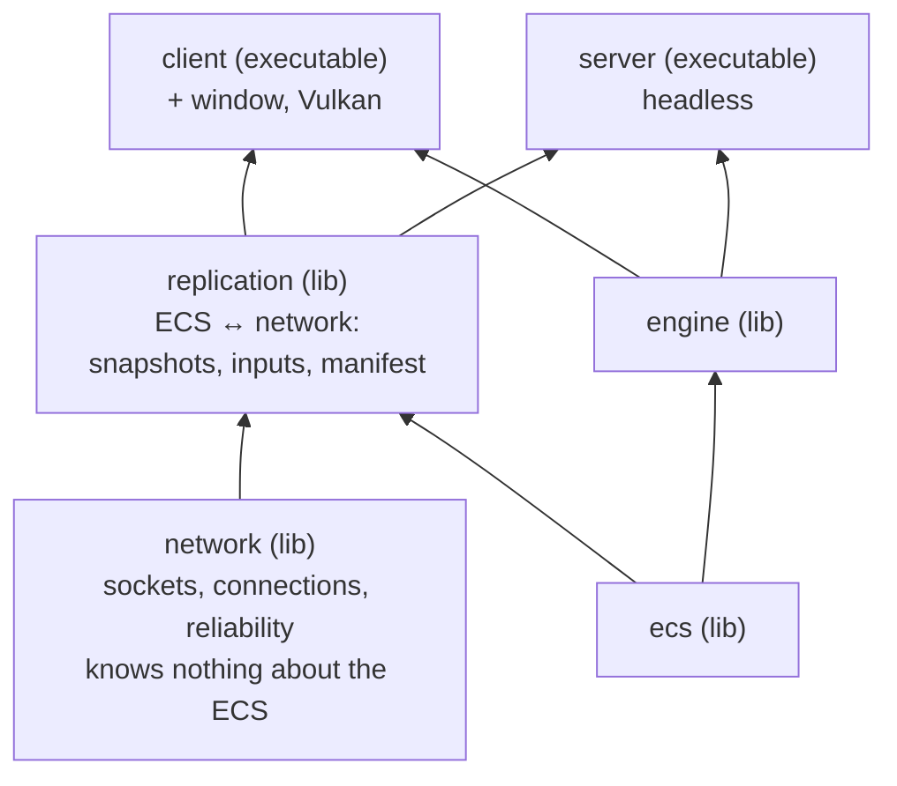
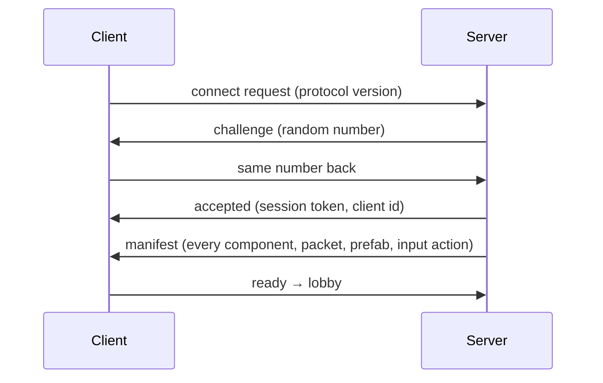

# Network Overview

The short version of the network design, for a first read. Every section links to the full document,
[`design.md`](design.md), which has the byte-level details, the exact limits and the reasons behind each choice.
Nothing here is implemented yet.

## In one paragraph

The **server decides everything**; clients only send their input states (buttons and axes) and permitted
intentions, never world state, and display what the server sends back. Everything goes over **UDP on a
single port**, with a small reliability layer written by us on top of **Asio**. The server runs **one thread for the network and one thread per game room**. Each room is a complete
ECS `App` with its own world and Luau VM. About 60 times per second, each client receives a **snapshot**: the
entities that appeared, changed or disappeared since the last snapshot it confirmed.

## The pieces



- **`network`**: moves bytes between machines. It handles connections, packet numbering, acks and resending.
  It never includes an ECS header.
- **`replication`**: the only code that knows both the ECS and the network. It turns the world into
  snapshots, applies them on the client, and turns client inputs into `PlayerInput` components.
- **`client`** links the window and the renderer. **`server`** never does, so it runs on a machine with no
  screen or GPU.

Details: [Targets and dependencies](design.md#3-targets-and-dependencies).

## How you play

| Mode | What runs |
|---|---|
| Dedicated server | `server` hosts every room on port `4242`. |
| Client | `client` connects to a server. |
| Host a game | `client` starts a server **thread inside itself** and connects to `127.0.0.1`; friends connect to the host's IP. |
| Single player | `client` with no network at all (the ECS `StandalonePlugin`). |

Details: [Topology and run modes](design.md#4-topology-and-run-modes).

## Threads: one owner for everything

```
 Room thread (one per room)                    Network thread (owns the socket and all connections)
 ──────────────────────────                    ────────────────────────────────────────────────────
 read inbox  ◄────────────────────────────────  receive, check, split into messages
 run gameplay
 write outbox ────────────────────────────────►  pack messages, number them, send
```

- A room never touches the socket, and the network thread never touches a world. They only exchange
  **messages** through two queues (a mutex and a vector each).
- One thread per room: a slow script in one room does not slow down the others.
- The client has no network thread: it polls the socket at the start of each frame.

This is what the subject asks for: the server never waits for clients, and the game keeps running whatever
they do.

Details: [Threads](design.md#5-threads).

## Connecting



- **Challenge:** someone pretending to have another player's address never receives the number, so they
  cannot connect in their name.
- **Session token:** a random number carried by every later packet. A packet with the wrong token is dropped.
- **Manifest:** the list of every component and packet the server knows, each with a hash of its layout. If
  the client's scripts differ ("update your game"), the client refuses to connect instead of misreading
  data later. After that, the wire uses 2-byte ids instead of names.
- **Crash detection:** a client silent for 2 seconds is disconnected, and the other players of its room are
  told (`kClientLeft`).

Details: [Connection lifecycle](design.md#63-connection-lifecycle), [Manifest](design.md#72-manifest).

## Packets and reliability

Every datagram is at most **1200 bytes** (bigger ones would be fragmented by the network, and lose
everything if one piece is lost: the protocol never fragments, senders split large reliable payloads into
messages, and an oversized datagram is dropped). It contains a 13-byte header and a list of **messages** on
one of two channels:

| Channel | Guarantee | Used for |
|---|---|---|
| Unreliable | May be lost | Snapshots (a newer one replaces a lost one) and inputs (each datagram repeats the last 3 per-tick samples, so the next one recovers a lost one) |
| Reliable | Arrives exactly once, in order | Manifest, lobby, "player X left", game events like `PlayerKilled` |

Each datagram confirms the last 33 datagrams it received from the other side (`ack` and `ackBits`). Reliable
messages are put again in later datagrams until a datagram carrying them is confirmed. The receiver drops
duplicates by message id.

Details: [Transport](design.md#6-transport-rtype-network).

## Snapshots: send states, never differences

Why not just send "what changed this tick"? Because if that one packet is lost, the change is lost forever:

| Tick | Server sends | Arrives? | Client shows |
|---|---|---|---|
| 100 | "boss HP = 40" | **lost** | 50 |
| 101+ | nothing about HP (it did not change again) | ✓ | **50 forever** |

Instead, the server keeps sending each change **until the client confirms it**:

| Tick | Client confirmed the boss up to | Server sends | Arrives? |
|---|---|---|---|
| 100 | 98 | "boss HP = 40" | **lost** |
| 101 | 98 | "boss HP = 40" again | ✓ (the client confirms 101) |
| 103 | 101 | nothing about HP: already confirmed | ✓ |

This works because a snapshot carries **states** ("HP = 40"), not differences ("HP −10"): receiving one twice
does no harm. The client confirms the last snapshot it applied in every input message.

A snapshot holds four lists:

| List | Meaning |
|---|---|
| Spawns | Entities this client has not confirmed yet, with all their components |
| Updates | Components changed since the client last confirmed that entity |
| Removals | Components removed |
| Despawns | Entities destroyed |

Spawns and despawns are **in the snapshot**, not on the reliable channel: one lost bullet spawn never delays
anything else. If a snapshot would be too big, what does not fit simply goes in the next one.

**Bullets** are `kSpawnOnly`: sent once when they appear, then moved by the same system on both sides. With
positions packed into 16-bit integers, a steady-state snapshot of 300 entities fits in one datagram instead of
ten; a burst of new bullets (about 20 bytes each) spreads over the next snapshots.

On the client, entities are drawn about **100 ms in the past**, smoothly interpolated between two snapshots,
so motion does not stutter.

Details: [Snapshots](design.md#74-snapshots-server--client), [Bandwidth estimate](design.md#11-bandwidth-estimate).

## Inputs

- The client sends its **held buttons and stick axes**, never positions or actions with coordinates.
- Every input message also contains the **two previous inputs**: if one packet is lost, the next one still
  has it, with no delay.
- The server applies one input per tick to the player's ship and repeats the last one if nothing arrived.

**Shooting is an input**, not a packet. The client says "fire is held"; the server decides where the bullet
appears, and everyone sees it as a spawn in the next snapshot. A client that could send `PlayerShoot {
origin = ... }` could shoot from anywhere.

Details: [Inputs](design.md#75-inputs-client--server), [Shooting is an input](design.md#84-shooting-is-an-input-not-a-packet).

## Custom packets (from Luau)

For what is not state, like a kill feed, a "ready" button or a chat line:

```luau
-- shared/packets/PlayerKilled.luau, loaded by the server and the client
return net.packet("game.PlayerKilled", {
    direction = "toClients",
    channel = "reliable",
    fields = {
        { name = "victim", type = "Entity" },
        { name = "killer", type = "Entity" },
    },
})
```

```luau
-- server: send it
ctx.net:sendToRoom("game.PlayerKilled", { victim = ship, killer = enemy })

-- client: read it like any ECS event, inside a system
for packet in ctx.events["game.PlayerKilled"] do
    showKillFeed(packet.victim, packet.killer)
end
```

- Fields are an **ordered list**, using the same type names as components (`u8`, `f32`, `vec2`, `Entity`,
  `string`...).
- Sending checks every value (`300` into a `u8` is a script error); receiving drops anything invalid.
- This one is 11 bytes on the wire.

Details: [Custom packets](design.md#8-custom-packets).

## Never trust the network

- Every byte is read through a bounds-checked reader; a bad packet is **dropped**, never a crash, a
  `throw` or an `assert`.
- Floats must be finite, counts and string lengths are capped, enum values are checked.
- Each client has rate limits and an error budget; past it, it is disconnected.
- **Windows trap:** after a client crashes, Windows reports an error on the server's next receive. The
  server turns that report off and never stops its receive loop on an error, or one crash would cut off
  every player.
- Encryption is **out of scope**: the session token stops impersonation, not eavesdropping.

Details: [Robustness and security](design.md#10-robustness-and-security).

## What the subject asks, and where it is answered

| The subject says | We do |
|---|---|
| Notify clients of spawns, moves, deaths, shots, kills, other players' actions | Snapshots, plus custom packets like `PlayerKilled` |
| The server is multithreaded and never waits for clients | Network thread plus one thread per room |
| A client crash does not stop the server, and the others are told | 2 s timeout, `kClientLeft` to the room |
| The server is robust | Checked parsing, limits, the Windows fix, fuzz tests |
| Asio or OS sockets | Asio, with our own reliability layer (no ENet) |

## Build order

1. `network`: byte reader and writer, packet numbering, acks, the reliable channel, tested with a fake
   network that loses and reorders packets.
2. Connections (challenge, token, timeouts), and the `client` and `server` executables.
3. `replication`: manifest and first snapshots, so the client sees the server world.
4. Inputs: the ship moves.
5. Updates, despawns, the size limit, `kSpawnOnly`: many bullets.
6. Lobby and rooms, custom packets, interpolation.

## Still to decide

Snapshot rate (60 or 30 Hz), players per room, whether the local ship skips the 100 ms display delay, and a
few more: see [Open questions](design.md#16-open-questions). Points where this design differs from the ECS
docs are listed in [Differences with the ECS docs](design.md#13-differences-with-the-ecs-docs).
