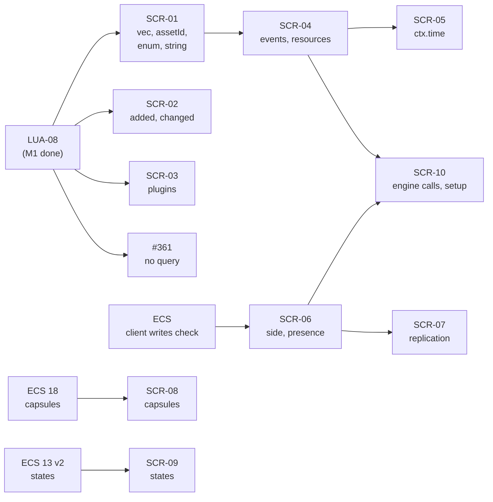
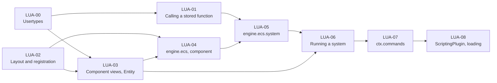

# Luau ECS Bridge: plan for a first version

Goal: **a game developer writes components and systems in Luau, and they run on the ECS** (`App`, `World`, scheduler),
on the server and the clients. Everything else of
[`../ecs/features/19-luau-bridge.md`](../ecs/features/19-luau-bridge.md) (capsules, states, hot reload, side checks,
replication of script components) comes after.

Based on the code of 2026-10-29 (branch `refactor/engine/luau-settings-registry`). Every snippet is a
recommendation, not an obligation.

## 1. Decisions of this plan

| #  | Decision                                                                                                                                                                                                                                                                                                                                                                                                                                                                                                                                                                                                                                                         | Why                                                                                                                                                                                               |
|----|------------------------------------------------------------------------------------------------------------------------------------------------------------------------------------------------------------------------------------------------------------------------------------------------------------------------------------------------------------------------------------------------------------------------------------------------------------------------------------------------------------------------------------------------------------------------------------------------------------------------------------------------------------------|---------------------------------------------------------------------------------------------------------------------------------------------------------------------------------------------------|
| D1 | **No AST parsing.** A component is described by a plain Luau table of field types (`fields = { strength = "f32" }`), read at runtime. The `export type` and the generated `.d.luau` are not needed to run.                                                                                                                                                                                                                                                                                                                                                                                                                                                       | Decided by the team. Cheapest way to get a real layout.                                                                                                                                           |
| D2 | **The bridge is its own library**, the `scripting` target (`src/rtype/scripting/`, `rtype-scripting`, namespace `rtype::scripting`), depending on `core`, `ecs` and `luau`. It holds the bridge itself (`ScriptHost`: runtime, layout, usertypes, the `engine.ecs` Luau library, registration on an `App`) and, in `plugin/`, a thin `ScriptingPlugin` (an `ecs::Plugin`) that calls it from `build()`. The executable (or `engine`) adds the plugin. Not to be confused with the Luau plugins of SCR-03 (`engine.ecs.plugin`), which are Luau modules. `luau` stays free of the ECS, and `plugins` never depends on `luau`. `SettingsLoader` stays in `engine`. | `plugins/` cannot depend on `luau` (dependency rules), and `engine` should not grow the bridge. `../Modules.md` gets one line for the new target.                                               |
| D3 | **Usertypes are implemented** in `rtype-luau` (LUA-00). A system receives each component as a **userdata view** that reads and writes the component bytes in place.                                                                                                                                                                                                                                                                                                                                                                                                                                                                                              | Removes the table copies and the write-back. A view is only valid during the `run` that received it (see D9): a late access raises a Luau error.                                                  |
| D4 | **`Entity` is a userdata handle** (`__eq`, `__tostring`, usable as a table key through its bits).                                                                                                                                                                                                                                                                                                                                                                                                                                                                                                                                                                | No 53-bit limit; scripts hold handles, not pointers.                                                                                                                                              |
| D5 | **Systems are `ScriptCallable`s** holding a `luau::FunctionRef`, using `DynamicQueries` and `Commands&` as parameters.                                                                                                                                                                                                                                                                                                                                                                                                                                                                                                                                           | That is exactly what `ScriptCallable` was made for.                                                                                                                                               |
| D6 | **Files are loaded by the bridge, not with `require`.** *(Fully superseded by D10, epic [#489](https://github.com/Charles-Mahoudeau/rtype/issues/489): no scan, no sorted order; files are loaded from the entry points.)*                                                                                                                                                                                                                                                                                                                                                                                                                                                  | `require` is a non-goal of the Luau proposal. Sorted order makes the load order the same on every machine.                                                                                        |
| D7 | **A system declares `run` as a field** of its declaration table (`run = function(ctx) ... end`).                                                                                                                                                                                                                                                                                                                                                                                                                                                                                                                                                                 | One registration step, and errors point at the faulty call. A method form (`function Sys:run(ctx)`) would need the registration to wait for the end of the chunk; it can be added later as sugar. |
| D8 | **A Luau error in `run` is logged and the system is skipped for that tick.** The app keeps running.                                                                                                                                                                                                                                                                                                                                                                                                                                                                                                                                                              | One broken script must not take the game down.                                                                                                                                                    |
| D9 | **Views are validated by a generation counter.** Each script system owns a heap-allocated `ViewScope { generation }`; a view stores the scope and the generation it was created with, and the bridge increments the generation when `run` returns. A script must not keep a view; keeping an `Entity` across ticks is allowed.                                                                                                                                                                                                                                                                                                                                   | No allocation per call, correct when the callable is moved. Views of earlier matches stay valid until `run` ends, because structural changes are deferred in `Commands`.                          |
| D10 | **Files require each other by string** (epic #489, reverses the D6 non-goal). `require("./x")`, `"../x"` and `"@alias/x"` follow the Luau require-by-string rules: `/` separators, no extension, a path resolves to `x.luau` or `x/init.luau` (both existing is an error). `@scripts` is the game's `scripts/` (alone: `scripts/init.luau`), `@self` the folder of the requiring file; in an `init.luau`, `./` means the siblings of its folder. Extra aliases come from the settings (`scripts` and `self` are reserved, names ignore case, targets stay inside `scripts/`). | The path logic is `ScriptPath` (pure parser) and `ScriptResolver` (`src/rtype/scripting/modules/`, namespace `rtype::scripting::modules`), the callback of `luau::ModuleLoader`. Nothing outside `scripts/` is reachable: no `..` past the root, no absolute path, no link pointing out (`core::asset::isInsideDirectory`, the check of `resolveAssetPath`). Every segment is compared with the real name in the folder listing, so a case mismatch is an error naming the real name on Linux, macOS and Windows alike. The cache key is the path relative to `scripts/` with its extension, the chunk name `scripts/<key>`. A root require (an entry point such as `server/main`) resolves `./x` from `scripts/`. **Entry points.** Nothing is auto-loaded: `scripts.main` (default `"main"`), `scripts.server` and `scripts.client` name entries (paths in `scripts/`, no extension, resolved by `ScriptResolver::resolveEntry`). A process requires `main`, then `server` if it is a server, then `client` if it is a client (standalone: all three); a module several entries require runs once. A missing default entry only warns; a missing explicit one fails the build naming `scripts.<key>`. The root set of the host is the entries; a changed file no module requires is ignored (`setAdoptsNewFiles(false)`). **Sandbox.** `ScriptHost::seal()` runs before the first module: it loads the plugins' setup forms, calls `Runtime::sandbox()` and deep-freezes the `engine` tree. Each file then has its own globals (`shareGlobals = false`), read-only standard libraries and `engine`; files share data only through `require`. Forms registered after sealing are an error. | The seal is lazy (first script run), so hosts created before their plugins (tests) still load all forms. |

## 2. What a script looks like (target of the first version)

```luau
-- game/scripts/components/Shield.luau
local ecs = engine.ecs

ecs.component("game.Shield", {
	fields = { strength = "f32", regen = "f32" },
	defaults = { strength = 50, regen = 2 },
})
```

```luau
-- game/scripts/components/Bullet.luau
local ecs = engine.ecs

ecs.component("game.Bullet", {
	fields = { owner = "entity", damage = "f32" },
	defaults = { damage = 10 },
})
```

```luau
-- game/scripts/systems/ShieldRegen.luau
local ecs = engine.ecs

ecs.system("game.ShieldRegen", {
	phase = "FixedUpdate",
	query = { write = { "game.Shield" }, without = { "rtype.Dead" } },
	after = { "rtype.movement" },
	run = function(ctx)
		for entity, shield in ctx.query do
			shield.strength = math.min(shield.strength + shield.regen * ctx.fixedDelta, 100)
		end
	end,
})
```

The scripts see one global, `engine` (as `project.luau` does: `engine.isClient`, `engine.isDebug`), and the bridge's
library is `engine.ecs`; `local ecs = engine.ecs` is only a shortcut. `ecs.component` and `ecs.system` are statements
that register on the `App`: the file returns nothing, because the bridge loads the files itself and no file uses
another one's return value. A later version can make them return a typed handle without breaking these scripts.

`run` is a field of the declaration table instead of a method (`function ShieldRegen:run`), because a plain table
needs no class machinery. The method form can be sugar on top later.

Supported in the first version:

- **Field types**: `bool`, `i8`..`i64`, `u8`..`u64`, `f32`, `f64`, `entity`, and, since SCR-01, `vec2`, `vec3`, `vec4`
  and `assetId` (every `ecs::FieldType`). A `vec3` reads as a Luau `vector` and writes from one or from a table; the
  Luau build has three-wide vectors only, so `vec2` and `vec4` read and write as tables `{x=, y=}` / `{x=, y=, z=, w=}`
  with every key present. An `assetId` writes from a path string (hashed to its `AssetId`) or an `AssetId`, and reads as
  an opaque `AssetId` userdata (`==`, `tostring`). A `string` field is an `ecs::String` (255 bytes of UTF-8 at most,
  a longer text is cut): it reads and writes as a Luau string.
- **Query terms**: `read`, `write`, `optionalRead`, `optionalWrite`, `with`, `without` (all exist in `QueryBuilder`)
  and, since SCR-02, `added` and `changed`. Those two only filter, like `with`: they give no view, so a script that
  needs the value lists the component under `read` as well.
- **Phases**: all of `ecs::Phase`.
- **Plugins**: since SCR-03, `engine.ecs.plugin(name, {build, plugins})` declares a Luau plugin and
  `engine.ecs.addPlugin(name)` adds it. Adding one first adds the plugins it lists, then calls `build(app)`, where
  `app` has `component`, `system` and `addPlugin` (it only lives during the build). A plugin is built once; an unknown
  name, a cycle (`a -> b -> a`) or a name declared twice is an error.
- **`ctx`**: `query` (iteration), `commands` (`spawn`, `despawn`, `add`, `patch`, `setParent`, `removeParent`), `fixedDelta`,
  `delta`.
- Scripts can read components declared in C++ (they are in the registry), as long as their fields use the types above.
  A `std::vector` field of a C++ component reads as a table, a copy, and is replaced from an array; a `std::string`
  field reads and writes as a string of any length. Components declared in Luau have neither: they hold no memory of
  their own. `rtype.Parent` and `rtype.Children` cannot be `write` terms: `commands:setParent()` changes a hierarchy.

## 3. Starting point

| Part                                                                                                                                                                                                               | State                                                                                                       |
|--------------------------------------------------------------------------------------------------------------------------------------------------------------------------------------------------------------------|-------------------------------------------------------------------------------------------------------------|
| `ecs`: `Components::registerType(ComponentInfo)`, `QueryBuilder`, `DynamicQueries`, `QueryMatch::get/getMut`, `Commands::spawn/add(entity, id, bytes)/despawn`, `ScriptCallable`, `App::addSystem(..., QueryList)` | Done. Used by `../../examples/ecs/EcsRuntimeComponents` and `EcsScriptSystems`.                             |
| `luau`: `Runtime`, `Script`, `Table` (get/set/entries/metatable), `Value`, `Function` (native), `FunctionRef`, `Library`/`LibraryBuilder`, `Result`                                                                | Done.                                                                                                       |
| `luau`: userdata                                                                                                                                                                                                   | **Missing**: no `Value` alternative, no usertype builder (LUA-00).                                          |
| `luau`: calling a stored Luau function from C++                                                                                                                                                                    | `FunctionRef`/`Function::call(ValuePack)` exist; LUA-01 checks it with the arguments the bridge needs.      |
| `ecs`: layout computation from a field list                                                                                                                                                                        | **Not in the ECS**: `registerType` expects offsets and size already set. The bridge computes them (LUA-02). |
| `engine`: `Engine` (holds an `App`), `SettingsLoader`                                                                                                                                                              | `Engine` does not run anything yet. The `scripting` target does not exist.                                  |

## 4. Tasks

Each task is one issue and one pull request. Ids `LUA-xx`. Tests go in `tests/scripting/` (bridge) or `../../tests/luau`
(runtime), as a separate `test(...)` commit.

### M1: first version

#### LUA-00: Usertypes

|            |        |
|------------|--------|
| Module     | `luau` |
| Blocked by | none   |

**Goal.** Let C++ expose its own types to Luau as userdata, with fields and methods.

**What to build**

- `Value::Userdata`: a handle on a userdata of the state, like `Table` and `FunctionRef`.
- A `Usertype<T>` builder with:
    - a name;
    - an optional constructor;
    - getters and setters by field name;
    - methods;
    - `__eq` and `__tostring`.
- An argument check that raises a Luau error (not a crash) when a method receives the wrong type.
- Tagged userdata with a destructor; each type is registered once per runtime.

**Done when**

- [ ] A test exposes a C++ struct with a getter, a setter and a method, and reads and writes it from a script.
- [ ] A method called with another userdata or `nil` raises a Luau error.
- [ ] The destructor runs when the state is closed.
- [ ] Two userdata compare equal when `__eq` says so.

#### LUA-01: Calling a stored function

|            |        |
|------------|--------|
| Module     | `luau` |
| Blocked by | LUA-00 |

**Goal.** Make sure the bridge can keep a Luau function for the whole game and call it every tick.

**What to build** (check what exists first, add only what is missing)

- Call a stored `FunctionRef` from C++ with a userdata and a number as arguments.
- Return its error as a `Result`, with the script name and the line.
- Keep the `FunctionRef` alive across frames.
- A native function that returns an iterator, for `for ... in ctx.query do`.

**Done when**

- [ ] A test calls a Luau function stored in a table with a userdata argument.
- [ ] An error raised by that function comes back as a `Result` error with the script name and the line.
- [ ] A `for ... in` loop over a native iterator works in a script.

#### LUA-02: Component layout and registration

|            |                                                                 |
|------------|-----------------------------------------------------------------|
| Module     | `scripting` (the sources only; the target is created by LUA-04) |
| Blocked by | none                                                            |

**Goal.** Turn a list of typed fields into a registered component with a deterministic layout.

**What to build**

- `ComponentDeclaration`: name, fields (`{name, FieldType}`), defaults as bytes, replication mode.
- `registerComponent(Components&, ComponentDeclaration)`:
    - sorts the fields by alignment, then by name;
    - computes the offsets, the size and the alignment;
    - calls `Components::registerType`.
- Errors come back as a `Result`: unknown field type, duplicate field, same name registered with another layout
  (`kLayoutMismatch`).

**Done when**

- [ ] `game.Bullet` (`owner: entity`, `damage: f32`) has size 16 and alignment 8, with `owner` first (alignment sorting
  and the `entity` type).
- [ ] `game.Shield` (`strength: f32`, `regen: f32`) has size 8 and alignment 4, with `regen` before `strength` (same
  alignment, sorted by name).
- [ ] Registering the same description twice returns the same id.
- [ ] A different layout under the same name is refused.

#### LUA-03: Component views and `Entity`

|            |                |
|------------|----------------|
| Module     | `scripting`    |
| Blocked by | LUA-00, LUA-02 |

**Goal.** Let a script read and write a component's fields in place.

**What to build**

- A `ComponentView` usertype over `(const ComponentInfo*, span<std::byte>, ViewScope*, generation, read-only)`:
    - `__index` and `__newindex` read and write a field by name, straight in the bytes, according to its `FieldType`;
    - integers are range-checked;
    - `nil`, a wrong type or an unknown field is an error, never a silent default.
- A read-only view, for read terms, that refuses writes.
- `ViewScope { std::uint64_t generation; }`, one per script system, heap-allocated and owned by its `ScriptCallable`.
  A view stores the scope and the generation it was created with, and every access checks that they still match.
- The `Entity` usertype.
- The conversion from a Lua table to bytes, used for defaults and `spawn` tables.

**Done when**

- [ ] A round trip works for every supported `FieldType`.
- [ ] `i8` given `300` reports an error that names the field.
- [ ] After the scope's generation is incremented, any access to an older view raises an error.
- [ ] Writing through a read-only view raises an error.

#### LUA-04: The `scripting` target, `ScriptHost` and `engine.ecs.component`

|            |                |
|------------|----------------|
| Module     | `scripting`    |
| Blocked by | LUA-02, LUA-03 |

**Goal.** A script can declare a component.

**What to build**

- The `scripting` target: `../../xmake.lua`, `Export.hpp` (`RTYPE_SCRIPTING_API`), `tests/scripting/`, and its line in
  the
  dependency rules of `AGENTS.md` (detail in `../Modules.md`).
- `ScriptHost`: knows no `Plugin`, can be used and tested with a bare `App`. It owns the `Runtime` and builds the
  `engine` global (with `engine.isClient` and the other flags) and its `ecs` library with `LibraryBuilder`.
- `engine.ecs.component(name, {fields, defaults, replication})`, a statement that returns nothing:
    - registers the component;
    - applies the defaults over zeroed bytes (the value used when a field is omitted by `Commands::add` and by
      `spawn` tables).

**Done when**

- [ ] A script declares `game.Shield`.
- [ ] A C++ test finds it by name in `World::getComponents()` with the right fields.

#### LUA-05: `engine.ecs.system`, from declaration to registered system

|            |                |
|------------|----------------|
| Module     | `scripting`    |
| Blocked by | LUA-04, LUA-01 |

**Goal.** A script can declare a system, and the scheduler knows it.

**What to build**

- Read `{phase, query, after, before, run}` from the declaration table.
- Turn `query` into a `QueryBuilder` and a `QueryList`.
- Call `app.addSystem(phase, name, ScriptCallable{...}, queryList)` with `.after()` and `.before()`.
- Report every error (unknown component or phase, missing `run`) as a `Result`; the loader turns it into one
  exception with the script name and the message.

**Done when**

- [ ] A script system is listed in the scheduler under its name, with the access set of its terms.
- [x] An unknown component name is refused when the script loads.

#### LUA-06: Running a system

|            |                |
|------------|----------------|
| Module     | `scripting`    |
| Blocked by | LUA-05, LUA-03 |

**Goal.** The `ShieldRegen` example runs on every tick.

**What to build**

- The body of the `ScriptCallable`: call `run` once with a `ctx` whose `query` iterator yields
  `(entity, view...)` for each match, in the order of the declared terms (read-only views for read terms).
- Increment the system's `ViewScope::generation` when `run` returns, which kills every view of the call.
- Error policy (decided): a Luau error in `run` is logged (system name and script location) and the system is skipped
  for that tick; the app keeps running.
- `ctx.fixedDelta` and `ctx.delta`.

**Done when**

- [ ] The `ShieldRegen` example above raises `strength` on every FixedUpdate tick, in a test.
- [ ] An entity with `rtype.Dead` is skipped by the `without` term.
- [ ] An error in `run` is logged once per tick and the other systems keep running.

#### LUA-07: `ctx.commands`

|            |             |
|------------|-------------|
| Module     | `scripting` |
| Blocked by | LUA-06      |

**Goal.** A script can create and destroy entities.

**What to build**

- `commands:spawn({ ["game.Shield"] = { strength = 10 }, ... })`: returns the reserved `Entity`. (Since SCR-10 a
  component may also be a C++ one, such as `rtype.Collider`, built from its C++ defaults; one that owns memory, such as
  `rtype.TextRenderer`, is constructed, filled and copied into the command buffer.)
- `commands:add(entity, "game.Shield", {...})`.
- `commands:despawn(entity)`, which despawns its children too.
- `commands:setParent(child, parent)` and `commands:removeParent(child)`.
- `commands:patch(entity, "game.Shield", {...})`: writes only the fields of the table over the value the entity has
  at the flush (`Commands::patch`), so a capsule just spawned keeps the rest.
- Component values are built with the LUA-03 conversion, over the defaults.

**Done when**

- [ ] A spawner system creates entities that a second system sees in the next phase.
- [ ] Spawning with an unknown component reports an error.
- [ ] Despawning a stale entity does nothing, as in C++.

#### LUA-08: `ScriptingPlugin` and loading by path

|            |                                               |
|------------|-----------------------------------------------|
| Module     | `scripting` (`plugin/`), `engine`, an example |
| Blocked by | LUA-07                                        |

**Goal.** A game starts with its Luau files and runs them.

**What to build**

- `ScriptingPlugin` (`scripting/plugin/ScriptingPlugin.hpp`, an `ecs::Plugin`, a few lines): owns a `ScriptHost`,
  calls it from `build()`.
- It requires the entry points named by `scripts.main/server/client` (D10): only the entries and what they require run.
- The `Engine` adds the plugin, with the entries of its side.
- An example: `examples/scripting/Shield`.

**Done when**
- [x] The example runs a Luau component and a Luau system loaded from files, with `xmake run`.

### M2: after the first version

Checked against the code on 2026-11-03. What the ECS already offers, and what it does not:

| Needed by                                                       | State in `ecs`                                                                                                                                                                                         |
|-----------------------------------------------------------------|--------------------------------------------------------------------------------------------------------------------------------------------------------------------------------------------------------|
| `added` / `changed` terms                                       | `QueryBuilder::added` / `changed` exist.                                                                                                                                                               |
| Events and resources from scripts                               | By bytes and id: `Events::send(EventId, span)`, `RawEventRange`, `Resources::find/get/getMut(ResourceId)`. `ScriptCallable` receives `DynamicQueries` and `Commands` only, so it needs access to them. |
| Systems by side                                                 | `Side`, `System::setSide`, `RunMode`. Done.                                                                                                                                                            |
| Client systems write only `kClientOnly` components              | **Not enforced.** `Presence` exists on types, but nothing reads it when a system is added.                                                                                                             |
| Capsules (feature 18) | **Implemented** in `plugin-capsule`: files describe them, scripts spawn, load and reload them through `rtype.capsule.*` calls. |
| States and run conditions (feature 13 v2) | **Not implemented.** Only described in the docs.                                                                                                                                                       |
| Replication of script components                                | The manifest carries `layoutHash`; whether it accepts components registered at runtime is **not checked**.                                                                                             |

Tasks about the `scripting` target use the `SCR-xx` ids, from `SCR-01`. Work that has to happen in the ECS first is
not numbered here: it is listed as a prerequisite under the task it blocks.
Ids follow the order the tasks are best done in. Weights are set when the issues are created.

#### SCR-01: `vec2/3/4`, `assetId`, enum and string fields

|            |                |
|------------|----------------|
| Module     | `scripting`    |
| Blocked by | none (M1 done) |

**Goal.** Scripts declare components with the field types that the C++ plugins already reflect (`Transform`, sprites).

**What to build**

- Add `vec2`, `vec3`, `vec4` and `assetId` to the field types of the layout (LUA-02), the views (LUA-03) and the
  table conversion.
- A vector field reads as a Luau `vector` value (check the Luau build has it) and writes from one or from a table
  `{x=, y=}`; an `assetId` field accepts a path string and stores its `AssetId` hash.
- **Enums and bitmasks.** The ECS reflects an enum field (`Collider::shape`, `TextRenderer::align`) as its underlying
  integer (`FieldTypeOf`), so a script already sees a number; a bitmask (`Collider::layer`, `mask`) is a plain `u32`.
  What is missing is names: let a plugin expose the enumerators of a reflected enum (ECS side: the field description
  would carry them), and give scripts `engine.ecs.enum("rtype.ShapeType").kBox` or a string accepted on write
  (`shape = "box"`). Bit operations are `bit32` (Luau has it).
- **Strings.** The ECS can *store* a component that holds a `std::string` (the type hooks construct, move and destroy
  it), but it cannot *reflect* one: there is no `FieldType` for it, and `RTYPE_ECS_COMPONENT(TextRenderer, ...)` stops
  before `text`. Views, `spawn` tables, the layout hash and replication all work from reflected fields, so a script
  cannot read or write `TextRenderer::text` (a spawned one stays empty).
  **ECS prerequisite (not numbered):** an `ecs::String` and a `FieldType::kString`.
    - `ecs::String` owns its bytes, has the same size and alignment on every compiler (`std::string` is 24 or 32
      bytes depending on the standard library, and `hashLayout()` hashes the size of the type), and is built, copied,
      moved and destroyed by the type hooks. A string field is then a field like any other: an offset and a size, so
      views, the layout hash, replication and script-declared components need no second path (an accessor-based field
      was considered and rejected for that reason).
    - It converts implicitly from `std::string_view` and `const std::string&` and back to `std::string_view`, so
      `TextRenderer{.text = std::format(...)}` still compiles; `layoutText()` already takes a `std::string_view`.
      `TextRenderer::text` becomes an `ecs::String` and joins its reflected fields.
    - A script-declared `string` field uses the same type.
    - Replication of strings: an `ecs::String` is a `u8` length and 255 bytes inline (plain data, so no hooks), written
      on the wire as its length and its bytes; a component with a string is sent after its `u16` length.

**Done when**

- [ ] A component with one field of each new type round-trips through a view.
- [ ] `defaults` and `spawn` tables accept the new types.
- [ ] A script reads `Transform.position` of a C++ component.
- [ ] A wrong type or a missing component of a vector is an error naming the field.
- [ ] A script reads and writes `Collider.shape` and `layer` / `mask` of a C++ component, by number and by name.
- [ ] An unknown enumerator is an error naming the field and the accepted names.
- [ ] A script declares a `string` field and round-trips it through a view (once the ECS prerequisite is done).
- [ ] A script spawns a `TextRenderer` with its `text` and the client draws it, and reads `text` back by name.

#### SCR-02: `added` and `changed` terms

|            |             |
|------------|-------------|
| Module     | `scripting` |
| Blocked by | none        |

**Goal.** A system runs only on entities whose component was added or written since it last ran.

**What to build**

- Read `added` and `changed` in the query declaration and call `QueryBuilder::added` / `changed`.
- Define which view each term gives: none, `added` and `changed` are filters like `with`; the value comes from a
  `read` or `write` term on the same component.

**Done when**

- [x] A system with `added = { "game.Shield" }` runs once for an entity, not on the next tick.
- [x] A system with `changed` runs after a write and not otherwise.
- [ ] An unknown component name is refused when the script loads.

#### SCR-03: `engine.ecs.plugin`

|            |             |
|------------|-------------|
| Module     | `scripting` |
| Blocked by | none        |

**Goal.** A Luau module groups components and systems and is added like a C++ plugin.

**What to build**

- `engine.ecs.plugin(name, { build = function(app) ... end, plugins = { ... } })`.
- An `app` usertype in Luau with `component`, `system` and `addPlugin`, so `build` does what top-level statements do
  now.
- Nested plugins, added once each; a cycle or a duplicate name is an error.

**Done when**

- [x] A plugin adds a component and a system through `build(app)`.
- [x] A plugin that lists another one adds it first, once.
- [x] A cycle is refused with the plugin names.

#### SCR-04: `ctx.events` and `ctx.resources`

|            |                                                  |
|------------|--------------------------------------------------|
| Module     | `ecs` (small), `scripting`                       |
| Blocked by | SCR-01 (a resource or event often holds vectors) |

**Goal.** A script reads and writes resources and sends and reads events, with the same views as components.

**What to build**

- `ecs`: let a `ScriptCallable` receive the world's resources and events, and declare which ones the system reads or
  writes, so the access set stays truthful for the scheduler. Done as the `DynamicResources` and `DynamicEvents`
  parameters (`docs/ecs/features/12-systems.md`), configured with a `ResourceList` and an `EventList`; the script
  declares them with `resources = { read, write }` and `events = { read, send }`.
- `ctx.resources["rtype.Input"]`: a `ComponentView` over the resource bytes (read-only unless declared as written),
  with the same generation check as component views.
- A system that only uses resources and events may declare an empty `query`: it has no query, and `ctx.query` ends
  at once.
- `ctx.events.send("game.Explosion", {...})` and `for event in ctx.events.read("rtype.Collision")`.
- Resources that are not plain data (main-thread, non-standard-layout) are refused with an error, not skipped.

**Done when**

- [x] A script reads `rtype.Time` in a test. (`rtype.Input` holds maps, so it is refused as not plain data: it
  needs a dedicated engine call, see SCR-10.)
- [x] A script sends an event that a C++ system reads, and the reverse.
- [x] Writing a resource declared as read raises an error.
- [x] The scheduler sees the resource and event access of a script system.

#### SCR-05: `ctx.time` as a table

|            |             |
|------------|-------------|
| Module     | `scripting` |
| Blocked by | SCR-04      |

**Goal.** One place for the time values (`ctx.time.delta`, `fixedDelta`, `elapsed`, `tick`).

Small: it can be folded into SCR-04 if the `rtype.Time` view is enough. Keep `ctx.delta` and `ctx.fixedDelta` working.

**Done when**

- [x] `ctx.time` gives the values of `rtype.Time` and the old fields still work.

#### SCR-06: `side` and `presence` in declarations

|            |                                                                                                                                    |
|------------|------------------------------------------------------------------------------------------------------------------------------------|
| Module     | `scripting`                                                                                                                        |
| Blocked by | ECS prerequisite: refuse a client system that writes a component that is not `kClientOnly` (not numbered); the rest has no blocker |

**Goal.** Scripts say where a system runs and where a component exists.

**What to build**

- `side = "server" | "client" | "both"` on `engine.ecs.system`, calling `System::setSide`; the default is the ECS one
  (`server`).
- `presence = "both" | "serverOnly" | "clientOnly"` on `engine.ecs.component` (`ComponentDeclaration` has no
  `presence` yet).
- The system loader reports the ECS refusal error with the script name.

**Done when**

- [x] A `side = "client"` system does not run in a server `App`, and does in a client one.
- [x] A client script system writing a replicated component fails to load, with the script name.
- [x] The `Shield` example declares its sides.

**ECS prerequisite (not numbered).** A `Side::kClient` system that writes a replicated or `kServerOnly` component is
refused by `Schedule::SystemConfig::setSide()` with a `ScheduleException` naming the system and the component (rule
of `../ecs/features/19-luau-bridge.md`). The loader turns it into a registration error, which the plugin reports with
the script name. Local components that are never replicated (`GlobalTransform`, written by the tilemap's client
system) stay allowed: nothing overwrites them. Decision on the open point: `kBoth` systems are never refused, since they are meant to simulate
replicated components identically on both sides (clients are overwritten by the snapshot, there is no prediction); the
loader only warns on `std::cerr` when a `both` system writes a `serverOnly` component, which does not exist on clients.

#### SCR-07: Replication of script components

|            |                                                                       |
|------------|-----------------------------------------------------------------------|
| Module     | `replication`, `scripting`                                            |
| Blocked by | SCR-06, and a check of what the manifest does with runtime components |

**Goal.** A component declared in Luau with `replication = "everyChange"` reaches the clients.

**What to build**

- First, verify in `replication/manifest/` that a component registered at runtime (by `registerType(ComponentInfo)`)
  is listed and sent like a C++ one. If not, that is the first task.
- Check on connection that both sides loaded the same scripts: a `layoutHash` mismatch refuses the client with the
  component name.
- **Strings** (from SCR-01's `ecs::String`): replicated as a length and its bytes, with a size cap, in components
  (a `PlayerName` on each ship, set by the server from the client's connection data). `kEveryChange` resends the whole
  value, which suits a name set once and not a string rewritten every frame.
- **Done: strings on the wire.** `FieldSerializer` writes a `kString` as a `u8` length and its bytes, and a snapshot sends
  a component with a string after its `u16` length, so the size budget (`kMaxMessageSize` = 1000 bytes) counts the
  bytes actually written. The 255-byte cap of `ecs::String` keeps one string inside it.
- **Done: the manifest accepts runtime components.** Checked in `replication/manifest/`: `registerType(ComponentInfo)`
  computes the `layoutHash` and lists a replicated component like a C++ one, and the client's check names the
  component that differs or is missing (a script one included). `tests/scripting/ScriptReplicationTests.cpp` runs a
  server and a client on `game.Shield`.
- **Events are not replicated; custom packets are the planned way across.** Checked in `replication/`: the only events
  are `ClientConnected` / `ClientDisconnected`, registered `kServerOnly` and raised from the local network
  notifications, and no code serializes an event. `EventInfo.hpp` and `ecs/features/11-events.md` say the same (the
  registry refuses a replicated event). `docs/network/design.md` section 8 designs **custom packets** for this
  (`net.packet`, `toServer` / `toClients`, with a `string` field: `u8` length, `maxLength` 64 by default, at most
  255), received as events in the receiver's world (NET-34, NET-35). A minimal slice is implemented
  since GR5-88 ([custom-packets](../network/custom-packets.md): `engine.net.packet`, typed fields with a bounded `string`, one
  `net.PacketReceived` event); the manifest check, the C++ macro and per-packet events are not. So text that has to
  reach other machines is a `string` field of a custom packet (a command or a one-shot message), or a replicated
  component (a `ChatLine` spawned by the server) for state that every client keeps.
- **A name cannot ride the handshake as it is.** Checked in `network/protocol/Packets.hpp`: `ConnectRequest` and
  `ChallengeResponse` carry a version and tokens only, padded to `kHandshakePadding` (64 bytes) before the client is
  authenticated, and `ClientConnected` carries the client id only. Client to server, the replication layer sends
  inputs (`InputMessage`) and, since GR5-88, the custom packets of the game (`engine.net.sendToServer`), through
  `NetClient::send(Channel, payload)`.
- **The server validates, replication does not.** A string that comes from a client (a name) is untrusted: the server
  checks its length and its UTF-8, and filters characters if the game needs it, before putting it in a component.
- **Decision: strings replicate in M2.**
- Open point for the team: how a name gets from the client to the server. Options: (a) a name field in
  `ConnectRequest`, which costs a protocol version bump, fits only the 64 padding bytes and is sent before the client
  is authenticated; (b) a reliable custom packet sent after `Accepted` (the draft's default: a `toServer` packet with a `string` field,
  NET-34, validated on the server; if NET-34 is not ready, a dedicated message kind next to `InputMessage`). With (b), `ClientConnected` fires before the
  name is known: the game either waits for a `ClientProfile` event or `ClientConnected` is delayed until the profile
  arrives.

**Open point for the team: how a script sends something across the network.** Events are local to a world and the ECS
refuses a replicated one (`validate(EventInfo)`; `ecs/features/11-events.md` still asks, line 226, whether some
events should be replicated for cosmetic effects). Two ways to give scripts a network send, both on the same transport
(custom packets, NET-34, received as events in the receiver's world):

*A. Custom packet, an explicit network API (the current design, `docs/network/design.md` section 8).*

```luau
local Hello = net.packet("game.Hello", {
    direction = "toServer", channel = "reliable",
    fields = { { name = "name", type = "string", maxLength = 24 } },
})

-- client
ctx.net:sendToServer("game.Hello", { name = myName })

-- server
for hello in ctx.events.read("game.Hello") do   -- hello.sender is the client id
    if validName(hello.name) then
        ctx.commands:add(shipOf(hello.sender), "game.PlayerName", { name = hello.name })
    end
end
ctx.net:sendToRoom("game.ChatLine", { from = ship, text = text })
```

*B. Networked event, one concept (a sketch: no document describes this syntax).*

```luau
engine.ecs.event("game.Hello", {
    net = { direction = "toServer", channel = "reliable" },
    fields = { name = "string" },
})

-- client
ctx.events.send("game.Hello", { name = myName })

-- server: read as any event, plus the sender
for hello in ctx.events.read("game.Hello") do ... end
```

| | A. Custom packet | B. Networked event |
|---|---|---|
| Concepts for a script author | `net.packet`, `ctx.net`, and `ctx.events` to receive | `engine.ecs.event` and `ctx.events` |
| Sending | A separate call (`sendToServer`, `sendTo`, `sendToRoom`) | The same `ctx.events.send` as a local event |
| Where it goes | Explicit at each call site | Implied by the declaration |
| Reading the code | A network send is obvious | A local send and a network send look alike |
| Side checks | A wrong direction is refused at the call | The declaration restricts who may send |
| State | Designed (NET-34, NET-35), not implemented | Reverses the ECS rule: needs a team decision |

B would also need: a way to validate an untrusted client event and to know its sender, no re-forwarding of a received
event, a declared channel per event, and a bound on every field (the packet budget). A middle path keeps B's
declaration and a distinct call for a network send (`ctx.events.sendNet`), so the cost stays visible. The default of
this plan is A: it exists in the design, and it needs no change to the ECS rule.

**Done when**

- [x] A server and a client load the same `game.Shield`, and a value changed on the server arrives on the client.
- [x] A client with a different layout is refused with a clear message.
- [x] A string component set on the server (a username) arrives on the client, and a string over the cap is refused or
  cut as documented.
- [ ] A client sends its name after connecting, and the server puts the validated name in a component every client
  sees (option (b) above, or the option the team picks).
- [ ] A script system rejects an invalid name before writing it.

#### SCR-08: Capsules (was: Prefabs)

|            |                                               |
|------------|-----------------------------------------------|
| Module     | `ecs`, then `scripting`                       |
| Blocked by | ECS feature 18: **done**, as capsules (`plugin-capsule`) |

**Goal.** Scripts use capsules. *Done differently than first planned:* actors and scenes became one concept,
capsules, described by files (`.actor`, `.scene`, `.capsule` under `assets/`, read by the plugin and reloaded when
saved) rather than declared from Luau, so scripts declare nothing: they call `rtype.capsule.spawn`,
`rtype.capsule.load` and `rtype.capsule.reload` (see [Capsules](../ecs/features/18-capsules.md)).

Not startable: the ECS part has to exist first. Create it as an `ecs` issue (feature 18, v2) and block this one on it.

**Done when**

- [x] A capsule described in a file is spawned by a Luau system and by a C++ one.
- [x] An unknown capsule or component is refused (a call error, or the file refused when it is read).

#### SCR-09: States and run conditions

|            |                                                                 |
|------------|-----------------------------------------------------------------|
| Module     | `ecs`, then `scripting`                                         |
| Blocked by | ECS feature 13 v2 (run conditions, states), **not implemented** |

**Goal.** `inState = "Playing"` on a system, and `OnEnter` / `OnExit` systems.

Not startable, for the same reason as SCR-08.

**Done when**

- [ ] A system with `inState` runs only in that state.
- [ ] An `OnEnter` system runs once on the change.

#### SCR-10: Engine calls and declarative setup from scripts

|            |                                                                                                                       |
|------------|-----------------------------------------------------------------------------------------------------------------------|
| Module     | `ecs` (a registry of named calls), `plugins`, `scripting`                                                             |
| Blocked by | SCR-04 (resources), SCR-06 (a setup runs on a side); the design point below needs a team decision first               |

**Goal.** A game's own setup is written in Luau: the executable only registers backends and adds the generic plugins,
and everything specific to the game (assets, inputs, spawns, rules) lives in `game/scripts/`. `rtype_duel` needed C++
for these (`GameAtlases`, `GameSounds`, `declareInputs`, `registerGame`).
*Done:* `rtype_duel` is written in Luau (`examples/games/rtype_duel/game/scripts/`: `shared/` for what both sides require, `server/` and
`client/`, each with a `main.luau` entry), and `aylo-runtime` runs it with `--game`. What it needed on the way: the backend plugin
draws a `ShapeRenderer` component (its obstacles) and reflects `SpriteRenderer::source` (its planets), and the
replication plugin registers `rtype.replication.localClient` on clients (who won), and `ctx.commands` builds the C++
components that own memory, such as the `rtype.TextRenderer` of its texts (the players' names, the winner).

**Why M2 alone is not enough.** SCR-04 gives scripts the *bytes* of a plain-data resource. The setup of the duel is
*calls*: `AtlasAssets::load()` / `grid()`, `TextureAssets::load()`, `FontAssets`, `AudioAssets`, `InputLayout::add()`,
physics queries and `moveAndSlide`. These resources hold hash maps and queues, so SCR-04 refuses them, and a view over
their bytes would be wrong anyway.

**What to build**

- **A registry of named engine calls, in `ecs`.** A plugin registers `("rtype.AtlasAssets.load", signature, function)`
  on the `App`; the signature is made of `FieldType`s, so `ecs` stays free of Luau, and `plugins` never depends on
  `luau` (dependency rules). `scripting` exposes each call under `engine`, converting arguments with the SCR-01
  conversions (an `assetId` takes a path). A call runs where it is declared (`side`, SCR-06) and on the thread that
  owns the resource.
  *Done:* `App::addCall(name, function)` registers a C++ function whose parameters are system parameters and an
  optional `const Args&`, `Args` and its result being plain-data structs declared with `RTYPE_ECS_CALL_DATA` (so the
  signature is a `TypeInfo` of `FieldType`s). Scripts call it with `engine.call(name, { field = value })` while they
  load, and with `ctx.call(name, {...})` in a system that lists it under `calls = {...}`; the system takes the call's
  access (and its main-thread need), so the scheduler orders it like any other. A call the system does not list is a
  Luau error; an unknown call is refused when the script loads, unless the system does not run in that `App`'s mode.
  The asset, input and audio plugins register their calls (`rtype.sprite.createAtlas`, `rtype.input.bindVector`,
  `rtype.audio.playSound`...; see the list in `docs/ecs/features/19-luau-bridge.md`). Controls are named with text
  (`plugins/input/ControlNames.hpp`).
- **Declarative forms for the common setup**, written in `scripting` on top of the calls, so scripts do not juggle
  handles: `engine.input.action("move", "vector2")`, `engine.assets.atlas{ path = ..., grid = {...}, animations =
  {...} }`, `engine.assets.sound(path)`, `engine.assets.font(path)`. Each one registers on both sides when the same
  files load on both, and does nothing on the side that does not need it.
  *Done:* `engine.assets.texture`, `sound`, `font`, `tilemap` and `atlas`, and `engine.input.action` with a `bind`
  list (`scripting/setup/`, see "Setup forms" in `docs/ecs/features/19-luau-bridge.md`). A form checks its table on
  every side, skips its calls where the plugin is absent and returns the asset's id all the same.
- **Plugin settings in `project.luau`.** `PhysicsSettings` (gravity) and the list of generic plugins to add are read
  from the project settings, so two games differ by data, not by an executable.
  *Done:* `engine.settings.plugins` lists `"transform"`, `"physics"` and `"physicsDebug"` (`engine/GamePlugins`), and
  the `physics` and `physicsDebug` sections set their settings (`PhysicsSettings::fromSettings()`,
  `PhysicsDebugSettings::fromSettings()`); see "Generic plugins" in `docs/engine/design.md`.
- **Physics.** Expose `Collider`, `RigidBody` and `Velocity` (SCR-01 covers their enums), the collision events
  (SCR-04) and the scene queries as engine calls.
  *Done:* `ctx.commands` spawns and adds the plain-data C++ components of the world (`rtype.Collider`,
  `rtype.Transform`...) from their C++ defaults, not only script ones, with the same client rule (and, since the
  duel's texts, those that own memory, such as `rtype.TextRenderer`). The physics plugin
  registers `rtype.physics.raycast`, `shapeCast`, `overlap` (a count and one entity: call data holds no list),
  `moveAndSlide` (an entity's `Collider`), `applyForce`, `applyImpulse`, `applyTorque` and `setGravity`
  (`plugins/physics/PhysicsCalls.hpp`, see "From scripts" in `docs/physics/design.md`); velocity and position are
  component writes.
- Replication components (`Owner`, `PlayerInput`) and `ClientConnected`: readable and writable like any component and
  event; check their layouts are plain data.
  *Done:* they are plain data; the `axes` array of `PlayerInput` is not script-readable, so the replication plugin
  registers `rtype.replication.readInput` (`{held, pressed, released, axis, vector}` of an action, by name) and
  `rtype.replication.addInput`, which `engine.input.action` makes on both sides so the network `InputLayout` comes
  from the scripts. On clients the `Engine` adds `rtype.engine.networkInput` (`engine/NetworkInput`), which fills the
  sent `PlayerInput` from the `Input` actions of the same names, so a game needs no `ClientState::setInput` of its own.

**Open point for the team (blocks the start).** Bound calls (above) or only declarative forms? The first is general and
costs a registry in `ecs`; the second is smaller and cannot express a call nobody wrote a form for. The draft assumes
both: the registry for the plugins, forms for the setup everybody writes.

**Done when**

- [x] A script loads an atlas, a sound and a font, and sets inputs, without C++ code in the game.
- [x] A game's server and client scripts spawn ships and lasers with colliders, and a collision event reaches a script.
- [x] `plugins` and `ecs` still include nothing of `luau`.
- [x] `rtype_duel`'s `src/` holds the generic executable only; its rules are in `game/scripts/`.
- [x] An unknown engine call, or a wrong argument type, is an error naming the call and the script.

#### Existing issue not in this list

- #361, "Script systems without a query": a system with no `query` term. It touches `SystemDeclarationReader` and
  `SystemRun`; no blocker, so it can be done at any time, and it is a good first task.

#### M2 order

Nothing blocks SCR-01, SCR-02, SCR-03 and #361, so they can start in parallel (the string part of SCR-01 waits for
its ECS prerequisite). Then SCR-04 (the largest), SCR-05, SCR-06, SCR-07, and SCR-10 last, once its design point is
decided. SCR-06 waits for its ECS prerequisite (a team decision is needed
first), and SCR-08 and SCR-09 for theirs.



## 5. Later

- **Hot reload**: reloading a file keeps a component if its `layoutHash` is unchanged; systems can always be replaced.
- **`generateTypes()`**: still useful for editor completion (`.d.luau` of the `ecs` library and of the components), but
  nothing depends on it now that there is no AST parsing.

## 6. Task graph



Two people can work in parallel from the start: LUA-00/01 (runtime) alongside LUA-02 (layout). LUA-03 needs both.
The first version is LUA-00 to LUA-08.
